# KeRestoreExtendedAndSupervisorState

- RVA: `0x003D60D0`–`0x003D631E` (길이 `590` bytes)
- VA: `0x00000001403D60D0`
- 실행 섹션: `.text`
- PDB 이름 있음: `예`; PDB Function 태그: `아니요`
- unwind 정보 RVA: `0x00093B18`
- 디코드: `140`개 명령, `590/590` bytes 표시
- 미해석 바이트: `0` (있으면 어셈블리에 `.byte`로 보존)

> 이 문서는 커널 이미지의 기계어와 PDB 기호를 분석해 생성했습니다. 4번과 5번은 함수 원형과 자료형을 바이너리 사용 방식에서 추정한 C 해석이며 원본 소스 복구 결과는 아닙니다.

## 1. Dependencies

- 직접 호출 지점: **8**; 고유 호출 대상: **4**
- 직접 호출자로 확인된 함수: **4**
- RIP 상대 이미지 참조: **2**

### Outgoing calls
- `0x003D618C` → [KiCheckForKernelApcDelivery](../2E/KiCheckForKernelApcDelivery_function_002E2C80.md) (function, `0x002E2C80`)
- `0x003D619C` → [KeFreeXStateContext](KeFreeXStateContext_function_003D6324.md) (function, `0x003D6324`)
- `0x003D6246` → [RtlXRestoreS](RtlXRestoreS_function_003D63C4.md) (function, `0x003D63C4`)
- `0x003D6269` → [KeBugCheckEx](../4F/KeBugCheckEx_function_004FD660.md) (function, `0x004FD660`)
- `0x003D6289` → [KeBugCheckEx](../4F/KeBugCheckEx_function_004FD660.md) (function, `0x004FD660`)
- `0x003D62A8` → [KeBugCheckEx](../4F/KeBugCheckEx_function_004FD660.md) (function, `0x004FD660`)
- `0x003D62C7` → [KeBugCheckEx](../4F/KeBugCheckEx_function_004FD660.md) (function, `0x004FD660`)
- `0x003D62E6` → [KeBugCheckEx](../4F/KeBugCheckEx_function_004FD660.md) (function, `0x004FD660`)

### Direct callers
- [KeRestoreExtendedProcessorState](KeRestoreExtendedProcessorState_function_003D60B0.md) at `0x003D60B4`
- [DifKeRestoreExtendedProcessorStateWrapper](../63/DifKeRestoreExtendedProcessorStateWrapper_function_00632650.md) at `0x00632716`
- [PnprQuiesceProcessorDpc](../../pagelk/B6/PnprQuiesceProcessorDpc_function_00B64B50.md) at `0x00B64DC4`
- [PopHandleNextState](../../pagelk/B7/PopHandleNextState_function_00B77350.md) at `0x00B776B5`

### Static image references
- `0x003D613F` → RVA `0x00FC6B30` (`ALMOSTRO`; read)
- `0x003D621F` → RVA `0x00FC6C60` (`ALMOSTRO`; read)

## 2. Other-region calls and transfers

- 다른 실행 섹션으로 향하는 call: **0**
- 별도 외부 분기/꼬리 이동을 확인하지 못했습니다.

## 3. Assembly (complete function range)

```asm
003D60D0  40 53                           push rbx
003D60D2  48 83 EC 30                     sub rsp, 0x30
003D60D6  48 8B D9                        mov rbx, rcx
003D60D9  45 0F 20 C1                     mov r9, cr8
003D60DD  65 4C 8B 04 25 88 01 00 00      mov r8, qword ptr gs:[0x188]
003D60E6  41 80 F9 02                     cmp r9b, 2
003D60EA  0F 87 60 01 00 00               ja 0x1403d6250
003D60F0  45 84 C9                        test r9b, r9b
003D60F3  0F 84 D9 00 00 00               je 0x1403d61d2
003D60F9  41 8D 41 01                     lea eax, [r9 + 1]
003D60FD  0F B6 49 10                     movzx ecx, byte ptr [rcx + 0x10]
003D6101  3A C8                           cmp cl, al
003D6103  0F 85 66 01 00 00               jne 0x1403d626f
003D6109  48 8B 43 08                     mov rax, qword ptr [rbx + 8]
003D610D  49 3B C0                        cmp rax, r8
003D6110  0F 85 79 01 00 00               jne 0x1403d628f
003D6116  41 80 F9 01                     cmp r9b, 1
003D611A  73 09                           jae 0x1403d6125
003D611C  66 41 FF 88 E6 01 00 00         dec word ptr [r8 + 0x1e6]
003D6124  90                              nop
003D6125  49 8B 80 98 01 00 00            mov rax, qword ptr [r8 + 0x198]
003D612C  48 3B C3                        cmp rax, rbx
003D612F  0F 85 79 01 00 00               jne 0x1403d62ae
003D6135  48 8B 03                        mov rax, qword ptr [rbx]
003D6138  49 89 80 98 01 00 00            mov qword ptr [r8 + 0x198], rax
003D613F  48 8B 0D EA 09 BF 00            mov rcx, qword ptr [rip + 0xbf09ea]
003D6146  48 8B 53 18                     mov rdx, qword ptr [rbx + 0x18]
003D614A  81 E1 00 00 80 00               and ecx, 0x800000
003D6150  0F 85 91 00 00 00               jne 0x1403d61e7
003D6156  48 F7 C2 FC FF FF FF            test rdx, -4
003D615D  0F 95 C0                        setne al
003D6160  84 C0                           test al, al
003D6162  0F 85 65 01 00 00               jne 0x1403d62cd
003D6168  48 85 D2                        test rdx, rdx
003D616B  75 3B                           jne 0x1403d61a8
003D616D  41 80 F9 01                     cmp r9b, 1
003D6171  73 1E                           jae 0x1403d6191
003D6173  90                              nop
003D6174  66 41 83 80 E6 01 00 00 01      add word ptr [r8 + 0x1e6], 1
003D617D  75 12                           jne 0x1403d6191
003D617F  49 81 C0 98 00 00 00            add r8, 0x98
003D6186  90                              nop
003D6187  4D 39 00                        cmp qword ptr [r8], r8
003D618A  74 05                           je 0x1403d6191
003D618C  E8 EF CA F0 FF                  call 0x1402e2c80
003D6191  48 83 7B 30 00                  cmp qword ptr [rbx + 0x30], 0
003D6196  74 09                           je 0x1403d61a1
003D6198  48 8D 4B 18                     lea rcx, [rbx + 0x18]
003D619C  E8 83 01 00 00                  call 0x1403d6324
003D61A1  48 83 C4 30                     add rsp, 0x30
003D61A5  5B                              pop rbx
003D61A6  C3                              ret
003D61A7  CC                              int3
003D61A8  48 85 C9                        test rcx, rcx
003D61AB  74 C0                           je 0x1403d616d
003D61AD  41 80 F9 02                     cmp r9b, 2
003D61B1  74 7E                           je 0x1403d6231
003D61B3  4C 8B 53 28                     mov r10, qword ptr [rbx + 0x28]
003D61B7  49 83 BA 08 02 00 00 00         cmp qword ptr [r10 + 0x208], 0
003D61BF  0F 8D 27 01 00 00               jge 0x1403d62ec
003D61C5  48 8B C2                        mov rax, rdx
003D61C8  48 C1 EA 20                     shr rdx, 0x20
003D61CC  41 0F AE 2A                     xrstor ptr [r10]
003D61D0  EB 9B                           jmp 0x1403d616d
003D61D2  41 F6 80 C0 00 00 00 01         test byte ptr [r8 + 0xc0], 1
003D61DA  0F 85 19 FF FF FF               jne 0x1403d60f9
003D61E0  32 C0                           xor al, al
003D61E2  E9 16 FF FF FF                  jmp 0x1403d60fd
003D61E7  41 80 F9 02                     cmp r9b, 2
003D61EB  74 18                           je 0x1403d6205
003D61ED  48 B8 D8 03 00 00 80 F7 FF FF   movabs rax, 0xfffff780000003d8
003D61F7  48 8B 00                        mov rax, qword ptr [rax]
003D61FA  48 F7 D0                        not rax
003D61FD  48 85 C2                        test rdx, rax
003D6200  E9 58 FF FF FF                  jmp 0x1403d615d
003D6205  A1 EC 03 00 00 80 F7 FF FF      movabs eax, dword ptr [0xfffff780000003ec]
003D620E  A8 02                           test al, 2
003D6210  74 DB                           je 0x1403d61ed
003D6212  48 B8 D8 03 00 00 80 F7 FF FF   movabs rax, 0xfffff780000003d8
003D621C  48 8B 00                        mov rax, qword ptr [rax]
003D621F  48 0B 05 3A 0A BF 00            or rax, qword ptr [rip + 0xbf0a3a]
003D6226  48 F7 D0                        not rax
003D6229  48 85 C2                        test rdx, rax
003D622C  E9 2C FF FF FF                  jmp 0x1403d615d
003D6231  A1 EC 03 00 00 80 F7 FF FF      movabs eax, dword ptr [0xfffff780000003ec]
003D623A  A8 02                           test al, 2
003D623C  0F 84 71 FF FF FF               je 0x1403d61b3
003D6242  48 8B 4B 28                     mov rcx, qword ptr [rbx + 0x28]
003D6246  E8 79 01 00 00                  call 0x1403d63c4
003D624B  E9 41 FF FF FF                  jmp 0x1403d6191
003D6250  45 0F B6 C1                     movzx r8d, r9b
003D6254  B9 31 01 00 00                  mov ecx, 0x131
003D6259  45 33 C9                        xor r9d, r9d
003D625C  48 C7 44 24 20 00 00 00 00      mov qword ptr [rsp + 0x20], 0
003D6265  41 8D 51 01                     lea edx, [r9 + 1]
003D6269  E8 F2 73 12 00                  call 0x1404fd660
003D626E  CC                              int3
003D626F  4C 8B C1                        mov r8, rcx
003D6272  44 0F B6 C8                     movzx r9d, al
003D6276  B9 31 01 00 00                  mov ecx, 0x131
003D627B  48 C7 44 24 20 00 00 00 00      mov qword ptr [rsp + 0x20], 0
003D6284  BA 04 00 00 00                  mov edx, 4
003D6289  E8 D2 73 12 00                  call 0x1404fd660
003D628E  CC                              int3
003D628F  4D 8B C8                        mov r9, r8
003D6292  48 C7 44 24 20 00 00 00 00      mov qword ptr [rsp + 0x20], 0
003D629B  4C 8B C0                        mov r8, rax
003D629E  BA 03 00 00 00                  mov edx, 3
003D62A3  B9 31 01 00 00                  mov ecx, 0x131
003D62A8  E8 B3 73 12 00                  call 0x1404fd660
003D62AD  CC                              int3
003D62AE  4C 8B CB                        mov r9, rbx
003D62B1  48 C7 44 24 20 00 00 00 00      mov qword ptr [rsp + 0x20], 0
003D62BA  4C 8B C0                        mov r8, rax
003D62BD  BA 07 00 00 00                  mov edx, 7
003D62C2  B9 31 01 00 00                  mov ecx, 0x131
003D62C7  E8 94 73 12 00                  call 0x1404fd660
003D62CC  CC                              int3
003D62CD  48 8B C2                        mov rax, rdx
003D62D0  44 8B CA                        mov r9d, edx
003D62D3  48 C1 E8 20                     shr rax, 0x20
003D62D7  4C 8B C1                        mov r8, rcx
003D62DA  33 D2                           xor edx, edx
003D62DC  48 89 44 24 20                  mov qword ptr [rsp + 0x20], rax
003D62E1  B9 31 01 00 00                  mov ecx, 0x131
003D62E6  E8 75 73 12 00                  call 0x1404fd660
003D62EB  CC                              int3
003D62EC  0F B6 C2                        movzx eax, dl
003D62EF  24 06                           and al, 6
003D62F1  3C 04                           cmp al, 4
003D62F3  0F 85 CC FE FF FF               jne 0x1403d61c5
003D62F9  41 8B 4A 18                     mov ecx, dword ptr [r10 + 0x18]
003D62FD  0F AE 5C 24 48                  stmxcsr dword ptr [rsp + 0x48]
003D6302  8B 44 24 48                     mov eax, dword ptr [rsp + 0x48]
003D6306  41 89 42 18                     mov dword ptr [r10 + 0x18], eax
003D630A  48 8B C2                        mov rax, rdx
003D630D  48 C1 EA 20                     shr rdx, 0x20
003D6311  41 0F AE 2A                     xrstor ptr [r10]
003D6315  41 89 4A 18                     mov dword ptr [r10 + 0x18], ecx
003D6319  E9 4F FE FF FF                  jmp 0x1403d616d
```

## 4. C-style interpretation (structured pseudocode)

```c
__int64 __fastcall KeRestoreExtendedAndSupervisorState(__int64 a1)
{
    __int64 result;
    __int64 v_rsp;
    unsigned __int64 v_stack_p20;
    unsigned int v_stack_p48;

    v_rsp = (v_rsp) - (48);
    if (((unsigned __int8)(v_cr8)) > 2) goto loc_003D6250;
    if ((unsigned __int8)(v_cr8) == 0) goto loc_003D61D2;
loc_003D60F9:
loc_003D60FD:
    if (((unsigned __int8)(*(unsigned __int8 *)(a1 + 16))) != ((unsigned __int8)(v_cr8 + 1))) goto loc_003D626F;
    if ((*(unsigned __int64 *)(a1 + 8)) != (*(unsigned __int64 *)(gs_base + (0 + 392)))) goto loc_003D628F;
    if (((unsigned __int8)(v_cr8)) < 1) {
    }
    if ((*(unsigned __int64 *)(*(unsigned __int64 *)(gs_base + (0 + 392)) + 408)) != a1) goto loc_003D62AE;
    *(unsigned __int64 *)(*(unsigned __int64 *)(gs_base + (0 + 392)) + 408) = *(unsigned __int64 *)(a1);
    a1 = (unsigned int)((*(unsigned __int64 *)(v_rip + 12519914)) & (0x800000ULL));
    if (condition_is_not_equal) goto loc_003D61E7;
loc_003D615D:
    result = (((*(unsigned __int64 *)(a1 + 24)) & (-4)) != 0) ? 1 : 0;
    if ((unsigned __int8)(result) != 0) goto loc_003D62CD;
    if (*(unsigned __int64 *)(a1 + 24) != 0) goto loc_003D61A8;
loc_003D616D:
    if (((unsigned __int8)(v_cr8)) >= 1) goto loc_003D6191;
    if (((unsigned __int8)(v_cr8)) != 1) goto loc_003D6191;
    a3 = (*(unsigned __int64 *)(gs_base + (0 + 392))) + (152);
    if ((*(unsigned __int64 *)(a3)) != a3) {
        result = KiCheckForKernelApcDelivery(a1, *(unsigned __int64 *)(a1 + 24), a3, v_cr8);
    }
    if ((*(unsigned __int64 *)(a1 + 48)) != 0) {
        a1 = a1 + 24;
        result = KeFreeXStateContext(a1, *(unsigned __int64 *)(a1 + 24), a3, v_cr8);
    }
    v_rsp = (v_rsp) + (48);
    return result;
loc_003D61A8:
    if (a1 == 0) goto loc_003D616D;
    if (((unsigned __int8)(v_cr8)) == 2) goto loc_003D6231;
loc_003D61B3:
    if ((*(unsigned __int64 *)(*(unsigned __int64 *)(a1 + 40) + 520)) >= 0) goto loc_003D62EC;
loc_003D61C5:
    a2 = (*(unsigned __int64 *)(a1 + 24)) >> (32);
    goto loc_003D616D;
loc_003D61D2:
    if (((*(unsigned __int8 *)(a3 + 192)) & (1)) != 0) goto loc_003D60F9;
    result = 0;
    goto loc_003D60FD;
loc_003D61E7:
    if (((unsigned __int8)(v_cr8)) == 2) goto loc_003D6205;
loc_003D61ED:
    result = ~(*(unsigned __int64 *)(result));
    goto loc_003D615D;
loc_003D6205:
    if ((((unsigned __int8)(result)) & (2)) == 0) goto loc_003D61ED;
    result = (*(unsigned __int64 *)(result)) | (*(unsigned __int64 *)(v_rip + 12519994));
    result = ~(result);
    goto loc_003D615D;
loc_003D6231:
    if ((((unsigned __int8)(result)) & (2)) == 0) goto loc_003D61B3;
    result = RtlXRestoreS(*(unsigned __int64 *)(a1 + 40), a2, a3, v_cr8);
    goto loc_003D6191;
loc_003D6250:
    a4 = 0;
    v_stack_p20 = 0;
    result = KeBugCheckEx(305, a4 + 1, (unsigned __int8)(v_cr8), a4);
loc_003D626F:
    v_stack_p20 = 0;
    result = KeBugCheckEx(305, 4, 305, (unsigned __int8)(result));
loc_003D628F:
    v_stack_p20 = 0;
    result = KeBugCheckEx(305, 3, result, 305);
loc_003D62AE:
    v_stack_p20 = 0;
    result = KeBugCheckEx(305, 7, result, a1);
loc_003D62CD:
    result = (7) >> (32);
    a2 = 0;
    v_stack_p20 = result;
    result = KeBugCheckEx(305, a2, 305, 7);
loc_003D62EC:
    result = (unsigned __int8)((0) & (6));
    if (((unsigned __int8)(result)) != 4) goto loc_003D61C5;
    *(unsigned int *)(*(unsigned __int64 *)(a1 + 40) + 24) = (unsigned int)((unsigned int)(v_stack_p48));
    a2 = (a2) >> (32);
    *(unsigned int *)(*(unsigned __int64 *)(a1 + 40) + 24) = (unsigned int)((unsigned int)(*(unsigned int *)(*(unsigned __int64 *)(a1 + 40) + 24)));
    goto loc_003D616D;
}
```

## 5. (Beta) C Style

```c
int64_t KeRestoreExtendedAndSupervisorState(void *Arg1)
{
    uint8_t *arg1 = (uint8_t *)Arg1;

    int64_t result;
    int64_t local_rsp;
    uint64_t v_stack_p20;
    uint32_t v_stack_p48;

    local_rsp = (local_rsp) - (48);
    if (((uint8_t)(v_cr8)) > 2) goto loc_003D6250;
    if ((uint8_t)(v_cr8) == 0) goto loc_003D61D2;
loc_003D60F9:
loc_003D60FD:
    if (((uint8_t)(*(uint8_t *)(arg1 + 0x10))) != ((uint8_t)(v_cr8 + 1))) goto loc_003D626F;
    if ((*(uint64_t *)(arg1 + 0x8)) != (*(uint64_t *)(gs_base + (0 + 0x188)))) goto loc_003D628F;
    if (((uint8_t)(v_cr8)) < 1) {
    }
    if ((*(uint64_t *)(*(uint64_t *)(gs_base + (0 + 0x188)) + 0x198)) != Arg1) goto loc_003D62AE;
    *(uint64_t *)(*(uint64_t *)(gs_base + (0 + 0x188)) + 0x198) = *(uint64_t *)(arg1);
    Arg1 = (uint32_t)((*(uint64_t *)(v_rip + 0xBF09EA)) & (0x800000ULL));
    if (condition_is_not_equal) goto loc_003D61E7;
loc_003D615D:
    result = (((*(uint64_t *)(arg1 + 0x18)) & (-4)) != 0) ? 1 : 0;
    if ((uint8_t)(result) != 0) goto loc_003D62CD;
    if (*(uint64_t *)(arg1 + 0x18) != 0) goto loc_003D61A8;
loc_003D616D:
    if (((uint8_t)(v_cr8)) >= 1) goto loc_003D6191;
    if (((uint8_t)(v_cr8)) != 1) goto loc_003D6191;
    a3 = (*(uint64_t *)(gs_base + (0 + 0x188))) + (152);
    if ((*(uint64_t *)(a3)) != a3) {
        result = KiCheckForKernelApcDelivery(Arg1, *(uint64_t *)(arg1 + 0x18), a3, v_cr8);
    }
    if ((*(uint64_t *)(arg1 + 0x30)) != 0) {
        Arg1 = Arg1 + 24;
        result = KeFreeXStateContext(Arg1, *(uint64_t *)(arg1 + 0x18), a3, v_cr8);
    }
    local_rsp = (local_rsp) + (48);
    return result;
loc_003D61A8:
    if (Arg1 == NULL) goto loc_003D616D;
    if (((uint8_t)(v_cr8)) == 2) goto loc_003D6231;
loc_003D61B3:
    if ((*(uint64_t *)(*(uint64_t *)(arg1 + 0x28) + 0x208)) >= 0) goto loc_003D62EC;
loc_003D61C5:
    a2 = (*(uint64_t *)(arg1 + 0x18)) >> (32);
    goto loc_003D616D;
loc_003D61D2:
    if (((*(uint8_t *)(a3 + 0xC0)) & (1)) != 0) goto loc_003D60F9;
    result = 0;
    goto loc_003D60FD;
loc_003D61E7:
    if (((uint8_t)(v_cr8)) == 2) goto loc_003D6205;
loc_003D61ED:
    result = ~(*(uint64_t *)(result));
    goto loc_003D615D;
loc_003D6205:
    if ((((uint8_t)(result)) & (2)) == 0) goto loc_003D61ED;
    result = (*(uint64_t *)(result)) | (*(uint64_t *)(v_rip + 0xBF0A3A));
    result = ~(result);
    goto loc_003D615D;
loc_003D6231:
    if ((((uint8_t)(result)) & (2)) == 0) goto loc_003D61B3;
    result = RtlXRestoreS(*(uint64_t *)(arg1 + 0x28), a2, a3, v_cr8);
    goto loc_003D6191;
loc_003D6250:
    a4 = 0;
    v_stack_p20 = 0;
    result = KeBugCheckEx(305, a4 + 1, (uint8_t)(v_cr8), a4);
loc_003D626F:
    v_stack_p20 = 0;
    result = KeBugCheckEx(305, 4, 305, (uint8_t)(result));
loc_003D628F:
    v_stack_p20 = 0;
    result = KeBugCheckEx(305, 3, result, 305);
loc_003D62AE:
    v_stack_p20 = 0;
    result = KeBugCheckEx(305, 7, result, Arg1);
loc_003D62CD:
    result = (7) >> (32);
    a2 = 0;
    v_stack_p20 = result;
    result = KeBugCheckEx(305, a2, 305, 7);
loc_003D62EC:
    result = (uint8_t)((0) & (6));
    if (((uint8_t)(result)) != 4) goto loc_003D61C5;
    *(uint32_t *)(*(uint64_t *)(arg1 + 0x28) + 0x18) = (uint32_t)((uint32_t)(v_stack_p48));
    a2 = (a2) >> (32);
    *(uint32_t *)(*(uint64_t *)(arg1 + 0x28) + 0x18) = (uint32_t)((uint32_t)(*(uint32_t *)(*(uint64_t *)(arg1 + 0x28) + 0x18)));
    goto loc_003D616D;
}
```

### 관측된 메모리 오프셋

구조체 형식이 확인되지 않은 접근은 인자 기준의 오프셋으로만 기록했습니다.

| 기준 인자 | 오프셋 표현 | 폭 (bit) | 접근 |
|---|---:|---:|---|
| `Arg1` | `+ 0x0` | `64` | `R` |
| `Arg1` | `+ 0x8` | `64` | `R` |
| `Arg1` | `+ 0x10` | `8` | `R` |
| `Arg1` | `+ 0x18` | `64` | `R` |
| `Arg1` | `+ 0x28` | `64` | `R` |
| `Arg1` | `+ 0x30` | `64` | `R` |

## 6. Execution-region graph

[열기: 2D/3D 그래프와 함수 탐색 컨트롤 패널](../../../control-panel.html?section=text&rva=0x003D60D0&view=graph)

- 2D 그래프는 위에서 아래로 흐르고, 3D 그래프는 빈 공간을 드래그해 회전합니다. Shift+드래그는 이동, 휠은 확대·축소, 함수 노드 선택은 대상 보고서 이동입니다.

### Static fallback

```mermaid
flowchart TD
  bb_003D60D0[BB_003D60D0]
  bb_003D60F0[BB_003D60F0]
  bb_003D60F9[BB_003D60F9]
  bb_003D60FD[BB_003D60FD]
  bb_003D6109[BB_003D6109]
  bb_003D6116[BB_003D6116]
  bb_003D611C[BB_003D611C]
  bb_003D6125[BB_003D6125]
  bb_003D6135[BB_003D6135]
  bb_003D6156[BB_003D6156]
  bb_003D615D[BB_003D615D]
  bb_003D6168[BB_003D6168]
  bb_003D616D[BB_003D616D]
  bb_003D6173[BB_003D6173]
  bb_003D617F[BB_003D617F]
  bb_003D618C[BB_003D618C]
  bb_003D6191[BB_003D6191]
  bb_003D6198[BB_003D6198]
  bb_003D61A1[BB_003D61A1]
  bb_003D61A7[BB_003D61A7]
  bb_003D61A8[BB_003D61A8]
  bb_003D61AD[BB_003D61AD]
  bb_003D61B3[BB_003D61B3]
  bb_003D61C5[BB_003D61C5]
  bb_003D61D2[BB_003D61D2]
  bb_003D61E0[BB_003D61E0]
  bb_003D61E7[BB_003D61E7]
  bb_003D61ED[BB_003D61ED]
  bb_003D6205[BB_003D6205]
  bb_003D6212[BB_003D6212]
  bb_003D6231[BB_003D6231]
  bb_003D6242[BB_003D6242]
  bb_003D6250[BB_003D6250]
  bb_003D626F[BB_003D626F]
  bb_003D628F[BB_003D628F]
  bb_003D62AE[BB_003D62AE]
  bb_003D62CD[BB_003D62CD]
  bb_003D62EC[BB_003D62EC]
  bb_003D62F9[BB_003D62F9]
  bb_003D60D0 -->|branch| bb_003D6250
  bb_003D60D0 -->|fallthrough| bb_003D60F0
  bb_003D60F0 -->|branch| bb_003D61D2
  bb_003D60F0 -->|fallthrough| bb_003D60F9
  bb_003D60F9 -->|flow| bb_003D60FD
  bb_003D60FD -->|branch| bb_003D626F
  bb_003D60FD -->|fallthrough| bb_003D6109
  bb_003D6109 -->|branch| bb_003D628F
  bb_003D6109 -->|fallthrough| bb_003D6116
  bb_003D6116 -->|branch| bb_003D6125
  bb_003D6116 -->|fallthrough| bb_003D611C
  bb_003D611C -->|flow| bb_003D6125
  bb_003D6125 -->|branch| bb_003D62AE
  bb_003D6125 -->|fallthrough| bb_003D6135
  bb_003D6135 -->|branch| bb_003D61E7
  bb_003D6135 -->|fallthrough| bb_003D6156
  bb_003D6156 -->|flow| bb_003D615D
  bb_003D615D -->|branch| bb_003D62CD
  bb_003D615D -->|fallthrough| bb_003D6168
  bb_003D6168 -->|branch| bb_003D61A8
  bb_003D6168 -->|fallthrough| bb_003D616D
  bb_003D616D -->|branch| bb_003D6191
  bb_003D616D -->|fallthrough| bb_003D6173
  bb_003D6173 -->|branch| bb_003D6191
  bb_003D6173 -->|fallthrough| bb_003D617F
  bb_003D617F -->|branch| bb_003D6191
  bb_003D617F -->|fallthrough| bb_003D618C
  bb_003D618C -->|flow| bb_003D6191
  bb_003D6191 -->|branch| bb_003D61A1
  bb_003D6191 -->|fallthrough| bb_003D6198
  bb_003D6198 -->|flow| bb_003D61A1
  bb_003D61A7 -->|flow| bb_003D61A8
  bb_003D61A8 -->|branch| bb_003D616D
  bb_003D61A8 -->|fallthrough| bb_003D61AD
  bb_003D61AD -->|branch| bb_003D6231
  bb_003D61AD -->|fallthrough| bb_003D61B3
  bb_003D61B3 -->|branch| bb_003D62EC
  bb_003D61B3 -->|fallthrough| bb_003D61C5
  bb_003D61C5 -->|branch| bb_003D616D
  bb_003D61D2 -->|branch| bb_003D60F9
  bb_003D61D2 -->|fallthrough| bb_003D61E0
  bb_003D61E0 -->|branch| bb_003D60FD
  bb_003D61E7 -->|branch| bb_003D6205
  bb_003D61E7 -->|fallthrough| bb_003D61ED
  bb_003D61ED -->|branch| bb_003D615D
  bb_003D6205 -->|branch| bb_003D61ED
  bb_003D6205 -->|fallthrough| bb_003D6212
  bb_003D6212 -->|branch| bb_003D615D
  bb_003D6231 -->|branch| bb_003D61B3
  bb_003D6231 -->|fallthrough| bb_003D6242
  bb_003D6242 -->|branch| bb_003D6191
  bb_003D6250 -->|flow| bb_003D626F
  bb_003D626F -->|flow| bb_003D628F
  bb_003D628F -->|flow| bb_003D62AE
  bb_003D62AE -->|flow| bb_003D62CD
  bb_003D62CD -->|flow| bb_003D62EC
  bb_003D62EC -->|branch| bb_003D61C5
  bb_003D62EC -->|fallthrough| bb_003D62F9
  bb_003D62F9 -->|branch| bb_003D616D
```


