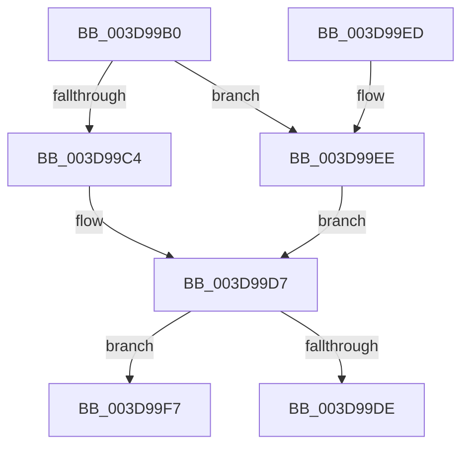

# KeSaveExtendedProcessorState

- RVA: `0x003D99B0`–`0x003D9A13` (길이 `99` bytes)
- VA: `0x00000001403D99B0`
- 실행 섹션: `.text`
- PDB 이름 있음: `예`; PDB Function 태그: `아니요`
- unwind 정보 RVA: `0x000687C0`
- 디코드: `26`개 명령, `99/99` bytes 표시
- 미해석 바이트: `0` (있으면 어셈블리에 `.byte`로 보존)

> 이 문서는 커널 이미지의 기계어와 PDB 기호를 분석해 생성했습니다. 4번과 5번은 함수 원형과 자료형을 바이너리 사용 방식에서 추정한 C 해석이며 원본 소스 복구 결과는 아닙니다.

## 1. Dependencies

- 직접 호출 지점: **2**; 고유 호출 대상: **2**
- 직접 호출자로 확인된 함수: **1**
- RIP 상대 이미지 참조: **1**

### Outgoing calls
- `0x003D99E3` → [KiSaveExtendedAndSupervisorState](KiSaveExtendedAndSupervisorState_function_003D9A1C.md) (function, `0x003D9A1C`)
- `0x003D9A0D` → [KeBugCheckEx](../4F/KeBugCheckEx_function_004FD660.md) (function, `0x004FD660`)

### Direct callers
- [DifKeSaveExtendedProcessorStateWrapper](../63/DifKeSaveExtendedProcessorStateWrapper_function_006327B0.md) at `0x00632884`

### Static image references
- `0x003D99B4` → RVA `0x00FC6B30` (`ALMOSTRO`; read)

## 2. Other-region calls and transfers

- 다른 실행 섹션으로 향하는 call: **0**
- 별도 외부 분기/꼬리 이동을 확인하지 못했습니다.

## 3. Assembly (complete function range)

```asm
003D99B0  48 83 EC 38                     sub rsp, 0x38
003D99B4  4C 8B 05 75 D1 BE 00            mov r8, qword ptr [rip + 0xbed175]
003D99BB  41 81 E0 00 00 80 00            and r8d, 0x800000
003D99C2  74 2A                           je 0x1403d99ee
003D99C4  48 B8 D8 03 00 00 80 F7 FF FF   movabs rax, 0xfffff780000003d8
003D99CE  48 8B 00                        mov rax, qword ptr [rax]
003D99D1  48 F7 D0                        not rax
003D99D4  48 85 C1                        test rcx, rax
003D99D7  0F 95 C0                        setne al
003D99DA  84 C0                           test al, al
003D99DC  75 19                           jne 0x1403d99f7
003D99DE  4C 8B 44 24 38                  mov r8, qword ptr [rsp + 0x38]
003D99E3  E8 34 00 00 00                  call 0x1403d9a1c
003D99E8  48 83 C4 38                     add rsp, 0x38
003D99EC  C3                              ret
003D99ED  CC                              int3
003D99EE  48 F7 C1 FC FF FF FF            test rcx, -4
003D99F5  EB E0                           jmp 0x1403d99d7
003D99F7  48 8B C1                        mov rax, rcx
003D99FA  44 8B C9                        mov r9d, ecx
003D99FD  48 C1 E8 20                     shr rax, 0x20
003D9A01  33 D2                           xor edx, edx
003D9A03  B9 31 01 00 00                  mov ecx, 0x131
003D9A08  48 89 44 24 20                  mov qword ptr [rsp + 0x20], rax
003D9A0D  E8 4E 3C 12 00                  call 0x1404fd660
003D9A12  CC                              int3
```

## 4. C-style interpretation (structured pseudocode)

```c
__int64 __fastcall KeSaveExtendedProcessorState(__int64 a1, int a2)
{
    __int64 result;
    __int64 v_rsp;
    unsigned __int64 v_stack_p0;
    unsigned __int64 v_stack_p20;

    v_rsp = (v_rsp) - (56);
    a3 = (unsigned int)((*(unsigned __int64 *)(v_rip + 12505461)) & (0x800000ULL));
    if (condition_is_equal) goto loc_003D99EE;
    result = ~(*(unsigned __int64 *)(result));
loc_003D99D7:
    result = (((a1) & (result)) != 0) ? 1 : 0;
    if ((unsigned __int8)(result) != 0) goto loc_003D99F7;
    result = KiSaveExtendedAndSupervisorState(a1, a2, v_stack_p0, a4);
    v_rsp = (v_rsp) + (56);
    return result;
loc_003D99EE:
    goto loc_003D99D7;
loc_003D99F7:
    result = (a1) >> (32);
    a2 = 0;
    v_stack_p20 = result;
    result = KeBugCheckEx(305, a2, v_stack_p0, (unsigned int)((unsigned int)(a1)));
    return result;
}
```

## 5. (Beta) C Style

```c
int64_t KeSaveExtendedProcessorState(int64_t Arg1, int32_t Arg2)
{
    int64_t result;
    int64_t local_rsp;
    uint64_t v_stack_p0;
    uint64_t v_stack_p20;

    local_rsp = (local_rsp) - (56);
    a3 = (uint32_t)((*(uint64_t *)(v_rip + 0xBED175)) & (0x800000ULL));
    if (condition_is_equal) goto loc_003D99EE;
    result = ~(*(uint64_t *)(result));
loc_003D99D7:
    result = (((Arg1) & (result)) != 0) ? 1 : 0;
    if ((uint8_t)(result) != 0) goto loc_003D99F7;
    result = KiSaveExtendedAndSupervisorState(Arg1, Arg2, v_stack_p0, a4);
    local_rsp = (local_rsp) + (56);
    return result;
loc_003D99EE:
    goto loc_003D99D7;
loc_003D99F7:
    result = (Arg1) >> (32);
    Arg2 = 0;
    v_stack_p20 = result;
    result = KeBugCheckEx(305, Arg2, v_stack_p0, (uint32_t)((uint32_t)(Arg1)));
    return result;
}
```

## 6. Execution-region graph

[열기: 2D/3D 그래프와 함수 탐색 컨트롤 패널](../../../control-panel.html?section=text&rva=0x003D99B0&view=graph)

- 2D 그래프는 위에서 아래로 흐르고, 3D 그래프는 빈 공간을 드래그해 회전합니다. Shift+드래그는 이동, 휠은 확대·축소, 함수 노드 선택은 대상 보고서 이동입니다.

### Static fallback


