# KeVerifyContextXStateCetU

- RVA: `0x003D72D0`–`0x003D75B7` (길이 `743` bytes)
- VA: `0x00000001403D72D0`
- 실행 섹션: `.text`
- PDB 이름 있음: `예`; PDB Function 태그: `아니요`
- unwind 정보 RVA: `0x00093BF0`
- 디코드: `172`개 명령, `743/743` bytes 표시
- 미해석 바이트: `0` (있으면 어셈블리에 `.byte`로 보존)

> 이 문서는 커널 이미지의 기계어와 PDB 기호를 분석해 생성했습니다. 4번과 5번은 함수 원형과 자료형을 바이너리 사용 방식에서 추정한 C 해석이며 원본 소스 복구 결과는 아닙니다.

## 1. Dependencies

- 직접 호출 지점: **1**; 고유 호출 대상: **1**
- 직접 호출자로 확인된 함수: **2**
- RIP 상대 이미지 참조: **0**

### Outgoing calls
- `0x003D7543` → [KiVerifyContextXStateCetUEnabled](KiVerifyContextXStateCetUEnabled_function_003D75C0.md) (function, `0x003D75C0`)

### Direct callers
- [KyRaiseException](KyRaiseException_function_003D5E20.md) at `0x003D6026`
- [sub_009A6520](../../page/9A/Unknown_function_009A6520.md) at `0x009A6557`

### Static image references
- 디코드된 RIP-relative 메모리 참조가 없습니다.

## 2. Other-region calls and transfers

- 다른 실행 섹션으로 향하는 call: **0**
- 별도 외부 분기/꼬리 이동을 확인하지 못했습니다.

## 3. Assembly (complete function range)

```asm
003D72D0  48 89 5C 24 08                  mov qword ptr [rsp + 8], rbx
003D72D5  57                              push rdi
003D72D6  48 83 EC 20                     sub rsp, 0x20
003D72DA  8B 42 30                        mov eax, dword ptr [rdx + 0x30]
003D72DD  49 8B D8                        mov rbx, r8
003D72E0  25 40 00 10 00                  and eax, 0x100040
003D72E5  4C 8B DA                        mov r11, rdx
003D72E8  48 8B F9                        mov rdi, rcx
003D72EB  3D 40 00 10 00                  cmp eax, 0x100040
003D72F0  0F 85 08 01 00 00               jne 0x1403d73fe
003D72F6  49 B9 08 07 00 00 80 F7 FF FF   movabs r9, 0xfffff78000000708
003D7300  4C 8D 92 D0 04 00 00            lea r10, [rdx + 0x4d0]
003D7307  48 B8 D8 03 00 00 80 F7 FF FF   movabs rax, 0xfffff780000003d8
003D7311  45 8B 09                        mov r9d, dword ptr [r9]
003D7314  44 0B 08                        or r9d, dword ptr [rax]
003D7317  49 0F BA E1 0B                  bt r9, 0xb
003D731C  0F 83 DC 00 00 00               jae 0x1403d73fe
003D7322  A1 EC 03 00 00 80 F7 FF FF      movabs eax, dword ptr [0xfffff780000003ec]
003D732B  A9 F8 FF FF FF                  test eax, 0xfffffff8
003D7330  0F 85 C8 00 00 00               jne 0x1403d73fe
003D7336  4D 63 4A 10                     movsxd r9, dword ptr [r10 + 0x10]
003D733A  41 8B 12                        mov edx, dword ptr [r10]
003D733D  41 3B D1                        cmp edx, r9d
003D7340  0F 8F B8 00 00 00               jg 0x1403d73fe
003D7346  45 8B 42 14                     mov r8d, dword ptr [r10 + 0x14]
003D734A  41 03 52 04                     add edx, dword ptr [r10 + 4]
003D734E  45 03 C1                        add r8d, r9d
003D7351  41 3B D0                        cmp edx, r8d
003D7354  0F 8C A4 00 00 00               jl 0x1403d73fe
003D735A  4D 03 CA                        add r9, r10
003D735D  0F 84 9B 00 00 00               je 0x1403d73fe
003D7363  A8 02                           test al, 2
003D7365  0F 84 EA 01 00 00               je 0x1403d7555
003D736B  49 8B 49 08                     mov rcx, qword ptr [r9 + 8]
003D736F  48 0F BA E1 0B                  bt rcx, 0xb
003D7374  0F 83 84 00 00 00               jae 0x1403d73fe
003D737A  49 B8 F8 05 00 00 80 F7 FF FF   movabs r8, 0xfffff780000005f8
003D7384  BA 40 02 00 00                  mov edx, 0x240
003D7389  4D 8B 00                        mov r8, qword ptr [r8]
003D738C  F6 C1 04                        test cl, 4
003D738F  75 7B                           jne 0x1403d740c
003D7391  F6 C1 08                        test cl, 8
003D7394  0F 85 82 00 00 00               jne 0x1403d741c
003D739A  F6 C1 10                        test cl, 0x10
003D739D  0F 85 96 00 00 00               jne 0x1403d7439
003D73A3  F6 C1 20                        test cl, 0x20
003D73A6  0F 85 AA 00 00 00               jne 0x1403d7456
003D73AC  F6 C1 40                        test cl, 0x40
003D73AF  0F 85 BE 00 00 00               jne 0x1403d7473
003D73B5  84 C9                           test cl, cl
003D73B7  0F 88 D3 00 00 00               js 0x1403d7490
003D73BD  48 0F BA E1 08                  bt rcx, 8
003D73C2  0F 82 E4 00 00 00               jb 0x1403d74ac
003D73C8  48 0F BA E1 09                  bt rcx, 9
003D73CD  0F 82 F7 00 00 00               jb 0x1403d74ca
003D73D3  48 0F BA E1 0A                  bt rcx, 0xa
003D73D8  0F 82 0A 01 00 00               jb 0x1403d74e8
003D73DE  49 0F BA E0 0B                  bt r8, 0xb
003D73E3  73 06                           jae 0x1403d73eb
003D73E5  83 C2 3F                        add edx, 0x3f
003D73E8  83 E2 C0                        and edx, 0xffffffc0
003D73EB  44 8B C2                        mov r8d, edx
003D73EE  4D 03 C1                        add r8, r9
003D73F1  49 81 C0 00 FE FF FF            add r8, -0x200
003D73F8  0F 85 08 01 00 00               jne 0x1403d7506
003D73FE  33 C0                           xor eax, eax
003D7400  48 8B 5C 24 30                  mov rbx, qword ptr [rsp + 0x30]
003D7405  48 83 C4 20                     add rsp, 0x20
003D7409  5F                              pop rdi
003D740A  C3                              ret
003D740B  CC                              int3
003D740C  A1 0C 06 00 00 80 F7 FF FF      movabs eax, dword ptr [0xfffff7800000060c]
003D7415  03 D0                           add edx, eax
003D7417  E9 75 FF FF FF                  jmp 0x1403d7391
003D741C  41 F6 C0 08                     test r8b, 8
003D7420  74 06                           je 0x1403d7428
003D7422  83 C2 3F                        add edx, 0x3f
003D7425  83 E2 C0                        and edx, 0xffffffc0
003D7428  48 B8 10 06 00 00 80 F7 FF FF   movabs rax, 0xfffff78000000610
003D7432  03 10                           add edx, dword ptr [rax]
003D7434  E9 61 FF FF FF                  jmp 0x1403d739a
003D7439  41 F6 C0 10                     test r8b, 0x10
003D743D  74 06                           je 0x1403d7445
003D743F  83 C2 3F                        add edx, 0x3f
003D7442  83 E2 C0                        and edx, 0xffffffc0
003D7445  48 B8 14 06 00 00 80 F7 FF FF   movabs rax, 0xfffff78000000614
003D744F  03 10                           add edx, dword ptr [rax]
003D7451  E9 4D FF FF FF                  jmp 0x1403d73a3
003D7456  41 F6 C0 20                     test r8b, 0x20
003D745A  74 06                           je 0x1403d7462
003D745C  83 C2 3F                        add edx, 0x3f
003D745F  83 E2 C0                        and edx, 0xffffffc0
003D7462  48 B8 18 06 00 00 80 F7 FF FF   movabs rax, 0xfffff78000000618
003D746C  03 10                           add edx, dword ptr [rax]
003D746E  E9 39 FF FF FF                  jmp 0x1403d73ac
003D7473  41 F6 C0 40                     test r8b, 0x40
003D7477  74 06                           je 0x1403d747f
003D7479  83 C2 3F                        add edx, 0x3f
003D747C  83 E2 C0                        and edx, 0xffffffc0
003D747F  48 B8 1C 06 00 00 80 F7 FF FF   movabs rax, 0xfffff7800000061c
003D7489  03 10                           add edx, dword ptr [rax]
003D748B  E9 25 FF FF FF                  jmp 0x1403d73b5
003D7490  45 84 C0                        test r8b, r8b
003D7493  79 06                           jns 0x1403d749b
003D7495  83 C2 3F                        add edx, 0x3f
003D7498  83 E2 C0                        and edx, 0xffffffc0
003D749B  48 B8 20 06 00 00 80 F7 FF FF   movabs rax, 0xfffff78000000620
003D74A5  03 10                           add edx, dword ptr [rax]
003D74A7  E9 11 FF FF FF                  jmp 0x1403d73bd
003D74AC  49 0F BA E0 08                  bt r8, 8
003D74B1  73 06                           jae 0x1403d74b9
003D74B3  83 C2 3F                        add edx, 0x3f
003D74B6  83 E2 C0                        and edx, 0xffffffc0
003D74B9  48 B8 24 06 00 00 80 F7 FF FF   movabs rax, 0xfffff78000000624
003D74C3  03 10                           add edx, dword ptr [rax]
003D74C5  E9 FE FE FF FF                  jmp 0x1403d73c8
003D74CA  49 0F BA E0 09                  bt r8, 9
003D74CF  73 06                           jae 0x1403d74d7
003D74D1  83 C2 3F                        add edx, 0x3f
003D74D4  83 E2 C0                        and edx, 0xffffffc0
003D74D7  48 B8 28 06 00 00 80 F7 FF FF   movabs rax, 0xfffff78000000628
003D74E1  03 10                           add edx, dword ptr [rax]
003D74E3  E9 EB FE FF FF                  jmp 0x1403d73d3
003D74E8  49 0F BA E0 0A                  bt r8, 0xa
003D74ED  73 06                           jae 0x1403d74f5
003D74EF  83 C2 3F                        add edx, 0x3f
003D74F2  83 E2 C0                        and edx, 0xffffffc0
003D74F5  48 B8 2C 06 00 00 80 F7 FF FF   movabs rax, 0xfffff7800000062c
003D74FF  03 10                           add edx, dword ptr [rax]
003D7501  E9 D8 FE FF FF                  jmp 0x1403d73de
003D7506  4D 63 93 E0 04 00 00            movsxd r10, dword ptr [r11 + 0x4e0]
003D750D  B9 A7 06 00 00                  mov ecx, 0x6a7
003D7512  0F 32                           rdmsr
003D7514  48 C1 E2 20                     shl rdx, 0x20
003D7518  48 0B C2                        or rax, rdx
003D751B  48 89 03                        mov qword ptr [rbx], rax
003D751E  4F 8B 8C 1A D0 04 00 00         mov r9, qword ptr [r10 + r11 + 0x4d0]
003D7526  49 8B D1                        mov rdx, r9
003D7529  81 E2 00 08 00 00               and edx, 0x800
003D752F  F7 47 74 00 00 10 00            test dword ptr [rdi + 0x74], 0x100000
003D7536  74 2F                           je 0x1403d7567
003D7538  48 85 D2                        test rdx, rdx
003D753B  74 53                           je 0x1403d7590
003D753D  48 8B D0                        mov rdx, rax
003D7540  49 8B C8                        mov rcx, r8
003D7543  E8 78 00 00 00                  call 0x1403d75c0
003D7548  85 C0                           test eax, eax
003D754A  0F 89 AE FE FF FF               jns 0x1403d73fe
003D7550  E9 AB FE FF FF                  jmp 0x1403d7400
003D7555  48 B8 48 04 00 00 80 F7 FF FF   movabs rax, 0xfffff78000000448
003D755F  44 8B 00                        mov r8d, dword ptr [rax]
003D7562  E9 87 FE FF FF                  jmp 0x1403d73ee
003D7567  48 85 D2                        test rdx, rdx
003D756A  0F 84 8E FE FF FF               je 0x1403d73fe
003D7570  49 83 38 00                     cmp qword ptr [r8], 0
003D7574  75 37                           jne 0x1403d75ad
003D7576  49 8B 40 08                     mov rax, qword ptr [r8 + 8]
003D757A  48 8B 5C 24 30                  mov rbx, qword ptr [rsp + 0x30]
003D757F  48 F7 D8                        neg rax
003D7582  1B C0                           sbb eax, eax
003D7584  25 0A 06 00 C0                  and eax, 0xc000060a
003D7589  48 83 C4 20                     add rsp, 0x20
003D758D  5F                              pop rdi
003D758E  C3                              ret
003D758F  CC                              int3
003D7590  49 0F BA E9 0B                  bts r9, 0xb
003D7595  4F 89 8C 1A D0 04 00 00         mov qword ptr [r10 + r11 + 0x4d0], r9
003D759D  49 C7 00 01 00 00 00            mov qword ptr [r8], 1
003D75A4  49 89 40 08                     mov qword ptr [r8 + 8], rax
003D75A8  E9 51 FE FF FF                  jmp 0x1403d73fe
003D75AD  B8 0A 06 00 C0                  mov eax, 0xc000060a
003D75B2  E9 49 FE FF FF                  jmp 0x1403d7400
```

## 4. C-style interpretation (structured pseudocode)

```c
__int64 __fastcall KeVerifyContextXStateCetU(__int64 a1, __int64 a2, __int64 a3)
{
    __int64 result;
    __int64 v_rsp;
    unsigned __int64 v_stack_p30;
    unsigned __int64 v_stack_p8;

    v_stack_p8 = v_rbx;
    v_rsp = (v_rsp) - (32);
    result = (unsigned int)(((unsigned int)(*(unsigned int *)(a2 + 48))) & (0x100040ULL));
    if (((unsigned int)(result)) != 0x100040ULL) goto loc_003D73FE;
    a4 = (unsigned int)(((unsigned int)(*(unsigned int *)(a4))) | (*(unsigned int *)(result)));
    if (condition_is_above_or_equal) goto loc_003D73FE;
    if ((((unsigned int)(result)) & (0xFFFFFFF8ULL)) != 0) goto loc_003D73FE;
    if (((unsigned int)((unsigned int)(*(unsigned int *)(a2 + 1232)))) > ((unsigned int)((int)(*(unsigned int *)(a2 + 1232 + 16))))) goto loc_003D73FE;
    a2 = (unsigned int)(((unsigned int)(*(unsigned int *)(a2 + 1232))) + (*(unsigned int *)(a2 + 1232 + 4)));
    a3 = (unsigned int)(((unsigned int)(*(unsigned int *)(a2 + 1232 + 20))) + ((unsigned int)((int)(*(unsigned int *)(a2 + 1232 + 16)))));
    if (((unsigned int)(a2)) < ((unsigned int)(a3))) goto loc_003D73FE;
    a4 = ((int)(*(unsigned int *)(a2 + 1232 + 16))) + (a2 + 1232);
    if (condition_is_equal) goto loc_003D73FE;
    if ((((unsigned __int8)(result)) & (2)) == 0) goto loc_003D7555;
    if (condition_is_above_or_equal) goto loc_003D73FE;
    if ((((unsigned __int8)(*(unsigned __int64 *)(a4 + 8))) & (4)) != 0) goto loc_003D740C;
loc_003D7391:
    if ((((unsigned __int8)(*(unsigned __int64 *)(a4 + 8))) & (8)) != 0) goto loc_003D741C;
loc_003D739A:
    if ((((unsigned __int8)(*(unsigned __int64 *)(a4 + 8))) & (16)) != 0) goto loc_003D7439;
loc_003D73A3:
    if ((((unsigned __int8)(*(unsigned __int64 *)(a4 + 8))) & (32)) != 0) goto loc_003D7456;
loc_003D73AC:
    if ((((unsigned __int8)(*(unsigned __int64 *)(a4 + 8))) & (64)) != 0) goto loc_003D7473;
loc_003D73B5:
    if (sign_flag) goto loc_003D7490;
loc_003D73BD:
    if (condition_is_below) goto loc_003D74AC;
loc_003D73C8:
    if (condition_is_below) goto loc_003D74CA;
loc_003D73D3:
    if (condition_is_below) goto loc_003D74E8;
loc_003D73DE:
    if (!(condition_is_above_or_equal)) {
        a2 = (unsigned int)((576) + (63));
        a2 = (unsigned int)((a2) & (0xFFFFFFC0ULL));
    }
loc_003D73EE:
    a3 = ((unsigned int)((unsigned int)(a2))) + (a4);
    a3 = (a3) + (-512);
    if (condition_is_not_equal) goto loc_003D7506;
loc_003D73FE:
    result = 0;
loc_003D7400:
    v_rsp = (v_rsp) + (32);
    return result;
loc_003D740C:
    a2 = (unsigned int)((a2) + (0));
    goto loc_003D7391;
loc_003D741C:
    if ((((unsigned __int8)(a3)) & (8)) != 0) {
        a2 = (unsigned int)((a2) + (63));
        a2 = (unsigned int)((a2) & (0xFFFFFFC0ULL));
    }
    a2 = (unsigned int)((a2) + (*(unsigned int *)(result)));
    goto loc_003D739A;
loc_003D7439:
    if ((((unsigned __int8)(a3)) & (16)) != 0) {
        a2 = (unsigned int)((a2) + (63));
        a2 = (unsigned int)((a2) & (0xFFFFFFC0ULL));
    }
    a2 = (unsigned int)((a2) + (*(unsigned int *)(result)));
    goto loc_003D73A3;
loc_003D7456:
    if ((((unsigned __int8)(a3)) & (32)) != 0) {
        a2 = (unsigned int)((a2) + (63));
        a2 = (unsigned int)((a2) & (0xFFFFFFC0ULL));
    }
    a2 = (unsigned int)((a2) + (*(unsigned int *)(result)));
    goto loc_003D73AC;
loc_003D7473:
    if ((((unsigned __int8)(a3)) & (64)) != 0) {
        a2 = (unsigned int)((a2) + (63));
        a2 = (unsigned int)((a2) & (0xFFFFFFC0ULL));
    }
    a2 = (unsigned int)((a2) + (*(unsigned int *)(result)));
    goto loc_003D73B5;
loc_003D7490:
    if (sign_flag) {
        a2 = (unsigned int)((a2) + (63));
        a2 = (unsigned int)((a2) & (0xFFFFFFC0ULL));
    }
    a2 = (unsigned int)((a2) + (*(unsigned int *)(result)));
    goto loc_003D73BD;
loc_003D74AC:
    if (!(condition_is_above_or_equal)) {
        a2 = (unsigned int)((a2) + (63));
        a2 = (unsigned int)((a2) & (0xFFFFFFC0ULL));
    }
    a2 = (unsigned int)((a2) + (*(unsigned int *)(result)));
    goto loc_003D73C8;
loc_003D74CA:
    if (!(condition_is_above_or_equal)) {
        a2 = (unsigned int)((a2) + (63));
        a2 = (unsigned int)((a2) & (0xFFFFFFC0ULL));
    }
    a2 = (unsigned int)((a2) + (*(unsigned int *)(result)));
    goto loc_003D73D3;
loc_003D74E8:
    if (!(condition_is_above_or_equal)) {
        a2 = (unsigned int)((a2) + (63));
        a2 = (unsigned int)((a2) & (0xFFFFFFC0ULL));
    }
    a2 = (unsigned int)((a2) + (*(unsigned int *)(result)));
    goto loc_003D73DE;
loc_003D7506:
    a2 = (a2) << (32);
    result = (result) | (a2);
    *(unsigned __int64 *)(v_stack_p8) = result;
    a2 = (unsigned int)((*(unsigned __int64 *)((int)(*(unsigned int *)(a2 + 1248)) + a2 * 1 + 1232)) & (0x800ULL));
    if (((*(unsigned int *)(a1 + 116)) & (0x100000ULL)) == 0) goto loc_003D7567;
    if (a2 == 0) goto loc_003D7590;
    result = KiVerifyContextXStateCetUEnabled(a3, result, a3, *(unsigned __int64 *)((int)(*(unsigned int *)(a2 + 1248)) + a2 * 1 + 1232));
    if (!sign_flag) goto loc_003D73FE;
    goto loc_003D7400;
loc_003D7555:
    goto loc_003D73EE;
loc_003D7567:
    if (result == 0) goto loc_003D73FE;
    if ((*(unsigned __int64 *)((unsigned int)(*(unsigned int *)(result)))) != 0) goto loc_003D75AD;
    result = -(*(unsigned __int64 *)((unsigned int)(*(unsigned int *)(result)) + 8));
    result = (unsigned int)((result) & (0xC000060AULL));
    v_rsp = (v_rsp) + (32);
    return result;
loc_003D7590:
    *(unsigned __int64 *)((int)(*(unsigned int *)(a2 + 1248)) + a2 * 1 + 1232) = *(unsigned __int64 *)((int)(*(unsigned int *)(a2 + 1248)) + a2 * 1 + 1232);
    *(unsigned __int64 *)((unsigned int)(*(unsigned int *)(result))) = 1;
    *(unsigned __int64 *)((unsigned int)(*(unsigned int *)(result)) + 8) = result;
    goto loc_003D73FE;
loc_003D75AD:
    goto loc_003D7400;
}
```

## 5. (Beta) C Style

```c
int64_t KeVerifyContextXStateCetU(void *Arg1, void *Arg2, void *Arg3)
{
    uint8_t *arg1 = (uint8_t *)Arg1;
    uint8_t *arg2 = (uint8_t *)Arg2;
    uint8_t *arg3 = (uint8_t *)Arg3;

    int64_t result;
    int64_t local_rsp;
    uint64_t v_stack_p30;
    uint64_t v_stack_p8;

    v_stack_p8 = local_rbx;
    local_rsp = (local_rsp) - (32);
    result = (uint32_t)(((uint32_t)(*(uint32_t *)(arg2 + 0x30))) & (0x100040ULL));
    if (((uint32_t)(result)) != 0x100040ULL) goto loc_003D73FE;
    a4 = (uint32_t)(((uint32_t)(*(uint32_t *)(a4))) | (*(uint32_t *)(result)));
    if (condition_is_above_or_equal) goto loc_003D73FE;
    if ((((uint32_t)(result)) & (0xFFFFFFF8ULL)) != 0) goto loc_003D73FE;
    if (((uint32_t)((uint32_t)(*(uint32_t *)(arg2 + 0x4D0)))) > ((uint32_t)((int32_t)(*(uint32_t *)(arg2 + 0x4D0 + 0x10))))) goto loc_003D73FE;
    Arg2 = (uint32_t)(((uint32_t)(*(uint32_t *)(arg2 + 0x4D0))) + (*(uint32_t *)(arg2 + 0x4D0 + 0x4)));
    Arg3 = (uint32_t)(((uint32_t)(*(uint32_t *)(arg2 + 0x4D0 + 0x14))) + ((uint32_t)((int32_t)(*(uint32_t *)(arg2 + 0x4D0 + 0x10)))));
    if (((uint32_t)(Arg2)) < ((uint32_t)(Arg3))) goto loc_003D73FE;
    a4 = ((int32_t)(*(uint32_t *)(arg2 + 0x4D0 + 0x10))) + (Arg2 + 1232);
    if (condition_is_equal) goto loc_003D73FE;
    if ((((uint8_t)(result)) & (2)) == 0) goto loc_003D7555;
    if (condition_is_above_or_equal) goto loc_003D73FE;
    if ((((uint8_t)(*(uint64_t *)(a4 + 0x8))) & (4)) != 0) goto loc_003D740C;
loc_003D7391:
    if ((((uint8_t)(*(uint64_t *)(a4 + 0x8))) & (8)) != 0) goto loc_003D741C;
loc_003D739A:
    if ((((uint8_t)(*(uint64_t *)(a4 + 0x8))) & (16)) != 0) goto loc_003D7439;
loc_003D73A3:
    if ((((uint8_t)(*(uint64_t *)(a4 + 0x8))) & (32)) != 0) goto loc_003D7456;
loc_003D73AC:
    if ((((uint8_t)(*(uint64_t *)(a4 + 0x8))) & (64)) != 0) goto loc_003D7473;
loc_003D73B5:
    if (sign_flag) goto loc_003D7490;
loc_003D73BD:
    if (condition_is_below) goto loc_003D74AC;
loc_003D73C8:
    if (condition_is_below) goto loc_003D74CA;
loc_003D73D3:
    if (condition_is_below) goto loc_003D74E8;
loc_003D73DE:
    if (!(condition_is_above_or_equal)) {
        Arg2 = (uint32_t)((576) + (63));
        Arg2 = (uint32_t)((Arg2) & (0xFFFFFFC0ULL));
    }
loc_003D73EE:
    Arg3 = ((uint32_t)((uint32_t)(Arg2))) + (a4);
    Arg3 = (Arg3) + (-512);
    if (condition_is_not_equal) goto loc_003D7506;
loc_003D73FE:
    result = 0;
loc_003D7400:
    local_rsp = (local_rsp) + (32);
    return result;
loc_003D740C:
    Arg2 = (uint32_t)((Arg2) + (0));
    goto loc_003D7391;
loc_003D741C:
    if ((((uint8_t)(Arg3)) & (8)) != 0) {
        Arg2 = (uint32_t)((Arg2) + (63));
        Arg2 = (uint32_t)((Arg2) & (0xFFFFFFC0ULL));
    }
    Arg2 = (uint32_t)((Arg2) + (*(uint32_t *)(result)));
    goto loc_003D739A;
loc_003D7439:
    if ((((uint8_t)(Arg3)) & (16)) != 0) {
        Arg2 = (uint32_t)((Arg2) + (63));
        Arg2 = (uint32_t)((Arg2) & (0xFFFFFFC0ULL));
    }
    Arg2 = (uint32_t)((Arg2) + (*(uint32_t *)(result)));
    goto loc_003D73A3;
loc_003D7456:
    if ((((uint8_t)(Arg3)) & (32)) != 0) {
        Arg2 = (uint32_t)((Arg2) + (63));
        Arg2 = (uint32_t)((Arg2) & (0xFFFFFFC0ULL));
    }
    Arg2 = (uint32_t)((Arg2) + (*(uint32_t *)(result)));
    goto loc_003D73AC;
loc_003D7473:
    if ((((uint8_t)(Arg3)) & (64)) != 0) {
        Arg2 = (uint32_t)((Arg2) + (63));
        Arg2 = (uint32_t)((Arg2) & (0xFFFFFFC0ULL));
    }
    Arg2 = (uint32_t)((Arg2) + (*(uint32_t *)(result)));
    goto loc_003D73B5;
loc_003D7490:
    if (sign_flag) {
        Arg2 = (uint32_t)((Arg2) + (63));
        Arg2 = (uint32_t)((Arg2) & (0xFFFFFFC0ULL));
    }
    Arg2 = (uint32_t)((Arg2) + (*(uint32_t *)(result)));
    goto loc_003D73BD;
loc_003D74AC:
    if (!(condition_is_above_or_equal)) {
        Arg2 = (uint32_t)((Arg2) + (63));
        Arg2 = (uint32_t)((Arg2) & (0xFFFFFFC0ULL));
    }
    Arg2 = (uint32_t)((Arg2) + (*(uint32_t *)(result)));
    goto loc_003D73C8;
loc_003D74CA:
    if (!(condition_is_above_or_equal)) {
        Arg2 = (uint32_t)((Arg2) + (63));
        Arg2 = (uint32_t)((Arg2) & (0xFFFFFFC0ULL));
    }
    Arg2 = (uint32_t)((Arg2) + (*(uint32_t *)(result)));
    goto loc_003D73D3;
loc_003D74E8:
    if (!(condition_is_above_or_equal)) {
        Arg2 = (uint32_t)((Arg2) + (63));
        Arg2 = (uint32_t)((Arg2) & (0xFFFFFFC0ULL));
    }
    Arg2 = (uint32_t)((Arg2) + (*(uint32_t *)(result)));
    goto loc_003D73DE;
loc_003D7506:
    Arg2 = (Arg2) << (32);
    result = (result) | (Arg2);
    *(uint64_t *)(v_stack_p8) = result;
    Arg2 = (uint32_t)((*(uint64_t *)((int32_t)(*(uint32_t *)(arg2 + 0x4E0)) + arg2 * 1 + 0x4D0)) & (0x800ULL));
    if (((*(uint32_t *)(arg1 + 0x74)) & (0x100000ULL)) == 0) goto loc_003D7567;
    if (Arg2 == NULL) goto loc_003D7590;
    result = KiVerifyContextXStateCetUEnabled(Arg3, result, Arg3, *(uint64_t *)((int32_t)(*(uint32_t *)(arg2 + 0x4E0)) + arg2 * 1 + 0x4D0));
    if (!sign_flag) goto loc_003D73FE;
    goto loc_003D7400;
loc_003D7555:
    goto loc_003D73EE;
loc_003D7567:
    if (result == 0) goto loc_003D73FE;
    if ((*(uint64_t *)((uint32_t)(*(uint32_t *)(result)))) != 0) goto loc_003D75AD;
    result = -(*(uint64_t *)((uint32_t)(*(uint32_t *)(result)) + 0x8));
    result = (uint32_t)((result) & (0xC000060AULL));
    local_rsp = (local_rsp) + (32);
    return result;
loc_003D7590:
    *(uint64_t *)((int32_t)(*(uint32_t *)(arg2 + 0x4E0)) + arg2 * 1 + 0x4D0) = *(uint64_t *)((int32_t)(*(uint32_t *)(arg2 + 0x4E0)) + arg2 * 1 + 0x4D0);
    *(uint64_t *)((uint32_t)(*(uint32_t *)(result))) = 1;
    *(uint64_t *)((uint32_t)(*(uint32_t *)(result)) + 0x8) = result;
    goto loc_003D73FE;
loc_003D75AD:
    goto loc_003D7400;
}
```

### 관측된 메모리 오프셋

구조체 형식이 확인되지 않은 접근은 인자 기준의 오프셋으로만 기록했습니다.

| 기준 인자 | 오프셋 표현 | 폭 (bit) | 접근 |
|---|---:|---:|---|
| `Arg1` | `+ 0x74` | `32` | `R` |
| `Arg2` | `+ 0x0` | `32` | `R` |
| `Arg2` | `+ 0x4` | `32` | `R` |
| `Arg2` | `+ 0x10` | `32` | `R` |
| `Arg2` | `+ 0x14` | `32` | `R` |
| `Arg2` | `+ 0x30` | `32` | `R` |
| `Arg2` | `+ 0x4D0` | `64` | `R` |
| `Arg2` | `+ 0x4E0` | `32` | `R` |
| `Arg3` | `+ 0x0` | `64` | `W` |

## 6. Execution-region graph

[열기: 2D/3D 그래프와 함수 탐색 컨트롤 패널](../../../control-panel.html?section=text&rva=0x003D72D0&view=graph)

- 2D 그래프는 위에서 아래로 흐르고, 3D 그래프는 빈 공간을 드래그해 회전합니다. Shift+드래그는 이동, 휠은 확대·축소, 함수 노드 선택은 대상 보고서 이동입니다.

### Static fallback

```mermaid
flowchart TD
  bb_003D72D0[BB_003D72D0]
  bb_003D72F6[BB_003D72F6]
  bb_003D7322[BB_003D7322]
  bb_003D7336[BB_003D7336]
  bb_003D7346[BB_003D7346]
  bb_003D735A[BB_003D735A]
  bb_003D7363[BB_003D7363]
  bb_003D736B[BB_003D736B]
  bb_003D737A[BB_003D737A]
  bb_003D7391[BB_003D7391]
  bb_003D739A[BB_003D739A]
  bb_003D73A3[BB_003D73A3]
  bb_003D73AC[BB_003D73AC]
  bb_003D73B5[BB_003D73B5]
  bb_003D73BD[BB_003D73BD]
  bb_003D73C8[BB_003D73C8]
  bb_003D73D3[BB_003D73D3]
  bb_003D73DE[BB_003D73DE]
  bb_003D73E5[BB_003D73E5]
  bb_003D73EB[BB_003D73EB]
  bb_003D73EE[BB_003D73EE]
  bb_003D73FE[BB_003D73FE]
  bb_003D7400[BB_003D7400]
  bb_003D740B[BB_003D740B]
  bb_003D740C[BB_003D740C]
  bb_003D741C[BB_003D741C]
  bb_003D7422[BB_003D7422]
  bb_003D7428[BB_003D7428]
  bb_003D7439[BB_003D7439]
  bb_003D743F[BB_003D743F]
  bb_003D7445[BB_003D7445]
  bb_003D7456[BB_003D7456]
  bb_003D745C[BB_003D745C]
  bb_003D7462[BB_003D7462]
  bb_003D7473[BB_003D7473]
  bb_003D7479[BB_003D7479]
  bb_003D747F[BB_003D747F]
  bb_003D7490[BB_003D7490]
  bb_003D7495[BB_003D7495]
  bb_003D749B[BB_003D749B]
  bb_003D74AC[BB_003D74AC]
  bb_003D74B3[BB_003D74B3]
  bb_003D74B9[BB_003D74B9]
  bb_003D74CA[BB_003D74CA]
  bb_003D74D1[BB_003D74D1]
  bb_003D74D7[BB_003D74D7]
  bb_003D74E8[BB_003D74E8]
  bb_003D74EF[BB_003D74EF]
  bb_003D74F5[BB_003D74F5]
  bb_003D7506[BB_003D7506]
  bb_003D7538[BB_003D7538]
  bb_003D753D[BB_003D753D]
  bb_003D7550[BB_003D7550]
  bb_003D7555[BB_003D7555]
  bb_003D7567[BB_003D7567]
  bb_003D7570[BB_003D7570]
  bb_003D7576[BB_003D7576]
  bb_003D758F[BB_003D758F]
  bb_003D7590[BB_003D7590]
  bb_003D75AD[BB_003D75AD]
  bb_003D72D0 -->|branch| bb_003D73FE
  bb_003D72D0 -->|fallthrough| bb_003D72F6
  bb_003D72F6 -->|branch| bb_003D73FE
  bb_003D72F6 -->|fallthrough| bb_003D7322
  bb_003D7322 -->|branch| bb_003D73FE
  bb_003D7322 -->|fallthrough| bb_003D7336
  bb_003D7336 -->|branch| bb_003D73FE
  bb_003D7336 -->|fallthrough| bb_003D7346
  bb_003D7346 -->|branch| bb_003D73FE
  bb_003D7346 -->|fallthrough| bb_003D735A
  bb_003D735A -->|branch| bb_003D73FE
  bb_003D735A -->|fallthrough| bb_003D7363
  bb_003D7363 -->|branch| bb_003D7555
  bb_003D7363 -->|fallthrough| bb_003D736B
  bb_003D736B -->|branch| bb_003D73FE
  bb_003D736B -->|fallthrough| bb_003D737A
  bb_003D737A -->|branch| bb_003D740C
  bb_003D737A -->|fallthrough| bb_003D7391
  bb_003D7391 -->|branch| bb_003D741C
  bb_003D7391 -->|fallthrough| bb_003D739A
  bb_003D739A -->|branch| bb_003D7439
  bb_003D739A -->|fallthrough| bb_003D73A3
  bb_003D73A3 -->|branch| bb_003D7456
  bb_003D73A3 -->|fallthrough| bb_003D73AC
  bb_003D73AC -->|branch| bb_003D7473
  bb_003D73AC -->|fallthrough| bb_003D73B5
  bb_003D73B5 -->|branch| bb_003D7490
  bb_003D73B5 -->|fallthrough| bb_003D73BD
  bb_003D73BD -->|branch| bb_003D74AC
  bb_003D73BD -->|fallthrough| bb_003D73C8
  bb_003D73C8 -->|branch| bb_003D74CA
  bb_003D73C8 -->|fallthrough| bb_003D73D3
  bb_003D73D3 -->|branch| bb_003D74E8
  bb_003D73D3 -->|fallthrough| bb_003D73DE
  bb_003D73DE -->|branch| bb_003D73EB
  bb_003D73DE -->|fallthrough| bb_003D73E5
  bb_003D73E5 -->|flow| bb_003D73EB
  bb_003D73EB -->|flow| bb_003D73EE
  bb_003D73EE -->|branch| bb_003D7506
  bb_003D73EE -->|fallthrough| bb_003D73FE
  bb_003D73FE -->|flow| bb_003D7400
  bb_003D740B -->|flow| bb_003D740C
  bb_003D740C -->|branch| bb_003D7391
  bb_003D741C -->|branch| bb_003D7428
  bb_003D741C -->|fallthrough| bb_003D7422
  bb_003D7422 -->|flow| bb_003D7428
  bb_003D7428 -->|branch| bb_003D739A
  bb_003D7439 -->|branch| bb_003D7445
  bb_003D7439 -->|fallthrough| bb_003D743F
  bb_003D743F -->|flow| bb_003D7445
  bb_003D7445 -->|branch| bb_003D73A3
  bb_003D7456 -->|branch| bb_003D7462
  bb_003D7456 -->|fallthrough| bb_003D745C
  bb_003D745C -->|flow| bb_003D7462
  bb_003D7462 -->|branch| bb_003D73AC
  bb_003D7473 -->|branch| bb_003D747F
  bb_003D7473 -->|fallthrough| bb_003D7479
  bb_003D7479 -->|flow| bb_003D747F
  bb_003D747F -->|branch| bb_003D73B5
  bb_003D7490 -->|branch| bb_003D749B
  bb_003D7490 -->|fallthrough| bb_003D7495
  bb_003D7495 -->|flow| bb_003D749B
  bb_003D749B -->|branch| bb_003D73BD
  bb_003D74AC -->|branch| bb_003D74B9
  bb_003D74AC -->|fallthrough| bb_003D74B3
  bb_003D74B3 -->|flow| bb_003D74B9
  bb_003D74B9 -->|branch| bb_003D73C8
  bb_003D74CA -->|branch| bb_003D74D7
  bb_003D74CA -->|fallthrough| bb_003D74D1
  bb_003D74D1 -->|flow| bb_003D74D7
  bb_003D74D7 -->|branch| bb_003D73D3
  bb_003D74E8 -->|branch| bb_003D74F5
  bb_003D74E8 -->|fallthrough| bb_003D74EF
  bb_003D74EF -->|flow| bb_003D74F5
  bb_003D74F5 -->|branch| bb_003D73DE
  bb_003D7506 -->|branch| bb_003D7567
  bb_003D7506 -->|fallthrough| bb_003D7538
  bb_003D7538 -->|branch| bb_003D7590
  bb_003D7538 -->|fallthrough| bb_003D753D
  bb_003D753D -->|branch| bb_003D73FE
  bb_003D753D -->|fallthrough| bb_003D7550
  bb_003D7550 -->|branch| bb_003D7400
  bb_003D7555 -->|branch| bb_003D73EE
  bb_003D7567 -->|branch| bb_003D73FE
  bb_003D7567 -->|fallthrough| bb_003D7570
  bb_003D7570 -->|branch| bb_003D75AD
  bb_003D7570 -->|fallthrough| bb_003D7576
  bb_003D758F -->|flow| bb_003D7590
  bb_003D7590 -->|branch| bb_003D73FE
  bb_003D75AD -->|branch| bb_003D7400
```


