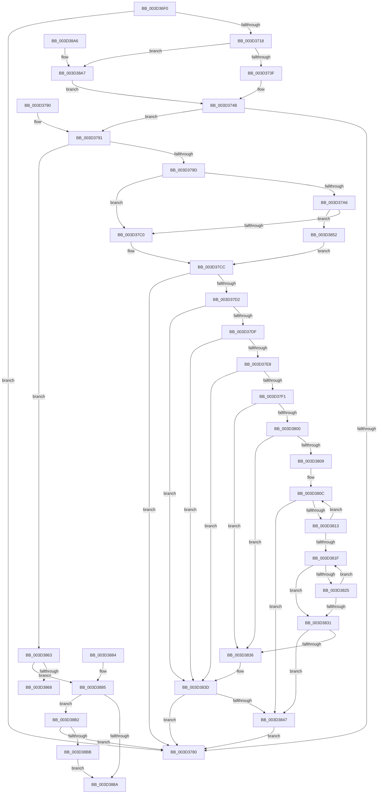

# KiAccumulateTicksFromCycles

- RVA: `0x003D36F0`–`0x003D38BD` (길이 `461` bytes)
- VA: `0x00000001403D36F0`
- 실행 섹션: `.text`
- PDB 이름 있음: `예`; PDB Function 태그: `아니요`
- unwind 정보 RVA: `0x000918A8`
- 디코드: `119`개 명령, `461/461` bytes 표시
- 미해석 바이트: `0` (있으면 어셈블리에 `.byte`로 보존)

> 이 문서는 커널 이미지의 기계어와 PDB 기호를 분석해 생성했습니다. 4번과 5번은 함수 원형과 자료형을 바이너리 사용 방식에서 추정한 C 해석이며 원본 소스 복구 결과는 아닙니다.

## 1. Dependencies

- 직접 호출 지점: **0**; 고유 호출 대상: **0**
- 직접 호출자로 확인된 함수: **1**
- RIP 상대 이미지 참조: **2**

### Outgoing calls
- 직접 디코드된 call 명령이 없습니다.

### Direct callers
- [KiEndDebugAccumulation](../4F/KiEndDebugAccumulation_function_004F5370.md) at `0x004F5410`

### Static image references
- `0x003D374B` → RVA `0x00FC6BC6` (`ALMOSTRO`; read)
- `0x003D375B` → RVA `0x00FC7318` (`ALMOSTRO`; read)

## 2. Other-region calls and transfers

- 다른 실행 섹션으로 향하는 call: **0**
- 별도 외부 분기/꼬리 이동을 확인하지 못했습니다.

## 3. Assembly (complete function range)

```asm
003D36F0  48 89 5C 24 08                  mov qword ptr [rsp + 8], rbx
003D36F5  48 89 74 24 10                  mov qword ptr [rsp + 0x10], rsi
003D36FA  57                              push rdi
003D36FB  48 83 EC 10                     sub rsp, 0x10
003D36FF  48 B8 00 03 00 00 80 F7 FF FF   movabs rax, 0xfffff78000000300
003D3709  49 8B D9                        mov rbx, r9
003D370C  48 8B FA                        mov rdi, rdx
003D370F  48 8B F1                        mov rsi, rcx
003D3712  48 83 38 00                     cmp qword ptr [rax], 0
003D3716  74 68                           je 0x1403d3780
003D3718  A0 69 03 00 00 80 F7 FF FF      movabs al, byte ptr [0xfffff78000000369]
003D3721  49 B9 60 03 00 00 80 F7 FF FF   movabs r9, 0xfffff78000000360
003D372B  45 33 DB                        xor r11d, r11d
003D372E  0F B6 C8                        movzx ecx, al
003D3731  84 C0                           test al, al
003D3733  4D 8B 09                        mov r9, qword ptr [r9]
003D3736  49 8B C1                        mov rax, r9
003D3739  0F 84 68 01 00 00               je 0x1403d38a7
003D373F  49 D3 E0                        shl r8, cl
003D3742  49 F7 E0                        mul r8
003D3745  4C 8B C3                        mov r8, rbx
003D3748  49 D3 E0                        shl r8, cl
003D374B  0F BE 0D 74 34 BF 00            movsx ecx, byte ptr [rip + 0xbf3474]
003D3752  4C 8B D2                        mov r10, rdx
003D3755  49 8B C1                        mov rax, r9
003D3758  49 F7 E0                        mul r8
003D375B  48 8B 05 B6 3B BF 00            mov rax, qword ptr [rip + 0xbf3bb6]
003D3762  4C 8B CA                        mov r9, rdx
003D3765  49 F7 E2                        mul r10
003D3768  48 8B 05 A9 3B BF 00            mov rax, qword ptr [rip + 0xbf3ba9]
003D376F  4C 8B D2                        mov r10, rdx
003D3772  49 F7 E1                        mul r9
003D3775  49 D3 EA                        shr r10, cl
003D3778  48 D3 EA                        shr rdx, cl
003D377B  41 2B D2                        sub edx, r10d
003D377E  75 11                           jne 0x1403d3791
003D3780  48 8B 5C 24 20                  mov rbx, qword ptr [rsp + 0x20]
003D3785  48 8B 74 24 28                  mov rsi, qword ptr [rsp + 0x28]
003D378A  48 83 C4 10                     add rsp, 0x10
003D378E  5F                              pop rdi
003D378F  C3                              ret
003D3790  CC                              int3
003D3791  8B 4C 24 40                     mov ecx, dword ptr [rsp + 0x40]
003D3795  85 C9                           test ecx, ecx
003D3797  0F 85 C6 00 00 00               jne 0x1403d3863
003D379D  F7 47 74 00 04 00 00            test dword ptr [rdi + 0x74], 0x400
003D37A4  75 1A                           jne 0x1403d37c0
003D37A6  8B 87 4C 04 00 00               mov eax, dword ptr [rdi + 0x44c]
003D37AC  48 C1 EB 04                     shr rbx, 4
003D37B0  F3 48 0F B8 C0                  popcnt rax, rax
003D37B5  83 E3 1F                        and ebx, 0x1f
003D37B8  3B D8                           cmp ebx, eax
003D37BA  0F 82 92 00 00 00               jb 0x1403d3852
003D37C0  01 96 44 86 00 00               add dword ptr [rsi + 0x8644], edx
003D37C6  01 97 8C 02 00 00               add dword ptr [rdi + 0x28c], edx
003D37CC  48 3B 7E 18                     cmp rdi, qword ptr [rsi + 0x18]
003D37D0  74 AE                           je 0x1403d3780
003D37D2  4C 8D 87 C3 00 00 00            lea r8, [rdi + 0xc3]
003D37D9  41 80 38 10                     cmp byte ptr [r8], 0x10
003D37DD  7D 5E                           jge 0x1403d383d
003D37DF  48 8B 47 68                     mov rax, qword ptr [rdi + 0x68]
003D37E3  48 85 C0                        test rax, rax
003D37E6  74 55                           je 0x1403d383d
003D37E8  48 8B 47 68                     mov rax, qword ptr [rdi + 0x68]
003D37EC  48 85 C0                        test rax, rax
003D37EF  74 4C                           je 0x1403d383d
003D37F1  8B 8E D8 00 00 00               mov ecx, dword ptr [rsi + 0xd8]
003D37F7  48 03 C8                        add rcx, rax
003D37FA  41 80 38 10                     cmp byte ptr [r8], 0x10
003D37FE  7D 36                           jge 0x1403d3836
003D3800  F7 47 78 00 02 00 00            test dword ptr [rdi + 0x78], 0x200
003D3807  75 2D                           jne 0x1403d3836
003D3809  4C 8B C1                        mov r8, rcx
003D380C  41 F6 40 70 02                  test byte ptr [r8 + 0x70], 2
003D3811  75 34                           jne 0x1403d3847
003D3813  4D 8B 80 A0 01 00 00            mov r8, qword ptr [r8 + 0x1a0]
003D381A  4D 85 C0                        test r8, r8
003D381D  75 ED                           jne 0x1403d380c
003D381F  44 03 59 7C                     add r11d, dword ptr [rcx + 0x7c]
003D3823  75 0C                           jne 0x1403d3831
003D3825  48 8B 89 A0 01 00 00            mov rcx, qword ptr [rcx + 0x1a0]
003D382C  48 85 C9                        test rcx, rcx
003D382F  75 EE                           jne 0x1403d381f
003D3831  45 85 DB                        test r11d, r11d
003D3834  75 11                           jne 0x1403d3847
003D3836  4C 8D 87 C3 00 00 00            lea r8, [rdi + 0xc3]
003D383D  41 80 38 08                     cmp byte ptr [r8], 8
003D3841  0F 8D 39 FF FF FF               jge 0x1403d3780
003D3847  01 96 6C 86 00 00               add dword ptr [rsi + 0x866c], edx
003D384D  E9 2E FF FF FF                  jmp 0x1403d3780
003D3852  01 96 48 86 00 00               add dword ptr [rsi + 0x8648], edx
003D3858  01 97 DC 02 00 00               add dword ptr [rdi + 0x2dc], edx
003D385E  E9 69 FF FF FF                  jmp 0x1403d37cc
003D3863  83 E9 01                        sub ecx, 1
003D3866  75 1D                           jne 0x1403d3885
003D3868  01 96 44 86 00 00               add dword ptr [rsi + 0x8644], edx
003D386E  01 96 4C 86 00 00               add dword ptr [rsi + 0x864c], edx
003D3874  48 8B 5C 24 20                  mov rbx, qword ptr [rsp + 0x20]
003D3879  48 8B 74 24 28                  mov rsi, qword ptr [rsp + 0x28]
003D387E  48 83 C4 10                     add rsp, 0x10
003D3882  5F                              pop rdi
003D3883  C3                              ret
003D3884  CC                              int3
003D3885  83 E9 01                        sub ecx, 1
003D3888  75 28                           jne 0x1403d38b2
003D388A  01 96 44 86 00 00               add dword ptr [rsi + 0x8644], edx
003D3890  01 96 50 86 00 00               add dword ptr [rsi + 0x8650], edx
003D3896  48 8B 74 24 28                  mov rsi, qword ptr [rsp + 0x28]
003D389B  48 8B 5C 24 20                  mov rbx, qword ptr [rsp + 0x20]
003D38A0  48 83 C4 10                     add rsp, 0x10
003D38A4  5F                              pop rdi
003D38A5  C3                              ret
003D38A6  CC                              int3
003D38A7  49 F7 E0                        mul r8
003D38AA  4C 8B C3                        mov r8, rbx
003D38AD  E9 99 FE FF FF                  jmp 0x1403d374b
003D38B2  83 F9 01                        cmp ecx, 1
003D38B5  0F 85 C5 FE FF FF               jne 0x1403d3780
003D38BB  EB CD                           jmp 0x1403d388a
```

## 4. C-style interpretation (structured pseudocode)

```c
__int64 __fastcall KiAccumulateTicksFromCycles(__int64 a1, __int64 a2, __int64 a3, __int64 a4, unsigned int a5)
{
    __int64 v_r10;
    __int64 v_r11;
    __int64 v_rbx;
    __int64 v_rsp;
    unsigned __int64 v_stack_p10;
    unsigned __int64 v_stack_p20;
    unsigned __int64 v_stack_p28;
    unsigned __int64 v_stack_p38;
    unsigned __int64 v_stack_p40;
    unsigned __int64 v_stack_p8;

    v_stack_p8 = v_rbx;
    v_stack_p10 = v_rsi;
    v_rsp = (v_rsp) - (16);
    if ((*(unsigned __int64 *)(result)) == 0) goto loc_003D3780;
    v_r11 = 0;
    if ((unsigned __int8)(result) == 0) goto loc_003D38A7;
    a3 = (a3) << ((unsigned __int8)((unsigned __int8)(result)));
    a3 = (a4) << ((unsigned __int8)((unsigned __int8)(result)));
loc_003D374B:
    v_r10 = (a2) >> ((unsigned __int8)((__int8)(*(unsigned __int8 *)(v_rip + 12530804))));
    a2 = (a2) >> ((unsigned __int8)((__int8)(*(unsigned __int8 *)(v_rip + 12530804))));
    a2 = (unsigned int)((a2) - ((unsigned int)(v_r10)));
    if (condition_is_not_equal) goto loc_003D3791;
loc_003D3780:
    v_rsp = (v_rsp) + (16);
    return *(unsigned __int64 *)(v_rip + 12532649);
loc_003D3791:
    if ((unsigned int)((unsigned int)(a5)) != 0) goto loc_003D3863;
    if (((*(unsigned int *)(a2 + 116)) & (0x400ULL)) != 0) goto loc_003D37C0;
    v_rbx = (v_stack_p8) >> (4);
    v_rbx = (unsigned int)((v_rbx) & (31));
    if (((unsigned int)(v_rbx)) < ((unsigned int)((unsigned int)(*(unsigned int *)(a2 + 1100))))) goto loc_003D3852;
loc_003D37C0:
loc_003D37CC:
    if (a2 == (*(unsigned __int64 *)(v_stack_p10 + 24))) goto loc_003D3780;
    if ((*(unsigned __int8 *)(a2 + 195)) >= 16) goto loc_003D383D;
    if (*(unsigned __int64 *)(a2 + 104) == 0) goto loc_003D383D;
    if (*(unsigned __int64 *)(a2 + 104) == 0) goto loc_003D383D;
    a1 = ((unsigned int)(*(unsigned int *)(v_stack_p10 + 216))) + (*(unsigned __int64 *)(a2 + 104));
    if ((*(unsigned __int8 *)(a2 + 195)) >= 16) goto loc_003D3836;
    if (((*(unsigned int *)(a2 + 120)) & (512)) != 0) goto loc_003D3836;
loc_003D380C:
    if (((*(unsigned __int8 *)(a1 + 112)) & (2)) != 0) goto loc_003D3847;
    if (*(unsigned __int64 *)(a1 + 416) != 0) goto loc_003D380C;
loc_003D381F:
    v_r11 = (unsigned int)((v_r11) + (*(unsigned int *)(a1 + 124)));
    if (condition_is_not_equal) goto loc_003D3831;
    if (*(unsigned __int64 *)(a1 + 416) != 0) goto loc_003D381F;
loc_003D3831:
    if ((unsigned int)(v_r11) != 0) goto loc_003D3847;
loc_003D3836:
loc_003D383D:
    if ((*(unsigned __int8 *)(a2 + 195)) >= 8) goto loc_003D3780;
loc_003D3847:
    goto loc_003D3780;
loc_003D3852:
    goto loc_003D37CC;
loc_003D3863:
    a1 = (unsigned int)((*(unsigned __int64 *)(a1 + 416)) - (1));
    if (condition_is_not_equal) goto loc_003D3885;
    v_rsp = (v_rsp) + (16);
    return *(unsigned __int64 *)(a2 + 104);
loc_003D3885:
    a1 = (unsigned int)((a1) - (1));
    if (condition_is_not_equal) goto loc_003D38B2;
loc_003D388A:
    v_rsp = (v_rsp) + (16);
    return *(unsigned __int64 *)(a2 + 104);
loc_003D38A7:
    goto loc_003D374B;
loc_003D38B2:
    if (((unsigned int)(a1)) != 1) goto loc_003D3780;
    goto loc_003D388A;
}
```

## 5. (Beta) C Style

```c
int64_t KiAccumulateTicksFromCycles(void *Arg1, void *Arg2, int64_t Arg3, int64_t Arg4, uint32_t Arg5)
{
    uint8_t *arg1 = (uint8_t *)Arg1;
    uint8_t *arg2 = (uint8_t *)Arg2;

    int64_t local_r10;
    int64_t local_r11;
    int64_t local_rbx;
    int64_t local_rsp;
    uint64_t v_stack_p10;
    uint64_t v_stack_p20;
    uint64_t v_stack_p28;
    uint64_t v_stack_p38;
    uint64_t v_stack_p40;
    uint64_t v_stack_p8;

    v_stack_p8 = local_rbx;
    v_stack_p10 = local_rsi;
    local_rsp = (local_rsp) - (16);
    if ((*(uint64_t *)(result)) == 0) goto loc_003D3780;
    local_r11 = 0;
    if ((uint8_t)(result) == 0) goto loc_003D38A7;
    Arg3 = (Arg3) << ((uint8_t)((uint8_t)(result)));
    Arg3 = (Arg4) << ((uint8_t)((uint8_t)(result)));
loc_003D374B:
    local_r10 = (Arg2) >> ((uint8_t)((int8_t)(*(uint8_t *)(v_rip + 0xBF3474))));
    Arg2 = (Arg2) >> ((uint8_t)((int8_t)(*(uint8_t *)(v_rip + 0xBF3474))));
    Arg2 = (uint32_t)((Arg2) - ((uint32_t)(local_r10)));
    if (condition_is_not_equal) goto loc_003D3791;
loc_003D3780:
    local_rsp = (local_rsp) + (16);
    return *(uint64_t *)(v_rip + 0xBF3BA9);
loc_003D3791:
    if ((uint32_t)((uint32_t)(Arg5)) != 0) goto loc_003D3863;
    if (((*(uint32_t *)(arg2 + 0x74)) & (0x400ULL)) != 0) goto loc_003D37C0;
    local_rbx = (v_stack_p8) >> (4);
    local_rbx = (uint32_t)((local_rbx) & (31));
    if (((uint32_t)(local_rbx)) < ((uint32_t)((uint32_t)(*(uint32_t *)(arg2 + 0x44C))))) goto loc_003D3852;
loc_003D37C0:
loc_003D37CC:
    if (Arg2 == (*(uint64_t *)(v_stack_p10 + 0x18))) goto loc_003D3780;
    if ((*(uint8_t *)(arg2 + 0xC3)) >= 16) goto loc_003D383D;
    if (*(uint64_t *)(arg2 + 0x68) == 0) goto loc_003D383D;
    if (*(uint64_t *)(arg2 + 0x68) == 0) goto loc_003D383D;
    Arg1 = ((uint32_t)(*(uint32_t *)(v_stack_p10 + 0xD8))) + (*(uint64_t *)(arg2 + 0x68));
    if ((*(uint8_t *)(arg2 + 0xC3)) >= 16) goto loc_003D3836;
    if (((*(uint32_t *)(arg2 + 0x78)) & (512)) != 0) goto loc_003D3836;
loc_003D380C:
    if (((*(uint8_t *)(arg1 + 0x70)) & (2)) != 0) goto loc_003D3847;
    if (*(uint64_t *)(arg1 + 0x1A0) != 0) goto loc_003D380C;
loc_003D381F:
    local_r11 = (uint32_t)((local_r11) + (*(uint32_t *)(arg1 + 0x7C)));
    if (condition_is_not_equal) goto loc_003D3831;
    if (*(uint64_t *)(arg1 + 0x1A0) != 0) goto loc_003D381F;
loc_003D3831:
    if ((uint32_t)(local_r11) != 0) goto loc_003D3847;
loc_003D3836:
loc_003D383D:
    if ((*(uint8_t *)(arg2 + 0xC3)) >= 8) goto loc_003D3780;
loc_003D3847:
    goto loc_003D3780;
loc_003D3852:
    goto loc_003D37CC;
loc_003D3863:
    Arg1 = (uint32_t)((*(uint64_t *)(arg1 + 0x1A0)) - (1));
    if (condition_is_not_equal) goto loc_003D3885;
    local_rsp = (local_rsp) + (16);
    return *(uint64_t *)(arg2 + 0x68);
loc_003D3885:
    Arg1 = (uint32_t)((Arg1) - (1));
    if (condition_is_not_equal) goto loc_003D38B2;
loc_003D388A:
    local_rsp = (local_rsp) + (16);
    return *(uint64_t *)(arg2 + 0x68);
loc_003D38A7:
    goto loc_003D374B;
loc_003D38B2:
    if (((uint32_t)(Arg1)) != 1) goto loc_003D3780;
    goto loc_003D388A;
}
```

### 관측된 메모리 오프셋

구조체 형식이 확인되지 않은 접근은 인자 기준의 오프셋으로만 기록했습니다.

| 기준 인자 | 오프셋 표현 | 폭 (bit) | 접근 |
|---|---:|---:|---|
| `Arg1` | `+ 0x18` | `64` | `R` |
| `Arg1` | `+ 0xD8` | `32` | `R` |
| `Arg1` | `+ 0x8644` | `32` | `R/W` |
| `Arg1` | `+ 0x8648` | `32` | `R/W` |
| `Arg1` | `+ 0x864C` | `32` | `R/W` |
| `Arg1` | `+ 0x8650` | `32` | `R/W` |
| `Arg1` | `+ 0x866C` | `32` | `R/W` |
| `Arg2` | `+ 0x74` | `32` | `R` |
| `Arg2` | `+ 0x28C` | `32` | `R/W` |
| `Arg2` | `+ 0x2DC` | `32` | `R/W` |
| `Arg2` | `+ 0x44C` | `32` | `R` |

## 6. Execution-region graph

[열기: 2D/3D 그래프와 함수 탐색 컨트롤 패널](../../../control-panel.html?section=text&rva=0x003D36F0&view=graph)

- 2D 그래프는 위에서 아래로 흐르고, 3D 그래프는 빈 공간을 드래그해 회전합니다. Shift+드래그는 이동, 휠은 확대·축소, 함수 노드 선택은 대상 보고서 이동입니다.

### Static fallback


