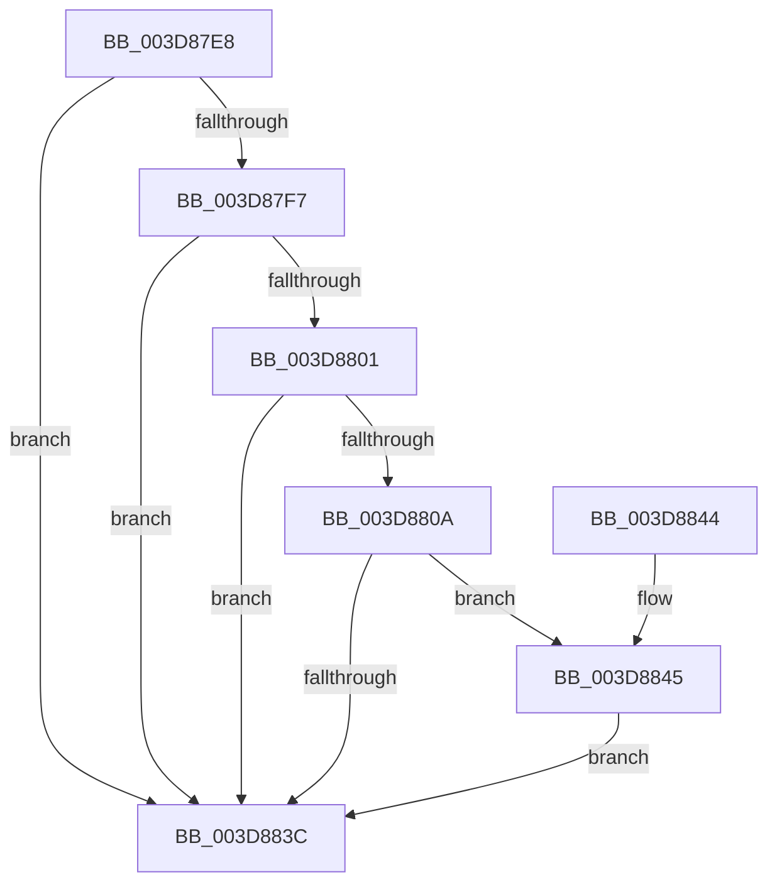

# KiCheckForAtlThunk

- RVA: `0x003D87E8`–`0x003D884B` (길이 `99` bytes)
- VA: `0x00000001403D87E8`
- 실행 섹션: `.text`
- PDB 이름 있음: `예`; PDB Function 태그: `아니요`
- unwind 정보 RVA: `0x00093D30`
- 디코드: `28`개 명령, `99/99` bytes 표시
- 미해석 바이트: `0` (있으면 어셈블리에 `.byte`로 보존)

> 이 문서는 커널 이미지의 기계어와 PDB 기호를 분석해 생성했습니다. 4번과 5번은 함수 원형과 자료형을 바이너리 사용 방식에서 추정한 C 해석이며 원본 소스 복구 결과는 아닙니다.

## 1. Dependencies

- 직접 호출 지점: **1**; 고유 호출 대상: **1**
- 직접 호출자로 확인된 함수: **1**
- RIP 상대 이미지 참조: **0**

### Outgoing calls
- `0x003D8833` → [KiEmulateAtlThunk](KiEmulateAtlThunk_function_003D8854.md) (function, `0x003D8854`)

### Direct callers
- [KiPreprocessFault](KiPreprocessFault_function_003D7E70.md) at `0x003D80B0`

### Static image references
- 디코드된 RIP-relative 메모리 참조가 없습니다.

## 2. Other-region calls and transfers

- 다른 실행 섹션으로 향하는 call: **0**
- 별도 외부 분기/꼬리 이동을 확인하지 못했습니다.

## 3. Assembly (complete function range)

```asm
003D87E8  40 53                           push rbx
003D87EA  48 83 EC 30                     sub rsp, 0x30
003D87EE  80 79 3A 00                     cmp byte ptr [rcx + 0x3a], 0
003D87F2  48 8B D9                        mov rbx, rcx
003D87F5  74 45                           je 0x1403d883c
003D87F7  48 8B 49 20                     mov rcx, qword ptr [rcx + 0x20]
003D87FB  F6 41 20 08                     test byte ptr [rcx + 0x20], 8
003D87FF  74 3B                           je 0x1403d883c
003D8801  48 8B 03                        mov rax, qword ptr [rbx]
003D8804  48 39 41 28                     cmp qword ptr [rcx + 0x28], rax
003D8808  75 32                           jne 0x1403d883c
003D880A  48 8B 4B 18                     mov rcx, qword ptr [rbx + 0x18]
003D880E  48 8D 81 88 00 00 00            lea rax, [rcx + 0x88]
003D8815  4C 8D 89 80 00 00 00            lea r9, [rcx + 0x80]
003D881C  48 89 44 24 20                  mov qword ptr [rsp + 0x20], rax
003D8821  4C 8D 41 78                     lea r8, [rcx + 0x78]
003D8825  48 8D 91 98 00 00 00            lea rdx, [rcx + 0x98]
003D882C  48 81 C1 F8 00 00 00            add rcx, 0xf8
003D8833  E8 1C 00 00 00                  call 0x1403d8854
003D8838  85 C0                           test eax, eax
003D883A  75 09                           jne 0x1403d8845
003D883C  33 C0                           xor eax, eax
003D883E  48 83 C4 30                     add rsp, 0x30
003D8842  5B                              pop rbx
003D8843  C3                              ret
003D8844  CC                              int3
003D8845  C6 43 60 01                     mov byte ptr [rbx + 0x60], 1
003D8849  EB F1                           jmp 0x1403d883c
```

## 4. C-style interpretation (structured pseudocode)

```c
__int64 __fastcall KiCheckForAtlThunk(__int64 a1)
{
    __int64 result;
    __int64 v_rsp;
    unsigned __int64 v_stack_m18;

    v_rsp = (v_rsp) - (48);
    if ((*(unsigned __int8 *)(a1 + 58)) == 0) goto loc_003D883C;
    if (((*(unsigned __int8 *)(*(unsigned __int64 *)(a1 + 32) + 32)) & (8)) == 0) goto loc_003D883C;
    if ((*(unsigned __int64 *)(*(unsigned __int64 *)(a1 + 32) + 40)) != (*(unsigned __int64 *)(a1))) goto loc_003D883C;
    v_stack_m18 = *(unsigned __int64 *)(a1 + 24) + 136;
    a1 = (*(unsigned __int64 *)(a1 + 24)) + (248);
    result = KiEmulateAtlThunk(a1, *(unsigned __int64 *)(a1 + 24) + 152, *(unsigned __int64 *)(a1 + 24) + 120, *(unsigned __int64 *)(a1 + 24) + 128);
    if ((unsigned int)(result) != 0) goto loc_003D8845;
loc_003D883C:
    result = 0;
    v_rsp = (v_rsp) + (48);
    return result;
loc_003D8845:
    *(unsigned __int8 *)(a1 + 96) = 1;
    goto loc_003D883C;
}
```

## 5. (Beta) C Style

```c
int64_t KiCheckForAtlThunk(void *Arg1)
{
    uint8_t *arg1 = (uint8_t *)Arg1;

    int64_t result;
    int64_t local_rsp;
    uint64_t v_stack_m18;

    local_rsp = (local_rsp) - (48);
    if ((*(uint8_t *)(arg1 + 0x3A)) == 0) goto loc_003D883C;
    if (((*(uint8_t *)(*(uint64_t *)(arg1 + 0x20) + 0x20)) & (8)) == 0) goto loc_003D883C;
    if ((*(uint64_t *)(*(uint64_t *)(arg1 + 0x20) + 0x28)) != (*(uint64_t *)(arg1))) goto loc_003D883C;
    v_stack_m18 = *(uint64_t *)(arg1 + 0x18) + 136;
    Arg1 = (*(uint64_t *)(arg1 + 0x18)) + (248);
    result = KiEmulateAtlThunk(Arg1, *(uint64_t *)(arg1 + 0x18) + 152, *(uint64_t *)(arg1 + 0x18) + 120, *(uint64_t *)(arg1 + 0x18) + 128);
    if ((uint32_t)(result) != 0) goto loc_003D8845;
loc_003D883C:
    result = 0;
    local_rsp = (local_rsp) + (48);
    return result;
loc_003D8845:
    *(uint8_t *)(arg1 + 0x60) = 1;
    goto loc_003D883C;
}
```

### 관측된 메모리 오프셋

구조체 형식이 확인되지 않은 접근은 인자 기준의 오프셋으로만 기록했습니다.

| 기준 인자 | 오프셋 표현 | 폭 (bit) | 접근 |
|---|---:|---:|---|
| `Arg1` | `+ 0x0` | `64` | `R` |
| `Arg1` | `+ 0x18` | `64` | `R` |
| `Arg1` | `+ 0x20` | `64` | `R` |
| `Arg1` | `+ 0x3A` | `8` | `R` |
| `Arg1` | `+ 0x60` | `8` | `W` |

## 6. Execution-region graph

[열기: 2D/3D 그래프와 함수 탐색 컨트롤 패널](../../../control-panel.html?section=text&rva=0x003D87E8&view=graph)

- 2D 그래프는 위에서 아래로 흐르고, 3D 그래프는 빈 공간을 드래그해 회전합니다. Shift+드래그는 이동, 휠은 확대·축소, 함수 노드 선택은 대상 보고서 이동입니다.

### Static fallback


