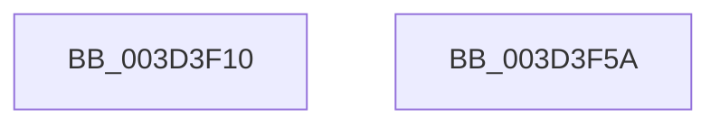

# KiDecodeTolerableDelayValue

- RVA: `0x003D3F10`–`0x003D3F5B` (길이 `75` bytes)
- VA: `0x00000001403D3F10`
- 실행 섹션: `.text`
- PDB 이름 있음: `예`; PDB Function 태그: `아니요`
- unwind 정보 RVA: `0x000DB714`
- 디코드: `23`개 명령, `75/75` bytes 표시
- 미해석 바이트: `0` (있으면 어셈블리에 `.byte`로 보존)

> 이 문서는 커널 이미지의 기계어와 PDB 기호를 분석해 생성했습니다. 4번과 5번은 함수 원형과 자료형을 바이너리 사용 방식에서 추정한 C 해석이며 원본 소스 복구 결과는 아닙니다.

## 1. Dependencies

- 직접 호출 지점: **0**; 고유 호출 대상: **0**
- 직접 호출자로 확인된 함수: **2**
- RIP 상대 이미지 참조: **0**

### Outgoing calls
- 직접 디코드된 call 명령이 없습니다.

### Direct callers
- [ExpTimerPause](ExpTimerPause_function_003D38C4.md) at `0x003D3999`
- [KeCancelTimerInternal](KeCancelTimerInternal_function_003D39E4.md) at `0x003D3A57`

### Static image references
- 디코드된 RIP-relative 메모리 참조가 없습니다.

## 2. Other-region calls and transfers

- 다른 실행 섹션으로 향하는 call: **0**
- 별도 외부 분기/꼬리 이동을 확인하지 못했습니다.

## 3. Assembly (complete function range)

```asm
003D3F10  44 8A C9                        mov r9b, cl
003D3F13  41 C0 E9 03                     shr r9b, 3
003D3F17  41 80 E1 07                     and r9b, 7
003D3F1B  41 8D 41 02                     lea eax, [r9 + 2]
003D3F1F  0F B6 D0                        movzx edx, al
003D3F22  41 8A C1                        mov al, r9b
003D3F25  F6 D8                           neg al
003D3F27  66 45 1B C0                     sbb r8w, r8w
003D3F2B  80 E1 07                        and cl, 7
003D3F2E  0F B6 C1                        movzx eax, cl
003D3F31  66 41 83 E0 08                  and r8w, 8
003D3F36  66 44 0B C0                     or r8w, ax
003D3F3A  8D 42 01                        lea eax, [rdx + 1]
003D3F3D  0F B6 C0                        movzx eax, al
003D3F40  45 84 C9                        test r9b, r9b
003D3F43  0F 44 D0                        cmove edx, eax
003D3F46  8A CA                           mov cl, dl
003D3F48  66 41 D3 E0                     shl r8w, cl
003D3F4C  41 0F B7 C0                     movzx eax, r8w
003D3F50  C1 E8 03                        shr eax, 3
003D3F53  69 C0 10 27 00 00               imul eax, eax, 0x2710
003D3F59  C3                              ret
003D3F5A  CC                              int3
```

## 4. C-style interpretation (structured pseudocode)

```c
__int64 __fastcall KiDecodeTolerableDelayValue(unsigned __int8 a1, __int64 a2, unsigned __int16 a3)
{
    __int64 result;

    a4 = (unsigned __int8)((a1) >> (3));
    a4 = (unsigned __int8)((a4) & (7));
    result = (unsigned __int8)(-((unsigned __int8)(a4)));
    a1 = (unsigned __int8)((a1) & (7));
    a3 = (unsigned __int16)((a3) & (8));
    a3 = (unsigned __int16)((a3) | (a1));
    a2 = (unsigned __int8)(a4 + 2);
    if ((unsigned __int8)(a4) == 0) { a2 = (unsigned int)((unsigned __int8)((unsigned __int8)(a4 + 2) + 1)); }
    a3 = (unsigned __int16)((a3) << ((unsigned __int8)((unsigned __int8)(a2))));
    result = (unsigned int)((a3) >> (3));
    result = (unsigned int)((result) * ((unsigned int)(result)));
    return result;
}
```

## 5. (Beta) C Style

```c
int64_t KiDecodeTolerableDelayValue(uint8_t Arg1, int64_t Arg2, uint16_t Arg3)
{
    int64_t result;

    a4 = (uint8_t)((Arg1) >> (3));
    a4 = (uint8_t)((a4) & (7));
    result = (uint8_t)(-((uint8_t)(a4)));
    Arg1 = (uint8_t)((Arg1) & (7));
    Arg3 = (uint16_t)((Arg3) & (8));
    Arg3 = (uint16_t)((Arg3) | (Arg1));
    Arg2 = (uint8_t)(a4 + 2);
    if ((uint8_t)(a4) == 0) { Arg2 = (uint32_t)((uint8_t)((uint8_t)(a4 + 2) + 1)); }
    Arg3 = (uint16_t)((Arg3) << ((uint8_t)((uint8_t)(Arg2))));
    result = (uint32_t)((Arg3) >> (3));
    result = (uint32_t)((result) * ((uint32_t)(result)));
    return result;
}
```

## 6. Execution-region graph

[열기: 2D/3D 그래프와 함수 탐색 컨트롤 패널](../../../control-panel.html?section=text&rva=0x003D3F10&view=graph)

- 2D 그래프는 위에서 아래로 흐르고, 3D 그래프는 빈 공간을 드래그해 회전합니다. Shift+드래그는 이동, 휠은 확대·축소, 함수 노드 선택은 대상 보고서 이동입니다.

### Static fallback


