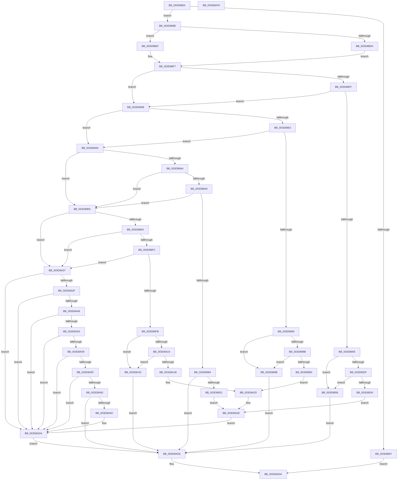

# KiEmulateAtlThunk

- RVA: `0x003D8854`–`0x003D8AFA` (길이 `678` bytes)
- VA: `0x00000001403D8854`
- 실행 섹션: `.text`
- PDB 이름 있음: `예`; PDB Function 태그: `아니요`
- unwind 정보 RVA: `0x00093D3C`
- 디코드: `192`개 명령, `678/678` bytes 표시
- 미해석 바이트: `0` (있으면 어셈블리에 `.byte`로 보존)

> 이 문서는 커널 이미지의 기계어와 PDB 기호를 분석해 생성했습니다. 4번과 5번은 함수 원형과 자료형을 바이너리 사용 방식에서 추정한 C 해석이며 원본 소스 복구 결과는 아닙니다.

## 1. Dependencies

- 직접 호출 지점: **5**; 고유 호출 대상: **1**
- 직접 호출자로 확인된 함수: **1**
- RIP 상대 이미지 참조: **0**

### Outgoing calls
- `0x003D8926` → [MmCheckForSafeExecution](../../page/80/MmCheckForSafeExecution_function_008076B0.md) (function, `0x008076B0`)
- `0x003D8982` → [MmCheckForSafeExecution](../../page/80/MmCheckForSafeExecution_function_008076B0.md) (function, `0x008076B0`)
- `0x003D89C5` → [MmCheckForSafeExecution](../../page/80/MmCheckForSafeExecution_function_008076B0.md) (function, `0x008076B0`)
- `0x003D8A0D` → [MmCheckForSafeExecution](../../page/80/MmCheckForSafeExecution_function_008076B0.md) (function, `0x008076B0`)
- `0x003D8AA4` → [MmCheckForSafeExecution](../../page/80/MmCheckForSafeExecution_function_008076B0.md) (function, `0x008076B0`)

### Direct callers
- [KiCheckForAtlThunk](KiCheckForAtlThunk_function_003D87E8.md) at `0x003D8833`

### Static image references
- 디코드된 RIP-relative 메모리 참조가 없습니다.

## 2. Other-region calls and transfers

- 다른 실행 섹션으로 향하는 call: **5**
  - `0x003D8926` → [MmCheckForSafeExecution](../../page/80/MmCheckForSafeExecution_function_008076B0.md) (`.text` → `PAGE`)
  - `0x003D8982` → [MmCheckForSafeExecution](../../page/80/MmCheckForSafeExecution_function_008076B0.md) (`.text` → `PAGE`)
  - `0x003D89C5` → [MmCheckForSafeExecution](../../page/80/MmCheckForSafeExecution_function_008076B0.md) (`.text` → `PAGE`)
  - `0x003D8A0D` → [MmCheckForSafeExecution](../../page/80/MmCheckForSafeExecution_function_008076B0.md) (`.text` → `PAGE`)
  - `0x003D8AA4` → [MmCheckForSafeExecution](../../page/80/MmCheckForSafeExecution_function_008076B0.md) (`.text` → `PAGE`)
- 별도 외부 분기/꼬리 이동을 확인하지 못했습니다.

## 3. Assembly (complete function range)

```asm
003D8854  48 8B C4                        mov rax, rsp
003D8857  48 89 58 08                     mov qword ptr [rax + 8], rbx
003D885B  48 89 70 10                     mov qword ptr [rax + 0x10], rsi
003D885F  48 89 78 18                     mov qword ptr [rax + 0x18], rdi
003D8863  4C 89 60 20                     mov qword ptr [rax + 0x20], r12
003D8867  41 55                           push r13
003D8869  41 56                           push r14
003D886B  41 57                           push r15
003D886D  48 83 EC 50                     sub rsp, 0x50
003D8871  4D 8B F1                        mov r14, r9
003D8874  4D 8B E8                        mov r13, r8
003D8877  4C 8B FA                        mov r15, rdx
003D887A  48 8B F1                        mov rsi, rcx
003D887D  65 48 8B 04 25 88 01 00 00      mov rax, qword ptr gs:[0x188]
003D8886  4C 8B 90 B8 00 00 00            mov r10, qword ptr [rax + 0xb8]
003D888D  41 F6 82 93 00 00 00 04         test byte ptr [r10 + 0x93], 4
003D8895  74 07                           je 0x1403d889e
003D8897  33 C0                           xor eax, eax
003D8899  E9 3C 02 00 00                  jmp 0x1403d8ada
003D889E  8B 19                           mov ebx, dword ptr [rcx]
003D88A0  8B 02                           mov eax, dword ptr [rdx]
003D88A2  48 89 44 24 30                  mov qword ptr [rsp + 0x30], rax
003D88A7  C7 44 24 24 00 00 00 00         mov dword ptr [rsp + 0x24], 0
003D88AF  90                              nop
003D88B0  8A 03                           mov al, byte ptr [rbx]
003D88B2  65 48 8B 04 25 30 00 00 00      mov rax, qword ptr gs:[0x30]
003D88BB  48 89 44 24 38                  mov qword ptr [rsp + 0x38], rax
003D88C0  48 8D 88 CA 2F 00 00            lea rcx, [rax + 0x2fca]
003D88C7  48 89 4C 24 40                  mov qword ptr [rsp + 0x40], rcx
003D88CC  0F B7 01                        movzx eax, word ptr [rcx]
003D88CF  41 BC 01 00 00 00               mov r12d, 1
003D88D5  41 84 C4                        test r12b, al
003D88D8  74 15                           je 0x1403d88ef
003D88DA  41 8A FC                        mov dil, r12b
003D88DD  44 88 64 24 20                  mov byte ptr [rsp + 0x20], r12b
003D88E2  BA FE FF 00 00                  mov edx, 0xfffe
003D88E7  66 23 C2                        and ax, dx
003D88EA  66 89 01                        mov word ptr [rcx], ax
003D88ED  EB 08                           jmp 0x1403d88f7
003D88EF  40 32 FF                        xor dil, dil
003D88F2  40 88 7C 24 20                  mov byte ptr [rsp + 0x20], dil
003D88F7  81 3B C7 44 24 04               cmp dword ptr [rbx], 0x42444c7
003D88FD  75 5C                           jne 0x1403d895b
003D88FF  80 7B 08 E9                     cmp byte ptr [rbx + 8], 0xe9
003D8903  75 56                           jne 0x1403d895b
003D8905  44 8B 73 09                     mov r14d, dword ptr [rbx + 9]
003D8909  41 83 C6 0D                     add r14d, 0xd
003D890D  44 03 F3                        add r14d, ebx
003D8910  44 89 74 24 28                  mov dword ptr [rsp + 0x28], r14d
003D8915  45 8B C6                        mov r8d, r14d
003D8918  45 8A CC                        mov r9b, r12b
003D891B  4C 8B 7C 24 30                  mov r15, qword ptr [rsp + 0x30]
003D8920  49 8B D7                        mov rdx, r15
003D8923  48 8B CB                        mov rcx, rbx
003D8926  E8 85 ED 42 00                  call 0x1408076b0
003D892B  84 C0                           test al, al
003D892D  74 27                           je 0x1403d8956
003D892F  40 84 FF                        test dil, dil
003D8932  74 22                           je 0x1403d8956
003D8934  8B 4B 04                        mov ecx, dword ptr [rbx + 4]
003D8937  49 8D 47 04                     lea rax, [r15 + 4]
003D893B  48 BA 00 00 FF FF FF 7F 00 00   movabs rdx, 0x7fffffff0000
003D8945  48 3B C2                        cmp rax, rdx
003D8948  48 0F 43 C2                     cmovae rax, rdx
003D894C  89 08                           mov dword ptr [rax], ecx
003D894E  44 89 36                        mov dword ptr [rsi], r14d
003D8951  E9 D2 00 00 00                  jmp 0x1403d8a28
003D8956  E9 7B 01 00 00                  jmp 0x1403d8ad6
003D895B  8A 03                           mov al, byte ptr [rbx]
003D895D  B2 B9                           mov dl, 0xb9
003D895F  3A C2                           cmp al, dl
003D8961  75 3D                           jne 0x1403d89a0
003D8963  80 7B 05 E9                     cmp byte ptr [rbx + 5], 0xe9
003D8967  75 37                           jne 0x1403d89a0
003D8969  44 8B 7B 06                     mov r15d, dword ptr [rbx + 6]
003D896D  41 83 C7 0A                     add r15d, 0xa
003D8971  44 03 FB                        add r15d, ebx
003D8974  45 8B C7                        mov r8d, r15d
003D8977  45 8A CC                        mov r9b, r12b
003D897A  48 8B 54 24 30                  mov rdx, qword ptr [rsp + 0x30]
003D897F  48 8B CB                        mov rcx, rbx
003D8982  E8 29 ED 42 00                  call 0x1408076b0
003D8987  84 C0                           test al, al
003D8989  74 10                           je 0x1403d899b
003D898B  40 84 FF                        test dil, dil
003D898E  74 0B                           je 0x1403d899b
003D8990  8B 43 01                        mov eax, dword ptr [rbx + 1]
003D8993  41 89 06                        mov dword ptr [r14], eax
003D8996  E9 8A 00 00 00                  jmp 0x1403d8a25
003D899B  E9 36 01 00 00                  jmp 0x1403d8ad6
003D89A0  3C BA                           cmp al, 0xba
003D89A2  75 42                           jne 0x1403d89e6
003D89A4  38 53 05                        cmp byte ptr [rbx + 5], dl
003D89A7  75 3D                           jne 0x1403d89e6
003D89A9  B9 FF E1 00 00                  mov ecx, 0xe1ff
003D89AE  66 39 4B 0A                     cmp word ptr [rbx + 0xa], cx
003D89B2  75 32                           jne 0x1403d89e6
003D89B4  8B 7B 06                        mov edi, dword ptr [rbx + 6]
003D89B7  44 8B C7                        mov r8d, edi
003D89BA  45 33 C9                        xor r9d, r9d
003D89BD  48 8B 54 24 30                  mov rdx, qword ptr [rsp + 0x30]
003D89C2  48 8B CB                        mov rcx, rbx
003D89C5  E8 E6 EC 42 00                  call 0x1408076b0
003D89CA  84 C0                           test al, al
003D89CC  0F 84 04 01 00 00               je 0x1403d8ad6
003D89D2  8B 4B 01                        mov ecx, dword ptr [rbx + 1]
003D89D5  48 8B 84 24 90 00 00 00         mov rax, qword ptr [rsp + 0x90]
003D89DD  89 08                           mov dword ptr [rax], ecx
003D89DF  41 89 3E                        mov dword ptr [r14], edi
003D89E2  89 3E                           mov dword ptr [rsi], edi
003D89E4  EB 42                           jmp 0x1403d8a28
003D89E6  3A C2                           cmp al, dl
003D89E8  75 4D                           jne 0x1403d8a37
003D89EA  80 7B 05 B8                     cmp byte ptr [rbx + 5], 0xb8
003D89EE  75 47                           jne 0x1403d8a37
003D89F0  B9 FF E0 00 00                  mov ecx, 0xe0ff
003D89F5  66 39 4B 0A                     cmp word ptr [rbx + 0xa], cx
003D89F9  75 3C                           jne 0x1403d8a37
003D89FB  44 8B 7B 06                     mov r15d, dword ptr [rbx + 6]
003D89FF  45 8B C7                        mov r8d, r15d
003D8A02  45 8A CC                        mov r9b, r12b
003D8A05  48 8B 54 24 30                  mov rdx, qword ptr [rsp + 0x30]
003D8A0A  48 8B CB                        mov rcx, rbx
003D8A0D  E8 9E EC 42 00                  call 0x1408076b0
003D8A12  84 C0                           test al, al
003D8A14  74 1C                           je 0x1403d8a32
003D8A16  40 84 FF                        test dil, dil
003D8A19  74 17                           je 0x1403d8a32
003D8A1B  8B 43 01                        mov eax, dword ptr [rbx + 1]
003D8A1E  41 89 06                        mov dword ptr [r14], eax
003D8A21  45 89 7D 00                     mov dword ptr [r13], r15d
003D8A25  44 89 3E                        mov dword ptr [rsi], r15d
003D8A28  44 89 64 24 24                  mov dword ptr [rsp + 0x24], r12d
003D8A2D  E9 A2 00 00 00                  jmp 0x1403d8ad4
003D8A32  E9 9F 00 00 00                  jmp 0x1403d8ad6
003D8A37  3C 59                           cmp al, 0x59
003D8A39  0F 85 95 00 00 00               jne 0x1403d8ad4
003D8A3F  80 7B 01 58                     cmp byte ptr [rbx + 1], 0x58
003D8A43  0F 85 8B 00 00 00               jne 0x1403d8ad4
003D8A49  80 7B 02 51                     cmp byte ptr [rbx + 2], 0x51
003D8A4D  0F 85 81 00 00 00               jne 0x1403d8ad4
003D8A53  80 7B 03 FF                     cmp byte ptr [rbx + 3], 0xff
003D8A57  75 7B                           jne 0x1403d8ad4
003D8A59  80 7B 04 60                     cmp byte ptr [rbx + 4], 0x60
003D8A5D  75 75                           jne 0x1403d8ad4
003D8A5F  80 7B 05 04                     cmp byte ptr [rbx + 5], 4
003D8A63  75 6F                           jne 0x1403d8ad4
003D8A65  48 8B 44 24 30                  mov rax, qword ptr [rsp + 0x30]
003D8A6A  48 83 C0 04                     add rax, 4
003D8A6E  48 BA 00 00 FF FF FF 7F 00 00   movabs rdx, 0x7fffffff0000
003D8A78  48 3B C2                        cmp rax, rdx
003D8A7B  48 0F 43 C2                     cmovae rax, rdx
003D8A7F  90                              nop
003D8A80  8B 00                           mov eax, dword ptr [rax]
003D8A82  89 44 24 28                     mov dword ptr [rsp + 0x28], eax
003D8A86  83 C0 04                        add eax, 4
003D8A89  90                              nop
003D8A8A  8B 00                           mov eax, dword ptr [rax]
003D8A8C  89 44 24 2C                     mov dword ptr [rsp + 0x2c], eax
003D8A90  44 8B E0                        mov r12d, eax
003D8A93  45 8B C4                        mov r8d, r12d
003D8A96  45 33 C9                        xor r9d, r9d
003D8A99  48 8B 7C 24 30                  mov rdi, qword ptr [rsp + 0x30]
003D8A9E  48 8B D7                        mov rdx, rdi
003D8AA1  48 8B CB                        mov rcx, rbx
003D8AA4  E8 07 EC 42 00                  call 0x1408076b0
003D8AA9  84 C0                           test al, al
003D8AAB  74 29                           je 0x1403d8ad6
003D8AAD  8B 07                           mov eax, dword ptr [rdi]
003D8AAF  41 89 06                        mov dword ptr [r14], eax
003D8AB2  48 83 C7 04                     add rdi, 4
003D8AB6  48 89 7C 24 30                  mov qword ptr [rsp + 0x30], rdi
003D8ABB  8B 07                           mov eax, dword ptr [rdi]
003D8ABD  41 89 45 00                     mov dword ptr [r13], eax
003D8AC1  41 8B 06                        mov eax, dword ptr [r14]
003D8AC4  89 07                           mov dword ptr [rdi], eax
003D8AC6  44 89 26                        mov dword ptr [rsi], r12d
003D8AC9  41 89 3F                        mov dword ptr [r15], edi
003D8ACC  C7 44 24 24 01 00 00 00         mov dword ptr [rsp + 0x24], 1
003D8AD4  EB 00                           jmp 0x1403d8ad6
003D8AD6  8B 44 24 24                     mov eax, dword ptr [rsp + 0x24]
003D8ADA  4C 8D 5C 24 50                  lea r11, [rsp + 0x50]
003D8ADF  49 8B 5B 20                     mov rbx, qword ptr [r11 + 0x20]
003D8AE3  49 8B 73 28                     mov rsi, qword ptr [r11 + 0x28]
003D8AE7  49 8B 7B 30                     mov rdi, qword ptr [r11 + 0x30]
003D8AEB  4D 8B 63 38                     mov r12, qword ptr [r11 + 0x38]
003D8AEF  49 8B E3                        mov rsp, r11
003D8AF2  41 5F                           pop r15
003D8AF4  41 5E                           pop r14
003D8AF6  41 5D                           pop r13
003D8AF8  C3                              ret
003D8AF9  CC                              int3
```

## 4. C-style interpretation (structured pseudocode)

```c
__int64 __fastcall KiEmulateAtlThunk(__int64 a1, __int64 a2, __int64 a3, __int64 a4, __int64 a5)
{
    __int64 result;
    __int64 v_r14;
    __int64 v_r15;
    __int64 v_rdi;
    __int64 v_rsp;
    unsigned __int64 v_stack_m18;
    unsigned __int64 v_stack_m28;
    unsigned __int64 v_stack_m30;
    unsigned __int64 v_stack_m38;
    unsigned int v_stack_m3C;
    unsigned int v_stack_m40;
    unsigned int v_stack_m44;
    unsigned __int8 v_stack_m48;

    *(unsigned __int64 *)(v_rsp + 8) = v_rbx;
    *(unsigned __int64 *)(v_rsp + 16) = v_rsi;
    *(unsigned __int64 *)(v_rsp + 24) = v_rdi;
    *(unsigned __int64 *)(v_rsp + 32) = v_r12;
    v_rsp = (v_rsp) - (80);
    if (((*(unsigned __int8 *)(*(unsigned __int64 *)(*(unsigned __int64 *)(gs_base + (0 + 392)) + 184) + 147)) & (4)) == 0) goto loc_003D889E;
    result = 0;
    goto loc_003D8ADA;
loc_003D889E:
    v_stack_m38 = (unsigned int)(*(unsigned int *)(a2));
    v_stack_m44 = 0;
    v_stack_m30 = *(unsigned __int64 *)(gs_base + (0 + 48));
    v_stack_m28 = *(unsigned __int64 *)(gs_base + (0 + 48)) + 12234;
    if (((1) & ((unsigned __int8)(*(unsigned __int16 *)(*(unsigned __int64 *)(gs_base + (0 + 48)) + 12234)))) == 0) goto loc_003D88EF;
    v_stack_m48 = 1;
    result = (unsigned __int16)((*(unsigned __int16 *)(*(unsigned __int64 *)(gs_base + (0 + 48)) + 12234)) & ((unsigned __int16)((unsigned int)(0xFFFEULL))));
    *(unsigned __int16 *)(*(unsigned __int64 *)(gs_base + (0 + 48)) + 12234) = (unsigned __int16)(result);
    goto loc_003D88F7;
loc_003D88EF:
    v_rdi = 0;
    v_stack_m48 = 0;
loc_003D88F7:
    if ((*(unsigned int *)((unsigned int)(*(unsigned int *)(a1)))) != 0x42444C7ULL) goto loc_003D895B;
    if ((*(unsigned __int8 *)((unsigned int)(*(unsigned int *)(a1)) + 8)) != 233) goto loc_003D895B;
    v_r14 = (unsigned int)(((unsigned int)(*(unsigned int *)((unsigned int)(*(unsigned int *)(a1)) + 9))) + (13));
    v_r14 = (unsigned int)((v_r14) + ((unsigned int)((unsigned int)(*(unsigned int *)(a1)))));
    v_stack_m40 = (unsigned int)(v_r14);
    result = MmCheckForSafeExecution((unsigned int)(*(unsigned int *)(a1)), v_stack_m38, (unsigned int)((unsigned int)(v_r14)), 1);
    if ((unsigned __int8)(result) == 0) goto loc_003D8956;
    if (0 == 0) goto loc_003D8956;
    result = v_stack_m38 + 4;
    if ((v_stack_m38 + 4) >= v_stack_m38) { result = v_stack_m38; }
    *(unsigned int *)(result) = (unsigned int)((unsigned int)(*(unsigned int *)((unsigned int)(*(unsigned int *)(a1)) + 4)));
    *(unsigned int *)(a1) = (unsigned int)(v_r14);
    goto loc_003D8A28;
loc_003D8956:
    goto loc_003D8AD6;
loc_003D895B:
    if (((unsigned __int8)(*(unsigned __int8 *)((unsigned int)(*(unsigned int *)(a1))))) != 185) goto loc_003D89A0;
    if ((*(unsigned __int8 *)((unsigned int)(*(unsigned int *)(a1)) + 5)) != 233) goto loc_003D89A0;
    v_r15 = (unsigned int)(((unsigned int)(*(unsigned int *)((unsigned int)(*(unsigned int *)(a1)) + 6))) + (10));
    v_r15 = (unsigned int)((v_r15) + ((unsigned int)((unsigned int)(*(unsigned int *)(a1)))));
    result = MmCheckForSafeExecution((unsigned int)(*(unsigned int *)(a1)), v_stack_m38, (unsigned int)((unsigned int)(v_r15)), 1);
    if ((unsigned __int8)(result) == 0) goto loc_003D899B;
    if (0 == 0) goto loc_003D899B;
    *(unsigned int *)(v_r14) = (unsigned int)((unsigned int)(*(unsigned int *)((unsigned int)(*(unsigned int *)(a1)) + 1)));
    goto loc_003D8A25;
loc_003D899B:
    goto loc_003D8AD6;
loc_003D89A0:
    if (((unsigned __int8)((unsigned int)(*(unsigned int *)((unsigned int)(*(unsigned int *)(a1)) + 1)))) != 186) goto loc_003D89E6;
    if ((*(unsigned __int8 *)((unsigned int)(*(unsigned int *)(a1)) + 5)) != ((unsigned __int8)(v_stack_m38))) goto loc_003D89E6;
    if ((*(unsigned __int16 *)((unsigned int)(*(unsigned int *)(a1)) + 10)) != ((unsigned __int16)((unsigned int)(0xE1FFULL)))) goto loc_003D89E6;
    a4 = 0;
    result = MmCheckForSafeExecution((unsigned int)(*(unsigned int *)(a1)), v_stack_m38, (unsigned int)((unsigned int)((unsigned int)(*(unsigned int *)((unsigned int)(*(unsigned int *)(a1)) + 6)))), a4);
    if ((unsigned __int8)(result) == 0) goto loc_003D8AD6;
    *(unsigned int *)(a5) = (unsigned int)((unsigned int)(*(unsigned int *)((unsigned int)(*(unsigned int *)(a1)) + 1)));
    *(unsigned int *)(v_r14) = (unsigned int)((unsigned int)(*(unsigned int *)((unsigned int)(*(unsigned int *)(a1)) + 6)));
    *(unsigned int *)(a1) = (unsigned int)((unsigned int)(*(unsigned int *)((unsigned int)(*(unsigned int *)(a1)) + 6)));
    goto loc_003D8A28;
loc_003D89E6:
    if (((unsigned __int8)(a5)) != ((unsigned __int8)(v_stack_m38))) goto loc_003D8A37;
    if ((*(unsigned __int8 *)((unsigned int)(*(unsigned int *)(a1)) + 5)) != 184) goto loc_003D8A37;
    if ((*(unsigned __int16 *)((unsigned int)(*(unsigned int *)(a1)) + 10)) != ((unsigned __int16)((unsigned int)(0xE0FFULL)))) goto loc_003D8A37;
    result = MmCheckForSafeExecution((unsigned int)(*(unsigned int *)(a1)), v_stack_m38, (unsigned int)((unsigned int)((unsigned int)(*(unsigned int *)((unsigned int)(*(unsigned int *)(a1)) + 6)))), 1);
    if ((unsigned __int8)(result) == 0) goto loc_003D8A32;
    if ((unsigned __int8)((unsigned int)(*(unsigned int *)((unsigned int)(*(unsigned int *)(a1)) + 6))) == 0) goto loc_003D8A32;
    *(unsigned int *)(v_r14) = (unsigned int)((unsigned int)(*(unsigned int *)((unsigned int)(*(unsigned int *)(a1)) + 1)));
    *(unsigned int *)(a3) = (unsigned int)((unsigned int)(*(unsigned int *)((unsigned int)(*(unsigned int *)(a1)) + 6)));
loc_003D8A25:
    *(unsigned int *)(a1) = (unsigned int)((unsigned int)(*(unsigned int *)((unsigned int)(*(unsigned int *)(a1)) + 6)));
loc_003D8A28:
    v_stack_m44 = 1;
    goto loc_003D8AD4;
loc_003D8A32:
    goto loc_003D8AD6;
loc_003D8A37:
    if (((unsigned __int8)((unsigned int)(*(unsigned int *)((unsigned int)(*(unsigned int *)(a1)) + 1)))) != 89) goto loc_003D8AD4;
    if ((*(unsigned __int8 *)((unsigned int)(*(unsigned int *)(a1)) + 1)) != 88) goto loc_003D8AD4;
    if ((*(unsigned __int8 *)((unsigned int)(*(unsigned int *)(a1)) + 2)) != 81) goto loc_003D8AD4;
    if ((*(unsigned __int8 *)((unsigned int)(*(unsigned int *)(a1)) + 3)) != 255) goto loc_003D8AD4;
    if ((*(unsigned __int8 *)((unsigned int)(*(unsigned int *)(a1)) + 4)) != 96) goto loc_003D8AD4;
    if ((*(unsigned __int8 *)((unsigned int)(*(unsigned int *)(a1)) + 5)) != 4) goto loc_003D8AD4;
    result = (v_stack_m38) + (4);
    if (result >= v_stack_m38) { result = v_stack_m38; }
    v_stack_m40 = (unsigned int)((unsigned int)(*(unsigned int *)(result)));
    result = (unsigned int)(((unsigned int)(*(unsigned int *)(result))) + (4));
    v_stack_m3C = (unsigned int)((unsigned int)(*(unsigned int *)(result)));
    a4 = 0;
    result = MmCheckForSafeExecution((unsigned int)(*(unsigned int *)(a1)), v_stack_m38, (unsigned int)((unsigned int)((unsigned int)((unsigned int)((unsigned int)(*(unsigned int *)(result)))))), a4);
    if ((unsigned __int8)(result) == 0) goto loc_003D8AD6;
    *(unsigned int *)(v_r14) = (unsigned int)((unsigned int)(*(unsigned int *)(v_stack_m38)));
    v_rdi = (v_stack_m38) + (4);
    v_stack_m38 = v_rdi;
    *(unsigned int *)(a3) = (unsigned int)((unsigned int)(*(unsigned int *)(v_rdi)));
    *(unsigned int *)(v_rdi) = (unsigned int)((unsigned int)(*(unsigned int *)(v_r14)));
    *(unsigned int *)(a1) = (unsigned int)((unsigned int)((unsigned int)((unsigned int)(*(unsigned int *)(result)))));
    *(unsigned int *)((unsigned int)(*(unsigned int *)((unsigned int)(*(unsigned int *)(a1)) + 6))) = (unsigned int)(v_rdi);
    v_stack_m44 = 1;
loc_003D8AD4:
    goto loc_003D8AD6;
loc_003D8AD6:
loc_003D8ADA:
    return (unsigned int)(v_stack_m44);
}
```

## 5. (Beta) C Style

```c
int64_t KiEmulateAtlThunk(void *Arg1, void *Arg2, void *Arg3, void *Arg4, void *Arg5)
{
    uint8_t *arg1 = (uint8_t *)Arg1;
    uint8_t *arg2 = (uint8_t *)Arg2;
    uint8_t *arg3 = (uint8_t *)Arg3;
    uint8_t *arg4 = (uint8_t *)Arg4;
    uint8_t *arg5 = (uint8_t *)Arg5;

    int64_t result;
    int64_t local_r14;
    int64_t local_r15;
    int64_t local_rdi;
    int64_t local_rsp;
    uint64_t v_stack_m18;
    uint64_t v_stack_m28;
    uint64_t v_stack_m30;
    uint64_t v_stack_m38;
    uint32_t v_stack_m3C;
    uint32_t v_stack_m40;
    uint32_t v_stack_m44;
    uint8_t v_stack_m48;

    *(uint64_t *)(local_rsp + 0x8) = local_rbx;
    *(uint64_t *)(local_rsp + 0x10) = local_rsi;
    *(uint64_t *)(local_rsp + 0x18) = local_rdi;
    *(uint64_t *)(local_rsp + 0x20) = local_r12;
    local_rsp = (local_rsp) - (80);
    if (((*(uint8_t *)(*(uint64_t *)(*(uint64_t *)(gs_base + (0 + 0x188)) + 0xB8) + 0x93)) & (4)) == 0) goto loc_003D889E;
    result = 0;
    goto loc_003D8ADA;
loc_003D889E:
    v_stack_m38 = (uint32_t)(*(uint32_t *)(arg2));
    v_stack_m44 = 0;
    v_stack_m30 = *(uint64_t *)(gs_base + (0 + 0x30));
    v_stack_m28 = *(uint64_t *)(gs_base + (0 + 0x30)) + 12234;
    if (((1) & ((uint8_t)(*(uint16_t *)(*(uint64_t *)(gs_base + (0 + 0x30)) + 0x2FCA)))) == 0) goto loc_003D88EF;
    v_stack_m48 = 1;
    result = (uint16_t)((*(uint16_t *)(*(uint64_t *)(gs_base + (0 + 0x30)) + 0x2FCA)) & ((uint16_t)((uint32_t)(0xFFFEULL))));
    *(uint16_t *)(*(uint64_t *)(gs_base + (0 + 0x30)) + 0x2FCA) = (uint16_t)(result);
    goto loc_003D88F7;
loc_003D88EF:
    local_rdi = 0;
    v_stack_m48 = 0;
loc_003D88F7:
    if ((*(uint32_t *)((uint32_t)(*(uint32_t *)(arg1)))) != 0x42444C7ULL) goto loc_003D895B;
    if ((*(uint8_t *)((uint32_t)(*(uint32_t *)(arg1)) + 0x8)) != 233) goto loc_003D895B;
    local_r14 = (uint32_t)(((uint32_t)(*(uint32_t *)((uint32_t)(*(uint32_t *)(arg1)) + 0x9))) + (13));
    local_r14 = (uint32_t)((local_r14) + ((uint32_t)((uint32_t)(*(uint32_t *)(arg1)))));
    v_stack_m40 = (uint32_t)(local_r14);
    result = MmCheckForSafeExecution((uint32_t)(*(uint32_t *)(arg1)), v_stack_m38, (uint32_t)((uint32_t)(local_r14)), 1);
    if ((uint8_t)(result) == 0) goto loc_003D8956;
    if (0 == 0) goto loc_003D8956;
    result = v_stack_m38 + 4;
    if ((v_stack_m38 + 4) >= v_stack_m38) { result = v_stack_m38; }
    *(uint32_t *)(result) = (uint32_t)((uint32_t)(*(uint32_t *)((uint32_t)(*(uint32_t *)(arg1)) + 0x4)));
    *(uint32_t *)(arg1) = (uint32_t)(local_r14);
    goto loc_003D8A28;
loc_003D8956:
    goto loc_003D8AD6;
loc_003D895B:
    if (((uint8_t)(*(uint8_t *)((uint32_t)(*(uint32_t *)(arg1))))) != 185) goto loc_003D89A0;
    if ((*(uint8_t *)((uint32_t)(*(uint32_t *)(arg1)) + 0x5)) != 233) goto loc_003D89A0;
    local_r15 = (uint32_t)(((uint32_t)(*(uint32_t *)((uint32_t)(*(uint32_t *)(arg1)) + 0x6))) + (10));
    local_r15 = (uint32_t)((local_r15) + ((uint32_t)((uint32_t)(*(uint32_t *)(arg1)))));
    result = MmCheckForSafeExecution((uint32_t)(*(uint32_t *)(arg1)), v_stack_m38, (uint32_t)((uint32_t)(local_r15)), 1);
    if ((uint8_t)(result) == 0) goto loc_003D899B;
    if (0 == 0) goto loc_003D899B;
    *(uint32_t *)(local_r14) = (uint32_t)((uint32_t)(*(uint32_t *)((uint32_t)(*(uint32_t *)(arg1)) + 0x1)));
    goto loc_003D8A25;
loc_003D899B:
    goto loc_003D8AD6;
loc_003D89A0:
    if (((uint8_t)((uint32_t)(*(uint32_t *)((uint32_t)(*(uint32_t *)(arg1)) + 0x1)))) != 186) goto loc_003D89E6;
    if ((*(uint8_t *)((uint32_t)(*(uint32_t *)(arg1)) + 0x5)) != ((uint8_t)(v_stack_m38))) goto loc_003D89E6;
    if ((*(uint16_t *)((uint32_t)(*(uint32_t *)(arg1)) + 0xA)) != ((uint16_t)((uint32_t)(0xE1FFULL)))) goto loc_003D89E6;
    Arg4 = 0;
    result = MmCheckForSafeExecution((uint32_t)(*(uint32_t *)(arg1)), v_stack_m38, (uint32_t)((uint32_t)((uint32_t)(*(uint32_t *)((uint32_t)(*(uint32_t *)(arg1)) + 0x6)))), Arg4);
    if ((uint8_t)(result) == 0) goto loc_003D8AD6;
    *(uint32_t *)(arg5) = (uint32_t)((uint32_t)(*(uint32_t *)((uint32_t)(*(uint32_t *)(arg1)) + 0x1)));
    *(uint32_t *)(local_r14) = (uint32_t)((uint32_t)(*(uint32_t *)((uint32_t)(*(uint32_t *)(arg1)) + 0x6)));
    *(uint32_t *)(arg1) = (uint32_t)((uint32_t)(*(uint32_t *)((uint32_t)(*(uint32_t *)(arg1)) + 0x6)));
    goto loc_003D8A28;
loc_003D89E6:
    if (((uint8_t)(Arg5)) != ((uint8_t)(v_stack_m38))) goto loc_003D8A37;
    if ((*(uint8_t *)((uint32_t)(*(uint32_t *)(arg1)) + 0x5)) != 184) goto loc_003D8A37;
    if ((*(uint16_t *)((uint32_t)(*(uint32_t *)(arg1)) + 0xA)) != ((uint16_t)((uint32_t)(0xE0FFULL)))) goto loc_003D8A37;
    result = MmCheckForSafeExecution((uint32_t)(*(uint32_t *)(arg1)), v_stack_m38, (uint32_t)((uint32_t)((uint32_t)(*(uint32_t *)((uint32_t)(*(uint32_t *)(arg1)) + 0x6)))), 1);
    if ((uint8_t)(result) == 0) goto loc_003D8A32;
    if ((uint8_t)((uint32_t)(*(uint32_t *)((uint32_t)(*(uint32_t *)(arg1)) + 0x6))) == 0) goto loc_003D8A32;
    *(uint32_t *)(local_r14) = (uint32_t)((uint32_t)(*(uint32_t *)((uint32_t)(*(uint32_t *)(arg1)) + 0x1)));
    *(uint32_t *)(arg3) = (uint32_t)((uint32_t)(*(uint32_t *)((uint32_t)(*(uint32_t *)(arg1)) + 0x6)));
loc_003D8A25:
    *(uint32_t *)(arg1) = (uint32_t)((uint32_t)(*(uint32_t *)((uint32_t)(*(uint32_t *)(arg1)) + 0x6)));
loc_003D8A28:
    v_stack_m44 = 1;
    goto loc_003D8AD4;
loc_003D8A32:
    goto loc_003D8AD6;
loc_003D8A37:
    if (((uint8_t)((uint32_t)(*(uint32_t *)((uint32_t)(*(uint32_t *)(arg1)) + 0x1)))) != 89) goto loc_003D8AD4;
    if ((*(uint8_t *)((uint32_t)(*(uint32_t *)(arg1)) + 0x1)) != 88) goto loc_003D8AD4;
    if ((*(uint8_t *)((uint32_t)(*(uint32_t *)(arg1)) + 0x2)) != 81) goto loc_003D8AD4;
    if ((*(uint8_t *)((uint32_t)(*(uint32_t *)(arg1)) + 0x3)) != 255) goto loc_003D8AD4;
    if ((*(uint8_t *)((uint32_t)(*(uint32_t *)(arg1)) + 0x4)) != 96) goto loc_003D8AD4;
    if ((*(uint8_t *)((uint32_t)(*(uint32_t *)(arg1)) + 0x5)) != 4) goto loc_003D8AD4;
    result = (v_stack_m38) + (4);
    if (result >= v_stack_m38) { result = v_stack_m38; }
    v_stack_m40 = (uint32_t)((uint32_t)(*(uint32_t *)(result)));
    result = (uint32_t)(((uint32_t)(*(uint32_t *)(result))) + (4));
    v_stack_m3C = (uint32_t)((uint32_t)(*(uint32_t *)(result)));
    Arg4 = 0;
    result = MmCheckForSafeExecution((uint32_t)(*(uint32_t *)(arg1)), v_stack_m38, (uint32_t)((uint32_t)((uint32_t)((uint32_t)((uint32_t)(*(uint32_t *)(result)))))), Arg4);
    if ((uint8_t)(result) == 0) goto loc_003D8AD6;
    *(uint32_t *)(local_r14) = (uint32_t)((uint32_t)(*(uint32_t *)(v_stack_m38)));
    local_rdi = (v_stack_m38) + (4);
    v_stack_m38 = local_rdi;
    *(uint32_t *)(arg3) = (uint32_t)((uint32_t)(*(uint32_t *)(local_rdi)));
    *(uint32_t *)(local_rdi) = (uint32_t)((uint32_t)(*(uint32_t *)(local_r14)));
    *(uint32_t *)(arg1) = (uint32_t)((uint32_t)((uint32_t)((uint32_t)(*(uint32_t *)(result)))));
    *(uint32_t *)((uint32_t)(*(uint32_t *)((uint32_t)(*(uint32_t *)(arg1)) + 0x6))) = (uint32_t)(local_rdi);
    v_stack_m44 = 1;
loc_003D8AD4:
    goto loc_003D8AD6;
loc_003D8AD6:
loc_003D8ADA:
    return (uint32_t)(v_stack_m44);
}
```

### 관측된 메모리 오프셋

구조체 형식이 확인되지 않은 접근은 인자 기준의 오프셋으로만 기록했습니다.

| 기준 인자 | 오프셋 표현 | 폭 (bit) | 접근 |
|---|---:|---:|---|
| `Arg1` | `+ 0x0` | `32` | `R` |
| `Arg1` | `+ 0x0` | `32` | `W` |
| `Arg2` | `+ 0x0` | `32` | `R` |
| `Arg2` | `+ 0x0` | `32` | `W` |
| `Arg3` | `+ 0x0` | `32` | `W` |
| `Arg4` | `+ 0x0` | `32` | `R` |
| `Arg4` | `+ 0x0` | `32` | `W` |
| `Arg5` | `+ 0x0` | `32` | `W` |

## 6. Execution-region graph

[열기: 2D/3D 그래프와 함수 탐색 컨트롤 패널](../../../control-panel.html?section=text&rva=0x003D8854&view=graph)

- 2D 그래프는 위에서 아래로 흐르고, 3D 그래프는 빈 공간을 드래그해 회전합니다. Shift+드래그는 이동, 휠은 확대·축소, 함수 노드 선택은 대상 보고서 이동입니다.

### Static fallback


