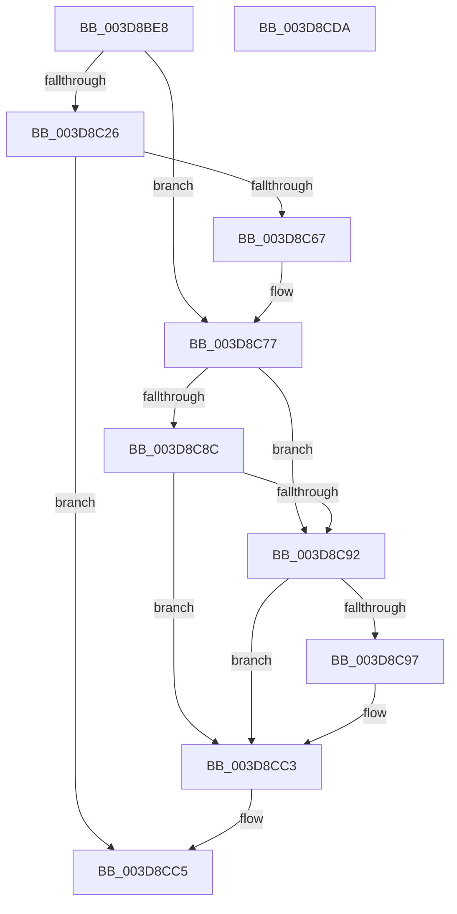

# KiEnableOptionalXStateFeatures

- RVA: `0x003D8BE8`–`0x003D8CDB` (길이 `243` bytes)
- VA: `0x00000001403D8BE8`
- 실행 섹션: `.text`
- PDB 이름 있음: `예`; PDB Function 태그: `아니요`
- unwind 정보 RVA: `0x00093D80`
- 디코드: `62`개 명령, `243/243` bytes 표시
- 미해석 바이트: `0` (있으면 어셈블리에 `.byte`로 보존)

> 이 문서는 커널 이미지의 기계어와 PDB 기호를 분석해 생성했습니다. 4번과 5번은 함수 원형과 자료형을 바이너리 사용 방식에서 추정한 C 해석이며 원본 소스 복구 결과는 아닙니다.

## 1. Dependencies

- 직접 호출 지점: **3**; 고유 호출 대상: **3**
- 직접 호출자로 확인된 함수: **1**
- RIP 상대 이미지 참조: **2**

### Outgoing calls
- `0x003D8C5E` → [MmCreateKernelStack](../33/MmCreateKernelStack_function_00337D20.md) (function, `0x00337D20`)
- `0x003D8C81` → [KxEnableOptionalXStateFeatures](../5B/KxEnableOptionalXStateFeatures_function_005BA164.md) (function, `0x005BA164`)
- `0x003D8CBE` → [MmDeleteKernelStack](../33/MmDeleteKernelStack_function_0033A960.md) (function, `0x0033A960`)

### Direct callers
- [KiPreprocessFault](KiPreprocessFault_function_003D7E70.md) at `0x003D80D3`

### Static image references
- `0x003D8C2C` → RVA `0x00FC8C40` (`ALMOSTRO`; read)
- `0x003D8C6B` → RVA `0x00FC6C54` (`ALMOSTRO`; read)

## 2. Other-region calls and transfers

- 다른 실행 섹션으로 향하는 call: **0**
- 별도 외부 분기/꼬리 이동을 확인하지 못했습니다.

## 3. Assembly (complete function range)

```asm
003D8BE8  48 89 5C 24 10                  mov qword ptr [rsp + 0x10], rbx
003D8BED  48 89 74 24 18                  mov qword ptr [rsp + 0x18], rsi
003D8BF2  48 89 7C 24 20                  mov qword ptr [rsp + 0x20], rdi
003D8BF7  55                              push rbp
003D8BF8  48 8B EC                        mov rbp, rsp
003D8BFB  48 83 EC 50                     sub rsp, 0x50
003D8BFF  0F 57 C0                        xorps xmm0, xmm0
003D8C02  C6 45 10 00                     mov byte ptr [rbp + 0x10], 0
003D8C06  45 33 C0                        xor r8d, r8d
003D8C09  33 DB                           xor ebx, ebx
003D8C0B  F7 41 74 00 00 80 00            test dword ptr [rcx + 0x74], 0x800000
003D8C12  48 8B F2                        mov rsi, rdx
003D8C15  48 8B F9                        mov rdi, rcx
003D8C18  0F 11 45 D0                     movups xmmword ptr [rbp - 0x30], xmm0
003D8C1C  0F 11 45 E0                     movups xmmword ptr [rbp - 0x20], xmm0
003D8C20  0F 11 45 F0                     movups xmmword ptr [rbp - 0x10], xmm0
003D8C24  75 51                           jne 0x1403d8c77
003D8C26  8B 81 4C 02 00 00               mov eax, dword ptr [rcx + 0x24c]
003D8C2C  48 8D 0D 0D 00 BF 00            lea rcx, [rip + 0xbf000d]
003D8C33  48 8B 04 C1                     mov rax, qword ptr [rcx + rax*8]
003D8C37  48 8B 88 C0 00 00 00            mov rcx, qword ptr [rax + 0xc0]
003D8C3E  0F B7 81 8A 00 00 00            movzx eax, word ptr [rcx + 0x8a]
003D8C45  48 8D 4D D0                     lea rcx, [rbp - 0x30]
003D8C49  89 45 D8                        mov dword ptr [rbp - 0x28], eax
003D8C4C  C7 45 D0 20 00 00 00            mov dword ptr [rbp - 0x30], 0x20
003D8C53  C7 45 D4 05 00 00 00            mov dword ptr [rbp - 0x2c], 5
003D8C5A  48 89 7D E0                     mov qword ptr [rbp - 0x20], rdi
003D8C5E  E8 BD F0 F5 FF                  call 0x140337d20
003D8C63  85 C0                           test eax, eax
003D8C65  78 5E                           js 0x1403d8cc5
003D8C67  48 8B 5D E8                     mov rbx, qword ptr [rbp - 0x18]
003D8C6B  8B 05 E3 DF BE 00               mov eax, dword ptr [rip + 0xbedfe3]
003D8C71  4C 8B C3                        mov r8, rbx
003D8C74  4C 2B C0                        sub r8, rax
003D8C77  4C 8D 4D 10                     lea r9, [rbp + 0x10]
003D8C7B  48 8B D6                        mov rdx, rsi
003D8C7E  48 8B CF                        mov rcx, rdi
003D8C81  E8 DE 14 1E 00                  call 0x1405ba164
003D8C86  8B F0                           mov esi, eax
003D8C88  85 C0                           test eax, eax
003D8C8A  78 06                           js 0x1403d8c92
003D8C8C  80 7D 10 00                     cmp byte ptr [rbp + 0x10], 0
003D8C90  75 31                           jne 0x1403d8cc3
003D8C92  48 85 DB                        test rbx, rbx
003D8C95  74 2C                           je 0x1403d8cc3
003D8C97  48 83 65 D8 00                  and qword ptr [rbp - 0x28], 0
003D8C9C  48 8D 4D D0                     lea rcx, [rbp - 0x30]
003D8CA0  0F 57 C0                        xorps xmm0, xmm0
003D8CA3  C7 45 D0 08 00 00 00            mov dword ptr [rbp - 0x30], 8
003D8CAA  F3 0F 7F 45 F0                  movdqu xmmword ptr [rbp - 0x10], xmm0
003D8CAF  C7 45 D4 05 00 00 00            mov dword ptr [rbp - 0x2c], 5
003D8CB6  48 89 7D E0                     mov qword ptr [rbp - 0x20], rdi
003D8CBA  48 89 5D E8                     mov qword ptr [rbp - 0x18], rbx
003D8CBE  E8 9D 1C F6 FF                  call 0x14033a960
003D8CC3  8B C6                           mov eax, esi
003D8CC5  48 8B 5C 24 68                  mov rbx, qword ptr [rsp + 0x68]
003D8CCA  48 8B 74 24 70                  mov rsi, qword ptr [rsp + 0x70]
003D8CCF  48 8B 7C 24 78                  mov rdi, qword ptr [rsp + 0x78]
003D8CD4  48 83 C4 50                     add rsp, 0x50
003D8CD8  5D                              pop rbp
003D8CD9  C3                              ret
003D8CDA  CC                              int3
```

## 4. C-style interpretation (structured pseudocode)

```c
__int64 __fastcall KiEnableOptionalXStateFeatures(__int64 a1, __int64 a2, int a3)
{
    __int64 result;
    __int64 v_rbx;
    __int64 v_rsp;
    unsigned __int64 v_stack_m18;
    unsigned __int64 v_stack_m20;
    unsigned __int64 v_stack_m28;
    unsigned int v_stack_m30;
    unsigned int v_stack_m34;
    unsigned __int64 v_stack_m38;
    unsigned __int64 v_stack_p10;
    unsigned __int64 v_stack_p18;
    unsigned __int64 v_stack_p20;
    unsigned __int8 v_stack_p8;

    v_stack_p10 = v_rbx;
    v_stack_p18 = v_rsi;
    v_stack_p20 = v_rdi;
    v_rsp = (v_rsp) - (80);
    v_stack_p8 = 0;
    a3 = 0;
    v_rbx = 0;
    v_stack_m38 = v_xmm0;
    v_stack_m28 = v_xmm0;
    v_stack_m18 = v_xmm0;
    if (((*(unsigned int *)(a1 + 116)) & (0x800000ULL)) != 0) goto loc_003D8C77;
    v_stack_m30 = (unsigned int)(*(unsigned __int16 *)(*(unsigned __int64 *)(*(unsigned __int64 *)(v_rip + 12517389 + (unsigned int)(*(unsigned int *)(a1 + 588)) * 8) + 192) + 138));
    v_stack_m38 = 32;
    v_stack_m34 = 5;
    v_stack_m28 = a1;
    result = MmCreateKernelStack(v_stack_m38, a2, a3, a4);
    if (sign_flag) goto loc_003D8CC5;
    a3 = (v_stack_m20) - ((unsigned int)(*(unsigned int *)(v_rip + 12509155)));
loc_003D8C77:
    result = KxEnableOptionalXStateFeatures(a1, a2, a3, v_stack_p8);
    if (sign_flag) goto loc_003D8C92;
    if (v_stack_p8 != 0) goto loc_003D8CC3;
loc_003D8C92:
    if (v_stack_m20 != 0) {
        a1 = v_stack_m38;
        v_stack_m38 = 8;
        v_stack_m18 = v_xmm0;
        v_stack_m34 = 5;
        v_stack_m28 = a1;
        v_stack_m20 = v_stack_m20;
        result = MmDeleteKernelStack(a1, a2, a3, v_stack_p8);
    }
loc_003D8CC5:
    v_rsp = (v_rsp) + (80);
    return (unsigned int)((unsigned int)((unsigned int)((unsigned int)(result))));
}
```

## 5. (Beta) C Style

```c
int64_t KiEnableOptionalXStateFeatures(void *Arg1, int64_t Arg2, int32_t Arg3)
{
    uint8_t *arg1 = (uint8_t *)Arg1;

    int64_t result;
    int64_t local_rbx;
    int64_t local_rsp;
    uint64_t v_stack_m18;
    uint64_t v_stack_m20;
    uint64_t v_stack_m28;
    uint32_t v_stack_m30;
    uint32_t v_stack_m34;
    uint64_t v_stack_m38;
    uint64_t v_stack_p10;
    uint64_t v_stack_p18;
    uint64_t v_stack_p20;
    uint8_t v_stack_p8;

    v_stack_p10 = local_rbx;
    v_stack_p18 = local_rsi;
    v_stack_p20 = local_rdi;
    local_rsp = (local_rsp) - (80);
    v_stack_p8 = 0;
    Arg3 = 0;
    local_rbx = 0;
    v_stack_m38 = v_xmm0;
    v_stack_m28 = v_xmm0;
    v_stack_m18 = v_xmm0;
    if (((*(uint32_t *)(arg1 + 0x74)) & (0x800000ULL)) != 0) goto loc_003D8C77;
    v_stack_m30 = (uint32_t)(*(uint16_t *)(*(uint64_t *)(*(uint64_t *)(v_rip + 0xBF000D + (uint32_t)(*(uint32_t *)(arg1 + 0x24C)) * 8) + 0xC0) + 0x8A));
    v_stack_m38 = 32;
    v_stack_m34 = 5;
    v_stack_m28 = Arg1;
    result = MmCreateKernelStack(v_stack_m38, Arg2, Arg3, a4);
    if (sign_flag) goto loc_003D8CC5;
    Arg3 = (v_stack_m20) - ((uint32_t)(*(uint32_t *)(v_rip + 0xBEDFE3)));
loc_003D8C77:
    result = KxEnableOptionalXStateFeatures(Arg1, Arg2, Arg3, v_stack_p8);
    if (sign_flag) goto loc_003D8C92;
    if (v_stack_p8 != 0) goto loc_003D8CC3;
loc_003D8C92:
    if (v_stack_m20 != 0) {
        Arg1 = v_stack_m38;
        v_stack_m38 = 8;
        v_stack_m18 = v_xmm0;
        v_stack_m34 = 5;
        v_stack_m28 = Arg1;
        v_stack_m20 = v_stack_m20;
        result = MmDeleteKernelStack(Arg1, Arg2, Arg3, v_stack_p8);
    }
loc_003D8CC5:
    local_rsp = (local_rsp) + (80);
    return (uint32_t)((uint32_t)((uint32_t)((uint32_t)(result))));
}
```

### 관측된 메모리 오프셋

구조체 형식이 확인되지 않은 접근은 인자 기준의 오프셋으로만 기록했습니다.

| 기준 인자 | 오프셋 표현 | 폭 (bit) | 접근 |
|---|---:|---:|---|
| `Arg1` | `+ 0x74` | `32` | `R` |
| `Arg1` | `+ 0x24C` | `32` | `R` |

## 6. Execution-region graph

[열기: 2D/3D 그래프와 함수 탐색 컨트롤 패널](../../../control-panel.html?section=text&rva=0x003D8BE8&view=graph)

- 2D 그래프는 위에서 아래로 흐르고, 3D 그래프는 빈 공간을 드래그해 회전합니다. Shift+드래그는 이동, 휠은 확대·축소, 함수 노드 선택은 대상 보고서 이동입니다.

### Static fallback


