# KiInitializeContextThread

- RVA: `0x003D6400`–`0x003D6848` (길이 `1,096` bytes)
- VA: `0x00000001403D6400`
- 실행 섹션: `.text`
- PDB 이름 있음: `예`; PDB Function 태그: `아니요`
- unwind 정보 RVA: `0x00093B30`
- 디코드: `247`개 명령, `1,096/1,096` bytes 표시
- 미해석 바이트: `0` (있으면 어셈블리에 `.byte`로 보존)

> 이 문서는 커널 이미지의 기계어와 PDB 기호를 분석해 생성했습니다. 4번과 5번은 함수 원형과 자료형을 바이너리 사용 방식에서 추정한 C 해석이며 원본 소스 복구 결과는 아닙니다.

## 1. Dependencies

- 직접 호출 지점: **9**; 고유 호출 대상: **6**
- 직접 호출자로 확인된 함수: **2**
- RIP 상대 이미지 참조: **9**

### Outgoing calls
- `0x003D6499` → [memset](../6C/memset_function_006C6C40.md) (function, `0x006C6C40`)
- `0x003D6573` → [memset](../6C/memset_function_006C6C40.md) (function, `0x006C6C40`)
- `0x003D6587` → [memset](../6C/memset_function_006C6C40.md) (function, `0x006C6C40`)
- `0x003D65AC` → [KxContextToKframes](KxContextToKframes_function_003D6850.md) (function, `0x003D6850`)
- `0x003D66E1` → [_security_check_cookie](../6A/_security_check_cookie_function_006AC640.md) (function, `0x006AC640`)
- `0x003D67C6` → [RtlLocateExtendedFeature](RtlLocateExtendedFeature_function_003D72A0.md) (function, `0x003D72A0`)
- `0x003D67DC` → [RtlLocateSupervisorFeature](RtlLocateSupervisorFeature_function_003D6E00.md) (function, `0x003D6E00`)
- `0x003D680C` → [ExBuildPasidMsrForThread](ExBuildPasidMsrForThread_function_003D5C54.md) (function, `0x003D5C54`)
- `0x003D683B` → [RtlLocateSupervisorFeature](RtlLocateSupervisorFeature_function_003D6E00.md) (function, `0x003D6E00`)

### Direct callers
- [KiStartIdleThread](../5C/KiStartIdleThread_function_005C46B0.md) at `0x005C4719`
- [KeInitThread](../../pagelk/B7/KeInitThread_function_00B78450.md) at `0x00B7874C`

### Static image references
- `0x003D6417` → RVA `0x00E0A740` (`.data`; read)
- `0x003D6430` → RVA `0x00FC5110` (`ALMOSTRO`; read)
- `0x003D6446` → RVA `0x00FC6C30` (`ALMOSTRO`; read)
- `0x003D64A1` → RVA `0x00FC5020` (`ALMOSTRO`; read)
- `0x003D65D3` → RVA `0x006B2E40` (`KiStartUserThreadReturn`; read)
- `0x003D65E1` → RVA `0x006B2EB0` (`KiStartUserThread`; read)
- `0x003D65F9` → RVA `0x00FC6B30` (`ALMOSTRO`; read)
- `0x003D6611` → RVA `0x00FC6C60` (`ALMOSTRO`; read)
- `0x003D6755` → RVA `0x006B2AA0` (`KiStartSystemThread`; read)

## 2. Other-region calls and transfers

- 다른 실행 섹션으로 향하는 call: **0**
- 별도 외부 분기/꼬리 이동을 확인하지 못했습니다.

## 3. Assembly (complete function range)

```asm
003D6400  48 89 5C 24 18                  mov qword ptr [rsp + 0x18], rbx
003D6405  55                              push rbp
003D6406  56                              push rsi
003D6407  57                              push rdi
003D6408  41 54                           push r12
003D640A  41 55                           push r13
003D640C  41 56                           push r14
003D640E  41 57                           push r15
003D6410  48 81 EC 10 05 00 00            sub rsp, 0x510
003D6417  48 8B 05 22 43 A3 00            mov rax, qword ptr [rip + 0xa34322]
003D641E  48 33 C4                        xor rax, rsp
003D6421  48 89 84 24 00 05 00 00         mov qword ptr [rsp + 0x500], rax
003D6429  48 8B 59 28                     mov rbx, qword ptr [rcx + 0x28]
003D642D  45 33 F6                        xor r14d, r14d
003D6430  8B 05 DA EC BE 00               mov eax, dword ptr [rip + 0xbeecda]
003D6436  48 8B FB                        mov rdi, rbx
003D6439  48 2B F8                        sub rdi, rax
003D643C  4C 8B EA                        mov r13, rdx
003D643F  48 83 E7 C0                     and rdi, 0xffffffffffffffc0
003D6443  48 8B F1                        mov rsi, rcx
003D6446  44 39 35 E3 07 BF 00            cmp dword ptr [rip + 0xbf07e3], r14d
003D644D  4C 8B FF                        mov r15, rdi
003D6450  76 16                           jbe 0x1403d6468
003D6452  48 B8 18 07 00 00 80 F7 FF FF   movabs rax, 0xfffff78000000718
003D645C  8B 00                           mov eax, dword ptr [rax]
003D645E  48 03 C7                        add rax, rdi
003D6461  48 89 81 58 04 00 00            mov qword ptr [rcx + 0x458], rax
003D6468  48 8B A9 28 04 00 00            mov rbp, qword ptr [rcx + 0x428]
003D646F  48 B9 D8 03 00 00 80 F7 FF FF   movabs rcx, 0xfffff780000003d8
003D6479  48 F7 D5                        not rbp
003D647C  23 29                           and ebp, dword ptr [rcx]
003D647E  81 E5 00 00 04 00               and ebp, 0x40000
003D6484  0F 85 9A 03 00 00               jne 0x1403d6824
003D648A  49 83 C7 B0                     add r15, -0x50
003D648E  4C 8B C3                        mov r8, rbx
003D6491  4D 2B C7                        sub r8, r15
003D6494  49 8B CF                        mov rcx, r15
003D6497  33 D2                           xor edx, edx
003D6499  E8 A2 07 2F 00                  call 0x1406c6c40
003D649E  49 89 1F                        mov qword ptr [r15], rbx
003D64A1  8B 05 79 EB BE 00               mov eax, dword ptr [rip + 0xbeeb79]
003D64A7  48 2B D8                        sub rbx, rax
003D64AA  49 89 5F 08                     mov qword ptr [r15 + 8], rbx
003D64AE  C7 47 18 80 1F 00 00            mov dword ptr [rdi + 0x18], 0x1f80
003D64B5  4D 8B 65 20                     mov r12, qword ptr [r13 + 0x20]
003D64B9  4D 85 E4                        test r12, r12
003D64BC  0F 84 67 02 00 00               je 0x1403d6729
003D64C2  BA 09 00 00 00                  mov edx, 9
003D64C7  48 8D 4C 24 30                  lea rcx, [rsp + 0x30]
003D64CC  49 8B C4                        mov rax, r12
003D64CF  44 8D 42 77                     lea r8d, [rdx + 0x77]
003D64D3  0F 10 00                        movups xmm0, xmmword ptr [rax]
003D64D6  0F 11 01                        movups xmmword ptr [rcx], xmm0
003D64D9  0F 10 48 10                     movups xmm1, xmmword ptr [rax + 0x10]
003D64DD  0F 11 49 10                     movups xmmword ptr [rcx + 0x10], xmm1
003D64E1  0F 10 40 20                     movups xmm0, xmmword ptr [rax + 0x20]
003D64E5  0F 11 41 20                     movups xmmword ptr [rcx + 0x20], xmm0
003D64E9  0F 10 48 30                     movups xmm1, xmmword ptr [rax + 0x30]
003D64ED  0F 11 49 30                     movups xmmword ptr [rcx + 0x30], xmm1
003D64F1  0F 10 40 40                     movups xmm0, xmmword ptr [rax + 0x40]
003D64F5  0F 11 41 40                     movups xmmword ptr [rcx + 0x40], xmm0
003D64F9  0F 10 48 50                     movups xmm1, xmmword ptr [rax + 0x50]
003D64FD  0F 11 49 50                     movups xmmword ptr [rcx + 0x50], xmm1
003D6501  0F 10 40 60                     movups xmm0, xmmword ptr [rax + 0x60]
003D6505  0F 11 41 60                     movups xmmword ptr [rcx + 0x60], xmm0
003D6509  49 03 C8                        add rcx, r8
003D650C  0F 10 48 70                     movups xmm1, xmmword ptr [rax + 0x70]
003D6510  49 03 C0                        add rax, r8
003D6513  0F 11 49 F0                     movups xmmword ptr [rcx - 0x10], xmm1
003D6517  48 83 EA 01                     sub rdx, 1
003D651B  75 B6                           jne 0x1403d64d3
003D651D  0F 10 00                        movups xmm0, xmmword ptr [rax]
003D6520  49 8D 9F 30 FD FF FF            lea rbx, [r15 - 0x2d0]
003D6527  41 B8 40 01 00 00               mov r8d, 0x140
003D652D  0F 11 01                        movups xmmword ptr [rcx], xmm0
003D6530  0F 10 48 10                     movups xmm1, xmmword ptr [rax + 0x10]
003D6534  0F 11 49 10                     movups xmmword ptr [rcx + 0x10], xmm1
003D6538  0F 10 40 20                     movups xmm0, xmmword ptr [rax + 0x20]
003D653C  0F 11 41 20                     movups xmmword ptr [rcx + 0x20], xmm0
003D6540  0F 10 48 30                     movups xmm1, xmmword ptr [rax + 0x30]
003D6544  0F 11 49 30                     movups xmmword ptr [rcx + 0x30], xmm1
003D6548  0F 10 40 40                     movups xmm0, xmmword ptr [rax + 0x40]
003D654C  0F 11 41 40                     movups xmmword ptr [rcx + 0x40], xmm0
003D6550  8B 44 24 60                     mov eax, dword ptr [rsp + 0x60]
003D6554  48 8B CB                        mov rcx, rbx
003D6557  83 E0 06                        and eax, 6
003D655A  0D 01 00 10 00                  or eax, 0x100001
003D655F  89 44 24 60                     mov dword ptr [rsp + 0x60], eax
003D6563  8D 42 33                        lea eax, [rdx + 0x33]
003D6566  66 89 44 24 68                  mov word ptr [rsp + 0x68], ax
003D656B  8D 42 2B                        lea eax, [rdx + 0x2b]
003D656E  66 89 44 24 72                  mov word ptr [rsp + 0x72], ax
003D6573  E8 C8 06 2F 00                  call 0x1406c6c40
003D6578  33 D2                           xor edx, edx
003D657A  49 8D 8F 70 FE FF FF            lea rcx, [r15 - 0x190]
003D6581  41 B8 90 01 00 00               mov r8d, 0x190
003D6587  E8 B4 06 2F 00                  call 0x1406c6c40
003D658C  49 8D 87 70 FE FF FF            lea rax, [r15 - 0x190]
003D6593  C6 44 24 20 01                  mov byte ptr [rsp + 0x20], 1
003D6598  C6 40 2B 01                     mov byte ptr [rax + 0x2b], 1
003D659C  4C 8D 44 24 30                  lea r8, [rsp + 0x30]
003D65A1  44 8B 4C 24 60                  mov r9d, dword ptr [rsp + 0x60]
003D65A6  48 8B D3                        mov rdx, rbx
003D65A9  48 8B C8                        mov rcx, rax
003D65AC  E8 9F 02 00 00                  call 0x1403d6850
003D65B1  49 8B 45 18                     mov rax, qword ptr [r13 + 0x18]
003D65B5  4D 8D 9F 70 FE FF FF            lea r11, [r15 - 0x190]
003D65BC  48 89 03                        mov qword ptr [rbx], rax
003D65BF  49 8B 45 10                     mov rax, qword ptr [r13 + 0x10]
003D65C3  48 89 43 08                     mov qword ptr [rbx + 8], rax
003D65C7  49 8B 45 08                     mov rax, qword ptr [r13 + 8]
003D65CB  4C 8D 6B C0                     lea r13, [rbx - 0x40]
003D65CF  48 89 43 10                     mov qword ptr [rbx + 0x10], rax
003D65D3  48 8D 05 66 C8 2D 00            lea rax, [rip + 0x2dc866]
003D65DA  48 89 83 38 01 00 00            mov qword ptr [rbx + 0x138], rax
003D65E1  48 8D 05 C8 C8 2D 00            lea rax, [rip + 0x2dc8c8]
003D65E8  49 89 45 38                     mov qword ptr [r13 + 0x38], rax
003D65EC  66 C7 07 7F 02                  mov word ptr [rdi], 0x27f
003D65F1  41 C7 43 2C 80 1F 00 00         mov dword ptr [r11 + 0x2c], 0x1f80
003D65F9  48 F7 05 2C 05 BF 00 00 00 80 00  test qword ptr [rip + 0xbf052c], 0x800000
003D6604  74 0B                           je 0x1403d6611
003D6606  48 C7 87 00 02 00 00 01 00 00 00  mov qword ptr [rdi + 0x200], 1
003D6611  48 8B 15 48 06 BF 00            mov rdx, qword ptr [rip + 0xbf0648]
003D6618  4C 8D 4E 74                     lea r9, [rsi + 0x74]
003D661C  81 E2 00 04 00 00               and edx, 0x400
003D6622  4C 8D 86 50 02 00 00            lea r8, [rsi + 0x250]
003D6629  48 B8 D8 03 00 00 80 F7 FF FF   movabs rax, 0xfffff780000003d8
003D6633  41 BA 00 08 00 00               mov r10d, 0x800
003D6639  48 0B 10                        or rdx, qword ptr [rax]
003D663C  48 81 E2 FD FF FB FF            and rdx, 0xfffffffffffbfffd
003D6643  48 0B D5                        or rdx, rbp
003D6646  48 83 CA 01                     or rdx, 1
003D664A  48 8B C2                        mov rax, rdx
003D664D  49 0B C2                        or rax, r10
003D6650  41 F7 01 00 00 10 00            test dword ptr [r9], 0x100000
003D6657  48 0F 44 C2                     cmove rax, rdx
003D665B  49 89 00                        mov qword ptr [r8], rax
003D665E  C6 86 32 02 00 00 01            mov byte ptr [rsi + 0x232], 1
003D6665  48 BA D8 03 00 00 80 F7 FF FF   movabs rdx, 0xfffff780000003d8
003D666F  41 C6 45 28 01                  mov byte ptr [r13 + 0x28], 1
003D6674  49 8D 83 80 00 00 00            lea rax, [r11 + 0x80]
003D667B  49 89 45 30                     mov qword ptr [r13 + 0x30], rax
003D667F  4C 39 32                        cmp qword ptr [rdx], r14
003D6682  75 7E                           jne 0x1403d6702
003D6684  45 8B 09                        mov r9d, dword ptr [r9]
003D6687  49 8B DE                        mov rbx, r14
003D668A  49 C1 E9 09                     shr r9, 9
003D668E  4D 23 CA                        and r9, r10
003D6691  48 0F BA 25 96 04 BF 00 38      bt qword ptr [rip + 0xbf0496], 0x38
003D669A  49 8B E9                        mov rbp, r9
003D669D  0F 82 4B 01 00 00               jb 0x1403d67ee
003D66A3  48 85 ED                        test rbp, rbp
003D66A6  74 17                           je 0x1403d66bf
003D66A8  48 09 AF 00 02 00 00            or qword ptr [rdi + 0x200], rbp
003D66AF  48 09 AF 08 02 00 00            or qword ptr [rdi + 0x208], rbp
003D66B6  49 85 EA                        test r10, rbp
003D66B9  0F 85 E8 00 00 00               jne 0x1403d67a7
003D66BF  48 0F BA E5 0A                  bt rbp, 0xa
003D66C4  0F 82 63 01 00 00               jb 0x1403d682d
003D66CA  4C 89 7E 28                     mov qword ptr [rsi + 0x28], r15
003D66CE  4C 89 6E 58                     mov qword ptr [rsi + 0x58], r13
003D66D2  48 89 7E 60                     mov qword ptr [rsi + 0x60], rdi
003D66D6  48 8B 8C 24 00 05 00 00         mov rcx, qword ptr [rsp + 0x500]
003D66DE  48 33 CC                        xor rcx, rsp
003D66E1  E8 5A 5F 2D 00                  call 0x1406ac640
003D66E6  48 8B 9C 24 60 05 00 00         mov rbx, qword ptr [rsp + 0x560]
003D66EE  48 81 C4 10 05 00 00            add rsp, 0x510
003D66F5  41 5F                           pop r15
003D66F7  41 5E                           pop r14
003D66F9  41 5D                           pop r13
003D66FB  41 5C                           pop r12
003D66FD  5F                              pop rdi
003D66FE  5E                              pop rsi
003D66FF  5D                              pop rbp
003D6700  C3                              ret
003D6701  CC                              int3
003D6702  A1 EC 03 00 00 80 F7 FF FF      movabs eax, dword ptr [0xfffff780000003ec]
003D670B  A8 02                           test al, 2
003D670D  0F 84 71 FF FF FF               je 0x1403d6684
003D6713  48 B8 03 00 00 00 00 00 00 80   movabs rax, 0x8000000000000003
003D671D  48 89 87 08 02 00 00            mov qword ptr [rdi + 0x208], rax
003D6724  E9 5B FF FF FF                  jmp 0x1403d6684
003D6729  49 8B 45 18                     mov rax, qword ptr [r13 + 0x18]
003D672D  4C 8D 4E 74                     lea r9, [rsi + 0x74]
003D6731  49 89 47 D0                     mov qword ptr [r15 - 0x30], rax
003D6735  4C 8D 86 50 02 00 00            lea r8, [rsi + 0x250]
003D673C  49 8B 45 10                     mov rax, qword ptr [r13 + 0x10]
003D6740  41 BA 00 08 00 00               mov r10d, 0x800
003D6746  49 89 47 D8                     mov qword ptr [r15 - 0x28], rax
003D674A  4D 8B DE                        mov r11, r14
003D674D  49 8B 45 08                     mov rax, qword ptr [r13 + 8]
003D6751  49 89 47 E0                     mov qword ptr [r15 - 0x20], rax
003D6755  48 8D 05 44 C3 2D 00            lea rax, [rip + 0x2dc344]
003D675C  49 89 47 C8                     mov qword ptr [r15 - 0x38], rax
003D6760  4D 89 77 F8                     mov qword ptr [r15 - 8], r14
003D6764  48 A1 D8 03 00 00 80 F7 FF FF   movabs rax, qword ptr [0xfffff780000003d8]
003D676E  48 25 FC FF FB FF               and rax, 0xfffffffffffbfffc
003D6774  48 0B C5                        or rax, rbp
003D6777  48 8B C8                        mov rcx, rax
003D677A  49 0B CA                        or rcx, r10
003D677D  41 F7 01 00 00 10 00            test dword ptr [r9], 0x100000
003D6784  48 0F 44 C8                     cmove rcx, rax
003D6788  49 89 08                        mov qword ptr [r8], rcx
003D678B  41 8B 45 3C                     mov eax, dword ptr [r13 + 0x3c]
003D678F  4D 8D 6F 90                     lea r13, [r15 - 0x70]
003D6793  A8 10                           test al, 0x10
003D6795  0F 85 C3 FE FF FF               jne 0x1403d665e
003D679B  44 88 B6 32 02 00 00            mov byte ptr [rsi + 0x232], r14b
003D67A2  E9 BE FE FF FF                  jmp 0x1403d6665
003D67A7  41 8B 44 24 30                  mov eax, dword ptr [r12 + 0x30]
003D67AC  B9 40 00 10 00                  mov ecx, 0x100040
003D67B1  23 C1                           and eax, ecx
003D67B3  3B C1                           cmp eax, ecx
003D67B5  75 17                           jne 0x1403d67ce
003D67B7  45 33 C0                        xor r8d, r8d
003D67BA  49 8D 8C 24 D0 04 00 00         lea rcx, [r12 + 0x4d0]
003D67C2  41 8D 50 0B                     lea edx, [r8 + 0xb]
003D67C6  E8 D5 0A 00 00                  call 0x1403d72a0
003D67CB  4C 8B F0                        mov r14, rax
003D67CE  45 33 C0                        xor r8d, r8d
003D67D1  48 8D 8F 00 02 00 00            lea rcx, [rdi + 0x200]
003D67D8  41 8D 50 0B                     lea edx, [r8 + 0xb]
003D67DC  E8 1F 06 00 00                  call 0x1403d6e00
003D67E1  41 0F 10 06                     movups xmm0, xmmword ptr [r14]
003D67E5  F3 0F 7F 00                     movdqu xmmword ptr [rax], xmm0
003D67E9  E9 D1 FE FF FF                  jmp 0x1403d66bf
003D67EE  4C 39 32                        cmp qword ptr [rdx], r14
003D67F1  0F 84 AC FE FF FF               je 0x1403d66a3
003D67F7  41 8B 00                        mov eax, dword ptr [r8]
003D67FA  41 BB 00 04 00 00               mov r11d, 0x400
003D6800  49 85 C3                        test r11, rax
003D6803  0F 84 9A FE FF FF               je 0x1403d66a3
003D6809  48 8B CE                        mov rcx, rsi
003D680C  E8 43 F4 FF FF                  call 0x1403d5c54
003D6811  48 8B D8                        mov rbx, rax
003D6814  85 C0                           test eax, eax
003D6816  0F 89 87 FE FF FF               jns 0x1403d66a3
003D681C  49 0B EB                        or rbp, r11
003D681F  E9 7F FE FF FF                  jmp 0x1403d66a3
003D6824  48 8B 7E 60                     mov rdi, qword ptr [rsi + 0x60]
003D6828  E9 5D FC FF FF                  jmp 0x1403d648a
003D682D  45 33 C0                        xor r8d, r8d
003D6830  48 8D 8F 00 02 00 00            lea rcx, [rdi + 0x200]
003D6837  41 8D 50 0A                     lea edx, [r8 + 0xa]
003D683B  E8 C0 05 00 00                  call 0x1403d6e00
003D6840  48 89 18                        mov qword ptr [rax], rbx
003D6843  E9 82 FE FF FF                  jmp 0x1403d66ca
```

## 4. C-style interpretation (structured pseudocode)

```c
__int64 __fastcall KiInitializeContextThread(__int64 a1, __int64 a2)
{
    __int64 result;
    __int64 v_r14;
    __int64 v_r15;
    __int64 v_rbp;
    __int64 v_rbx;
    __int64 v_rdi;
    __int64 v_rsp;
    unsigned __int64 v_stack_m48;
    unsigned __int16 v_stack_m4D6;
    unsigned __int16 v_stack_m4E0;
    unsigned int v_stack_m4E8;
    unsigned __int64 v_stack_m518;
    unsigned __int8 v_stack_m528;
    unsigned __int64 v_stack_p18;

    v_stack_p18 = v_rbx;
    v_rsp = (v_rsp) - (0x510ULL);
    result = (*(unsigned __int64 *)(v_rip + 10699554)) ^ (v_rsp);
    v_stack_m48 = result;
    v_r14 = 0;
    v_rdi = (*(unsigned __int64 *)(a1 + 40)) - ((unsigned int)(*(unsigned int *)(v_rip + 12512474)));
    v_rdi = (v_rdi) & (-64);
    result = (unsigned int)(*(unsigned int *)(v_rip + 12512474));
    if ((*(unsigned int *)(v_rip + 12519395)) >= = 0) {
        result = *(unsigned int *)((unsigned int)(*(unsigned int *)(v_rip + 12512474)));
        result = (result) + (v_rdi);
        *(unsigned __int64 *)(a1 + 1112) = result;
    }
    v_rbp = ~(*(unsigned __int64 *)(a1 + 1064));
    v_rbp = (unsigned int)((v_rbp) & (*(unsigned int *)(a1)));
    v_rbp = (unsigned int)((v_rbp) & (0x40000ULL));
    if (condition_is_not_equal) goto loc_003D6824;
loc_003D648A:
    v_r15 = (v_rdi) + (-80);
    a3 = (*(unsigned __int64 *)(a1 + 40)) - (v_r15);
    a2 = 0;
    result = memset(v_r15, a2, a3, a4);
    *(unsigned __int64 *)(v_r15) = *(unsigned __int64 *)(a1 + 40);
    v_rbx = (*(unsigned __int64 *)(a1 + 40)) - ((unsigned int)(*(unsigned int *)(v_rip + 12512121)));
    *(unsigned __int64 *)(v_r15 + 8) = v_rbx;
    *(unsigned int *)(v_rdi + 24) = 0x1F80ULL;
    if (*(unsigned __int64 *)(a2 + 32) == 0) goto loc_003D6729;
loc_003D64D3:
    *(unsigned __int64 *)(v_stack_m518) = v_xmm0;
    *(unsigned __int64 *)(v_stack_m518 + 16) = v_xmm1;
    *(unsigned __int64 *)(v_stack_m518 + 32) = v_xmm0;
    *(unsigned __int64 *)(v_stack_m518 + 48) = v_xmm1;
    *(unsigned __int64 *)(v_stack_m518 + 64) = v_xmm0;
    *(unsigned __int64 *)(v_stack_m518 + 80) = v_xmm1;
    *(unsigned __int64 *)(v_stack_m518 + 96) = v_xmm0;
    a1 = (v_stack_m518) + (9 + 119);
    result = (*(unsigned __int64 *)(a2 + 32)) + (9 + 119);
    *(unsigned __int64 *)(a1 - 16) = v_xmm1;
    a2 = (9) - (1);
    if (condition_is_not_equal) goto loc_003D64D3;
    *(unsigned __int64 *)(a1) = v_xmm0;
    *(unsigned __int64 *)(a1 + 16) = v_xmm1;
    *(unsigned __int64 *)(a1 + 32) = v_xmm0;
    *(unsigned __int64 *)(a1 + 48) = v_xmm1;
    *(unsigned __int64 *)(a1 + 64) = v_xmm0;
    result = (unsigned int)(((unsigned int)(v_stack_m4E8)) & (6));
    result = (unsigned int)((result) | (0x100001ULL));
    v_stack_m4E8 = (unsigned int)(result);
    v_stack_m4E0 = (unsigned __int16)(a2 + 51);
    v_stack_m4D6 = (unsigned __int16)(a2 + 43);
    result = memset(v_r15 - 720, a2, 320, a4);
    a2 = 0;
    result = memset(v_r15 - 400, a2, 400, a4);
    v_stack_m528 = 1;
    *(unsigned __int8 *)(v_r15 - 400 + 43) = 1;
    result = KxContextToKframes(v_r15 - 400, v_r15 - 720, v_stack_m518, (unsigned int)(v_stack_m4E8));
    *(unsigned __int64 *)(v_r15 - 720) = *(unsigned __int64 *)(a2 + 24);
    *(unsigned __int64 *)(v_r15 - 720 + 8) = *(unsigned __int64 *)(a2 + 16);
    *(unsigned __int64 *)(v_r15 - 720 + 16) = *(unsigned __int64 *)(a2 + 8);
    *(unsigned __int64 *)(v_r15 - 720 + 312) = v_rip + 3000422;
    *(unsigned __int64 *)(v_r15 - 720 - 64 + 56) = v_rip + 3000520;
    *(unsigned __int16 *)(v_rdi) = 639;
    *(unsigned int *)(v_r15 - 400 + 44) = 0x1F80ULL;
    if (((*(unsigned __int64 *)(v_rip + 12518700)) & (0x800000ULL)) != 0) {
        *(unsigned __int64 *)(v_rdi + 512) = 1;
    }
    a2 = (unsigned int)((*(unsigned __int64 *)(v_rip + 12518984)) & (0x400ULL));
    a2 = (a2) | (*(unsigned __int64 *)(v_rip + 3000520));
    a2 = (a2) & (0xFFFFFFFFFFFBFFFDULL);
    a2 = (a2) | (v_rbp);
    a2 = (a2) | (1);
    result = (a2) | ((unsigned int)(0x800ULL));
    if (((*(unsigned int *)(a1 + 116)) & (0x100000ULL)) == 0) { result = a2; }
    *(unsigned __int64 *)(a1 + 592) = result;
loc_003D665E:
    *(unsigned __int8 *)(a1 + 562) = 1;
loc_003D6665:
    *(unsigned __int8 *)(v_r15 - 720 - 64 + 40) = 1;
    *(unsigned __int64 *)(v_r15 - 720 - 64 + 48) = v_r15 - 400 + 128;
    if ((*(unsigned __int64 *)(a2)) != 0) goto loc_003D6702;
loc_003D6684:
    a4 = ((unsigned int)(*(unsigned int *)(a1 + 116))) >> (9);
    a4 = (a4) & ((unsigned int)(0x800ULL));
    if (condition_is_below) goto loc_003D67EE;
loc_003D66A3:
    if (a4 == 0) goto loc_003D66BF;
    if ((((unsigned int)(0x800ULL)) & (a4)) != 0) goto loc_003D67A7;
loc_003D66BF:
    if (condition_is_below) goto loc_003D682D;
loc_003D66CA:
    *(unsigned __int64 *)(a1 + 40) = v_r15;
    *(unsigned __int64 *)(a1 + 88) = v_r15 - 720 - 64;
    *(unsigned __int64 *)(a1 + 96) = v_rdi;
    a1 = (v_stack_m48) ^ (v_rsp);
    result = _security_check_cookie(a1, a2, a1 + 592, a4);
    v_rsp = (v_rsp) + (0x510ULL);
    return result;
loc_003D6702:
    if ((((unsigned __int8)(result)) & (2)) == 0) goto loc_003D6684;
    *(unsigned __int64 *)(v_rdi + 520) = result;
    goto loc_003D6684;
loc_003D6729:
    *(unsigned __int64 *)(v_r15 - 48) = *(unsigned __int64 *)(v_r15 - 720 - 64 + 24);
    *(unsigned __int64 *)(v_r15 - 40) = *(unsigned __int64 *)(v_r15 - 720 - 64 + 16);
    *(unsigned __int64 *)(v_r15 - 32) = *(unsigned __int64 *)(v_r15 - 720 - 64 + 8);
    *(unsigned __int64 *)(v_r15 - 56) = v_rip + 2999108;
    *(unsigned __int64 *)(v_r15 - 8) = 0;
    result = (v_rip + 2999108) & (0xFFFFFFFFFFFBFFFCULL);
    result = (result) | (a4);
    a1 = (result) | ((unsigned int)(0x800ULL));
    if (((*(unsigned int *)(a1 + 116)) & (0x100000ULL)) == 0) { a1 = result; }
    *(unsigned __int64 *)(a1 + 592) = a1;
    if ((((unsigned __int8)((unsigned int)(*(unsigned int *)(v_r15 - 720 - 64 + 60)))) & (16)) != 0) goto loc_003D665E;
    *(unsigned __int8 *)(a1 + 562) = 0;
    goto loc_003D6665;
loc_003D67A7:
    result = (unsigned int)(((unsigned int)(*(unsigned int *)(*(unsigned __int64 *)(a2 + 32) + 48))) & ((unsigned int)((unsigned int)(0x100040ULL))));
    if (((unsigned int)(result)) == ((unsigned int)((unsigned int)(0x100040ULL)))) {
        a3 = 0;
        a1 = *(unsigned __int64 *)(a2 + 32) + 1232;
        a2 = a3 + 11;
        result = RtlLocateExtendedFeature(a1, a2, a3, a1 + 116);
        v_r14 = result;
    }
    a3 = 0;
    result = RtlLocateSupervisorFeature(v_rdi + 512, a3 + 11, a3, a1 + 116);
    *(unsigned __int64 *)(result) = v_xmm0;
    goto loc_003D66BF;
loc_003D67EE:
    if ((*(unsigned __int64 *)(a3 + 11)) == v_r14) goto loc_003D66A3;
    if ((((unsigned int)(0x400ULL)) & ((unsigned int)(*(unsigned int *)(a3)))) == 0) goto loc_003D66A3;
    result = ExBuildPasidMsrForThread(a1, a3 + 11, a3, a1 + 116);
    if (!sign_flag) goto loc_003D66A3;
    v_rbp = (a4) | ((unsigned int)(0x400ULL));
    goto loc_003D66A3;
loc_003D6824:
    goto loc_003D648A;
loc_003D682D:
    a3 = 0;
    result = RtlLocateSupervisorFeature(*(unsigned __int64 *)(a1 + 96) + 512, a3 + 10, a3, a1 + 116);
    *(unsigned __int64 *)(result) = result;
    goto loc_003D66CA;
}
```

## 5. (Beta) C Style

```c
int64_t KiInitializeContextThread(void *Arg1, void *Arg2)
{
    uint8_t *arg1 = (uint8_t *)Arg1;
    uint8_t *arg2 = (uint8_t *)Arg2;

    int64_t result;
    int64_t local_r14;
    int64_t local_r15;
    int64_t local_rbp;
    int64_t local_rbx;
    int64_t local_rdi;
    int64_t local_rsp;
    uint64_t v_stack_m48;
    uint16_t v_stack_m4D6;
    uint16_t v_stack_m4E0;
    uint32_t v_stack_m4E8;
    uint64_t v_stack_m518;
    uint8_t v_stack_m528;
    uint64_t v_stack_p18;

    v_stack_p18 = local_rbx;
    local_rsp = (local_rsp) - (0x510ULL);
    result = (*(uint64_t *)(v_rip + 0xA34322)) ^ (local_rsp);
    v_stack_m48 = result;
    local_r14 = 0;
    local_rdi = (*(uint64_t *)(arg1 + 0x28)) - ((uint32_t)(*(uint32_t *)(v_rip + 0xBEECDA)));
    local_rdi = (local_rdi) & (-64);
    result = (uint32_t)(*(uint32_t *)(v_rip + 0xBEECDA));
    if ((*(uint32_t *)(v_rip + 0xBF07E3)) >= = 0) {
        result = *(uint32_t *)((uint32_t)(*(uint32_t *)(v_rip + 0xBEECDA)));
        result = (result) + (local_rdi);
        *(uint64_t *)(arg1 + 0x458) = result;
    }
    local_rbp = ~(*(uint64_t *)(arg1 + 0x428));
    local_rbp = (uint32_t)((local_rbp) & (*(uint32_t *)(arg1)));
    local_rbp = (uint32_t)((local_rbp) & (0x40000ULL));
    if (condition_is_not_equal) goto loc_003D6824;
loc_003D648A:
    local_r15 = (local_rdi) + (-80);
    a3 = (*(uint64_t *)(arg1 + 0x28)) - (local_r15);
    Arg2 = 0;
    result = memset(local_r15, Arg2, a3, a4);
    *(uint64_t *)(local_r15) = *(uint64_t *)(arg1 + 0x28);
    local_rbx = (*(uint64_t *)(arg1 + 0x28)) - ((uint32_t)(*(uint32_t *)(v_rip + 0xBEEB79)));
    *(uint64_t *)(local_r15 + 0x8) = local_rbx;
    *(uint32_t *)(local_rdi + 0x18) = 0x1F80ULL;
    if (*(uint64_t *)(arg2 + 0x20) == 0) goto loc_003D6729;
loc_003D64D3:
    *(uint64_t *)(v_stack_m518) = v_xmm0;
    *(uint64_t *)(v_stack_m518 + 0x10) = v_xmm1;
    *(uint64_t *)(v_stack_m518 + 0x20) = v_xmm0;
    *(uint64_t *)(v_stack_m518 + 0x30) = v_xmm1;
    *(uint64_t *)(v_stack_m518 + 0x40) = v_xmm0;
    *(uint64_t *)(v_stack_m518 + 0x50) = v_xmm1;
    *(uint64_t *)(v_stack_m518 + 0x60) = v_xmm0;
    Arg1 = (v_stack_m518) + (9 + 119);
    result = (*(uint64_t *)(arg2 + 0x20)) + (9 + 119);
    *(uint64_t *)(arg1 - 0x10) = v_xmm1;
    Arg2 = (9) - (1);
    if (condition_is_not_equal) goto loc_003D64D3;
    *(uint64_t *)(arg1) = v_xmm0;
    *(uint64_t *)(arg1 + 0x10) = v_xmm1;
    *(uint64_t *)(arg1 + 0x20) = v_xmm0;
    *(uint64_t *)(arg1 + 0x30) = v_xmm1;
    *(uint64_t *)(arg1 + 0x40) = v_xmm0;
    result = (uint32_t)(((uint32_t)(v_stack_m4E8)) & (6));
    result = (uint32_t)((result) | (0x100001ULL));
    v_stack_m4E8 = (uint32_t)(result);
    v_stack_m4E0 = (uint16_t)(Arg2 + 51);
    v_stack_m4D6 = (uint16_t)(Arg2 + 43);
    result = memset(local_r15 - 720, Arg2, 320, a4);
    Arg2 = 0;
    result = memset(local_r15 - 400, Arg2, 400, a4);
    v_stack_m528 = 1;
    *(uint8_t *)(local_r15 - 0x190 + 0x2B) = 1;
    result = KxContextToKframes(local_r15 - 400, local_r15 - 720, v_stack_m518, (uint32_t)(v_stack_m4E8));
    *(uint64_t *)(local_r15 - 0x2D0) = *(uint64_t *)(arg2 + 0x18);
    *(uint64_t *)(local_r15 - 0x2D0 + 0x8) = *(uint64_t *)(arg2 + 0x10);
    *(uint64_t *)(local_r15 - 0x2D0 + 0x10) = *(uint64_t *)(arg2 + 0x8);
    *(uint64_t *)(local_r15 - 0x2D0 + 0x138) = v_rip + 3000422;
    *(uint64_t *)(local_r15 - 0x2D0 - 0x40 + 0x38) = v_rip + 3000520;
    *(uint16_t *)(local_rdi) = 639;
    *(uint32_t *)(local_r15 - 0x190 + 0x2C) = 0x1F80ULL;
    if (((*(uint64_t *)(v_rip + 0xBF052C)) & (0x800000ULL)) != 0) {
        *(uint64_t *)(local_rdi + 0x200) = 1;
    }
    Arg2 = (uint32_t)((*(uint64_t *)(v_rip + 0xBF0648)) & (0x400ULL));
    Arg2 = (Arg2) | (*(uint64_t *)(v_rip + 0x2DC8C8));
    Arg2 = (Arg2) & (0xFFFFFFFFFFFBFFFDULL);
    Arg2 = (Arg2) | (local_rbp);
    Arg2 = (Arg2) | (1);
    result = (Arg2) | ((uint32_t)(0x800ULL));
    if (((*(uint32_t *)(arg1 + 0x74)) & (0x100000ULL)) == 0) { result = Arg2; }
    *(uint64_t *)(arg1 + 0x250) = result;
loc_003D665E:
    *(uint8_t *)(arg1 + 0x232) = 1;
loc_003D6665:
    *(uint8_t *)(local_r15 - 0x2D0 - 0x40 + 0x28) = 1;
    *(uint64_t *)(local_r15 - 0x2D0 - 0x40 + 0x30) = local_r15 - 400 + 128;
    if ((*(uint64_t *)(arg2)) != 0) goto loc_003D6702;
loc_003D6684:
    a4 = ((uint32_t)(*(uint32_t *)(arg1 + 0x74))) >> (9);
    a4 = (a4) & ((uint32_t)(0x800ULL));
    if (condition_is_below) goto loc_003D67EE;
loc_003D66A3:
    if (a4 == 0) goto loc_003D66BF;
    if ((((uint32_t)(0x800ULL)) & (a4)) != 0) goto loc_003D67A7;
loc_003D66BF:
    if (condition_is_below) goto loc_003D682D;
loc_003D66CA:
    *(uint64_t *)(arg1 + 0x28) = local_r15;
    *(uint64_t *)(arg1 + 0x58) = local_r15 - 720 - 64;
    *(uint64_t *)(arg1 + 0x60) = local_rdi;
    Arg1 = (v_stack_m48) ^ (local_rsp);
    result = _security_check_cookie(Arg1, Arg2, Arg1 + 592, a4);
    local_rsp = (local_rsp) + (0x510ULL);
    return result;
loc_003D6702:
    if ((((uint8_t)(result)) & (2)) == 0) goto loc_003D6684;
    *(uint64_t *)(local_rdi + 0x208) = result;
    goto loc_003D6684;
loc_003D6729:
    *(uint64_t *)(local_r15 - 0x30) = *(uint64_t *)(local_r15 - 0x2D0 - 0x40 + 0x18);
    *(uint64_t *)(local_r15 - 0x28) = *(uint64_t *)(local_r15 - 0x2D0 - 0x40 + 0x10);
    *(uint64_t *)(local_r15 - 0x20) = *(uint64_t *)(local_r15 - 0x2D0 - 0x40 + 0x8);
    *(uint64_t *)(local_r15 - 0x38) = v_rip + 2999108;
    *(uint64_t *)(local_r15 - 0x8) = 0;
    result = (v_rip + 2999108) & (0xFFFFFFFFFFFBFFFCULL);
    result = (result) | (a4);
    Arg1 = (result) | ((uint32_t)(0x800ULL));
    if (((*(uint32_t *)(arg1 + 0x74)) & (0x100000ULL)) == 0) { Arg1 = result; }
    *(void **)(arg1 + 0x250) = Arg1;
    if ((((uint8_t)((uint32_t)(*(uint32_t *)(local_r15 - 0x2D0 - 0x40 + 0x3C)))) & (16)) != 0) goto loc_003D665E;
    *(uint8_t *)(arg1 + 0x232) = 0;
    goto loc_003D6665;
loc_003D67A7:
    result = (uint32_t)(((uint32_t)(*(uint32_t *)(*(uint64_t *)(arg2 + 0x20) + 0x30))) & ((uint32_t)((uint32_t)(0x100040ULL))));
    if (((uint32_t)(result)) == ((uint32_t)((uint32_t)(0x100040ULL)))) {
        a3 = 0;
        Arg1 = *(uint64_t *)(arg2 + 0x20) + 1232;
        Arg2 = a3 + 11;
        result = RtlLocateExtendedFeature(Arg1, Arg2, a3, Arg1 + 116);
        local_r14 = result;
    }
    a3 = 0;
    result = RtlLocateSupervisorFeature(local_rdi + 512, a3 + 11, a3, Arg1 + 116);
    *(uint64_t *)(result) = v_xmm0;
    goto loc_003D66BF;
loc_003D67EE:
    if ((*(uint64_t *)(a3 + 0xB)) == local_r14) goto loc_003D66A3;
    if ((((uint32_t)(0x400ULL)) & ((uint32_t)(*(uint32_t *)(a3)))) == 0) goto loc_003D66A3;
    result = ExBuildPasidMsrForThread(Arg1, a3 + 11, a3, Arg1 + 116);
    if (!sign_flag) goto loc_003D66A3;
    local_rbp = (a4) | ((uint32_t)(0x400ULL));
    goto loc_003D66A3;
loc_003D6824:
    goto loc_003D648A;
loc_003D682D:
    a3 = 0;
    result = RtlLocateSupervisorFeature(*(uint64_t *)(arg1 + 0x60) + 512, a3 + 10, a3, Arg1 + 116);
    *(uint64_t *)(result) = result;
    goto loc_003D66CA;
}
```

### 관측된 메모리 오프셋

구조체 형식이 확인되지 않은 접근은 인자 기준의 오프셋으로만 기록했습니다.

| 기준 인자 | 오프셋 표현 | 폭 (bit) | 접근 |
|---|---:|---:|---|
| `Arg1` | `+ 0x0` | `32` | `R` |
| `Arg1` | `+ 0x0` | `64` | `W` |
| `Arg1` | `+ 0x28` | `64` | `R` |
| `Arg1` | `+ 0x28` | `64` | `W` |
| `Arg1` | `+ 0x58` | `64` | `W` |
| `Arg1` | `+ 0x60` | `64` | `R` |
| `Arg1` | `+ 0x60` | `64` | `W` |
| `Arg1` | `+ 0x74` | `64` | `R` |
| `Arg1` | `+ 0x232` | `8` | `W` |
| `Arg1` | `+ 0x250` | `64` | `R` |
| `Arg1` | `+ 0x428` | `64` | `R` |
| `Arg1` | `+ 0x458` | `64` | `W` |
| `Arg2` | `+ 0x8` | `64` | `R` |
| `Arg2` | `+ 0x10` | `64` | `R` |
| `Arg2` | `+ 0x18` | `64` | `R` |
| `Arg2` | `+ 0x20` | `64` | `R` |
| `Arg2` | `+ 0x3C` | `32` | `R` |

## 6. Execution-region graph

[열기: 2D/3D 그래프와 함수 탐색 컨트롤 패널](../../../control-panel.html?section=text&rva=0x003D6400&view=graph)

- 2D 그래프는 위에서 아래로 흐르고, 3D 그래프는 빈 공간을 드래그해 회전합니다. Shift+드래그는 이동, 휠은 확대·축소, 함수 노드 선택은 대상 보고서 이동입니다.

### Static fallback

```mermaid
flowchart TD
  bb_003D6400[BB_003D6400]
  bb_003D6452[BB_003D6452]
  bb_003D6468[BB_003D6468]
  bb_003D648A[BB_003D648A]
  bb_003D64C2[BB_003D64C2]
  bb_003D64D3[BB_003D64D3]
  bb_003D651D[BB_003D651D]
  bb_003D6606[BB_003D6606]
  bb_003D6611[BB_003D6611]
  bb_003D665E[BB_003D665E]
  bb_003D6665[BB_003D6665]
  bb_003D6684[BB_003D6684]
  bb_003D66A3[BB_003D66A3]
  bb_003D66A8[BB_003D66A8]
  bb_003D66BF[BB_003D66BF]
  bb_003D66CA[BB_003D66CA]
  bb_003D6701[BB_003D6701]
  bb_003D6702[BB_003D6702]
  bb_003D6713[BB_003D6713]
  bb_003D6729[BB_003D6729]
  bb_003D679B[BB_003D679B]
  bb_003D67A7[BB_003D67A7]
  bb_003D67B7[BB_003D67B7]
  bb_003D67CE[BB_003D67CE]
  bb_003D67EE[BB_003D67EE]
  bb_003D67F7[BB_003D67F7]
  bb_003D6809[BB_003D6809]
  bb_003D681C[BB_003D681C]
  bb_003D6824[BB_003D6824]
  bb_003D682D[BB_003D682D]
  bb_003D6400 -->|branch| bb_003D6468
  bb_003D6400 -->|fallthrough| bb_003D6452
  bb_003D6452 -->|flow| bb_003D6468
  bb_003D6468 -->|branch| bb_003D6824
  bb_003D6468 -->|fallthrough| bb_003D648A
  bb_003D648A -->|branch| bb_003D6729
  bb_003D648A -->|fallthrough| bb_003D64C2
  bb_003D64C2 -->|flow| bb_003D64D3
  bb_003D64D3 -->|branch| bb_003D64D3
  bb_003D64D3 -->|fallthrough| bb_003D651D
  bb_003D651D -->|branch| bb_003D6611
  bb_003D651D -->|fallthrough| bb_003D6606
  bb_003D6606 -->|flow| bb_003D6611
  bb_003D6611 -->|flow| bb_003D665E
  bb_003D665E -->|flow| bb_003D6665
  bb_003D6665 -->|branch| bb_003D6702
  bb_003D6665 -->|fallthrough| bb_003D6684
  bb_003D6684 -->|branch| bb_003D67EE
  bb_003D6684 -->|fallthrough| bb_003D66A3
  bb_003D66A3 -->|branch| bb_003D66BF
  bb_003D66A3 -->|fallthrough| bb_003D66A8
  bb_003D66A8 -->|branch| bb_003D67A7
  bb_003D66A8 -->|fallthrough| bb_003D66BF
  bb_003D66BF -->|branch| bb_003D682D
  bb_003D66BF -->|fallthrough| bb_003D66CA
  bb_003D6701 -->|flow| bb_003D6702
  bb_003D6702 -->|branch| bb_003D6684
  bb_003D6702 -->|fallthrough| bb_003D6713
  bb_003D6713 -->|branch| bb_003D6684
  bb_003D6729 -->|branch| bb_003D665E
  bb_003D6729 -->|fallthrough| bb_003D679B
  bb_003D679B -->|branch| bb_003D6665
  bb_003D67A7 -->|branch| bb_003D67CE
  bb_003D67A7 -->|fallthrough| bb_003D67B7
  bb_003D67B7 -->|flow| bb_003D67CE
  bb_003D67CE -->|branch| bb_003D66BF
  bb_003D67EE -->|branch| bb_003D66A3
  bb_003D67EE -->|fallthrough| bb_003D67F7
  bb_003D67F7 -->|branch| bb_003D66A3
  bb_003D67F7 -->|fallthrough| bb_003D6809
  bb_003D6809 -->|branch| bb_003D66A3
  bb_003D6809 -->|fallthrough| bb_003D681C
  bb_003D681C -->|branch| bb_003D66A3
  bb_003D6824 -->|branch| bb_003D648A
  bb_003D682D -->|branch| bb_003D66CA
```


