# KiInitializeUserApc

- RVA: `0x003D8D38`–`0x003D9338` (길이 `1,536` bytes)
- VA: `0x00000001403D8D38`
- 실행 섹션: `.text`
- PDB 이름 있음: `예`; PDB Function 태그: `아니요`
- unwind 정보 RVA: `0x00093D98`
- 디코드: `326`개 명령, `1,536/1,536` bytes 표시
- 미해석 바이트: `0` (있으면 어셈블리에 `.byte`로 보존)

> 이 문서는 커널 이미지의 기계어와 PDB 기호를 분석해 생성했습니다. 4번과 5번은 함수 원형과 자료형을 바이너리 사용 방식에서 추정한 C 해석이며 원본 소스 복구 결과는 아닙니다.

## 1. Dependencies

- 직접 호출 지점: **14**; 고유 호출 대상: **13**
- 직접 호출자로 확인된 함수: **1**
- RIP 상대 이미지 참조: **24**

### Outgoing calls
- `0x003D8D94` → [memset](../6C/memset_function_006C6C40.md) (function, `0x006C6C40`)
- `0x003D8E2E` → [RtlpGetNonLegacyXStateAreaLength](RtlpGetNonLegacyXStateAreaLength_function_003D995C.md) (function, `0x003D995C`)
- `0x003D8EA6` → [ProbeForWrite](../../page/8E/ProbeForWrite_function_008E91C0.md) (function, `0x008E91C0`)
- `0x003D8F33` → [KeContextFromKframes](KeContextFromKframes_function_003D9380.md) (function, `0x003D9380`)
- `0x003D8F55` → [KePopulateContinuationContext](KePopulateContinuationContext_function_003D9340.md) (function, `0x003D9340`)
- `0x003D9080` → [memset](../6C/memset_function_006C6C40.md) (function, `0x006C6C40`)
- `0x003D911D` → [KiUnwindUserSspForApcContextCopyBypass](KiUnwindUserSspForApcContextCopyBypass_function_003D6F0C.md) (function, `0x003D6F0C`)
- `0x003D912C` → [RtlRaiseStatus](../2F/RtlRaiseStatus_function_002F6A50.md) (function, `0x002F6A50`)
- `0x003D915A` → [ExRaiseDatatypeMisalignment](../../page/89/ExRaiseDatatypeMisalignment_function_00899FD0.md) (function, `0x00899FD0`)
- `0x003D91C0` → [KiSetupForInstrumentationReturn](../45/KiSetupForInstrumentationReturn_function_00459300.md) (function, `0x00459300`)
- `0x003D92B2` → [KeInsertQueueDpc](../20/KeInsertQueueDpc_function_00207C50.md) (function, `0x00207C50`)
- `0x003D92CD` → [KiLowerIrqlProcessIrqlFlags](../4F/KiLowerIrqlProcessIrqlFlags_function_004F5698.md) (function, `0x004F5698`)
- `0x003D9304` → [KiDispatchException](KiDispatchException_function_003D7650.md) (function, `0x003D7650`)
- `0x003D9315` → [_security_check_cookie](../6A/_security_check_cookie_function_006AC640.md) (function, `0x006AC640`)

### Direct callers
- [sub_002514A5](../25/Unknown_function_002514A5.md) at `0x0025150E`

### Static image references
- `0x003D8D52` → RVA `0x00E0A740` (`.data`; read)
- `0x003D8DCC` → RVA `0x00FC6B30` (`ALMOSTRO`; read)
- `0x003D8FC2` → RVA `0x00FC7498` (`ALMOSTRO`; read)
- `0x003D900E` → RVA `0x00E62710` (`.data`; read)
- `0x003D9160` → RVA `0x00E626D0` (`.data`; read)
- `0x003D91B1` → RVA `0x00E62710` (`.data`; write)
- `0x003D91D0` → RVA `0x00E62700` (`.data`; read)
- `0x003D91D7` → RVA `0x00E62708` (`.data`; read)
- `0x003D9214` → RVA `0x00E62718` (`.data`; read)
- `0x003D9239` → RVA `0x00E626D0` (`.data`; write)
- `0x003D9240` → RVA `0x00E626D8` (`.data`; write)
- `0x003D9247` → RVA `0x00E626E0` (`.data`; write)
- `0x003D924E` → RVA `0x00E626E8` (`.data`; write)
- `0x003D9259` → RVA `0x00E626F0` (`.data`; write)
- `0x003D9265` → RVA `0x0069BE90` (`KiScanQueues`; read)
- `0x003D926C` → RVA `0x00E62690` (`.data`; read)
- `0x003D9273` → RVA `0x00E626A8` (`.data`; read)
- `0x003D927C` → RVA `0x00E62690` (`.data`; write)
- `0x003D9286` → RVA `0x00E626A8` (`.data`; write)
- `0x003D928D` → RVA `0x00E626B0` (`.data`; write)
- `0x003D9294` → RVA `0x00E626C8` (`.data`; write)
- `0x003D929B` → RVA `0x00E626A0` (`.data`; write)
- `0x003D92A2` → RVA `0x00E626F8` (`.data`; write)
- `0x003D92BE` → RVA `0x00FC6D20` (`ALMOSTRO`; read)

## 2. Other-region calls and transfers

- 다른 실행 섹션으로 향하는 call: **2**
  - `0x003D8EA6` → [ProbeForWrite](../../page/8E/ProbeForWrite_function_008E91C0.md) (`.text` → `PAGE`)
  - `0x003D915A` → [ExRaiseDatatypeMisalignment](../../page/89/ExRaiseDatatypeMisalignment_function_00899FD0.md) (`.text` → `PAGE`)
- 별도 외부 분기/꼬리 이동을 확인하지 못했습니다.

## 3. Assembly (complete function range)

```asm
003D8D38  48 89 5C 24 18                  mov qword ptr [rsp + 0x18], rbx
003D8D3D  48 89 74 24 20                  mov qword ptr [rsp + 0x20], rsi
003D8D42  57                              push rdi
003D8D43  41 54                           push r12
003D8D45  41 55                           push r13
003D8D47  41 56                           push r14
003D8D49  41 57                           push r15
003D8D4B  48 81 EC 90 01 00 00            sub rsp, 0x190
003D8D52  48 8B 05 E7 19 A3 00            mov rax, qword ptr [rip + 0xa319e7]
003D8D59  48 33 C4                        xor rax, rsp
003D8D5C  48 89 84 24 80 01 00 00         mov qword ptr [rsp + 0x180], rax
003D8D64  49 8B D9                        mov rbx, r9
003D8D67  48 89 5C 24 60                  mov qword ptr [rsp + 0x60], rbx
003D8D6C  4D 8B F0                        mov r14, r8
003D8D6F  4C 89 44 24 48                  mov qword ptr [rsp + 0x48], r8
003D8D74  48 8B F2                        mov rsi, rdx
003D8D77  48 89 4C 24 38                  mov qword ptr [rsp + 0x38], rcx
003D8D7C  48 89 94 24 A0 00 00 00         mov qword ptr [rsp + 0xa0], rdx
003D8D84  33 D2                           xor edx, edx
003D8D86  41 B8 98 00 00 00               mov r8d, 0x98
003D8D8C  48 8D 8C 24 E0 00 00 00         lea rcx, [rsp + 0xe0]
003D8D94  E8 A7 DE 2E 00                  call 0x1406c6c40
003D8D99  90                              nop
003D8D9A  65 48 8B 14 25 88 01 00 00      mov rdx, qword ptr gs:[0x188]
003D8DA3  48 89 94 24 80 00 00 00         mov qword ptr [rsp + 0x80], rdx
003D8DAB  45 33 E4                        xor r12d, r12d
003D8DAE  4C 39 64 24 38                  cmp qword ptr [rsp + 0x38], r12
003D8DB3  0F 84 78 03 00 00               je 0x1403d9131
003D8DB9  41 BF 1B 00 10 00               mov r15d, 0x10001b
003D8DBF  44 89 7C 24 30                  mov dword ptr [rsp + 0x30], r15d
003D8DC4  41 8B DC                        mov ebx, r12d
003D8DC7  48 89 5C 24 50                  mov qword ptr [rsp + 0x50], rbx
003D8DCC  48 0F BA 25 5B DD BE 00 17      bt qword ptr [rip + 0xbedd5b], 0x17
003D8DD5  0F 92 C1                        setb cl
003D8DD8  F6 84 24 F0 01 00 00 02         test byte ptr [rsp + 0x1f0], 2
003D8DE0  0F 95 C0                        setne al
003D8DE3  84 C8                           test al, cl
003D8DE5  0F 85 C1 02 00 00               jne 0x1403d90ac
003D8DEB  41 BC 40 00 10 00               mov r12d, 0x100040
003D8DF1  F7 42 74 00 00 10 00            test dword ptr [rdx + 0x74], 0x100000
003D8DF8  0F 85 66 02 00 00               jne 0x1403d9064
003D8DFE  48 0F BA F3 0B                  btr rbx, 0xb
003D8E03  48 89 5C 24 50                  mov qword ptr [rsp + 0x50], rbx
003D8E08  4C 8B 9E 80 01 00 00            mov r11, qword ptr [rsi + 0x180]
003D8E0F  4D 8B F3                        mov r14, r11
003D8E12  4C 89 5C 24 68                  mov qword ptr [rsp + 0x68], r11
003D8E17  83 64 24 34 00                  and dword ptr [rsp + 0x34], 0
003D8E1C  41 8B C7                        mov eax, r15d
003D8E1F  41 23 C4                        and eax, r12d
003D8E22  89 44 24 40                     mov dword ptr [rsp + 0x40], eax
003D8E26  41 3B C4                        cmp eax, r12d
003D8E29  75 1F                           jne 0x1403d8e4a
003D8E2B  48 8B CB                        mov rcx, rbx
003D8E2E  E8 29 0B 00 00                  call 0x1403d995c
003D8E33  89 44 24 34                     mov dword ptr [rsp + 0x34], eax
003D8E37  8B C8                           mov ecx, eax
003D8E39  4C 2B F1                        sub r14, rcx
003D8E3C  4C 89 74 24 68                  mov qword ptr [rsp + 0x68], r14
003D8E41  49 83 E6 C0                     and r14, 0xffffffffffffffc0
003D8E45  4C 89 74 24 68                  mov qword ptr [rsp + 0x68], r14
003D8E4A  49 8D 46 D8                     lea rax, [r14 - 0x28]
003D8E4E  48 83 E0 F0                     and rax, 0xfffffffffffffff0
003D8E52  48 89 84 24 88 00 00 00         mov qword ptr [rsp + 0x88], rax
003D8E5A  48 89 84 24 B8 00 00 00         mov qword ptr [rsp + 0xb8], rax
003D8E62  4C 8D 68 E0                     lea r13, [rax - 0x20]
003D8E66  4C 89 6C 24 70                  mov qword ptr [rsp + 0x70], r13
003D8E6B  49 8D 7D E0                     lea rdi, [r13 - 0x20]
003D8E6F  48 89 BC 24 C0 00 00 00         mov qword ptr [rsp + 0xc0], rdi
003D8E77  48 83 C7 E0                     add rdi, -0x20
003D8E7B  48 89 BC 24 C8 00 00 00         mov qword ptr [rsp + 0xc8], rdi
003D8E83  48 81 C7 30 FB FF FF            add rdi, -0x4d0
003D8E8A  48 89 7C 24 58                  mov qword ptr [rsp + 0x58], rdi
003D8E8F  4C 2B DF                        sub r11, rdi
003D8E92  4C 89 9C 24 D0 00 00 00         mov qword ptr [rsp + 0xd0], r11
003D8E9A  41 B8 10 00 00 00               mov r8d, 0x10
003D8EA0  49 8B D3                        mov rdx, r11
003D8EA3  48 8B CF                        mov rcx, rdi
003D8EA6  E8 15 03 51 00                  call 0x1408e91c0
003D8EAB  0F 57 C0                        xorps xmm0, xmm0
003D8EAE  33 C9                           xor ecx, ecx
003D8EB0  41 0F 11 45 E0                  movups xmmword ptr [r13 - 0x20], xmm0
003D8EB5  49 89 4D F0                     mov qword ptr [r13 - 0x10], rcx
003D8EB9  41 C7 45 E0 01 00 00 00         mov dword ptr [r13 - 0x20], 1
003D8EC1  41 C7 45 E4 02 00 00 00         mov dword ptr [r13 - 0x1c], 2
003D8EC9  F6 84 24 F0 01 00 00 01         test byte ptr [rsp + 0x1f0], 1
003D8ED1  74 08                           je 0x1403d8edb
003D8ED3  41 C7 45 E4 03 00 00 00         mov dword ptr [r13 - 0x1c], 3
003D8EDB  8B 4C 24 40                     mov ecx, dword ptr [rsp + 0x40]
003D8EDF  41 3B CC                        cmp ecx, r12d
003D8EE2  75 40                           jne 0x1403d8f24
003D8EE4  41 B8 30 FB FF FF               mov r8d, 0xfffffb30
003D8EEA  49 8D 55 C0                     lea rdx, [r13 - 0x40]
003D8EEE  44 89 02                        mov dword ptr [rdx], r8d
003D8EF1  8B 86 80 01 00 00               mov eax, dword ptr [rsi + 0x180]
003D8EF7  2B C7                           sub eax, edi
003D8EF9  89 42 04                        mov dword ptr [rdx + 4], eax
003D8EFC  44 89 42 08                     mov dword ptr [rdx + 8], r8d
003D8F00  C7 42 0C D0 04 00 00            mov dword ptr [rdx + 0xc], 0x4d0
003D8F07  41 8B C6                        mov eax, r14d
003D8F0A  2B C2                           sub eax, edx
003D8F0C  89 42 10                        mov dword ptr [rdx + 0x10], eax
003D8F0F  8B 86 80 01 00 00               mov eax, dword ptr [rsi + 0x180]
003D8F15  41 2B C6                        sub eax, r14d
003D8F18  89 42 14                        mov dword ptr [rdx + 0x14], eax
003D8F1B  41 3B CC                        cmp ecx, r12d
003D8F1E  0F 84 52 01 00 00               je 0x1403d9076
003D8F24  44 89 7F 30                     mov dword ptr [rdi + 0x30], r15d
003D8F28  4C 8B C7                        mov r8, rdi
003D8F2B  48 8B 54 24 38                  mov rdx, qword ptr [rsp + 0x38]
003D8F30  48 8B CE                        mov rcx, rsi
003D8F33  E8 48 04 00 00                  call 0x1403d9380
003D8F38  48 8B 87 98 00 00 00            mov rax, qword ptr [rdi + 0x98]
003D8F3F  48 8B 94 24 88 00 00 00         mov rdx, qword ptr [rsp + 0x88]
003D8F47  48 89 42 18                     mov qword ptr [rdx + 0x18], rax
003D8F4B  48 8B 8F F8 00 00 00            mov rcx, qword ptr [rdi + 0xf8]
003D8F52  48 89 0A                        mov qword ptr [rdx], rcx
003D8F55  E8 E6 03 00 00                  call 0x1403d9340
003D8F5A  48 8B 5C 24 60                  mov rbx, qword ptr [rsp + 0x60]
003D8F5F  4C 8B 74 24 48                  mov r14, qword ptr [rsp + 0x48]
003D8F64  45 33 E4                        xor r12d, r12d
003D8F67  0F 57 C0                        xorps xmm0, xmm0
003D8F6A  41 0F 11 45 00                  movups xmmword ptr [r13], xmm0
003D8F6F  41 0F 11 45 10                  movups xmmword ptr [r13 + 0x10], xmm0
003D8F74  8B 8C 24 F0 01 00 00            mov ecx, dword ptr [rsp + 0x1f0]
003D8F7B  F6 C1 04                        test cl, 4
003D8F7E  74 18                           je 0x1403d8f98
003D8F80  48 8B 84 24 E0 01 00 00         mov rax, qword ptr [rsp + 0x1e0]
003D8F88  49 89 45 00                     mov qword ptr [r13], rax
003D8F8C  49 89 7D 08                     mov qword ptr [r13 + 8], rdi
003D8F90  4C 89 AC 24 E0 01 00 00         mov qword ptr [rsp + 0x1e0], r13
003D8F98  48 89 1F                        mov qword ptr [rdi], rbx
003D8F9B  48 8B 84 24 E0 01 00 00         mov rax, qword ptr [rsp + 0x1e0]
003D8FA3  48 89 47 08                     mov qword ptr [rdi + 8], rax
003D8FA7  48 8B 84 24 E8 01 00 00         mov rax, qword ptr [rsp + 0x1e8]
003D8FAF  48 89 47 10                     mov qword ptr [rdi + 0x10], rax
003D8FB3  4C 89 77 18                     mov qword ptr [rdi + 0x18], r14
003D8FB7  48 89 4F 20                     mov qword ptr [rdi + 0x20], rcx
003D8FBB  48 89 BE 80 01 00 00            mov qword ptr [rsi + 0x180], rdi
003D8FC2  48 8B 05 CF E4 BE 00            mov rax, qword ptr [rip + 0xbee4cf]
003D8FC9  48 89 86 68 01 00 00            mov qword ptr [rsi + 0x168], rax
003D8FD0  B8 33 00 00 00                  mov eax, 0x33
003D8FD5  66 89 86 70 01 00 00            mov word ptr [rsi + 0x170], ax
003D8FDC  80 7E 2B 02                     cmp byte ptr [rsi + 0x2b], 2
003D8FE0  0F 85 D7 01 00 00               jne 0x1403d91bd
003D8FE6  48 BB B0 03 00 00 80 F7 FF FF   movabs rbx, 0xfffff780000003b0
003D8FF0  48 BF 08 00 00 00 80 F7 FF FF   movabs rdi, 0xfffff78000000008
003D8FFA  48 8B 13                        mov rdx, qword ptr [rbx]
003D8FFD  48 8B 0F                        mov rcx, qword ptr [rdi]
003D9000  48 8B 03                        mov rax, qword ptr [rbx]
003D9003  48 3B D0                        cmp rdx, rax
003D9006  75 F2                           jne 0x1403d8ffa
003D9008  48 2B CA                        sub rcx, rdx
003D900B  41 8B C4                        mov eax, r12d
003D900E  48 3B 0D FB 96 A8 00            cmp rcx, qword ptr [rip + 0xa896fb]
003D9015  0F 93 C0                        setae al
003D9018  85 C0                           test eax, eax
003D901A  0F 84 9C 02 00 00               je 0x1403d92bc
003D9020  0F 01 8C 24 A8 00 00 00         sidt [rsp + 0xa8]
003D9028  4C 8B 94 24 AA 00 00 00         mov r10, qword ptr [rsp + 0xaa]
003D9030  4D 8B C2                        mov r8, r10
003D9033  4C 89 54 24 78                  mov qword ptr [rsp + 0x78], r10
003D9038  49 8B C2                        mov rax, r10
003D903B  48 89 84 24 90 00 00 00         mov qword ptr [rsp + 0x90], rax
003D9043  49 8D 8A 50 03 00 00            lea rcx, [r10 + 0x350]
003D904A  48 3B C1                        cmp rax, rcx
003D904D  0F 83 77 01 00 00               jae 0x1403d91ca
003D9053  0F 18 00                        prefetchnta byte ptr [rax]
003D9056  48 83 C0 40                     add rax, 0x40
003D905A  48 89 84 24 90 00 00 00         mov qword ptr [rsp + 0x90], rax
003D9062  EB E6                           jmp 0x1403d904a
003D9064  45 0B FC                        or r15d, r12d
003D9067  44 89 7C 24 30                  mov dword ptr [rsp + 0x30], r15d
003D906C  48 0F BA EB 0B                  bts rbx, 0xb
003D9071  E9 8D FD FF FF                  jmp 0x1403d8e03
003D9076  44 8B 44 24 34                  mov r8d, dword ptr [rsp + 0x34]
003D907B  33 D2                           xor edx, edx
003D907D  49 8B CE                        mov rcx, r14
003D9080  E8 BB DB 2E 00                  call 0x1406c6c40
003D9085  A1 EC 03 00 00 80 F7 FF FF      movabs eax, dword ptr [0xfffff780000003ec]
003D908E  A8 02                           test al, 2
003D9090  0F 84 8E FE FF FF               je 0x1403d8f24
003D9096  48 B8 00 00 00 00 00 00 00 80   movabs rax, 0x8000000000000000
003D90A0  48 0B D8                        or rbx, rax
003D90A3  49 89 5E 08                     mov qword ptr [r14 + 8], rbx
003D90A7  E9 78 FE FF FF                  jmp 0x1403d8f24
003D90AC  41 BF 5B 00 10 00               mov r15d, 0x10005b
003D90B2  44 89 7C 24 30                  mov dword ptr [rsp + 0x30], r15d
003D90B7  48 BB 08 07 00 00 80 F7 FF FF   movabs rbx, 0xfffff78000000708
003D90C1  48 B8 D8 03 00 00 80 F7 FF FF   movabs rax, 0xfffff780000003d8
003D90CB  48 8B 1B                        mov rbx, qword ptr [rbx]
003D90CE  48 0B 18                        or rbx, qword ptr [rax]
003D90D1  48 83 E3 FC                     and rbx, 0xfffffffffffffffc
003D90D5  48 89 5C 24 50                  mov qword ptr [rsp + 0x50], rbx
003D90DA  E9 0C FD FF FF                  jmp 0x1403d8deb
003D90DF  48 B8 00 00 FF FF FF 7F 00 00   movabs rax, 0x7fffffff0000
003D90E9  48 3B C8                        cmp rcx, rax
003D90EC  48 0F 43 C8                     cmovae rcx, rax
003D90F0  8A 01                           mov al, byte ptr [rcx]
003D90F2  88 01                           mov byte ptr [rcx], al
003D90F4  8A 41 1F                        mov al, byte ptr [rcx + 0x1f]
003D90F7  88 41 1F                        mov byte ptr [rcx + 0x1f], al
003D90FA  48 8B 84 24 80 00 00 00         mov rax, qword ptr [rsp + 0x80]
003D9102  48 8B 7C 24 58                  mov rdi, qword ptr [rsp + 0x58]
003D9107  F7 40 74 00 00 10 00            test dword ptr [rax + 0x74], 0x100000
003D910E  75 0A                           jne 0x1403d911a
003D9110  4C 8B 6C 24 70                  mov r13, qword ptr [rsp + 0x70]
003D9115  E9 4D FE FF FF                  jmp 0x1403d8f67
003D911A  48 8B CF                        mov rcx, rdi
003D911D  E8 EA DD FF FF                  call 0x1403d6f0c
003D9122  89 44 24 60                     mov dword ptr [rsp + 0x60], eax
003D9126  85 C0                           test eax, eax
003D9128  79 E6                           jns 0x1403d9110
003D912A  8B C8                           mov ecx, eax
003D912C  E8 1F D9 F1 FF                  call 0x1402f6a50
003D9131  48 8B 8E D0 00 00 00            mov rcx, qword ptr [rsi + 0xd0]
003D9138  48 89 4C 24 58                  mov qword ptr [rsp + 0x58], rcx
003D913D  48 8B 86 60 01 00 00            mov rax, qword ptr [rsi + 0x160]
003D9144  48 89 44 24 38                  mov qword ptr [rsp + 0x38], rax
003D9149  48 81 C1 10 05 00 00            add rcx, 0x510
003D9150  48 89 4C 24 70                  mov qword ptr [rsp + 0x70], rcx
003D9155  F6 C1 0F                        test cl, 0xf
003D9158  74 85                           je 0x1403d90df
003D915A  E8 71 0E 4C 00                  call 0x140899fd0
003D915F  CC                              int3
003D9160  4C 39 25 69 95 A8 00            cmp qword ptr [rip + 0xa89569], r12
003D9167  0F 85 F8 00 00 00               jne 0x1403d9265
003D916D  48 8B 0B                        mov rcx, qword ptr [rbx]
003D9170  4C 8B 07                        mov r8, qword ptr [rdi]
003D9173  48 8B 03                        mov rax, qword ptr [rbx]
003D9176  48 3B C8                        cmp rcx, rax
003D9179  75 F2                           jne 0x1403d916d
003D917B  0F 31                           rdtsc
003D917D  48 C1 E2 20                     shl rdx, 0x20
003D9181  48 0B C2                        or rax, rdx
003D9184  48 C1 E8 04                     shr rax, 4
003D9188  48 69 C0 BF CB 7F 02            imul rax, rax, 0x27fcbbf
003D918F  33 D2                           xor edx, edx
003D9191  49 B9 00 20 5F A0 12 00 00 00   movabs r9, 0x12a05f2000
003D919B  49 F7 F1                        div r9
003D919E  48 2B D1                        sub rdx, rcx
003D91A1  48 B9 00 40 23 0E 43 00 00 00   movabs rcx, 0x430e234000
003D91AB  48 03 CA                        add rcx, rdx
003D91AE  49 03 C8                        add rcx, r8
003D91B1  48 89 0D 58 95 A8 00            mov qword ptr [rip + 0xa89558], rcx
003D91B8  E9 FF 00 00 00                  jmp 0x1403d92bc
003D91BD  48 8B CE                        mov rcx, rsi
003D91C0  E8 3B 01 08 00                  call 0x140459300
003D91C5  E9 1C FE FF FF                  jmp 0x1403d8fe6
003D91CA  41 B9 50 03 00 00               mov r9d, 0x350
003D91D0  48 8B 15 29 95 A8 00            mov rdx, qword ptr [rip + 0xa89529]
003D91D7  8B 0D 2B 95 A8 00               mov ecx, dword ptr [rip + 0xa8952b]
003D91DD  41 83 F9 08                     cmp r9d, 8
003D91E1  72 15                           jb 0x1403d91f8
003D91E3  49 2B 10                        sub rdx, qword ptr [r8]
003D91E6  48 D3 CA                        ror rdx, cl
003D91E9  49 83 C0 08                     add r8, 8
003D91ED  4C 89 44 24 78                  mov qword ptr [rsp + 0x78], r8
003D91F2  41 83 C1 F8                     add r9d, -8
003D91F6  EB E5                           jmp 0x1403d91dd
003D91F8  45 85 C9                        test r9d, r9d
003D91FB  74 17                           je 0x1403d9214
003D91FD  41 0F B6 00                     movzx eax, byte ptr [r8]
003D9201  48 2B D0                        sub rdx, rax
003D9204  48 D3 CA                        ror rdx, cl
003D9207  49 FF C0                        inc r8
003D920A  4C 89 44 24 78                  mov qword ptr [rsp + 0x78], r8
003D920F  41 FF C9                        dec r9d
003D9212  EB E4                           jmp 0x1403d91f8
003D9214  48 39 15 FD 94 A8 00            cmp qword ptr [rip + 0xa894fd], rdx
003D921B  0F 84 3F FF FF FF               je 0x1403d9160
003D9221  4C 39 25 A8 94 A8 00            cmp qword ptr [rip + 0xa894a8], r12
003D9228  75 3B                           jne 0x1403d9265
003D922A  C7 44 24 48 04 00 00 24         mov dword ptr [rsp + 0x48], 0x24000004
003D9232  8B 44 24 48                     mov eax, dword ptr [rsp + 0x48]
003D9236  C1 C0 A6                        rol eax, 0xa6
003D9239  48 89 05 90 94 A8 00            mov qword ptr [rip + 0xa89490], rax
003D9240  4C 89 25 91 94 A8 00            mov qword ptr [rip + 0xa89491], r12
003D9247  4C 89 25 92 94 A8 00            mov qword ptr [rip + 0xa89492], r12
003D924E  48 C7 05 8F 94 A8 00 0D 01 00 00  mov qword ptr [rip + 0xa8948f], 0x10d
003D9259  4C 89 15 90 94 A8 00            mov qword ptr [rip + 0xa89490], r10
003D9260  E9 FB FE FF FF                  jmp 0x1403d9160
003D9265  48 8D 05 24 2C 2C 00            lea rax, [rip + 0x2c2c24]
003D926C  48 8D 0D 1D 94 A8 00            lea rcx, [rip + 0xa8941d]
003D9273  48 39 05 2E 94 A8 00            cmp qword ptr [rip + 0xa8942e], rax
003D927A  74 26                           je 0x1403d92a2
003D927C  C7 05 0A 94 A8 00 13 01 00 00   mov dword ptr [rip + 0xa8940a], 0x113
003D9286  48 89 05 1B 94 A8 00            mov qword ptr [rip + 0xa8941b], rax
003D928D  48 89 0D 1C 94 A8 00            mov qword ptr [rip + 0xa8941c], rcx
003D9294  4C 89 25 2D 94 A8 00            mov qword ptr [rip + 0xa8942d], r12
003D929B  4C 89 25 FE 93 A8 00            mov qword ptr [rip + 0xa893fe], r12
003D92A2  48 C7 05 4B 94 A8 00 80 1A 0F 00  mov qword ptr [rip + 0xa8944b], 0xf1a80
003D92AD  45 33 C0                        xor r8d, r8d
003D92B0  33 D2                           xor edx, edx
003D92B2  E8 99 E9 E2 FF                  call 0x140207c50
003D92B7  E9 B1 FE FF FF                  jmp 0x1403d916d
003D92BC  EB 4C                           jmp 0x1403d930a
003D92BE  83 3D 5B DA BE 00 00            cmp dword ptr [rip + 0xbeda5b], 0
003D92C5  74 0B                           je 0x1403d92d2
003D92C7  44 0F 20 C1                     mov rcx, cr8
003D92CB  33 D2                           xor edx, edx
003D92CD  E8 C6 C3 11 00                  call 0x1404f5698
003D92D2  33 C0                           xor eax, eax
003D92D4  44 0F 22 C0                     mov cr8, rax
003D92D8  4C 8B 84 24 A0 00 00 00         mov r8, qword ptr [rsp + 0xa0]
003D92E0  49 8B 80 68 01 00 00            mov rax, qword ptr [r8 + 0x168]
003D92E7  48 89 84 24 F0 00 00 00         mov qword ptr [rsp + 0xf0], rax
003D92EF  C6 44 24 20 01                  mov byte ptr [rsp + 0x20], 1
003D92F4  41 B1 01                        mov r9b, 1
003D92F7  48 8B 54 24 38                  mov rdx, qword ptr [rsp + 0x38]
003D92FC  48 8D 8C 24 E0 00 00 00         lea rcx, [rsp + 0xe0]
003D9304  E8 47 E3 FF FF                  call 0x1403d7650
003D9309  90                              nop
003D930A  48 8B 8C 24 80 01 00 00         mov rcx, qword ptr [rsp + 0x180]
003D9312  48 33 CC                        xor rcx, rsp
003D9315  E8 26 33 2D 00                  call 0x1406ac640
003D931A  4C 8D 9C 24 90 01 00 00         lea r11, [rsp + 0x190]
003D9322  49 8B 5B 40                     mov rbx, qword ptr [r11 + 0x40]
003D9326  49 8B 73 48                     mov rsi, qword ptr [r11 + 0x48]
003D932A  49 8B E3                        mov rsp, r11
003D932D  41 5F                           pop r15
003D932F  41 5E                           pop r14
003D9331  41 5D                           pop r13
003D9333  41 5C                           pop r12
003D9335  5F                              pop rdi
003D9336  C3                              ret
003D9337  CC                              int3
```

## 4. C-style interpretation (structured pseudocode)

```c
__int64 __fastcall KiInitializeUserApc(__int64 a1, __int64 a2, __int64 a3, __int64 a4, __int64 a5, __int64 a6, unsigned __int8 a7)
{
    __int64 result;
    __int64 v_r11;
    __int64 v_r12;
    __int64 v_r14;
    __int64 v_r15;
    __int64 v_rbx;
    __int64 v_rdi;
    __int64 v_rsp;
    unsigned __int64 v_stack_m100;
    unsigned __int64 v_stack_m10E;
    unsigned __int64 v_stack_m110;
    unsigned __int64 v_stack_m118;
    unsigned __int64 v_stack_m128;
    unsigned __int64 v_stack_m130;
    unsigned __int64 v_stack_m138;
    unsigned __int64 v_stack_m140;
    unsigned __int64 v_stack_m148;
    unsigned __int64 v_stack_m150;
    unsigned __int64 v_stack_m158;
    unsigned __int64 v_stack_m160;
    unsigned __int64 v_stack_m168;
    unsigned __int64 v_stack_m170;
    unsigned int v_stack_m178;
    unsigned __int64 v_stack_m180;
    unsigned int v_stack_m184;
    unsigned int v_stack_m188;
    unsigned __int8 v_stack_m198;
    unsigned __int64 v_stack_m28;
    unsigned __int64 v_stack_m38;
    unsigned __int64 v_stack_mC8;
    unsigned __int64 v_stack_mD8;
    unsigned __int64 v_stack_mE8;
    unsigned __int64 v_stack_mF0;
    unsigned __int64 v_stack_mF8;
    unsigned __int64 v_stack_p18;
    unsigned __int64 v_stack_p20;
    unsigned __int64 v_stack_p28;

    v_stack_p18 = v_rbx;
    v_stack_p20 = v_rsi;
    v_rsp = (v_rsp) - (400);
    result = (*(unsigned __int64 *)(v_rip + 10688999)) ^ (v_rsp);
    v_stack_m38 = result;
    v_stack_m158 = a4;
    v_stack_m170 = a3;
    v_stack_m180 = a1;
    v_stack_m118 = a2;
    a2 = 0;
    result = memset(v_stack_mD8, a2, 152, a4);
    v_stack_m138 = *(unsigned __int64 *)(gs_base + (0 + 392));
    v_r12 = 0;
    if (v_stack_m180 == 0) goto loc_003D9131;
    v_stack_m188 = (unsigned int)((unsigned int)(0x10001BULL));
    v_stack_m168 = 0;
    a1 = (v_stack_m180 < 0) ? 1 : 0;
    result = (((a7) & (2)) != 0) ? 1 : 0;
    if ((((unsigned __int8)(result)) & ((unsigned __int8)(a1))) != 0) goto loc_003D90AC;
loc_003D8DEB:
    if (((*(unsigned int *)(*(unsigned __int64 *)(gs_base + (0 + 392)) + 116)) & (0x100000ULL)) != 0) goto loc_003D9064;
loc_003D8E03:
    v_stack_m168 = 0;
    v_stack_m150 = *(unsigned __int64 *)(a2 + 384);
    result = (unsigned int)(((unsigned int)((unsigned int)((unsigned int)(0x10001BULL)))) & ((unsigned int)((unsigned int)(0x100040ULL))));
    v_stack_m178 = (unsigned int)(result);
    v_r14 = *(unsigned __int64 *)(a2 + 384);
    if (((unsigned int)(result)) == ((unsigned int)((unsigned int)(0x100040ULL)))) {
        a1 = 0;
        result = RtlpGetNonLegacyXStateAreaLength(a1, *(unsigned __int64 *)(gs_base + (0 + 392)), 152, a4);
        v_stack_m184 = (unsigned int)(result);
        a1 = (unsigned int)(result);
        v_r14 = (*(unsigned __int64 *)(a2 + 384)) - (a1);
        v_stack_m150 = v_r14;
        v_r14 = (v_r14) & (-64);
        v_stack_m150 = v_r14;
    }
    result = (v_r14 - 40) & (-16);
    v_stack_m130 = result;
    v_stack_m100 = result;
    v_stack_m148 = result - 32;
    v_stack_mF8 = result - 32 - 32;
    v_rdi = (result - 32 - 32) + (-32);
    v_stack_mF0 = v_rdi;
    v_rdi = (v_rdi) + (0xFFFFFFFFFFFFFB30ULL);
    v_stack_m160 = v_rdi;
    v_r11 = (*(unsigned __int64 *)(a2 + 384)) - (v_rdi);
    v_stack_mE8 = v_r11;
    result = ProbeForWrite(v_rdi, v_r11, 16, a4);
    a1 = 0;
    *(unsigned __int64 *)(result - 32 - 32) = v_xmm0;
    *(unsigned __int64 *)(result - 32 - 16) = 0;
    *(unsigned int *)(result - 32 - 32) = 1;
    *(unsigned int *)(result - 32 - 28) = 2;
    if (((a7) & (1)) != 0) {
        *(unsigned int *)(result - 32 - 28) = 3;
    }
    if (((unsigned int)((unsigned int)(v_stack_m178))) != ((unsigned int)((unsigned int)(0x100040ULL)))) goto loc_003D8F24;
    *(unsigned int *)(result - 32 - 64) = (unsigned int)((unsigned int)(0xFFFFFB30ULL));
    result = (unsigned int)(((unsigned int)(*(unsigned int *)(a2 + 384))) - ((unsigned int)(v_rdi)));
    *(unsigned int *)(result - 32 - 64 + 4) = (unsigned int)(result);
    *(unsigned int *)(result - 32 - 64 + 8) = (unsigned int)((unsigned int)(0xFFFFFB30ULL));
    *(unsigned int *)(result - 32 - 64 + 12) = 0x4D0ULL;
    result = (unsigned int)(((unsigned int)((unsigned int)(v_r14))) - ((unsigned int)(result - 32 - 64)));
    *(unsigned int *)(result - 32 - 64 + 16) = (unsigned int)(result);
    result = (unsigned int)(((unsigned int)(*(unsigned int *)(a2 + 384))) - ((unsigned int)(v_r14)));
    *(unsigned int *)(result - 32 - 64 + 20) = (unsigned int)(result);
    if (((unsigned int)((unsigned int)(v_stack_m178))) == ((unsigned int)((unsigned int)(0x100040ULL)))) goto loc_003D9076;
loc_003D8F24:
    *(unsigned int *)(v_rdi + 48) = (unsigned int)((unsigned int)(0x10001BULL));
    result = KeContextFromKframes(0, v_stack_m180, v_rdi, a4);
    *(unsigned __int64 *)(v_stack_m130 + 24) = *(unsigned __int64 *)(v_rdi + 152);
    *(unsigned __int64 *)(v_stack_m130) = *(unsigned __int64 *)(v_rdi + 248);
    result = KePopulateContinuationContext(*(unsigned __int64 *)(v_rdi + 248), v_stack_m130, v_rdi, a4);
    v_r12 = 0;
loc_003D8F67:
    *(unsigned __int64 *)(result - 32) = v_xmm0;
    *(unsigned __int64 *)(result - 32 + 16) = v_xmm0;
    if ((((unsigned __int8)((unsigned int)(a7))) & (4)) != 0) {
        result = a5;
        *(unsigned __int64 *)(result - 32) = result;
        *(unsigned __int64 *)(result - 32 + 8) = v_rdi;
        v_stack_p28 = result - 32;
    }
    *(unsigned __int64 *)(v_rdi) = v_stack_m158;
    *(unsigned __int64 *)(v_rdi + 8) = a5;
    *(unsigned __int64 *)(v_rdi + 16) = a6;
    *(unsigned __int64 *)(v_rdi + 24) = v_stack_m170;
    *(unsigned __int64 *)(v_rdi + 32) = (unsigned int)(a7);
    *(unsigned __int64 *)(a2 + 384) = v_rdi;
    *(unsigned __int64 *)(a2 + 360) = *(unsigned __int64 *)(v_rip + 12510415);
    *(unsigned __int16 *)(a2 + 368) = 51;
    if ((*(unsigned __int8 *)(a2 + 43)) != 2) goto loc_003D91BD;
loc_003D8FE6:
loc_003D8FFA:
    if ((*(unsigned __int64 *)(v_stack_m158)) != (*(unsigned __int64 *)(v_stack_m158))) goto loc_003D8FFA;
    a1 = (*(unsigned __int64 *)(v_rdi)) - (*(unsigned __int64 *)(v_stack_m158));
    result = (a1 >= (*(unsigned __int64 *)(v_rip + 11048699))) ? 1 : 0;
    if ((unsigned int)(result) == 0) goto loc_003D92BC;
    v_stack_m140 = v_stack_m10E;
    v_stack_m128 = v_stack_m10E;
loc_003D904A:
    if (v_stack_m10E >= (v_stack_m10E + 848)) goto loc_003D91CA;
    result = (v_stack_m10E) + (64);
    v_stack_m128 = result;
    goto loc_003D904A;
loc_003D9064:
    v_r15 = (unsigned int)(((unsigned int)(0x10001BULL)) | (0));
    v_stack_m188 = (unsigned int)(v_r15);
    goto loc_003D8E03;
loc_003D9076:
    a2 = 0;
    result = memset(v_stack_m170, a2, (unsigned int)(v_stack_m184), a4);
    if ((((unsigned __int8)(result)) & (2)) == 0) goto loc_003D8F24;
    v_rbx = (v_stack_m158) | (result);
    *(unsigned __int64 *)(v_stack_m170 + 8) = v_rbx;
    goto loc_003D8F24;
loc_003D90AC:
    v_stack_m188 = (unsigned int)((unsigned int)(0x10005BULL));
    v_rbx = (*(unsigned __int64 *)(v_rbx)) | (*(unsigned __int64 *)(result));
    v_rbx = (v_rbx) & (-4);
    v_stack_m168 = v_rbx;
    goto loc_003D8DEB;
loc_003D90DF:
    a1 = v_stack_m170;
    if (v_stack_m170 >= result) { a1 = result; }
    *(unsigned __int8 *)(a1) = (unsigned __int8)(*(unsigned __int8 *)(a1));
    *(unsigned __int8 *)(a1 + 31) = (unsigned __int8)(*(unsigned __int8 *)(a1 + 31));
    if (((*(unsigned int *)(v_stack_m138 + 116)) & (0x100000ULL)) != 0) goto loc_003D911A;
loc_003D9110:
    goto loc_003D8F67;
loc_003D911A:
    result = KiUnwindUserSspForApcContextCopyBypass(v_stack_m160, a2, (unsigned int)(v_stack_m184), a4);
    v_stack_m158 = (unsigned int)(result);
    if (!sign_flag) goto loc_003D9110;
    result = RtlRaiseStatus((unsigned int)((unsigned int)(result)), a2, (unsigned int)(v_stack_m184), a4);
loc_003D9131:
    v_stack_m160 = *(unsigned __int64 *)(a2 + 208);
    v_stack_m180 = *(unsigned __int64 *)(a2 + 352);
    a1 = (*(unsigned __int64 *)(a2 + 208)) + (0x510ULL);
    v_stack_m148 = a1;
    if ((((unsigned __int8)(a1)) & (15)) == 0) goto loc_003D90DF;
    result = ExRaiseDatatypeMisalignment(a1, a2, (unsigned int)(v_stack_m184), a4);
loc_003D9160:
    if ((*(unsigned __int64 *)(v_rip + 11048297)) != 0) goto loc_003D9265;
loc_003D916D:
    if ((*(unsigned __int64 *)(v_rbx)) != (*(unsigned __int64 *)(v_rbx))) goto loc_003D916D;
    a2 = (a2) << (32);
    result = (*(unsigned __int64 *)(v_rbx)) | (a2);
    result = (result) >> (4);
    result = (result) * (result);
    a2 = 0;
    a2 = (a2) - (*(unsigned __int64 *)(v_rbx));
    a1 = (*(unsigned __int64 *)(v_rbx)) + (a2);
    a1 = (a1) + (*(unsigned __int64 *)(v_stack_m160));
    *(unsigned __int64 *)(v_rip + 11048280) = a1;
    goto loc_003D92BC;
loc_003D91BD:
    result = KiSetupForInstrumentationReturn(a2, a2, *(unsigned __int64 *)(v_stack_m160), a4);
    goto loc_003D8FE6;
loc_003D91CA:
loc_003D91DD:
    if (848 < 8) goto loc_003D91F8;
    a2 = (*(unsigned __int64 *)(v_rip + 11048233)) - (*(unsigned __int64 *)(*(unsigned __int64 *)(v_stack_m160)));
    a3 = (*(unsigned __int64 *)(v_stack_m160)) + (8);
    v_stack_m140 = a3;
    a4 = (unsigned int)((848) + (-8));
    goto loc_003D91DD;
loc_003D91F8:
    if ((unsigned int)(a4) == 0) goto loc_003D9214;
    a2 = (a2) - (*(unsigned __int8 *)(a3));
    a3 = (a3) + 1;
    v_stack_m140 = a3;
    a4 = (unsigned int)((a4) - 1);
    goto loc_003D91F8;
loc_003D9214:
    if ((*(unsigned __int64 *)(v_rip + 11048189)) == a2) goto loc_003D9160;
    if ((*(unsigned __int64 *)(v_rip + 11048104)) != 0) goto loc_003D9265;
    v_stack_m170 = 0x24000004ULL;
    *(unsigned __int64 *)(v_rip + 11048080) = (unsigned int)(v_stack_m170);
    *(unsigned __int64 *)(v_rip + 11048081) = 0;
    *(unsigned __int64 *)(v_rip + 11048082) = 0;
    *(unsigned __int64 *)(v_rip + 11048079) = 269;
    *(unsigned __int64 *)(v_rip + 11048080) = v_stack_m10E;
    goto loc_003D9160;
loc_003D9265:
    if ((*(unsigned __int64 *)(v_rip + 11047982)) != (v_rip + 2894884)) {
        *(unsigned int *)(v_rip + 11047946) = 275;
        *(unsigned __int64 *)(v_rip + 11047963) = v_rip + 2894884;
        *(unsigned __int64 *)(v_rip + 11047964) = v_rip + 11047965;
        *(unsigned __int64 *)(v_rip + 11047981) = 0;
        *(unsigned __int64 *)(v_rip + 11047934) = 0;
    }
    *(unsigned __int64 *)(v_rip + 11048011) = 0xF1A80ULL;
    a3 = 0;
    a2 = 0;
    result = KeInsertQueueDpc(v_rip + 11047965, a2, a3, a4);
    goto loc_003D916D;
loc_003D92BC:
    goto loc_003D930A;
loc_003D930A:
    a1 = (v_stack_m38) ^ (v_rsp);
    result = _security_check_cookie(a1, a2, a3, a4);
    return result;
}
```

## 5. (Beta) C Style

```c
int64_t KiInitializeUserApc(int64_t Arg1, void *Arg2, int64_t Arg3, int64_t Arg4, int64_t Arg5, int64_t Arg6, uint8_t Arg7)
{
    uint8_t *arg2 = (uint8_t *)Arg2;

    int64_t result;
    int64_t local_r11;
    int64_t local_r12;
    int64_t local_r14;
    int64_t local_r15;
    int64_t local_rbx;
    int64_t local_rdi;
    int64_t local_rsp;
    uint64_t v_stack_m100;
    uint64_t v_stack_m10E;
    uint64_t v_stack_m110;
    uint64_t v_stack_m118;
    uint64_t v_stack_m128;
    uint64_t v_stack_m130;
    uint64_t v_stack_m138;
    uint64_t v_stack_m140;
    uint64_t v_stack_m148;
    uint64_t v_stack_m150;
    uint64_t v_stack_m158;
    uint64_t v_stack_m160;
    uint64_t v_stack_m168;
    uint64_t v_stack_m170;
    uint32_t v_stack_m178;
    uint64_t v_stack_m180;
    uint32_t v_stack_m184;
    uint32_t v_stack_m188;
    uint8_t v_stack_m198;
    uint64_t v_stack_m28;
    uint64_t v_stack_m38;
    uint64_t v_stack_mC8;
    uint64_t v_stack_mD8;
    uint64_t v_stack_mE8;
    uint64_t v_stack_mF0;
    uint64_t v_stack_mF8;
    uint64_t v_stack_p18;
    uint64_t v_stack_p20;
    uint64_t v_stack_p28;

    v_stack_p18 = local_rbx;
    v_stack_p20 = local_rsi;
    local_rsp = (local_rsp) - (400);
    result = (*(uint64_t *)(v_rip + 0xA319E7)) ^ (local_rsp);
    v_stack_m38 = result;
    v_stack_m158 = Arg4;
    v_stack_m170 = Arg3;
    v_stack_m180 = Arg1;
    v_stack_m118 = Arg2;
    Arg2 = 0;
    result = memset(v_stack_mD8, Arg2, 152, Arg4);
    v_stack_m138 = *(uint64_t *)(gs_base + (0 + 0x188));
    local_r12 = 0;
    if (v_stack_m180 == 0) goto loc_003D9131;
    v_stack_m188 = (uint32_t)((uint32_t)(0x10001BULL));
    v_stack_m168 = 0;
    Arg1 = (v_stack_m180 < 0) ? 1 : 0;
    result = (((Arg7) & (2)) != 0) ? 1 : 0;
    if ((((uint8_t)(result)) & ((uint8_t)(Arg1))) != 0) goto loc_003D90AC;
loc_003D8DEB:
    if (((*(uint32_t *)(*(uint64_t *)(gs_base + (0 + 0x188)) + 0x74)) & (0x100000ULL)) != 0) goto loc_003D9064;
loc_003D8E03:
    v_stack_m168 = 0;
    v_stack_m150 = *(uint64_t *)(arg2 + 0x180);
    result = (uint32_t)(((uint32_t)((uint32_t)((uint32_t)(0x10001BULL)))) & ((uint32_t)((uint32_t)(0x100040ULL))));
    v_stack_m178 = (uint32_t)(result);
    local_r14 = *(uint64_t *)(arg2 + 0x180);
    if (((uint32_t)(result)) == ((uint32_t)((uint32_t)(0x100040ULL)))) {
        Arg1 = 0;
        result = RtlpGetNonLegacyXStateAreaLength(Arg1, *(uint64_t *)(gs_base + (0 + 0x188)), 152, Arg4);
        v_stack_m184 = (uint32_t)(result);
        Arg1 = (uint32_t)(result);
        local_r14 = (*(uint64_t *)(arg2 + 0x180)) - (Arg1);
        v_stack_m150 = local_r14;
        local_r14 = (local_r14) & (-64);
        v_stack_m150 = local_r14;
    }
    result = (local_r14 - 40) & (-16);
    v_stack_m130 = result;
    v_stack_m100 = result;
    v_stack_m148 = result - 32;
    v_stack_mF8 = result - 32 - 32;
    local_rdi = (result - 32 - 32) + (-32);
    v_stack_mF0 = local_rdi;
    local_rdi = (local_rdi) + (0xFFFFFFFFFFFFFB30ULL);
    v_stack_m160 = local_rdi;
    local_r11 = (*(uint64_t *)(arg2 + 0x180)) - (local_rdi);
    v_stack_mE8 = local_r11;
    result = ProbeForWrite(local_rdi, local_r11, 16, Arg4);
    Arg1 = 0;
    *(uint64_t *)(result - 0x20 - 0x20) = v_xmm0;
    *(uint64_t *)(result - 0x20 - 0x10) = 0;
    *(uint32_t *)(result - 0x20 - 0x20) = 1;
    *(uint32_t *)(result - 0x20 - 0x1C) = 2;
    if (((Arg7) & (1)) != 0) {
        *(uint32_t *)(result - 0x20 - 0x1C) = 3;
    }
    if (((uint32_t)((uint32_t)(v_stack_m178))) != ((uint32_t)((uint32_t)(0x100040ULL)))) goto loc_003D8F24;
    *(uint32_t *)(result - 0x20 - 0x40) = (uint32_t)((uint32_t)(0xFFFFFB30ULL));
    result = (uint32_t)(((uint32_t)(*(uint32_t *)(arg2 + 0x180))) - ((uint32_t)(local_rdi)));
    *(uint32_t *)(result - 0x20 - 0x40 + 0x4) = (uint32_t)(result);
    *(uint32_t *)(result - 0x20 - 0x40 + 0x8) = (uint32_t)((uint32_t)(0xFFFFFB30ULL));
    *(uint32_t *)(result - 0x20 - 0x40 + 0xC) = 0x4D0ULL;
    result = (uint32_t)(((uint32_t)((uint32_t)(local_r14))) - ((uint32_t)(result - 32 - 64)));
    *(uint32_t *)(result - 0x20 - 0x40 + 0x10) = (uint32_t)(result);
    result = (uint32_t)(((uint32_t)(*(uint32_t *)(arg2 + 0x180))) - ((uint32_t)(local_r14)));
    *(uint32_t *)(result - 0x20 - 0x40 + 0x14) = (uint32_t)(result);
    if (((uint32_t)((uint32_t)(v_stack_m178))) == ((uint32_t)((uint32_t)(0x100040ULL)))) goto loc_003D9076;
loc_003D8F24:
    *(uint32_t *)(local_rdi + 0x30) = (uint32_t)((uint32_t)(0x10001BULL));
    result = KeContextFromKframes(0, v_stack_m180, local_rdi, Arg4);
    *(uint64_t *)(v_stack_m130 + 0x18) = *(uint64_t *)(local_rdi + 0x98);
    *(uint64_t *)(v_stack_m130) = *(uint64_t *)(local_rdi + 0xF8);
    result = KePopulateContinuationContext(*(uint64_t *)(local_rdi + 0xF8), v_stack_m130, local_rdi, Arg4);
    local_r12 = 0;
loc_003D8F67:
    *(uint64_t *)(result - 0x20) = v_xmm0;
    *(uint64_t *)(result - 0x20 + 0x10) = v_xmm0;
    if ((((uint8_t)((uint32_t)(Arg7))) & (4)) != 0) {
        result = Arg5;
        *(uint64_t *)(result - 0x20) = result;
        *(uint64_t *)(result - 0x20 + 0x8) = local_rdi;
        v_stack_p28 = result - 32;
    }
    *(uint64_t *)(local_rdi) = v_stack_m158;
    *(uint64_t *)(local_rdi + 0x8) = Arg5;
    *(uint64_t *)(local_rdi + 0x10) = Arg6;
    *(uint64_t *)(local_rdi + 0x18) = v_stack_m170;
    *(uint64_t *)(local_rdi + 0x20) = (uint32_t)(Arg7);
    *(uint64_t *)(arg2 + 0x180) = local_rdi;
    *(uint64_t *)(arg2 + 0x168) = *(uint64_t *)(v_rip + 0xBEE4CF);
    *(uint16_t *)(arg2 + 0x170) = 51;
    if ((*(uint8_t *)(arg2 + 0x2B)) != 2) goto loc_003D91BD;
loc_003D8FE6:
loc_003D8FFA:
    if ((*(uint64_t *)(v_stack_m158)) != (*(uint64_t *)(v_stack_m158))) goto loc_003D8FFA;
    Arg1 = (*(uint64_t *)(local_rdi)) - (*(uint64_t *)(v_stack_m158));
    result = (Arg1 >= (*(uint64_t *)(v_rip + 0xA896FB))) ? 1 : 0;
    if ((uint32_t)(result) == 0) goto loc_003D92BC;
    v_stack_m140 = v_stack_m10E;
    v_stack_m128 = v_stack_m10E;
loc_003D904A:
    if (v_stack_m10E >= (v_stack_m10E + 848)) goto loc_003D91CA;
    result = (v_stack_m10E) + (64);
    v_stack_m128 = result;
    goto loc_003D904A;
loc_003D9064:
    local_r15 = (uint32_t)(((uint32_t)(0x10001BULL)) | (0));
    v_stack_m188 = (uint32_t)(local_r15);
    goto loc_003D8E03;
loc_003D9076:
    Arg2 = 0;
    result = memset(v_stack_m170, Arg2, (uint32_t)(v_stack_m184), Arg4);
    if ((((uint8_t)(result)) & (2)) == 0) goto loc_003D8F24;
    local_rbx = (v_stack_m158) | (result);
    *(uint64_t *)(v_stack_m170 + 0x8) = local_rbx;
    goto loc_003D8F24;
loc_003D90AC:
    v_stack_m188 = (uint32_t)((uint32_t)(0x10005BULL));
    local_rbx = (*(uint64_t *)(local_rbx)) | (*(uint64_t *)(result));
    local_rbx = (local_rbx) & (-4);
    v_stack_m168 = local_rbx;
    goto loc_003D8DEB;
loc_003D90DF:
    Arg1 = v_stack_m170;
    if (v_stack_m170 >= result) { Arg1 = result; }
    *(uint8_t *)(Arg1) = (uint8_t)(*(uint8_t *)(Arg1));
    *(uint8_t *)(Arg1 + 0x1F) = (uint8_t)(*(uint8_t *)(Arg1 + 0x1F));
    if (((*(uint32_t *)(v_stack_m138 + 0x74)) & (0x100000ULL)) != 0) goto loc_003D911A;
loc_003D9110:
    goto loc_003D8F67;
loc_003D911A:
    result = KiUnwindUserSspForApcContextCopyBypass(v_stack_m160, Arg2, (uint32_t)(v_stack_m184), Arg4);
    v_stack_m158 = (uint32_t)(result);
    if (!sign_flag) goto loc_003D9110;
    result = RtlRaiseStatus((uint32_t)((uint32_t)(result)), Arg2, (uint32_t)(v_stack_m184), Arg4);
loc_003D9131:
    v_stack_m160 = *(uint64_t *)(arg2 + 0xD0);
    v_stack_m180 = *(uint64_t *)(arg2 + 0x160);
    Arg1 = (*(uint64_t *)(arg2 + 0xD0)) + (0x510ULL);
    v_stack_m148 = Arg1;
    if ((((uint8_t)(Arg1)) & (15)) == 0) goto loc_003D90DF;
    result = ExRaiseDatatypeMisalignment(Arg1, Arg2, (uint32_t)(v_stack_m184), Arg4);
loc_003D9160:
    if ((*(uint64_t *)(v_rip + 0xA89569)) != 0) goto loc_003D9265;
loc_003D916D:
    if ((*(uint64_t *)(local_rbx)) != (*(uint64_t *)(local_rbx))) goto loc_003D916D;
    Arg2 = (Arg2) << (32);
    result = (*(uint64_t *)(local_rbx)) | (Arg2);
    result = (result) >> (4);
    result = (result) * (result);
    Arg2 = 0;
    Arg2 = (Arg2) - (*(uint64_t *)(local_rbx));
    Arg1 = (*(uint64_t *)(local_rbx)) + (Arg2);
    Arg1 = (Arg1) + (*(uint64_t *)(v_stack_m160));
    *(uint64_t *)(v_rip + 0xA89558) = Arg1;
    goto loc_003D92BC;
loc_003D91BD:
    result = KiSetupForInstrumentationReturn(Arg2, Arg2, *(uint64_t *)(v_stack_m160), Arg4);
    goto loc_003D8FE6;
loc_003D91CA:
loc_003D91DD:
    if (848 < 8) goto loc_003D91F8;
    Arg2 = (*(uint64_t *)(v_rip + 0xA89529)) - (*(uint64_t *)(*(uint64_t *)(v_stack_m160)));
    Arg3 = (*(uint64_t *)(v_stack_m160)) + (8);
    v_stack_m140 = Arg3;
    Arg4 = (uint32_t)((848) + (-8));
    goto loc_003D91DD;
loc_003D91F8:
    if ((uint32_t)(Arg4) == 0) goto loc_003D9214;
    Arg2 = (Arg2) - (*(uint8_t *)(Arg3));
    Arg3 = (Arg3) + 1;
    v_stack_m140 = Arg3;
    Arg4 = (uint32_t)((Arg4) - 1);
    goto loc_003D91F8;
loc_003D9214:
    if ((*(uint64_t *)(v_rip + 0xA894FD)) == Arg2) goto loc_003D9160;
    if ((*(uint64_t *)(v_rip + 0xA894A8)) != 0) goto loc_003D9265;
    v_stack_m170 = 0x24000004ULL;
    *(uint64_t *)(v_rip + 0xA89490) = (uint32_t)(v_stack_m170);
    *(uint64_t *)(v_rip + 0xA89491) = 0;
    *(uint64_t *)(v_rip + 0xA89492) = 0;
    *(uint64_t *)(v_rip + 0xA8948F) = 269;
    *(uint64_t *)(v_rip + 0xA89490) = v_stack_m10E;
    goto loc_003D9160;
loc_003D9265:
    if ((*(uint64_t *)(v_rip + 0xA8942E)) != (v_rip + 2894884)) {
        *(uint32_t *)(v_rip + 0xA8940A) = 275;
        *(uint64_t *)(v_rip + 0xA8941B) = v_rip + 2894884;
        *(uint64_t *)(v_rip + 0xA8941C) = v_rip + 11047965;
        *(uint64_t *)(v_rip + 0xA8942D) = 0;
        *(uint64_t *)(v_rip + 0xA893FE) = 0;
    }
    *(uint64_t *)(v_rip + 0xA8944B) = 0xF1A80ULL;
    Arg3 = 0;
    Arg2 = 0;
    result = KeInsertQueueDpc(v_rip + 11047965, Arg2, Arg3, Arg4);
    goto loc_003D916D;
loc_003D92BC:
    goto loc_003D930A;
loc_003D930A:
    Arg1 = (v_stack_m38) ^ (local_rsp);
    result = _security_check_cookie(Arg1, Arg2, Arg3, Arg4);
    return result;
}
```

### 관측된 메모리 오프셋

구조체 형식이 확인되지 않은 접근은 인자 기준의 오프셋으로만 기록했습니다.

| 기준 인자 | 오프셋 표현 | 폭 (bit) | 접근 |
|---|---:|---:|---|
| `Arg2` | `+ 0x2B` | `8` | `R` |
| `Arg2` | `+ 0xD0` | `64` | `R` |
| `Arg2` | `+ 0x160` | `64` | `R` |
| `Arg2` | `+ 0x168` | `64` | `W` |
| `Arg2` | `+ 0x170` | `16` | `W` |
| `Arg2` | `+ 0x180` | `32` | `R` |
| `Arg2` | `+ 0x180` | `64` | `R` |
| `Arg2` | `+ 0x180` | `64` | `W` |

## 6. Execution-region graph

[열기: 2D/3D 그래프와 함수 탐색 컨트롤 패널](../../../control-panel.html?section=text&rva=0x003D8D38&view=graph)

- 2D 그래프는 위에서 아래로 흐르고, 3D 그래프는 빈 공간을 드래그해 회전합니다. Shift+드래그는 이동, 휠은 확대·축소, 함수 노드 선택은 대상 보고서 이동입니다.

### Static fallback

```mermaid
flowchart TD
  bb_003D8D38[BB_003D8D38]
  bb_003D8DB9[BB_003D8DB9]
  bb_003D8DEB[BB_003D8DEB]
  bb_003D8DFE[BB_003D8DFE]
  bb_003D8E03[BB_003D8E03]
  bb_003D8E2B[BB_003D8E2B]
  bb_003D8E4A[BB_003D8E4A]
  bb_003D8ED3[BB_003D8ED3]
  bb_003D8EDB[BB_003D8EDB]
  bb_003D8EE4[BB_003D8EE4]
  bb_003D8F24[BB_003D8F24]
  bb_003D8F67[BB_003D8F67]
  bb_003D8F80[BB_003D8F80]
  bb_003D8F98[BB_003D8F98]
  bb_003D8FE6[BB_003D8FE6]
  bb_003D8FFA[BB_003D8FFA]
  bb_003D9008[BB_003D9008]
  bb_003D9020[BB_003D9020]
  bb_003D904A[BB_003D904A]
  bb_003D9053[BB_003D9053]
  bb_003D9064[BB_003D9064]
  bb_003D9076[BB_003D9076]
  bb_003D9096[BB_003D9096]
  bb_003D90AC[BB_003D90AC]
  bb_003D90DF[BB_003D90DF]
  bb_003D9110[BB_003D9110]
  bb_003D911A[BB_003D911A]
  bb_003D912A[BB_003D912A]
  bb_003D9131[BB_003D9131]
  bb_003D915A[BB_003D915A]
  bb_003D9160[BB_003D9160]
  bb_003D916D[BB_003D916D]
  bb_003D917B[BB_003D917B]
  bb_003D91BD[BB_003D91BD]
  bb_003D91CA[BB_003D91CA]
  bb_003D91DD[BB_003D91DD]
  bb_003D91E3[BB_003D91E3]
  bb_003D91F8[BB_003D91F8]
  bb_003D91FD[BB_003D91FD]
  bb_003D9214[BB_003D9214]
  bb_003D9221[BB_003D9221]
  bb_003D922A[BB_003D922A]
  bb_003D9265[BB_003D9265]
  bb_003D927C[BB_003D927C]
  bb_003D92A2[BB_003D92A2]
  bb_003D92BC[BB_003D92BC]
  bb_003D92BE[BB_003D92BE]
  bb_003D92C7[BB_003D92C7]
  bb_003D92D2[BB_003D92D2]
  bb_003D930A[BB_003D930A]
  bb_003D9337[BB_003D9337]
  bb_003D8D38 -->|branch| bb_003D9131
  bb_003D8D38 -->|fallthrough| bb_003D8DB9
  bb_003D8DB9 -->|branch| bb_003D90AC
  bb_003D8DB9 -->|fallthrough| bb_003D8DEB
  bb_003D8DEB -->|branch| bb_003D9064
  bb_003D8DEB -->|fallthrough| bb_003D8DFE
  bb_003D8DFE -->|flow| bb_003D8E03
  bb_003D8E03 -->|branch| bb_003D8E4A
  bb_003D8E03 -->|fallthrough| bb_003D8E2B
  bb_003D8E2B -->|flow| bb_003D8E4A
  bb_003D8E4A -->|branch| bb_003D8EDB
  bb_003D8E4A -->|fallthrough| bb_003D8ED3
  bb_003D8ED3 -->|flow| bb_003D8EDB
  bb_003D8EDB -->|branch| bb_003D8F24
  bb_003D8EDB -->|fallthrough| bb_003D8EE4
  bb_003D8EE4 -->|branch| bb_003D9076
  bb_003D8EE4 -->|fallthrough| bb_003D8F24
  bb_003D8F24 -->|flow| bb_003D8F67
  bb_003D8F67 -->|branch| bb_003D8F98
  bb_003D8F67 -->|fallthrough| bb_003D8F80
  bb_003D8F80 -->|flow| bb_003D8F98
  bb_003D8F98 -->|branch| bb_003D91BD
  bb_003D8F98 -->|fallthrough| bb_003D8FE6
  bb_003D8FE6 -->|flow| bb_003D8FFA
  bb_003D8FFA -->|branch| bb_003D8FFA
  bb_003D8FFA -->|fallthrough| bb_003D9008
  bb_003D9008 -->|branch| bb_003D92BC
  bb_003D9008 -->|fallthrough| bb_003D9020
  bb_003D9020 -->|flow| bb_003D904A
  bb_003D904A -->|branch| bb_003D91CA
  bb_003D904A -->|fallthrough| bb_003D9053
  bb_003D9053 -->|branch| bb_003D904A
  bb_003D9064 -->|branch| bb_003D8E03
  bb_003D9076 -->|branch| bb_003D8F24
  bb_003D9076 -->|fallthrough| bb_003D9096
  bb_003D9096 -->|branch| bb_003D8F24
  bb_003D90AC -->|branch| bb_003D8DEB
  bb_003D90DF -->|branch| bb_003D911A
  bb_003D90DF -->|fallthrough| bb_003D9110
  bb_003D9110 -->|branch| bb_003D8F67
  bb_003D911A -->|branch| bb_003D9110
  bb_003D911A -->|fallthrough| bb_003D912A
  bb_003D912A -->|flow| bb_003D9131
  bb_003D9131 -->|branch| bb_003D90DF
  bb_003D9131 -->|fallthrough| bb_003D915A
  bb_003D915A -->|flow| bb_003D9160
  bb_003D9160 -->|branch| bb_003D9265
  bb_003D9160 -->|fallthrough| bb_003D916D
  bb_003D916D -->|branch| bb_003D916D
  bb_003D916D -->|fallthrough| bb_003D917B
  bb_003D917B -->|branch| bb_003D92BC
  bb_003D91BD -->|branch| bb_003D8FE6
  bb_003D91CA -->|flow| bb_003D91DD
  bb_003D91DD -->|branch| bb_003D91F8
  bb_003D91DD -->|fallthrough| bb_003D91E3
  bb_003D91E3 -->|branch| bb_003D91DD
  bb_003D91F8 -->|branch| bb_003D9214
  bb_003D91F8 -->|fallthrough| bb_003D91FD
  bb_003D91FD -->|branch| bb_003D91F8
  bb_003D9214 -->|branch| bb_003D9160
  bb_003D9214 -->|fallthrough| bb_003D9221
  bb_003D9221 -->|branch| bb_003D9265
  bb_003D9221 -->|fallthrough| bb_003D922A
  bb_003D922A -->|branch| bb_003D9160
  bb_003D9265 -->|branch| bb_003D92A2
  bb_003D9265 -->|fallthrough| bb_003D927C
  bb_003D927C -->|flow| bb_003D92A2
  bb_003D92A2 -->|branch| bb_003D916D
  bb_003D92BC -->|branch| bb_003D930A
  bb_003D92BE -->|branch| bb_003D92D2
  bb_003D92BE -->|fallthrough| bb_003D92C7
  bb_003D92C7 -->|flow| bb_003D92D2
  bb_003D92D2 -->|flow| bb_003D930A
```


