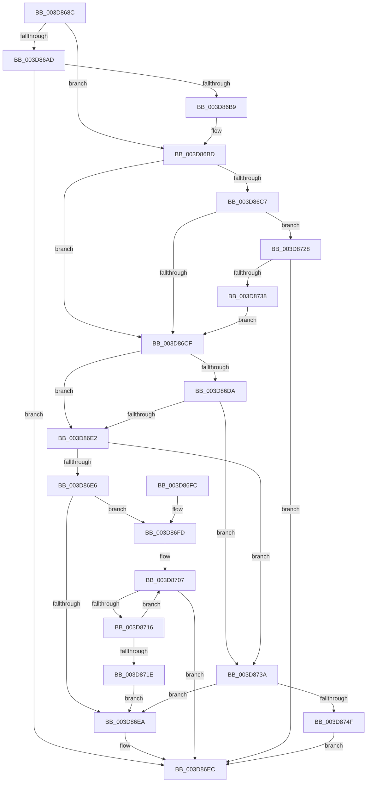

# KiOpDecodeModRM

- RVA: `0x003D868C`–`0x003D8751` (길이 `197` bytes)
- VA: `0x00000001403D868C`
- 실행 섹션: `.text`
- PDB 이름 있음: `예`; PDB Function 태그: `아니요`
- unwind 정보 RVA: `0x00093D00`
- 디코드: `67`개 명령, `197/197` bytes 표시
- 미해석 바이트: `0` (있으면 어셈블리에 `.byte`로 보존)

> 이 문서는 커널 이미지의 기계어와 PDB 기호를 분석해 생성했습니다. 4번과 5번은 함수 원형과 자료형을 바이너리 사용 방식에서 추정한 C 해석이며 원본 소스 복구 결과는 아닙니다.

## 1. Dependencies

- 직접 호출 지점: **4**; 고유 호출 대상: **2**
- 직접 호출자로 확인된 함수: **1**
- RIP 상대 이미지 참조: **0**

### Outgoing calls
- `0x003D86B0` → [KiOpFetchNextByte](KiOpFetchNextByte_function_003D87C0.md) (function, `0x003D87C0`)
- `0x003D870D` → [KiOpFetchNextByte](KiOpFetchNextByte_function_003D87C0.md) (function, `0x003D87C0`)
- `0x003D872F` → [KiOpFetchNextByte](KiOpFetchNextByte_function_003D87C0.md) (function, `0x003D87C0`)
- `0x003D8746` → [KiOpFetchBytes](KiOpFetchBytes_function_003D8778.md) (function, `0x003D8778`)

### Direct callers
- [KiOpDecode](KiOpDecode_function_003D81F0.md) at `0x003D8403`

### Static image references
- 디코드된 RIP-relative 메모리 참조가 없습니다.

## 2. Other-region calls and transfers

- 다른 실행 섹션으로 향하는 call: **0**
- 별도 외부 분기/꼬리 이동을 확인하지 못했습니다.

## 3. Assembly (complete function range)

```asm
003D868C  48 89 5C 24 10                  mov qword ptr [rsp + 0x10], rbx
003D8691  48 89 74 24 18                  mov qword ptr [rsp + 0x18], rsi
003D8696  57                              push rdi
003D8697  48 83 EC 20                     sub rsp, 0x20
003D869B  80 79 50 00                     cmp byte ptr [rcx + 0x50], 0
003D869F  48 8D 79 41                     lea rdi, [rcx + 0x41]
003D86A3  48 8B D9                        mov rbx, rcx
003D86A6  C6 44 24 30 00                  mov byte ptr [rsp + 0x30], 0
003D86AB  75 10                           jne 0x1403d86bd
003D86AD  48 8B D7                        mov rdx, rdi
003D86B0  E8 0B 01 00 00                  call 0x1403d87c0
003D86B5  85 C0                           test eax, eax
003D86B7  78 33                           js 0x1403d86ec
003D86B9  C6 43 50 01                     mov byte ptr [rbx + 0x50], 1
003D86BD  8A 0F                           mov cl, byte ptr [rdi]
003D86BF  8A C1                           mov al, cl
003D86C1  24 C0                           and al, 0xc0
003D86C3  3C C0                           cmp al, 0xc0
003D86C5  74 08                           je 0x1403d86cf
003D86C7  80 E1 07                        and cl, 7
003D86CA  80 F9 04                        cmp cl, 4
003D86CD  74 59                           je 0x1403d8728
003D86CF  8A 0F                           mov cl, byte ptr [rdi]
003D86D1  8A C1                           mov al, cl
003D86D3  C0 E8 06                        shr al, 6
003D86D6  84 C0                           test al, al
003D86D8  75 08                           jne 0x1403d86e2
003D86DA  80 E1 07                        and cl, 7
003D86DD  80 F9 05                        cmp cl, 5
003D86E0  74 58                           je 0x1403d873a
003D86E2  3C 02                           cmp al, 2
003D86E4  74 54                           je 0x1403d873a
003D86E6  3C 01                           cmp al, 1
003D86E8  74 13                           je 0x1403d86fd
003D86EA  33 C0                           xor eax, eax
003D86EC  48 8B 5C 24 38                  mov rbx, qword ptr [rsp + 0x38]
003D86F1  48 8B 74 24 40                  mov rsi, qword ptr [rsp + 0x40]
003D86F6  48 83 C4 20                     add rsp, 0x20
003D86FA  5F                              pop rdi
003D86FB  C3                              ret
003D86FC  CC                              int3
003D86FD  BE 01 00 00 00                  mov esi, 1
003D8702  48 8D 7C 24 30                  lea rdi, [rsp + 0x30]
003D8707  48 8B D7                        mov rdx, rdi
003D870A  48 8B CB                        mov rcx, rbx
003D870D  E8 AE 00 00 00                  call 0x1403d87c0
003D8712  85 C0                           test eax, eax
003D8714  78 D6                           js 0x1403d86ec
003D8716  48 FF C7                        inc rdi
003D8719  83 C6 FF                        add esi, -1
003D871C  75 E9                           jne 0x1403d8707
003D871E  0F BE 44 24 30                  movsx eax, byte ptr [rsp + 0x30]
003D8723  89 43 44                        mov dword ptr [rbx + 0x44], eax
003D8726  EB C2                           jmp 0x1403d86ea
003D8728  48 8D 53 42                     lea rdx, [rbx + 0x42]
003D872C  48 8B CB                        mov rcx, rbx
003D872F  E8 8C 00 00 00                  call 0x1403d87c0
003D8734  85 C0                           test eax, eax
003D8736  78 B4                           js 0x1403d86ec
003D8738  EB 95                           jmp 0x1403d86cf
003D873A  4C 8D 43 44                     lea r8, [rbx + 0x44]
003D873E  BA 04 00 00 00                  mov edx, 4
003D8743  48 8B CB                        mov rcx, rbx
003D8746  E8 2D 00 00 00                  call 0x1403d8778
003D874B  85 C0                           test eax, eax
003D874D  79 9B                           jns 0x1403d86ea
003D874F  EB 9B                           jmp 0x1403d86ec
```

## 4. C-style interpretation (structured pseudocode)

```c
__int64 __fastcall KiOpDecodeModRM(__int64 a1)
{
    __int64 result;
    __int64 v_rdi;
    __int64 v_rsi;
    __int64 v_rsp;
    unsigned __int64 v_stack_p10;
    unsigned __int64 v_stack_p18;
    unsigned __int64 v_stack_p30;
    unsigned __int8 v_stack_p8;

    v_stack_p10 = v_rbx;
    v_stack_p18 = v_rsi;
    v_rsp = (v_rsp) - (32);
    v_stack_p8 = 0;
    if ((*(unsigned __int8 *)(a1 + 80)) != 0) goto loc_003D86BD;
    result = KiOpFetchNextByte(a1, a1 + 65, a3, a4);
    if (sign_flag) goto loc_003D86EC;
    *(unsigned __int8 *)(a1 + 80) = 1;
loc_003D86BD:
    result = (unsigned __int8)(((unsigned __int8)(*(unsigned __int8 *)(a1 + 65))) & (192));
    if (((unsigned __int8)(result)) == 192) goto loc_003D86CF;
    a1 = (unsigned __int8)((*(unsigned __int8 *)(a1 + 65)) & (7));
    if (((unsigned __int8)(a1)) == 4) goto loc_003D8728;
loc_003D86CF:
    result = (unsigned __int8)(((unsigned __int8)(*(unsigned __int8 *)(a1 + 65))) >> (6));
    if ((unsigned __int8)(result) != 0) goto loc_003D86E2;
    a1 = (unsigned __int8)((*(unsigned __int8 *)(a1 + 65)) & (7));
    if (((unsigned __int8)(a1)) == 5) goto loc_003D873A;
loc_003D86E2:
    if (((unsigned __int8)(result)) == 2) goto loc_003D873A;
    if (((unsigned __int8)(result)) == 1) goto loc_003D86FD;
loc_003D86EA:
    result = 0;
loc_003D86EC:
    v_rsp = (v_rsp) + (32);
    return result;
loc_003D86FD:
loc_003D8707:
    result = KiOpFetchNextByte(v_stack_p10, v_stack_p30, a3, a4);
    if (sign_flag) goto loc_003D86EC;
    v_rdi = (v_stack_p30) + 1;
    v_rsi = (unsigned int)((1) + (-1));
    if (condition_is_not_equal) goto loc_003D8707;
    *(unsigned int *)(v_stack_p10 + 68) = (unsigned int)((__int8)(v_stack_p30));
    goto loc_003D86EA;
loc_003D8728:
    result = KiOpFetchNextByte(v_stack_p10, v_stack_p10 + 66, a3, a4);
    if (sign_flag) goto loc_003D86EC;
    goto loc_003D86CF;
loc_003D873A:
    result = KiOpFetchBytes(v_stack_p10, 4, v_stack_p10 + 68, a4);
    if (!sign_flag) goto loc_003D86EA;
    goto loc_003D86EC;
}
```

## 5. (Beta) C Style

```c
int64_t KiOpDecodeModRM(void *Arg1)
{
    uint8_t *arg1 = (uint8_t *)Arg1;

    int64_t result;
    int64_t local_rdi;
    int64_t local_rsi;
    int64_t local_rsp;
    uint64_t v_stack_p10;
    uint64_t v_stack_p18;
    uint64_t v_stack_p30;
    uint8_t v_stack_p8;

    v_stack_p10 = local_rbx;
    v_stack_p18 = local_rsi;
    local_rsp = (local_rsp) - (32);
    v_stack_p8 = 0;
    if ((*(uint8_t *)(arg1 + 0x50)) != 0) goto loc_003D86BD;
    result = KiOpFetchNextByte(Arg1, Arg1 + 65, a3, a4);
    if (sign_flag) goto loc_003D86EC;
    *(uint8_t *)(arg1 + 0x50) = 1;
loc_003D86BD:
    result = (uint8_t)(((uint8_t)(*(uint8_t *)(arg1 + 0x41))) & (192));
    if (((uint8_t)(result)) == 192) goto loc_003D86CF;
    Arg1 = (uint8_t)((*(uint8_t *)(arg1 + 0x41)) & (7));
    if (((uint8_t)(Arg1)) == 4) goto loc_003D8728;
loc_003D86CF:
    result = (uint8_t)(((uint8_t)(*(uint8_t *)(arg1 + 0x41))) >> (6));
    if ((uint8_t)(result) != 0) goto loc_003D86E2;
    Arg1 = (uint8_t)((*(uint8_t *)(arg1 + 0x41)) & (7));
    if (((uint8_t)(Arg1)) == 5) goto loc_003D873A;
loc_003D86E2:
    if (((uint8_t)(result)) == 2) goto loc_003D873A;
    if (((uint8_t)(result)) == 1) goto loc_003D86FD;
loc_003D86EA:
    result = 0;
loc_003D86EC:
    local_rsp = (local_rsp) + (32);
    return result;
loc_003D86FD:
loc_003D8707:
    result = KiOpFetchNextByte(v_stack_p10, v_stack_p30, a3, a4);
    if (sign_flag) goto loc_003D86EC;
    local_rdi = (v_stack_p30) + 1;
    local_rsi = (uint32_t)((1) + (-1));
    if (condition_is_not_equal) goto loc_003D8707;
    *(uint32_t *)(v_stack_p10 + 0x44) = (uint32_t)((int8_t)(v_stack_p30));
    goto loc_003D86EA;
loc_003D8728:
    result = KiOpFetchNextByte(v_stack_p10, v_stack_p10 + 66, a3, a4);
    if (sign_flag) goto loc_003D86EC;
    goto loc_003D86CF;
loc_003D873A:
    result = KiOpFetchBytes(v_stack_p10, 4, v_stack_p10 + 68, a4);
    if (!sign_flag) goto loc_003D86EA;
    goto loc_003D86EC;
}
```

### 관측된 메모리 오프셋

구조체 형식이 확인되지 않은 접근은 인자 기준의 오프셋으로만 기록했습니다.

| 기준 인자 | 오프셋 표현 | 폭 (bit) | 접근 |
|---|---:|---:|---|
| `Arg1` | `+ 0x0` | `8` | `R` |
| `Arg1` | `+ 0x41` | `64` | `R` |
| `Arg1` | `+ 0x42` | `64` | `R` |
| `Arg1` | `+ 0x44` | `32` | `W` |
| `Arg1` | `+ 0x44` | `64` | `R` |
| `Arg1` | `+ 0x50` | `8` | `R` |
| `Arg1` | `+ 0x50` | `8` | `W` |

## 6. Execution-region graph

[열기: 2D/3D 그래프와 함수 탐색 컨트롤 패널](../../../control-panel.html?section=text&rva=0x003D868C&view=graph)

- 2D 그래프는 위에서 아래로 흐르고, 3D 그래프는 빈 공간을 드래그해 회전합니다. Shift+드래그는 이동, 휠은 확대·축소, 함수 노드 선택은 대상 보고서 이동입니다.

### Static fallback


