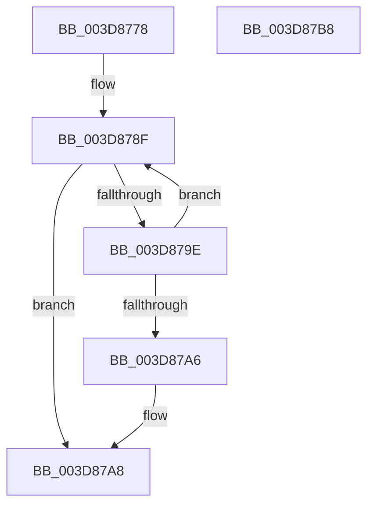

# KiOpFetchBytes

- RVA: `0x003D8778`–`0x003D87B9` (길이 `65` bytes)
- VA: `0x00000001403D8778`
- 실행 섹션: `.text`
- PDB 이름 있음: `예`; PDB Function 태그: `아니요`
- unwind 정보 RVA: `0x00060BC4`
- 디코드: `22`개 명령, `65/65` bytes 표시
- 미해석 바이트: `0` (있으면 어셈블리에 `.byte`로 보존)

> 이 문서는 커널 이미지의 기계어와 PDB 기호를 분석해 생성했습니다. 4번과 5번은 함수 원형과 자료형을 바이너리 사용 방식에서 추정한 C 해석이며 원본 소스 복구 결과는 아닙니다.

## 1. Dependencies

- 직접 호출 지점: **1**; 고유 호출 대상: **1**
- 직접 호출자로 확인된 함수: **3**
- RIP 상대 이미지 참조: **0**

### Outgoing calls
- `0x003D8795` → [KiOpFetchNextByte](KiOpFetchNextByte_function_003D87C0.md) (function, `0x003D87C0`)

### Direct callers
- [KiOpDecode](KiOpDecode_function_003D81F0.md) at `0x003D859A`
- [KiOpDecodeModRM](KiOpDecodeModRM_function_003D868C.md) at `0x003D8746`
- [sub_006E9980](../6E/Unknown_function_006E9980.md) at `0x006E9997`

### Static image references
- 디코드된 RIP-relative 메모리 참조가 없습니다.

## 2. Other-region calls and transfers

- 다른 실행 섹션으로 향하는 call: **0**
- 별도 외부 분기/꼬리 이동을 확인하지 못했습니다.

## 3. Assembly (complete function range)

```asm
003D8778  48 89 5C 24 08                  mov qword ptr [rsp + 8], rbx
003D877D  48 89 74 24 10                  mov qword ptr [rsp + 0x10], rsi
003D8782  57                              push rdi
003D8783  48 83 EC 20                     sub rsp, 0x20
003D8787  49 8B D8                        mov rbx, r8
003D878A  8B FA                           mov edi, edx
003D878C  48 8B F1                        mov rsi, rcx
003D878F  48 8B D3                        mov rdx, rbx
003D8792  48 8B CE                        mov rcx, rsi
003D8795  E8 26 00 00 00                  call 0x1403d87c0
003D879A  85 C0                           test eax, eax
003D879C  78 0A                           js 0x1403d87a8
003D879E  48 FF C3                        inc rbx
003D87A1  83 C7 FF                        add edi, -1
003D87A4  75 E9                           jne 0x1403d878f
003D87A6  33 C0                           xor eax, eax
003D87A8  48 8B 5C 24 30                  mov rbx, qword ptr [rsp + 0x30]
003D87AD  48 8B 74 24 38                  mov rsi, qword ptr [rsp + 0x38]
003D87B2  48 83 C4 20                     add rsp, 0x20
003D87B6  5F                              pop rdi
003D87B7  C3                              ret
003D87B8  CC                              int3
```

## 4. C-style interpretation (structured pseudocode)

```c
__int64 __fastcall KiOpFetchBytes(__int64 a1, int a2, __int64 a3)
{
    __int64 result;
    __int64 v_rbx;
    __int64 v_rdi;
    __int64 v_rsp;
    unsigned __int64 v_stack_p10;
    unsigned __int64 v_stack_p8;

    v_stack_p8 = v_rbx;
    v_stack_p10 = v_rsi;
    v_rsp = (v_rsp) - (32);
loc_003D878F:
    result = KiOpFetchNextByte(a1, a3, a3, a4);
    if (sign_flag) goto loc_003D87A8;
    v_rbx = (a3) + 1;
    v_rdi = (unsigned int)(((unsigned int)(a2)) + (-1));
    if (condition_is_not_equal) goto loc_003D878F;
    result = 0;
loc_003D87A8:
    v_rsp = (v_rsp) + (32);
    return result;
}
```

## 5. (Beta) C Style

```c
int64_t KiOpFetchBytes(int64_t Arg1, int32_t Arg2, int64_t Arg3)
{
    int64_t result;
    int64_t local_rbx;
    int64_t local_rdi;
    int64_t local_rsp;
    uint64_t v_stack_p10;
    uint64_t v_stack_p8;

    v_stack_p8 = local_rbx;
    v_stack_p10 = local_rsi;
    local_rsp = (local_rsp) - (32);
loc_003D878F:
    result = KiOpFetchNextByte(Arg1, Arg3, Arg3, a4);
    if (sign_flag) goto loc_003D87A8;
    local_rbx = (Arg3) + 1;
    local_rdi = (uint32_t)(((uint32_t)(Arg2)) + (-1));
    if (condition_is_not_equal) goto loc_003D878F;
    result = 0;
loc_003D87A8:
    local_rsp = (local_rsp) + (32);
    return result;
}
```

## 6. Execution-region graph

[열기: 2D/3D 그래프와 함수 탐색 컨트롤 패널](../../../control-panel.html?section=text&rva=0x003D8778&view=graph)

- 2D 그래프는 위에서 아래로 흐르고, 3D 그래프는 빈 공간을 드래그해 회전합니다. Shift+드래그는 이동, 휠은 확대·축소, 함수 노드 선택은 대상 보고서 이동입니다.

### Static fallback


