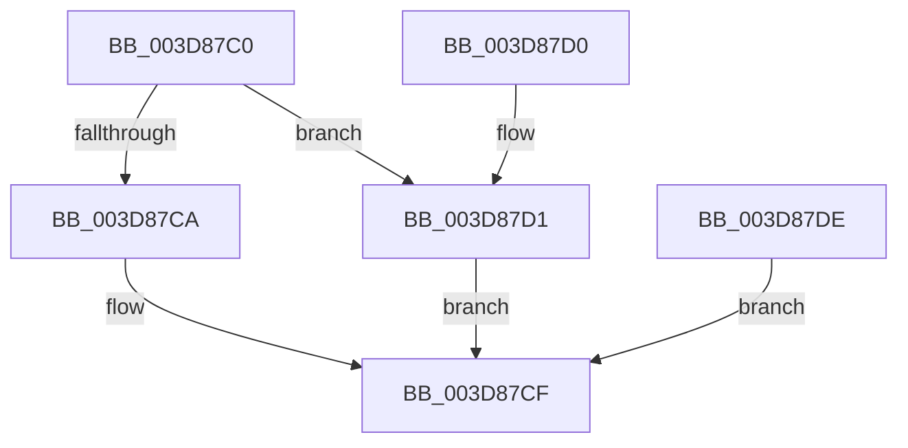

# KiOpFetchNextByte

- RVA: `0x003D87C0`–`0x003D87E0` (길이 `32` bytes)
- VA: `0x00000001403D87C0`
- 실행 섹션: `.text`
- PDB 이름 있음: `예`; PDB Function 태그: `아니요`
- unwind 정보 RVA: `0x00093D14`
- 디코드: `12`개 명령, `32/32` bytes 표시
- 미해석 바이트: `0` (있으면 어셈블리에 `.byte`로 보존)

> 이 문서는 커널 이미지의 기계어와 PDB 기호를 분석해 생성했습니다. 4번과 5번은 함수 원형과 자료형을 바이너리 사용 방식에서 추정한 C 해석이며 원본 소스 복구 결과는 아닙니다.

## 1. Dependencies

- 직접 호출 지점: **0**; 고유 호출 대상: **0**
- 직접 호출자로 확인된 함수: **3**
- RIP 상대 이미지 참조: **0**

### Outgoing calls
- 직접 디코드된 call 명령이 없습니다.

### Direct callers
- [KiOpDecode](KiOpDecode_function_003D81F0.md) at `0x003D82A9`
- [KiOpDecode](KiOpDecode_function_003D81F0.md) at `0x003D848B`
- [KiOpDecode](KiOpDecode_function_003D81F0.md) at `0x003D84B6`
- [KiOpDecode](KiOpDecode_function_003D81F0.md) at `0x003D8548`
- [KiOpDecodeModRM](KiOpDecodeModRM_function_003D868C.md) at `0x003D86B0`
- [KiOpDecodeModRM](KiOpDecodeModRM_function_003D868C.md) at `0x003D870D`
- [KiOpDecodeModRM](KiOpDecodeModRM_function_003D868C.md) at `0x003D872F`
- [KiOpFetchBytes](KiOpFetchBytes_function_003D8778.md) at `0x003D8795`

### Static image references
- 디코드된 RIP-relative 메모리 참조가 없습니다.

## 2. Other-region calls and transfers

- 다른 실행 섹션으로 향하는 call: **0**
- 별도 외부 분기/꼬리 이동을 확인하지 못했습니다.

## 3. Assembly (complete function range)

```asm
003D87C0  48 8B 41 10                     mov rax, qword ptr [rcx + 0x10]
003D87C4  48 3B 41 08                     cmp rax, qword ptr [rcx + 8]
003D87C8  75 07                           jne 0x1403d87d1
003D87CA  B8 01 00 00 C0                  mov eax, 0xc0000001
003D87CF  C3                              ret
003D87D0  CC                              int3
003D87D1  0F B6 00                        movzx eax, byte ptr [rax]
003D87D4  88 02                           mov byte ptr [rdx], al
003D87D6  48 FF 41 10                     inc qword ptr [rcx + 0x10]
003D87DA  33 C0                           xor eax, eax
003D87DC  EB F1                           jmp 0x1403d87cf
003D87DE  EB EF                           jmp 0x1403d87cf
```

## 4. C-style interpretation (structured pseudocode)

```c
__int64 __fastcall KiOpFetchNextByte(__int64 a1, __int64 a2)
{
    __int64 result;

    if ((*(unsigned __int64 *)(a1 + 16)) != (*(unsigned __int64 *)(a1 + 8))) goto loc_003D87D1;
loc_003D87CF:
    return (unsigned int)(0xC0000001ULL);
loc_003D87D1:
    *(unsigned __int8 *)(a2) = (unsigned __int8)(*(unsigned __int8 *)((unsigned int)(0xC0000001ULL)));
    result = 0;
    goto loc_003D87CF;
}
```

## 5. (Beta) C Style

```c
int64_t KiOpFetchNextByte(void *Arg1, void *Arg2)
{
    uint8_t *arg1 = (uint8_t *)Arg1;
    uint8_t *arg2 = (uint8_t *)Arg2;

    int64_t result;

    if ((*(uint64_t *)(arg1 + 0x10)) != (*(uint64_t *)(arg1 + 0x8))) goto loc_003D87D1;
loc_003D87CF:
    return (uint32_t)(0xC0000001ULL);
loc_003D87D1:
    *(uint8_t *)(arg2) = (uint8_t)(*(uint8_t *)((uint32_t)(0xC0000001ULL)));
    result = 0;
    goto loc_003D87CF;
}
```

### 관측된 메모리 오프셋

구조체 형식이 확인되지 않은 접근은 인자 기준의 오프셋으로만 기록했습니다.

| 기준 인자 | 오프셋 표현 | 폭 (bit) | 접근 |
|---|---:|---:|---|
| `Arg1` | `+ 0x8` | `64` | `R` |
| `Arg1` | `+ 0x10` | `64` | `R` |
| `Arg1` | `+ 0x10` | `64` | `R/W` |
| `Arg2` | `+ 0x0` | `8` | `W` |

## 6. Execution-region graph

[열기: 2D/3D 그래프와 함수 탐색 컨트롤 패널](../../../control-panel.html?section=text&rva=0x003D87C0&view=graph)

- 2D 그래프는 위에서 아래로 흐르고, 3D 그래프는 빈 공간을 드래그해 회전합니다. Shift+드래그는 이동, 휠은 확대·축소, 함수 노드 선택은 대상 보고서 이동입니다.

### Static fallback


