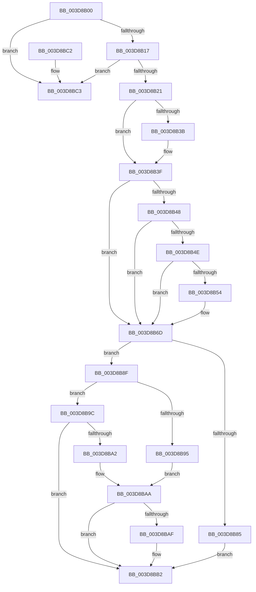

# KiOpPreprocessSecureFault

- RVA: `0x003D8B00`–`0x003D8BE0` (길이 `224` bytes)
- VA: `0x00000001403D8B00`
- 실행 섹션: `.text`
- PDB 이름 있음: `예`; PDB Function 태그: `아니요`
- unwind 정보 RVA: `0x00093D74`
- 디코드: `59`개 명령, `224/224` bytes 표시
- 미해석 바이트: `0` (있으면 어셈블리에 `.byte`로 보존)

> 이 문서는 커널 이미지의 기계어와 PDB 기호를 분석해 생성했습니다. 4번과 5번은 함수 원형과 자료형을 바이너리 사용 방식에서 추정한 C 해석이며 원본 소스 복구 결과는 아닙니다.

## 1. Dependencies

- 직접 호출 지점: **2**; 고유 호출 대상: **1**
- 직접 호출자로 확인된 함수: **1**
- RIP 상대 이미지 참조: **1**

### Outgoing calls
- `0x003D8B67` → [KeBugCheckEx](../4F/KeBugCheckEx_function_004FD660.md) (function, `0x004FD660`)
- `0x003D8BDA` → [KeBugCheckEx](../4F/KeBugCheckEx_function_004FD660.md) (function, `0x004FD660`)

### Direct callers
- [KiPreprocessFault](KiPreprocessFault_function_003D7E70.md) at `0x003D80F4`

### Static image references
- `0x003D8B06` → RVA `0x01201860` (`CFGRO`; read)

## 2. Other-region calls and transfers

- 다른 실행 섹션으로 향하는 call: **0**
- 별도 외부 분기/꼬리 이동을 확인하지 못했습니다.

## 3. Assembly (complete function range)

```asm
003D8B00  40 53                           push rbx
003D8B02  48 83 EC 30                     sub rsp, 0x30
003D8B06  48 83 3D 52 8D E2 00 00         cmp qword ptr [rip + 0xe28d52], 0
003D8B0E  4C 8B D2                        mov r10, rdx
003D8B11  0F 84 AC 00 00 00               je 0x1403d8bc3
003D8B17  83 79 18 03                     cmp dword ptr [rcx + 0x18], 3
003D8B1B  0F 85 A2 00 00 00               jne 0x1403d8bc3
003D8B21  65 4C 8B 0C 25 20 00 00 00      mov r9, qword ptr gs:[0x20]
003D8B2A  48 8B 41 20                     mov rax, qword ptr [rcx + 0x20]
003D8B2E  48 8B 59 28                     mov rbx, qword ptr [rcx + 0x28]
003D8B32  4C 8B 59 30                     mov r11, qword ptr [rcx + 0x30]
003D8B36  4D 85 C0                        test r8, r8
003D8B39  74 04                           je 0x1403d8b3f
003D8B3B  49 83 08 FF                     or qword ptr [r8], 0xffffffffffffffff
003D8B3F  48 8B D0                        mov rdx, rax
003D8B42  48 83 EA 01                     sub rdx, 1
003D8B46  74 25                           je 0x1403d8b6d
003D8B48  48 83 EA 01                     sub rdx, 1
003D8B4C  74 1F                           je 0x1403d8b6d
003D8B4E  48 83 FA 02                     cmp rdx, 2
003D8B52  74 19                           je 0x1403d8b6d
003D8B54  4C 8B C9                        mov r9, rcx
003D8B57  4C 89 54 24 20                  mov qword ptr [rsp + 0x20], r10
003D8B5C  B9 8D 01 00 00                  mov ecx, 0x18d
003D8B61  4C 8B C3                        mov r8, rbx
003D8B64  48 8B D0                        mov rdx, rax
003D8B67  E8 F4 4A 12 00                  call 0x1404fd660
003D8B6C  CC                              int3
003D8B6D  48 83 61 30 00                  and qword ptr [rcx + 0x30], 0
003D8B72  C7 01 04 00 00 10               mov dword ptr [rcx], 0x10000004
003D8B78  C7 41 18 02 00 00 00            mov dword ptr [rcx + 0x18], 2
003D8B7F  48 83 F8 01                     cmp rax, 1
003D8B83  75 0A                           jne 0x1403d8b8f
003D8B85  48 C7 41 20 08 00 00 00         mov qword ptr [rcx + 0x20], 8
003D8B8D  EB 23                           jmp 0x1403d8bb2
003D8B8F  48 83 F8 02                     cmp rax, 2
003D8B93  75 07                           jne 0x1403d8b9c
003D8B95  48 83 61 20 00                  and qword ptr [rcx + 0x20], 0
003D8B9A  EB 0E                           jmp 0x1403d8baa
003D8B9C  48 83 F8 04                     cmp rax, 4
003D8BA0  75 10                           jne 0x1403d8bb2
003D8BA2  48 C7 41 20 01 00 00 00         mov qword ptr [rcx + 0x20], 1
003D8BAA  4D 85 C0                        test r8, r8
003D8BAD  74 03                           je 0x1403d8bb2
003D8BAF  4D 89 18                        mov qword ptr [r8], r11
003D8BB2  F0 49 FF 81 08 87 00 00         lock inc qword ptr [r9 + 0x8708]
003D8BBA  32 C0                           xor al, al
003D8BBC  48 83 C4 30                     add rsp, 0x30
003D8BC0  5B                              pop rbx
003D8BC1  C3                              ret
003D8BC2  CC                              int3
003D8BC3  48 8B 41 20                     mov rax, qword ptr [rcx + 0x20]
003D8BC7  BA 04 00 00 00                  mov edx, 4
003D8BCC  4C 8B C1                        mov r8, rcx
003D8BCF  48 89 44 24 20                  mov qword ptr [rsp + 0x20], rax
003D8BD4  4D 8B CA                        mov r9, r10
003D8BD7  8D 4A 0E                        lea ecx, [rdx + 0xe]
003D8BDA  E8 81 4A 12 00                  call 0x1404fd660
003D8BDF  CC                              int3
```

## 4. C-style interpretation (structured pseudocode)

```c
__int64 __fastcall KiOpPreprocessSecureFault(__int64 a1, __int64 a2, __int64 a3)
{
    __int64 result;
    __int64 v_rsp;
    unsigned __int64 v_stack_m18;
    unsigned __int64 v_stack_p20;

    v_rsp = (v_rsp) - (48);
    if ((*(unsigned __int64 *)(v_rip + 14847314)) == 0) goto loc_003D8BC3;
    if ((*(unsigned int *)(a1 + 24)) != 3) goto loc_003D8BC3;
    if (a3 != 0) {
    }
    a2 = (*(unsigned __int64 *)(a1 + 32)) - (1);
    if (condition_is_equal) goto loc_003D8B6D;
    a2 = (a2) - (1);
    if (condition_is_equal) goto loc_003D8B6D;
    result = *(unsigned __int64 *)(a1 + 32);
    if (a2 != 2) {
        a4 = a1;
        v_stack_m18 = a2;
        a1 = 397;
        a3 = *(unsigned __int64 *)(a1 + 40);
        a2 = *(unsigned __int64 *)(a1 + 32);
        result = KeBugCheckEx(a1, a2, a3, a4);
    }
    *(unsigned int *)(a1) = 0x10000004ULL;
    *(unsigned int *)(a1 + 24) = 2;
    if (result != 1) goto loc_003D8B8F;
    *(unsigned __int64 *)(a1 + 32) = 8;
    goto loc_003D8BB2;
loc_003D8B8F:
    if (result != 2) goto loc_003D8B9C;
    goto loc_003D8BAA;
loc_003D8B9C:
    if (result != 4) goto loc_003D8BB2;
    *(unsigned __int64 *)(a1 + 32) = 1;
loc_003D8BAA:
    if (a3 != 0) {
        *(unsigned __int64 *)(a3) = *(unsigned __int64 *)(a1 + 48);
    }
    result = 0;
    v_rsp = (v_rsp) + (48);
    return result;
loc_003D8BC3:
    v_stack_p20 = *(unsigned __int64 *)(a1 + 32);
    result = KeBugCheckEx(4 + 14, 4, a1, a2);
    return result;
}
```

## 5. (Beta) C Style

```c
int64_t KiOpPreprocessSecureFault(void *Arg1, int64_t Arg2, int64_t Arg3)
{
    uint8_t *arg1 = (uint8_t *)Arg1;

    int64_t result;
    int64_t local_rsp;
    uint64_t v_stack_m18;
    uint64_t v_stack_p20;

    local_rsp = (local_rsp) - (48);
    if ((*(uint64_t *)(v_rip + 0xE28D52)) == 0) goto loc_003D8BC3;
    if ((*(uint32_t *)(arg1 + 0x18)) != 3) goto loc_003D8BC3;
    if (Arg3 != 0) {
    }
    Arg2 = (*(uint64_t *)(arg1 + 0x20)) - (1);
    if (condition_is_equal) goto loc_003D8B6D;
    Arg2 = (Arg2) - (1);
    if (condition_is_equal) goto loc_003D8B6D;
    result = *(uint64_t *)(arg1 + 0x20);
    if (Arg2 != 2) {
        a4 = Arg1;
        v_stack_m18 = Arg2;
        Arg1 = 397;
        Arg3 = *(uint64_t *)(arg1 + 0x28);
        Arg2 = *(uint64_t *)(arg1 + 0x20);
        result = KeBugCheckEx(Arg1, Arg2, Arg3, a4);
    }
    *(uint32_t *)(arg1) = 0x10000004ULL;
    *(uint32_t *)(arg1 + 0x18) = 2;
    if (result != 1) goto loc_003D8B8F;
    *(uint64_t *)(arg1 + 0x20) = 8;
    goto loc_003D8BB2;
loc_003D8B8F:
    if (result != 2) goto loc_003D8B9C;
    goto loc_003D8BAA;
loc_003D8B9C:
    if (result != 4) goto loc_003D8BB2;
    *(uint64_t *)(arg1 + 0x20) = 1;
loc_003D8BAA:
    if (Arg3 != 0) {
        *(uint64_t *)(Arg3) = *(uint64_t *)(arg1 + 0x30);
    }
    result = 0;
    local_rsp = (local_rsp) + (48);
    return result;
loc_003D8BC3:
    v_stack_p20 = *(uint64_t *)(arg1 + 0x20);
    result = KeBugCheckEx(4 + 14, 4, Arg1, Arg2);
    return result;
}
```

### 관측된 메모리 오프셋

구조체 형식이 확인되지 않은 접근은 인자 기준의 오프셋으로만 기록했습니다.

| 기준 인자 | 오프셋 표현 | 폭 (bit) | 접근 |
|---|---:|---:|---|
| `Arg1` | `+ 0x18` | `32` | `R` |
| `Arg1` | `+ 0x20` | `64` | `R` |
| `Arg1` | `+ 0x28` | `64` | `R` |
| `Arg1` | `+ 0x30` | `64` | `R` |

## 6. Execution-region graph

[열기: 2D/3D 그래프와 함수 탐색 컨트롤 패널](../../../control-panel.html?section=text&rva=0x003D8B00&view=graph)

- 2D 그래프는 위에서 아래로 흐르고, 3D 그래프는 빈 공간을 드래그해 회전합니다. Shift+드래그는 이동, 휠은 확대·축소, 함수 노드 선택은 대상 보고서 이동입니다.

### Static fallback


