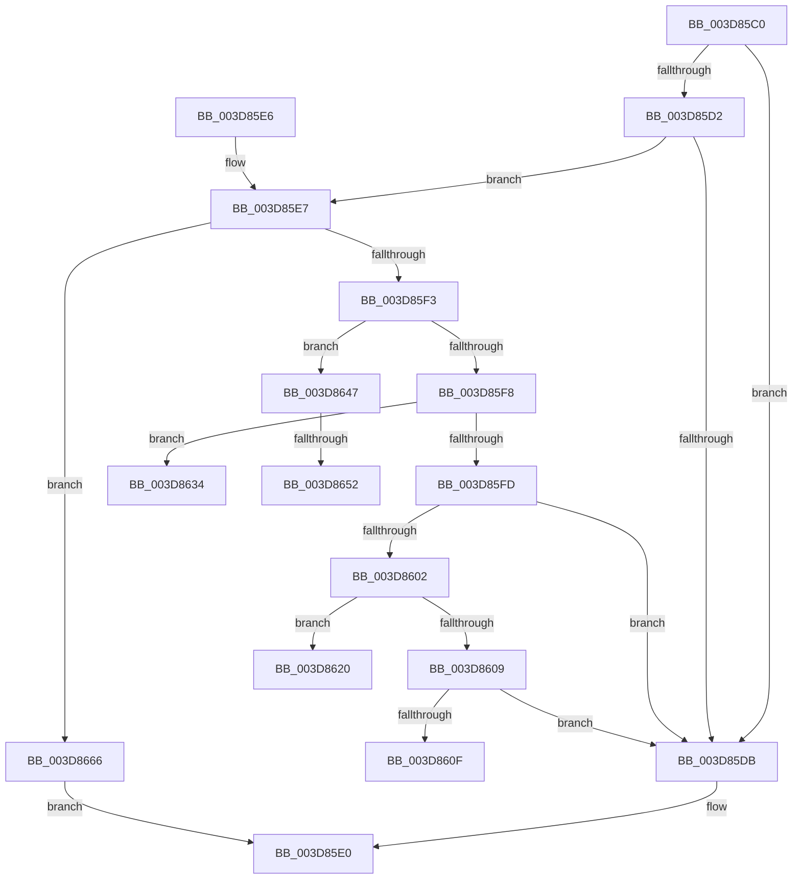

# KiOp_Mov

- RVA: `0x003D85C0`–`0x003D8684` (길이 `196` bytes)
- VA: `0x00000001403D85C0`
- 실행 섹션: `.text`
- PDB 이름 있음: `예`; PDB Function 태그: `예`
- unwind 정보 RVA: `0x00093CE4`
- 디코드: `53`개 명령, `196/196` bytes 표시
- 미해석 바이트: `0` (있으면 어셈블리에 `.byte`로 보존)

> 이 문서는 커널 이미지의 기계어와 PDB 기호를 분석해 생성했습니다. 4번과 5번은 함수 원형과 자료형을 바이너리 사용 방식에서 추정한 C 해석이며 원본 소스 복구 결과는 아닙니다.

## 1. Dependencies

- 직접 호출 지점: **1**; 고유 호출 대상: **1**
- 직접 호출자로 확인된 함수: **1**
- RIP 상대 이미지 참조: **0**

### Outgoing calls
- `0x003D867A` → [KiOpPciConfigSpaceAccessCommon](../5C/KiOpPciConfigSpaceAccessCommon_function_005C6AAC.md) (function, `0x005C6AAC`)

### Direct callers
- [KiPreprocessFault](KiPreprocessFault_function_003D7E70.md) at `0x003D7F6A`

### Static image references
- 디코드된 RIP-relative 메모리 참조가 없습니다.

## 2. Other-region calls and transfers

- 다른 실행 섹션으로 향하는 call: **0**
- call이 아닌 외부 분기/꼬리 이동: **5**
  - `0x003D861B` → [sub_006E99B2](../6E/Unknown_function_006E99B2.md) (`tail-transfer`)
  - `0x003D862F` → [sub_006E99B2](../6E/Unknown_function_006E99B2.md) (`tail-transfer`)
  - `0x003D8642` → [sub_006E99B2](../6E/Unknown_function_006E99B2.md) (`tail-transfer`)
  - `0x003D864C` → [sub_006E99B2 + 0x22](../6E/Unknown_function_006E99B2.md) (`tail-transfer`)
  - `0x003D8661` → [sub_006E99B2 + 0x18](../6E/Unknown_function_006E99B2.md) (`tail-transfer`)

## 3. Assembly (complete function range)

```asm
003D85C0  40 55                           push rbp
003D85C2  48 8B EC                        mov rbp, rsp
003D85C5  48 83 EC 20                     sub rsp, 0x20
003D85C9  45 33 C0                        xor r8d, r8d
003D85CC  44 38 41 51                     cmp byte ptr [rcx + 0x51], r8b
003D85D0  75 09                           jne 0x1403d85db
003D85D2  F7 41 3C 00 00 00 02            test dword ptr [rcx + 0x3c], 0x2000000
003D85D9  75 0C                           jne 0x1403d85e7
003D85DB  B8 BB 00 00 C0                  mov eax, 0xc00000bb
003D85E0  48 83 C4 20                     add rsp, 0x20
003D85E4  5D                              pop rbp
003D85E5  C3                              ret
003D85E6  CC                              int3
003D85E7  0F B6 51 38                     movzx edx, byte ptr [rcx + 0x38]
003D85EB  81 EA 88 00 00 00               sub edx, 0x88
003D85F1  74 73                           je 0x1403d8666
003D85F3  83 EA 01                        sub edx, 1
003D85F6  74 4F                           je 0x1403d8647
003D85F8  83 EA 01                        sub edx, 1
003D85FB  74 37                           je 0x1403d8634
003D85FD  83 FA 01                        cmp edx, 1
003D8600  75 D9                           jne 0x1403d85db
003D8602  8B 41 30                        mov eax, dword ptr [rcx + 0x30]
003D8605  A8 40                           test al, 0x40
003D8607  75 17                           jne 0x1403d8620
003D8609  F6 41 40 08                     test byte ptr [rcx + 0x40], 8
003D860D  75 CC                           jne 0x1403d85db
003D860F  44 89 45 10                     mov dword ptr [rbp + 0x10], r8d
003D8613  4C 8D 4D 10                     lea r9, [rbp + 0x10]
003D8617  44 8D 42 03                     lea r8d, [rdx + 3]
003D861B  E9 92 13 31 00                  jmp 0x1406e99b2
003D8620  66 44 89 45 10                  mov word ptr [rbp + 0x10], r8w
003D8625  4C 8D 4D 10                     lea r9, [rbp + 0x10]
003D8629  41 B8 02 00 00 00               mov r8d, 2
003D862F  E9 7E 13 31 00                  jmp 0x1406e99b2
003D8634  44 88 45 10                     mov byte ptr [rbp + 0x10], r8b
003D8638  4C 8D 4D 10                     lea r9, [rbp + 0x10]
003D863C  41 B8 01 00 00 00               mov r8d, 1
003D8642  E9 6B 13 31 00                  jmp 0x1406e99b2
003D8647  8B 41 30                        mov eax, dword ptr [rcx + 0x30]
003D864A  A8 40                           test al, 0x40
003D864C  0F 84 82 13 31 00               je 0x1406e99d4
003D8652  66 44 89 45 10                  mov word ptr [rbp + 0x10], r8w
003D8657  4C 8D 4D 10                     lea r9, [rbp + 0x10]
003D865B  41 B8 02 00 00 00               mov r8d, 2
003D8661  E9 64 13 31 00                  jmp 0x1406e99ca
003D8666  44 88 45 10                     mov byte ptr [rbp + 0x10], r8b
003D866A  4C 8D 4D 10                     lea r9, [rbp + 0x10]
003D866E  41 B8 01 00 00 00               mov r8d, 1
003D8674  48 8B D1                        mov rdx, rcx
003D8677  41 8A C8                        mov cl, r8b
003D867A  E8 2D E4 1E 00                  call 0x1405c6aac
003D867F  E9 5C FF FF FF                  jmp 0x1403d85e0
```

## 4. C-style interpretation (structured pseudocode)

```c
__int64 __fastcall KiOp_Mov(__int64 a1, __int64 a2, int a3)
{
    __int64 result;
    __int64 v_rsp;
    unsigned int v_stack_p8;

    v_rsp = (v_rsp) - (32);
    a3 = 0;
    if ((*(unsigned __int8 *)(a1 + 81)) != 0) goto loc_003D85DB;
    if (((*(unsigned int *)(a1 + 60)) & (0x2000000ULL)) != 0) goto loc_003D85E7;
loc_003D85DB:
loc_003D85E0:
    v_rsp = (v_rsp) + (32);
    return (unsigned int)(0xC00000BBULL);
loc_003D85E7:
    a2 = (unsigned int)((*(unsigned __int8 *)(a1 + 56)) - (136));
    if (condition_is_equal) goto loc_003D8666;
    a2 = (unsigned int)((a2) - (1));
    if (condition_is_equal) goto loc_003D8647;
    a2 = (unsigned int)((a2) - (1));
    if (condition_is_equal) goto loc_003D8634;
    if (((unsigned int)(a2)) != 1) goto loc_003D85DB;
    if ((((unsigned __int8)((unsigned int)(*(unsigned int *)(a1 + 48)))) & (64)) != 0) goto loc_003D8620;
    if (((*(unsigned __int8 *)(a1 + 64)) & (8)) != 0) goto loc_003D85DB;
    v_stack_p8 = 0;
loc_003D8620:
    v_stack_p8 = (unsigned __int16)(a2 + 3);
loc_003D8634:
    v_stack_p8 = 2;
loc_003D8647:
    v_stack_p8 = 1;
loc_003D8666:
    v_stack_p8 = 2;
    result = KiOpPciConfigSpaceAccessCommon(1, a1, 1, v_stack_p8);
    goto loc_003D85E0;
}
```

## 5. (Beta) C Style

```c
int64_t KiOp_Mov(void *Arg1, int64_t Arg2, int32_t Arg3)
{
    uint8_t *arg1 = (uint8_t *)Arg1;

    int64_t result;
    int64_t local_rsp;
    uint32_t v_stack_p8;

    local_rsp = (local_rsp) - (32);
    Arg3 = 0;
    if ((*(uint8_t *)(arg1 + 0x51)) != 0) goto loc_003D85DB;
    if (((*(uint32_t *)(arg1 + 0x3C)) & (0x2000000ULL)) != 0) goto loc_003D85E7;
loc_003D85DB:
loc_003D85E0:
    local_rsp = (local_rsp) + (32);
    return (uint32_t)(0xC00000BBULL);
loc_003D85E7:
    Arg2 = (uint32_t)((*(uint8_t *)(arg1 + 0x38)) - (136));
    if (condition_is_equal) goto loc_003D8666;
    Arg2 = (uint32_t)((Arg2) - (1));
    if (condition_is_equal) goto loc_003D8647;
    Arg2 = (uint32_t)((Arg2) - (1));
    if (condition_is_equal) goto loc_003D8634;
    if (((uint32_t)(Arg2)) != 1) goto loc_003D85DB;
    if ((((uint8_t)((uint32_t)(*(uint32_t *)(arg1 + 0x30)))) & (64)) != 0) goto loc_003D8620;
    if (((*(uint8_t *)(arg1 + 0x40)) & (8)) != 0) goto loc_003D85DB;
    v_stack_p8 = 0;
loc_003D8620:
    v_stack_p8 = (uint16_t)(Arg2 + 3);
loc_003D8634:
    v_stack_p8 = 2;
loc_003D8647:
    v_stack_p8 = 1;
loc_003D8666:
    v_stack_p8 = 2;
    result = KiOpPciConfigSpaceAccessCommon(1, Arg1, 1, v_stack_p8);
    goto loc_003D85E0;
}
```

### 관측된 메모리 오프셋

구조체 형식이 확인되지 않은 접근은 인자 기준의 오프셋으로만 기록했습니다.

| 기준 인자 | 오프셋 표현 | 폭 (bit) | 접근 |
|---|---:|---:|---|
| `Arg1` | `+ 0x30` | `32` | `R` |
| `Arg1` | `+ 0x38` | `8` | `R` |
| `Arg1` | `+ 0x3C` | `32` | `R` |
| `Arg1` | `+ 0x40` | `8` | `R` |
| `Arg1` | `+ 0x51` | `8` | `R` |

## 6. Execution-region graph

[열기: 2D/3D 그래프와 함수 탐색 컨트롤 패널](../../../control-panel.html?section=text&rva=0x003D85C0&view=graph)

- 2D 그래프는 위에서 아래로 흐르고, 3D 그래프는 빈 공간을 드래그해 회전합니다. Shift+드래그는 이동, 휠은 확대·축소, 함수 노드 선택은 대상 보고서 이동입니다.

### Static fallback


