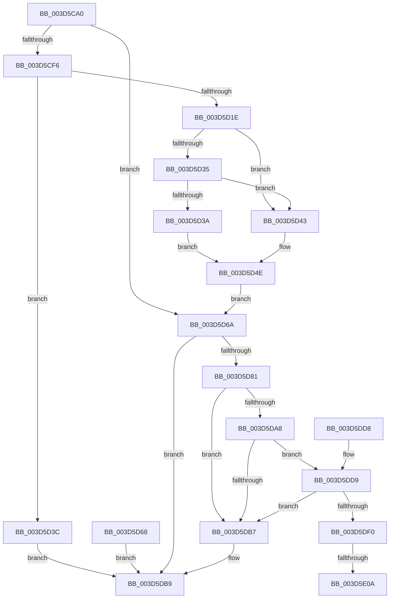

# KiRaiseException

- RVA: `0x003D5CA0`–`0x003D5E17` (길이 `375` bytes)
- VA: `0x00000001403D5CA0`
- 실행 섹션: `.text`
- PDB 이름 있음: `예`; PDB Function 태그: `예`
- unwind 정보 RVA: `0x00093A84`
- 디코드: `98`개 명령, `375/375` bytes 표시
- 미해석 바이트: `0` (있으면 어셈블리에 `.byte`로 보존)

> 이 문서는 커널 이미지의 기계어와 PDB 기호를 분석해 생성했습니다. 4번과 5번은 함수 원형과 자료형을 바이너리 사용 방식에서 추정한 C 해석이며 원본 소스 복구 결과는 아닙니다.

## 1. Dependencies

- 직접 호출 지점: **6**; 고유 호출 대상: **6**
- 직접 호출자로 확인된 함수: **1**
- RIP 상대 이미지 참조: **2**

### Outgoing calls
- `0x003D5CDC` → [memset](../6C/memset_function_006C6C40.md) (function, `0x006C6C40`)
- `0x003D5D53` → [memcpy](../6C/memcpy_function_006C6840.md) (function, `0x006C6840`)
- `0x003D5D78` → [KyRaiseException](KyRaiseException_function_003D5E20.md) (function, `0x003D5E20`)
- `0x003D5D9E` → [KiDispatchException](KiDispatchException_function_003D7650.md) (function, `0x003D7650`)
- `0x003D5DC4` → [_security_check_cookie](../6A/_security_check_cookie_function_006AC640.md) (function, `0x006AC640`)
- `0x003D5E0C` → [KiRaiseIrqlProcessIrqlFlags](../4F/KiRaiseIrqlProcessIrqlFlags_function_004F56FC.md) (function, `0x004F56FC`)

### Direct callers
- [NtRaiseException](../6B/NtRaiseException_function_006B1560.md) at `0x006B15F1`

### Static image references
- `0x003D5CAF` → RVA `0x00E0A740` (`.data`; read)
- `0x003D5DFD` → RVA `0x00FC6D20` (`ALMOSTRO`; read)

## 2. Other-region calls and transfers

- 다른 실행 섹션으로 향하는 call: **0**
- call이 아닌 외부 분기/꼬리 이동: **2**
  - `0x003D5E04` → [sub_006E983C](../6E/Unknown_function_006E983C.md) (`tail-transfer`)
  - `0x003D5E12` → [sub_006E983C](../6E/Unknown_function_006E983C.md) (`tail-transfer`)

## 3. Assembly (complete function range)

```asm
003D5CA0  40 53                           push rbx
003D5CA2  56                              push rsi
003D5CA3  57                              push rdi
003D5CA4  41 56                           push r14
003D5CA6  41 57                           push r15
003D5CA8  48 81 EC F0 00 00 00            sub rsp, 0xf0
003D5CAF  48 8B 05 8A 4A A3 00            mov rax, qword ptr [rip + 0xa34a8a]
003D5CB6  48 33 C4                        xor rax, rsp
003D5CB9  48 89 84 24 E0 00 00 00         mov qword ptr [rsp + 0xe0], rax
003D5CC1  49 8B F9                        mov rdi, r9
003D5CC4  4D 8B F0                        mov r14, r8
003D5CC7  4C 8B FA                        mov r15, rdx
003D5CCA  48 89 4C 24 30                  mov qword ptr [rsp + 0x30], rcx
003D5CCF  33 D2                           xor edx, edx
003D5CD1  41 B8 98 00 00 00               mov r8d, 0x98
003D5CD7  48 8D 4C 24 40                  lea rcx, [rsp + 0x40]
003D5CDC  E8 5F 0F 2F 00                  call 0x1406c6c40
003D5CE1  65 48 8B 04 25 88 01 00 00      mov rax, qword ptr gs:[0x188]
003D5CEA  40 8A B0 32 02 00 00            mov sil, byte ptr [rax + 0x232]
003D5CF1  40 84 F6                        test sil, sil
003D5CF4  74 74                           je 0x1403d5d6a
003D5CF6  48 8B 44 24 30                  mov rax, qword ptr [rsp + 0x30]
003D5CFB  48 83 C0 18                     add rax, 0x18
003D5CFF  48 B9 00 00 FF FF FF 7F 00 00   movabs rcx, 0x7fffffff0000
003D5D09  48 3B C1                        cmp rax, rcx
003D5D0C  48 0F 43 C1                     cmovae rax, rcx
003D5D10  90                              nop
003D5D11  8B 00                           mov eax, dword ptr [rax]
003D5D13  89 44 24 38                     mov dword ptr [rsp + 0x38], eax
003D5D17  8B D8                           mov ebx, eax
003D5D19  83 F8 0F                        cmp eax, 0xf
003D5D1C  77 1E                           ja 0x1403d5d3c
003D5D1E  8D 04 C5 20 00 00 00            lea eax, [rax*8 + 0x20]
003D5D25  44 8B C0                        mov r8d, eax
003D5D28  48 8B 54 24 30                  mov rdx, qword ptr [rsp + 0x30]
003D5D2D  48 03 C2                        add rax, rdx
003D5D30  48 3B C1                        cmp rax, rcx
003D5D33  77 0E                           ja 0x1403d5d43
003D5D35  48 3B C2                        cmp rax, rdx
003D5D38  72 09                           jb 0x1403d5d43
003D5D3A  EB 12                           jmp 0x1403d5d4e
003D5D3C  B8 0D 00 00 C0                  mov eax, 0xc000000d
003D5D41  EB 76                           jmp 0x1403d5db9
003D5D43  8A 01                           mov al, byte ptr [rcx]
003D5D45  8B 5C 24 38                     mov ebx, dword ptr [rsp + 0x38]
003D5D49  48 8B 54 24 30                  mov rdx, qword ptr [rsp + 0x30]
003D5D4E  48 8D 4C 24 40                  lea rcx, [rsp + 0x40]
003D5D53  E8 E8 0A 2F 00                  call 0x1406c6840
003D5D58  48 8D 44 24 40                  lea rax, [rsp + 0x40]
003D5D5D  48 89 44 24 30                  mov qword ptr [rsp + 0x30], rax
003D5D62  89 5C 24 58                     mov dword ptr [rsp + 0x58], ebx
003D5D66  EB 02                           jmp 0x1403d5d6a
003D5D68  EB 4F                           jmp 0x1403d5db9
003D5D6A  4C 8B CF                        mov r9, rdi
003D5D6D  4D 8B C6                        mov r8, r14
003D5D70  49 8B D7                        mov rdx, r15
003D5D73  48 8B 4C 24 30                  mov rcx, qword ptr [rsp + 0x30]
003D5D78  E8 A3 00 00 00                  call 0x1403d5e20
003D5D7D  85 C0                           test eax, eax
003D5D7F  78 38                           js 0x1403d5db9
003D5D81  48 8B 4C 24 30                  mov rcx, qword ptr [rsp + 0x30]
003D5D86  0F BA 31 1C                     btr dword ptr [rcx], 0x1c
003D5D8A  8A 84 24 40 01 00 00            mov al, byte ptr [rsp + 0x140]
003D5D91  88 44 24 20                     mov byte ptr [rsp + 0x20], al
003D5D95  44 8A CE                        mov r9b, sil
003D5D98  4C 8B C7                        mov r8, rdi
003D5D9B  49 8B D6                        mov rdx, r14
003D5D9E  E8 AD 18 00 00                  call 0x1403d7650
003D5DA3  40 84 F6                        test sil, sil
003D5DA6  74 0F                           je 0x1403d5db7
003D5DA8  65 48 8B 0C 25 88 01 00 00      mov rcx, qword ptr gs:[0x188]
003D5DB1  F6 41 03 02                     test byte ptr [rcx + 3], 2
003D5DB5  75 22                           jne 0x1403d5dd9
003D5DB7  33 C0                           xor eax, eax
003D5DB9  48 8B 8C 24 E0 00 00 00         mov rcx, qword ptr [rsp + 0xe0]
003D5DC1  48 33 CC                        xor rcx, rsp
003D5DC4  E8 77 68 2D 00                  call 0x1406ac640
003D5DC9  48 81 C4 F0 00 00 00            add rsp, 0xf0
003D5DD0  41 5F                           pop r15
003D5DD2  41 5E                           pop r14
003D5DD4  5F                              pop rdi
003D5DD5  5E                              pop rsi
003D5DD6  5B                              pop rbx
003D5DD7  C3                              ret
003D5DD8  CC                              int3
003D5DD9  48 8B 81 20 02 00 00            mov rax, qword ptr [rcx + 0x220]
003D5DE0  48 8B 80 68 01 00 00            mov rax, qword ptr [rax + 0x168]
003D5DE7  48 39 87 68 01 00 00            cmp qword ptr [rdi + 0x168], rax
003D5DEE  74 C7                           je 0x1403d5db7
003D5DF0  44 0F 20 C3                     mov rbx, cr8
003D5DF4  BA 01 00 00 00                  mov edx, 1
003D5DF9  44 0F 22 C2                     mov cr8, rdx
003D5DFD  83 3D 1C 0F BF 00 00            cmp dword ptr [rip + 0xbf0f1c], 0
003D5E04  0F 84 32 3A 31 00               je 0x1406e983c
003D5E0A  8A CB                           mov cl, bl
003D5E0C  E8 EB F8 11 00                  call 0x1404f56fc
003D5E11  90                              nop
003D5E12  E9 25 3A 31 00                  jmp 0x1406e983c
```

## 4. C-style interpretation (structured pseudocode)

```c
__int64 __fastcall KiRaiseException(__int64 a1, __int64 a2, __int64 a3, __int64 a4, unsigned __int8 a5)
{
    __int64 result;
    __int64 v_rsp;
    unsigned __int64 v_stack_m38;
    unsigned int v_stack_mC0;
    unsigned __int64 v_stack_mD8;
    unsigned int v_stack_mE0;
    unsigned __int64 v_stack_mE8;
    unsigned __int8 v_stack_mF8;

    v_rsp = (v_rsp) - (240);
    result = (*(unsigned __int64 *)(v_rip + 10701450)) ^ (v_rsp);
    v_stack_m38 = result;
    v_stack_mE8 = a1;
    a2 = 0;
    result = memset(v_stack_mD8, a2, 152, a4);
    if ((unsigned __int8)(*(unsigned __int8 *)(*(unsigned __int64 *)(gs_base + (0 + 392)) + 562)) == 0) goto loc_003D5D6A;
    result = (v_stack_mE8) + (24);
    if (result >= v_stack_mD8) { result = v_stack_mD8; }
    v_stack_mE0 = (unsigned int)((unsigned int)(*(unsigned int *)(result)));
    if (((unsigned int)((unsigned int)(*(unsigned int *)(result)))) > 15) goto loc_003D5D3C;
    result = ((unsigned int)(*(unsigned int *)(result)) * 8 + 32) + (v_stack_mE8);
    if (result > v_stack_mD8) goto loc_003D5D43;
    if (result < v_stack_mE8) goto loc_003D5D43;
    goto loc_003D5D4E;
loc_003D5D3C:
    goto loc_003D5DB9;
loc_003D5D43:
loc_003D5D4E:
    result = memcpy(v_stack_mD8, v_stack_mE8, (unsigned int)((unsigned int)((unsigned int)(*(unsigned int *)(result)) * 8 + 32)), a4);
    v_stack_mE8 = v_stack_mD8;
    v_stack_mC0 = (unsigned int)((unsigned int)(v_stack_mE0));
    goto loc_003D5D6A;
loc_003D5D6A:
    result = KyRaiseException(v_stack_mE8, 0, a3, a4);
    if (sign_flag) goto loc_003D5DB9;
    v_stack_mF8 = a5;
    result = KiDispatchException(v_stack_mE8, a3, a4, (unsigned __int8)(*(unsigned __int8 *)(*(unsigned __int64 *)(gs_base + (0 + 392)) + 562)));
    if ((unsigned __int8)(*(unsigned __int8 *)(*(unsigned __int64 *)(gs_base + (0 + 392)) + 562)) == 0) goto loc_003D5DB7;
    if (((*(unsigned __int8 *)(*(unsigned __int64 *)(gs_base + (0 + 392)) + 3)) & (2)) != 0) goto loc_003D5DD9;
loc_003D5DB7:
    result = 0;
loc_003D5DB9:
    a1 = (v_stack_m38) ^ (v_rsp);
    result = _security_check_cookie(a1, a3, a4, (unsigned __int8)(*(unsigned __int8 *)(*(unsigned __int64 *)(gs_base + (0 + 392)) + 562)));
    v_rsp = (v_rsp) + (240);
    return result;
loc_003D5DD9:
    if ((*(unsigned __int64 *)(a4 + 360)) == (*(unsigned __int64 *)(*(unsigned __int64 *)(a1 + 544) + 360))) goto loc_003D5DB7;
    result = KiRaiseIrqlProcessIrqlFlags((unsigned __int8)(v_cr8), 1, a4, (unsigned __int8)(*(unsigned __int8 *)(*(unsigned __int64 *)(gs_base + (0 + 392)) + 562)));
}
```

## 5. (Beta) C Style

```c
int64_t KiRaiseException(int64_t Arg1, int64_t Arg2, int64_t Arg3, void *Arg4, uint8_t Arg5)
{
    uint8_t *arg4 = (uint8_t *)Arg4;

    int64_t result;
    int64_t local_rsp;
    uint64_t v_stack_m38;
    uint32_t v_stack_mC0;
    uint64_t v_stack_mD8;
    uint32_t v_stack_mE0;
    uint64_t v_stack_mE8;
    uint8_t v_stack_mF8;

    local_rsp = (local_rsp) - (240);
    result = (*(uint64_t *)(v_rip + 0xA34A8A)) ^ (local_rsp);
    v_stack_m38 = result;
    v_stack_mE8 = Arg1;
    Arg2 = 0;
    result = memset(v_stack_mD8, Arg2, 152, Arg4);
    if ((uint8_t)(*(uint8_t *)(*(uint64_t *)(gs_base + (0 + 0x188)) + 0x232)) == 0) goto loc_003D5D6A;
    result = (v_stack_mE8) + (24);
    if (result >= v_stack_mD8) { result = v_stack_mD8; }
    v_stack_mE0 = (uint32_t)((uint32_t)(*(uint32_t *)(result)));
    if (((uint32_t)((uint32_t)(*(uint32_t *)(result)))) > 15) goto loc_003D5D3C;
    result = ((uint32_t)(*(uint32_t *)(result)) * 8 + 32) + (v_stack_mE8);
    if (result > v_stack_mD8) goto loc_003D5D43;
    if (result < v_stack_mE8) goto loc_003D5D43;
    goto loc_003D5D4E;
loc_003D5D3C:
    goto loc_003D5DB9;
loc_003D5D43:
loc_003D5D4E:
    result = memcpy(v_stack_mD8, v_stack_mE8, (uint32_t)((uint32_t)((uint32_t)(*(uint32_t *)(result)) * 8 + 32)), Arg4);
    v_stack_mE8 = v_stack_mD8;
    v_stack_mC0 = (uint32_t)((uint32_t)(v_stack_mE0));
    goto loc_003D5D6A;
loc_003D5D6A:
    result = KyRaiseException(v_stack_mE8, 0, Arg3, Arg4);
    if (sign_flag) goto loc_003D5DB9;
    v_stack_mF8 = Arg5;
    result = KiDispatchException(v_stack_mE8, Arg3, Arg4, (uint8_t)(*(uint8_t *)(*(uint64_t *)(gs_base + (0 + 0x188)) + 0x232)));
    if ((uint8_t)(*(uint8_t *)(*(uint64_t *)(gs_base + (0 + 0x188)) + 0x232)) == 0) goto loc_003D5DB7;
    if (((*(uint8_t *)(*(uint64_t *)(gs_base + (0 + 0x188)) + 0x3)) & (2)) != 0) goto loc_003D5DD9;
loc_003D5DB7:
    result = 0;
loc_003D5DB9:
    Arg1 = (v_stack_m38) ^ (local_rsp);
    result = _security_check_cookie(Arg1, Arg3, Arg4, (uint8_t)(*(uint8_t *)(*(uint64_t *)(gs_base + (0 + 0x188)) + 0x232)));
    local_rsp = (local_rsp) + (240);
    return result;
loc_003D5DD9:
    if ((*(uint64_t *)(arg4 + 0x168)) == (*(uint64_t *)(*(uint64_t *)(Arg1 + 0x220) + 0x168))) goto loc_003D5DB7;
    result = KiRaiseIrqlProcessIrqlFlags((uint8_t)(v_cr8), 1, Arg4, (uint8_t)(*(uint8_t *)(*(uint64_t *)(gs_base + (0 + 0x188)) + 0x232)));
}
```

### 관측된 메모리 오프셋

구조체 형식이 확인되지 않은 접근은 인자 기준의 오프셋으로만 기록했습니다.

| 기준 인자 | 오프셋 표현 | 폭 (bit) | 접근 |
|---|---:|---:|---|
| `Arg4` | `+ 0x168` | `64` | `R` |

## 6. Execution-region graph

[열기: 2D/3D 그래프와 함수 탐색 컨트롤 패널](../../../control-panel.html?section=text&rva=0x003D5CA0&view=graph)

- 2D 그래프는 위에서 아래로 흐르고, 3D 그래프는 빈 공간을 드래그해 회전합니다. Shift+드래그는 이동, 휠은 확대·축소, 함수 노드 선택은 대상 보고서 이동입니다.

### Static fallback


