# KiSaveExtendedAndSupervisorState

- RVA: `0x003D9A1C`–`0x003D9CFB` (길이 `735` bytes)
- VA: `0x00000001403D9A1C`
- 실행 섹션: `.text`
- PDB 이름 있음: `예`; PDB Function 태그: `예`
- unwind 정보 RVA: `0x00093DFC`
- 디코드: `167`개 명령, `735/735` bytes 표시
- 미해석 바이트: `0` (있으면 어셈블리에 `.byte`로 보존)

> 이 문서는 커널 이미지의 기계어와 PDB 기호를 분석해 생성했습니다. 4번과 5번은 함수 원형과 자료형을 바이너리 사용 방식에서 추정한 C 해석이며 원본 소스 복구 결과는 아닙니다.

## 1. Dependencies

- 직접 호출 지점: **8**; 고유 호출 대상: **6**
- 직접 호출자로 확인된 함수: **2**
- RIP 상대 이미지 참조: **3**

### Outgoing calls
- `0x003D9A9B` → [KeBugCheckEx](../4F/KeBugCheckEx_function_004FD660.md) (function, `0x004FD660`)
- `0x003D9B3A` → [KiCheckForKernelApcDelivery](../2E/KiCheckForKernelApcDelivery_function_002E2C80.md) (function, `0x002E2C80`)
- `0x003D9B8D` → [RtlXSave](RtlXSave_function_003D9D10.md) (function, `0x003D9D10`)
- `0x003D9BC6` → [KeAllocateXStateContext](KeAllocateXStateContext_function_003D9D60.md) (function, `0x003D9D60`)
- `0x003D9BFE` → [memset](../6C/memset_function_006C6C40.md) (function, `0x006C6C40`)
- `0x003D9C49` → [RtlXSaveS](RtlXSaveS_function_003D8CE4.md) (function, `0x003D8CE4`)
- `0x003D9C95` → [KeBugCheckEx](../4F/KeBugCheckEx_function_004FD660.md) (function, `0x004FD660`)
- `0x003D9CC0` → [KeBugCheckEx](../4F/KeBugCheckEx_function_004FD660.md) (function, `0x004FD660`)

### Direct callers
- [KeSaveExtendedProcessorState](KeSaveExtendedProcessorState_function_003D99B0.md) at `0x003D99E3`
- [KeSaveExtendedAndSupervisorState](../4F/KeSaveExtendedAndSupervisorState_function_004FC74C.md) at `0x004FC755`

### Static image references
- `0x003D9A58` → RVA `0x00FC6B30` (`ALMOSTRO`; read)
- `0x003D9C03` → RVA `0x00FC50D0` (`ALMOSTRO`; read)
- `0x003D9C67` → RVA `0x00FC6C60` (`ALMOSTRO`; read)

## 2. Other-region calls and transfers

- 다른 실행 섹션으로 향하는 call: **0**
- call이 아닌 외부 분기/꼬리 이동: **1**
  - `0x003D9CA3` → [sub_006E99E0](../6E/Unknown_function_006E99E0.md) (`tail-transfer`)

## 3. Assembly (complete function range)

```asm
003D9A1C  48 89 5C 24 08                  mov qword ptr [rsp + 8], rbx
003D9A21  48 89 6C 24 10                  mov qword ptr [rsp + 0x10], rbp
003D9A26  4C 89 44 24 18                  mov qword ptr [rsp + 0x18], r8
003D9A2B  57                              push rdi
003D9A2C  41 54                           push r12
003D9A2E  41 55                           push r13
003D9A30  41 56                           push r14
003D9A32  41 57                           push r15
003D9A34  48 83 EC 30                     sub rsp, 0x30
003D9A38  49 8B D8                        mov rbx, r8
003D9A3B  48 8B FA                        mov rdi, rdx
003D9A3E  4C 8B F1                        mov r14, rcx
003D9A41  45 0F 20 C7                     mov r15, cr8
003D9A45  65 48 8B 2C 25 88 01 00 00      mov rbp, qword ptr gs:[0x188]
003D9A4E  41 80 FF 02                     cmp r15b, 2
003D9A52  0F 87 27 02 00 00               ja 0x1403d9c7f
003D9A58  4C 8B 05 D1 D0 BE 00            mov r8, qword ptr [rip + 0xbed0d1]
003D9A5F  48 B9 D8 03 00 00 80 F7 FF FF   movabs rcx, 0xfffff780000003d8
003D9A69  41 BD 01 00 00 00               mov r13d, 1
003D9A6F  41 81 E0 00 00 80 00            and r8d, 0x800000
003D9A76  0F 85 1B 01 00 00               jne 0x1403d9b97
003D9A7C  49 F7 C6 FC FF FF FF            test r14, -4
003D9A83  74 1C                           je 0x1403d9aa1
003D9A85  49 8B C6                        mov rax, r14
003D9A88  45 8B CE                        mov r9d, r14d
003D9A8B  48 C1 E8 20                     shr rax, 0x20
003D9A8F  33 D2                           xor edx, edx
003D9A91  B9 31 01 00 00                  mov ecx, 0x131
003D9A96  48 89 44 24 20                  mov qword ptr [rsp + 0x20], rax
003D9A9B  E8 C0 3B 12 00                  call 0x1404fd660
003D9AA0  CC                              int3
003D9AA1  45 84 FF                        test r15b, r15b
003D9AA4  0F 84 B0 00 00 00               je 0x1403d9b5a
003D9AAA  47 8D 24 2F                     lea r12d, [r15 + r13]
003D9AAE  4C 0B 31                        or r14, qword ptr [rcx]
003D9AB1  4C 8B 8D 98 01 00 00            mov r9, qword ptr [rbp + 0x198]
003D9AB8  49 83 E6 FC                     and r14, 0xfffffffffffffffc
003D9ABC  4D 85 C9                        test r9, r9
003D9ABF  0F 85 D6 01 00 00               jne 0x1403d9c9b
003D9AC5  4D 85 F6                        test r14, r14
003D9AC8  0F 85 E1 00 00 00               jne 0x1403d9baf
003D9ACE  44 21 72 20                     and dword ptr [rdx + 0x20], r14d
003D9AD2  4C 21 72 30                     and qword ptr [rdx + 0x30], r14
003D9AD6  4C 21 72 28                     and qword ptr [rdx + 0x28], r14
003D9ADA  48 89 6F 08                     mov qword ptr [rdi + 8], rbp
003D9ADE  44 88 67 10                     mov byte ptr [rdi + 0x10], r12b
003D9AE2  4C 89 77 18                     mov qword ptr [rdi + 0x18], r14
003D9AE6  45 3A FD                        cmp r15b, r13b
003D9AE9  73 08                           jae 0x1403d9af3
003D9AEB  66 FF 8D E6 01 00 00            dec word ptr [rbp + 0x1e6]
003D9AF2  90                              nop
003D9AF3  48 8B 85 98 01 00 00            mov rax, qword ptr [rbp + 0x198]
003D9AFA  48 89 07                        mov qword ptr [rdi], rax
003D9AFD  4D 85 F6                        test r14, r14
003D9B00  75 6D                           jne 0x1403d9b6f
003D9B02  48 C1 E3 14                     shl rbx, 0x14
003D9B06  48 89 BD 98 01 00 00            mov qword ptr [rbp + 0x198], rdi
003D9B0D  81 E7 FF FF 0F 00               and edi, 0xfffff
003D9B13  48 0B DF                        or rbx, rdi
003D9B16  48 89 9D F8 01 00 00            mov qword ptr [rbp + 0x1f8], rbx
003D9B1D  45 3A FD                        cmp r15b, r13b
003D9B20  73 1D                           jae 0x1403d9b3f
003D9B22  90                              nop
003D9B23  66 44 01 AD E6 01 00 00         add word ptr [rbp + 0x1e6], r13w
003D9B2B  75 12                           jne 0x1403d9b3f
003D9B2D  48 8D 85 98 00 00 00            lea rax, [rbp + 0x98]
003D9B34  90                              nop
003D9B35  48 39 00                        cmp qword ptr [rax], rax
003D9B38  74 05                           je 0x1403d9b3f
003D9B3A  E8 41 91 F0 FF                  call 0x1402e2c80
003D9B3F  33 C0                           xor eax, eax
003D9B41  48 8B 5C 24 60                  mov rbx, qword ptr [rsp + 0x60]
003D9B46  48 8B 6C 24 68                  mov rbp, qword ptr [rsp + 0x68]
003D9B4B  48 83 C4 30                     add rsp, 0x30
003D9B4F  41 5F                           pop r15
003D9B51  41 5E                           pop r14
003D9B53  41 5D                           pop r13
003D9B55  41 5C                           pop r12
003D9B57  5F                              pop rdi
003D9B58  C3                              ret
003D9B59  CC                              int3
003D9B5A  44 84 AD C0 00 00 00            test byte ptr [rbp + 0xc0], r13b
003D9B61  0F 85 43 FF FF FF               jne 0x1403d9aaa
003D9B67  45 32 E4                        xor r12b, r12b
003D9B6A  E9 3F FF FF FF                  jmp 0x1403d9aae
003D9B6F  48 F7 05 B6 CF BE 00 00 00 80 00  test qword ptr [rip + 0xbecfb6], 0x800000
003D9B7A  74 86                           je 0x1403d9b02
003D9B7C  41 80 FF 02                     cmp r15b, 2
003D9B80  0F 84 A0 00 00 00               je 0x1403d9c26
003D9B86  48 8B 4F 28                     mov rcx, qword ptr [rdi + 0x28]
003D9B8A  49 8B D6                        mov rdx, r14
003D9B8D  E8 7E 01 00 00                  call 0x1403d9d10
003D9B92  E9 6B FF FF FF                  jmp 0x1403d9b02
003D9B97  41 80 FF 02                     cmp r15b, 2
003D9B9B  0F 84 B2 00 00 00               je 0x1403d9c53
003D9BA1  48 8B 01                        mov rax, qword ptr [rcx]
003D9BA4  48 F7 D0                        not rax
003D9BA7  49 85 C6                        test r14, rax
003D9BAA  E9 D4 FE FF FF                  jmp 0x1403d9a83
003D9BAF  41 80 FF 02                     cmp r15b, 2
003D9BB3  73 23                           jae 0x1403d9bd8
003D9BB5  49 B8 E8 03 00 00 80 F7 FF FF   movabs r8, 0xfffff780000003e8
003D9BBF  45 8B 00                        mov r8d, dword ptr [r8]
003D9BC2  48 8D 4A 18                     lea rcx, [rdx + 0x18]
003D9BC6  E8 95 01 00 00                  call 0x1403d9d60
003D9BCB  85 C0                           test eax, eax
003D9BCD  0F 88 6E FF FF FF               js 0x1403d9b41
003D9BD3  E9 02 FF FF FF                  jmp 0x1403d9ada
003D9BD8  4D 85 C9                        test r9, r9
003D9BDB  0F 85 E5 00 00 00               jne 0x1403d9cc6
003D9BE1  65 48 8B 1C 25 20 00 00 00      mov rbx, qword ptr gs:[0x20]
003D9BEA  33 D2                           xor edx, edx
003D9BEC  48 8B 8B D0 8F 00 00            mov rcx, qword ptr [rbx + 0x8fd0]
003D9BF3  44 8D 42 40                     lea r8d, [rdx + 0x40]
003D9BF7  48 81 C1 00 02 00 00            add rcx, 0x200
003D9BFE  E8 3D D0 2E 00                  call 0x1406c6c40
003D9C03  8B 05 C7 B4 BE 00               mov eax, dword ptr [rip + 0xbeb4c7]
003D9C09  48 83 67 30 00                  and qword ptr [rdi + 0x30], 0
003D9C0E  89 47 20                        mov dword ptr [rdi + 0x20], eax
003D9C11  48 8B 83 D0 8F 00 00            mov rax, qword ptr [rbx + 0x8fd0]
003D9C18  48 8B 5C 24 70                  mov rbx, qword ptr [rsp + 0x70]
003D9C1D  48 89 47 28                     mov qword ptr [rdi + 0x28], rax
003D9C21  E9 B4 FE FF FF                  jmp 0x1403d9ada
003D9C26  A1 EC 03 00 00 80 F7 FF FF      movabs eax, dword ptr [0xfffff780000003ec]
003D9C2F  A8 02                           test al, 2
003D9C31  0F 84 4F FF FF FF               je 0x1403d9b86
003D9C37  48 8B 47 28                     mov rax, qword ptr [rdi + 0x28]
003D9C3B  49 8B D6                        mov rdx, r14
003D9C3E  4C 89 B0 08 02 00 00            mov qword ptr [rax + 0x208], r14
003D9C45  48 8B 4F 28                     mov rcx, qword ptr [rdi + 0x28]
003D9C49  E8 96 F0 FF FF                  call 0x1403d8ce4
003D9C4E  E9 AF FE FF FF                  jmp 0x1403d9b02
003D9C53  A1 EC 03 00 00 80 F7 FF FF      movabs eax, dword ptr [0xfffff780000003ec]
003D9C5C  A8 02                           test al, 2
003D9C5E  0F 84 3D FF FF FF               je 0x1403d9ba1
003D9C64  48 8B 01                        mov rax, qword ptr [rcx]
003D9C67  48 0B 05 F2 CF BE 00            or rax, qword ptr [rip + 0xbecff2]
003D9C6E  48 F7 D0                        not rax
003D9C71  49 85 C6                        test r14, rax
003D9C74  0F 85 0B FE FF FF               jne 0x1403d9a85
003D9C7A  E9 2B FE FF FF                  jmp 0x1403d9aaa
003D9C7F  48 83 64 24 20 00               and qword ptr [rsp + 0x20], 0
003D9C85  45 33 C9                        xor r9d, r9d
003D9C88  45 0F B6 C7                     movzx r8d, r15b
003D9C8C  B9 31 01 00 00                  mov ecx, 0x131
003D9C91  41 8D 51 01                     lea edx, [r9 + 1]
003D9C95  E8 C6 39 12 00                  call 0x1404fd660
003D9C9A  CC                              int3
003D9C9B  41 0F B6 49 10                  movzx ecx, byte ptr [r9 + 0x10]
003D9CA0  41 3A CC                        cmp cl, r12b
003D9CA3  0F 86 37 FD 30 00               jbe 0x1406e99e0
003D9CA9  48 83 64 24 20 00               and qword ptr [rsp + 0x20], 0
003D9CAF  44 8B C1                        mov r8d, ecx
003D9CB2  B9 31 01 00 00                  mov ecx, 0x131
003D9CB7  45 0F B6 CC                     movzx r9d, r12b
003D9CBB  BA 02 00 00 00                  mov edx, 2
003D9CC0  E8 9B 39 12 00                  call 0x1404fd660
003D9CC5  CC                              int3
003D9CC6  45 38 61 10                     cmp byte ptr [r9 + 0x10], r12b
003D9CCA  0F 85 11 FF FF FF               jne 0x1403d9be1
003D9CD0  41 80 FF 02                     cmp r15b, 2
003D9CD4  0F 85 DB FE FF FF               jne 0x1403d9bb5
003D9CDA  A1 EC 03 00 00 80 F7 FF FF      movabs eax, dword ptr [0xfffff780000003ec]
003D9CE3  49 B8 00 06 00 00 80 F7 FF FF   movabs r8, 0xfffff78000000600
003D9CED  41 84 C7                        test r15b, al
003D9CF0  0F 85 C9 FE FF FF               jne 0x1403d9bbf
003D9CF6  E9 BA FE FF FF                  jmp 0x1403d9bb5
```

## 4. C-style interpretation (structured pseudocode)

```c
__int64 __fastcall KiSaveExtendedAndSupervisorState(__int64 a1, __int64 a2, __int64 a3)
{
    __int64 result;
    __int64 v_r12;
    __int64 v_r14;
    __int64 v_rbx;
    __int64 v_rdi;
    __int64 v_rsp;
    unsigned __int64 v_stack_m38;
    unsigned __int64 v_stack_p10;
    unsigned __int64 v_stack_p18;
    unsigned __int64 v_stack_p20;
    unsigned __int64 v_stack_p70;
    unsigned __int64 v_stack_p8;

    v_stack_p8 = v_rbx;
    v_stack_p10 = v_rbp;
    v_stack_p18 = a3;
    v_rsp = (v_rsp) - (48);
    if (((unsigned __int8)(v_cr8)) > 2) goto loc_003D9C7F;
    a3 = (unsigned int)((*(unsigned __int64 *)(v_rip + 12505297)) & (0x800000ULL));
    if (condition_is_not_equal) goto loc_003D9B97;
loc_003D9A83:
    if (((a1) & (-4)) != 0) {
        result = a1;
        a4 = (unsigned int)(a1);
        result = (result) >> (32);
        a2 = 0;
        a1 = 305;
        v_stack_m38 = result;
        result = KeBugCheckEx(a1, a2, a3, a4);
    }
    if ((unsigned __int8)(v_cr8) == 0) goto loc_003D9B5A;
loc_003D9AAA:
loc_003D9AAE:
    v_r14 = (a1) | (*(unsigned __int64 *)(a1));
    v_r14 = (v_r14) & (-4);
    if (*(unsigned __int64 *)(*(unsigned __int64 *)(gs_base + (0 + 392)) + 408) != 0) goto loc_003D9C9B;
    if (v_r14 != 0) goto loc_003D9BAF;
loc_003D9ADA:
    *(unsigned __int64 *)(a2 + 8) = *(unsigned __int64 *)(gs_base + (0 + 392));
    *(unsigned __int8 *)(a2 + 16) = (unsigned __int8)(v_cr8 + 1 * 1);
    *(unsigned __int64 *)(a2 + 24) = v_r14;
    if (((unsigned __int8)(v_cr8)) < 1) {
    }
    *(unsigned __int64 *)(a2) = *(unsigned __int64 *)(*(unsigned __int64 *)(gs_base + (0 + 392)) + 408);
    if (v_r14 != 0) goto loc_003D9B6F;
loc_003D9B02:
    v_rbx = (a3) << (20);
    *(unsigned __int64 *)(*(unsigned __int64 *)(gs_base + (0 + 392)) + 408) = 0;
    v_rdi = (unsigned int)((a2) & (0xFFFFFULL));
    v_rbx = (v_rbx) | (v_rdi);
    *(unsigned __int64 *)(*(unsigned __int64 *)(gs_base + (0 + 392)) + 504) = v_rbx;
    if (((unsigned __int8)(v_cr8)) >= 1) goto loc_003D9B3F;
    if (((unsigned __int8)(v_cr8)) != 1) goto loc_003D9B3F;
    result = *(unsigned __int64 *)(gs_base + (0 + 392)) + 152;
    if ((*(unsigned __int64 *)(*(unsigned __int64 *)(gs_base + (0 + 392)) + 152)) != (*(unsigned __int64 *)(gs_base + (0 + 392)) + 152)) {
        result = KiCheckForKernelApcDelivery(a1, a2, a3, *(unsigned __int64 *)(*(unsigned __int64 *)(gs_base + (0 + 392)) + 408));
    }
    result = 0;
loc_003D9B41:
    v_rsp = (v_rsp) + (48);
    return result;
loc_003D9B5A:
    if (((*(unsigned __int8 *)(v_stack_p10 + 192)) & (1)) != 0) goto loc_003D9AAA;
    v_r12 = 0;
    goto loc_003D9AAE;
loc_003D9B6F:
    if (((*(unsigned __int64 *)(v_rip + 12505014)) & (0x800000ULL)) == 0) goto loc_003D9B02;
    if (((unsigned __int8)(v_cr8)) == 2) goto loc_003D9C26;
loc_003D9B86:
    result = RtlXSave(*(unsigned __int64 *)(v_rdi + 40), v_r14, a3, *(unsigned __int64 *)(*(unsigned __int64 *)(gs_base + (0 + 392)) + 408));
    goto loc_003D9B02;
loc_003D9B97:
    if (((unsigned __int8)(v_cr8)) == 2) goto loc_003D9C53;
loc_003D9BA1:
    result = ~(*(unsigned __int64 *)(*(unsigned __int64 *)(v_rdi + 40)));
    goto loc_003D9A83;
loc_003D9BAF:
    if (((unsigned __int8)(v_cr8)) >= 2) goto loc_003D9BD8;
loc_003D9BB5:
loc_003D9BBF:
    result = KeAllocateXStateContext(v_r14 + 24, v_r14, (unsigned int)(*(unsigned int *)(a3)), *(unsigned __int64 *)(*(unsigned __int64 *)(gs_base + (0 + 392)) + 408));
    if (sign_flag) goto loc_003D9B41;
    goto loc_003D9ADA;
loc_003D9BD8:
    if (*(unsigned __int64 *)(*(unsigned __int64 *)(gs_base + (0 + 392)) + 408) != 0) goto loc_003D9CC6;
loc_003D9BE1:
    a2 = 0;
    a1 = (*(unsigned __int64 *)(*(unsigned __int64 *)(gs_base + (0 + 32)) + 36816)) + (512);
    result = memset(a1, a2, a2 + 64, *(unsigned __int64 *)(*(unsigned __int64 *)(gs_base + (0 + 392)) + 408));
    *(unsigned int *)(v_rdi + 32) = (unsigned int)((unsigned int)(*(unsigned int *)(v_rip + 12498119)));
    *(unsigned __int64 *)(v_rdi + 40) = *(unsigned __int64 *)(*(unsigned __int64 *)(gs_base + (0 + 32)) + 36816);
    goto loc_003D9ADA;
loc_003D9C26:
    if ((((unsigned __int8)(*(unsigned __int64 *)(*(unsigned __int64 *)(gs_base + (0 + 32)) + 36816))) & (2)) == 0) goto loc_003D9B86;
    *(unsigned __int64 *)(*(unsigned __int64 *)(v_rdi + 40) + 520) = v_r14;
    result = RtlXSaveS(*(unsigned __int64 *)(v_rdi + 40), v_r14, a2 + 64, *(unsigned __int64 *)(*(unsigned __int64 *)(gs_base + (0 + 392)) + 408));
    goto loc_003D9B02;
loc_003D9C53:
    if ((((unsigned __int8)(result)) & (2)) == 0) goto loc_003D9BA1;
    result = (*(unsigned __int64 *)(*(unsigned __int64 *)(v_rdi + 40))) | (*(unsigned __int64 *)(v_rip + 12505074));
    result = ~(result);
    if (((v_r14) & (result)) != 0) goto loc_003D9A85;
    goto loc_003D9AAA;
loc_003D9C7F:
    a4 = 0;
    result = KeBugCheckEx(305, a4 + 1, (unsigned __int8)(v_cr8), a4);
loc_003D9C9B:
    result = KeBugCheckEx(305, 2, (unsigned int)((unsigned int)(*(unsigned __int8 *)(a4 + 16))), 0);
loc_003D9CC6:
    if ((*(unsigned __int8 *)(0 + 16)) != 0) goto loc_003D9BE1;
    if (((unsigned __int8)(v_cr8)) != 2) goto loc_003D9BB5;
    if ((((unsigned __int8)(v_cr8)) & ((unsigned __int8)(result))) != 0) goto loc_003D9BBF;
    goto loc_003D9BB5;
}
```

## 5. (Beta) C Style

```c
int64_t KiSaveExtendedAndSupervisorState(int64_t Arg1, void *Arg2, int64_t Arg3)
{
    uint8_t *arg2 = (uint8_t *)Arg2;

    int64_t result;
    int64_t local_r12;
    int64_t local_r14;
    int64_t local_rbx;
    int64_t local_rdi;
    int64_t local_rsp;
    uint64_t v_stack_m38;
    uint64_t v_stack_p10;
    uint64_t v_stack_p18;
    uint64_t v_stack_p20;
    uint64_t v_stack_p70;
    uint64_t v_stack_p8;

    v_stack_p8 = local_rbx;
    v_stack_p10 = local_rbp;
    v_stack_p18 = Arg3;
    local_rsp = (local_rsp) - (48);
    if (((uint8_t)(v_cr8)) > 2) goto loc_003D9C7F;
    Arg3 = (uint32_t)((*(uint64_t *)(v_rip + 0xBED0D1)) & (0x800000ULL));
    if (condition_is_not_equal) goto loc_003D9B97;
loc_003D9A83:
    if (((Arg1) & (-4)) != 0) {
        result = Arg1;
        a4 = (uint32_t)(Arg1);
        result = (result) >> (32);
        Arg2 = 0;
        Arg1 = 305;
        v_stack_m38 = result;
        result = KeBugCheckEx(Arg1, Arg2, Arg3, a4);
    }
    if ((uint8_t)(v_cr8) == 0) goto loc_003D9B5A;
loc_003D9AAA:
loc_003D9AAE:
    local_r14 = (Arg1) | (*(uint64_t *)(Arg1));
    local_r14 = (local_r14) & (-4);
    if (*(uint64_t *)(*(uint64_t *)(gs_base + (0 + 0x188)) + 0x198) != 0) goto loc_003D9C9B;
    if (local_r14 != 0) goto loc_003D9BAF;
loc_003D9ADA:
    *(uint64_t *)(arg2 + 0x8) = *(uint64_t *)(gs_base + (0 + 0x188));
    *(uint8_t *)(arg2 + 0x10) = (uint8_t)(v_cr8 + 1 * 1);
    *(uint64_t *)(arg2 + 0x18) = local_r14;
    if (((uint8_t)(v_cr8)) < 1) {
    }
    *(uint64_t *)(arg2) = *(uint64_t *)(*(uint64_t *)(gs_base + (0 + 0x188)) + 0x198);
    if (local_r14 != 0) goto loc_003D9B6F;
loc_003D9B02:
    local_rbx = (Arg3) << (20);
    *(uint64_t *)(*(uint64_t *)(gs_base + (0 + 0x188)) + 0x198) = 0;
    local_rdi = (uint32_t)((Arg2) & (0xFFFFFULL));
    local_rbx = (local_rbx) | (local_rdi);
    *(uint64_t *)(*(uint64_t *)(gs_base + (0 + 0x188)) + 0x1F8) = local_rbx;
    if (((uint8_t)(v_cr8)) >= 1) goto loc_003D9B3F;
    if (((uint8_t)(v_cr8)) != 1) goto loc_003D9B3F;
    result = *(uint64_t *)(gs_base + (0 + 0x188)) + 152;
    if ((*(uint64_t *)(*(uint64_t *)(gs_base + (0 + 0x188)) + 0x98)) != (*(uint64_t *)(gs_base + (0 + 0x188)) + 152)) {
        result = KiCheckForKernelApcDelivery(Arg1, Arg2, Arg3, *(uint64_t *)(*(uint64_t *)(gs_base + (0 + 0x188)) + 0x198));
    }
    result = 0;
loc_003D9B41:
    local_rsp = (local_rsp) + (48);
    return result;
loc_003D9B5A:
    if (((*(uint8_t *)(v_stack_p10 + 0xC0)) & (1)) != 0) goto loc_003D9AAA;
    local_r12 = 0;
    goto loc_003D9AAE;
loc_003D9B6F:
    if (((*(uint64_t *)(v_rip + 0xBECFB6)) & (0x800000ULL)) == 0) goto loc_003D9B02;
    if (((uint8_t)(v_cr8)) == 2) goto loc_003D9C26;
loc_003D9B86:
    result = RtlXSave(*(uint64_t *)(local_rdi + 0x28), local_r14, Arg3, *(uint64_t *)(*(uint64_t *)(gs_base + (0 + 0x188)) + 0x198));
    goto loc_003D9B02;
loc_003D9B97:
    if (((uint8_t)(v_cr8)) == 2) goto loc_003D9C53;
loc_003D9BA1:
    result = ~(*(uint64_t *)(*(uint64_t *)(local_rdi + 0x28)));
    goto loc_003D9A83;
loc_003D9BAF:
    if (((uint8_t)(v_cr8)) >= 2) goto loc_003D9BD8;
loc_003D9BB5:
loc_003D9BBF:
    result = KeAllocateXStateContext(local_r14 + 24, local_r14, (uint32_t)(*(uint32_t *)(Arg3)), *(uint64_t *)(*(uint64_t *)(gs_base + (0 + 0x188)) + 0x198));
    if (sign_flag) goto loc_003D9B41;
    goto loc_003D9ADA;
loc_003D9BD8:
    if (*(uint64_t *)(*(uint64_t *)(gs_base + (0 + 0x188)) + 0x198) != 0) goto loc_003D9CC6;
loc_003D9BE1:
    Arg2 = 0;
    Arg1 = (*(uint64_t *)(*(uint64_t *)(gs_base + (0 + 0x20)) + 0x8FD0)) + (512);
    result = memset(Arg1, Arg2, Arg2 + 64, *(uint64_t *)(*(uint64_t *)(gs_base + (0 + 0x188)) + 0x198));
    *(uint32_t *)(local_rdi + 0x20) = (uint32_t)((uint32_t)(*(uint32_t *)(v_rip + 0xBEB4C7)));
    *(uint64_t *)(local_rdi + 0x28) = *(uint64_t *)(*(uint64_t *)(gs_base + (0 + 0x20)) + 0x8FD0);
    goto loc_003D9ADA;
loc_003D9C26:
    if ((((uint8_t)(*(uint64_t *)(*(uint64_t *)(gs_base + (0 + 0x20)) + 0x8FD0))) & (2)) == 0) goto loc_003D9B86;
    *(uint64_t *)(*(uint64_t *)(local_rdi + 0x28) + 0x208) = local_r14;
    result = RtlXSaveS(*(uint64_t *)(local_rdi + 0x28), local_r14, Arg2 + 64, *(uint64_t *)(*(uint64_t *)(gs_base + (0 + 0x188)) + 0x198));
    goto loc_003D9B02;
loc_003D9C53:
    if ((((uint8_t)(result)) & (2)) == 0) goto loc_003D9BA1;
    result = (*(uint64_t *)(*(uint64_t *)(local_rdi + 0x28))) | (*(uint64_t *)(v_rip + 0xBECFF2));
    result = ~(result);
    if (((local_r14) & (result)) != 0) goto loc_003D9A85;
    goto loc_003D9AAA;
loc_003D9C7F:
    a4 = 0;
    result = KeBugCheckEx(305, a4 + 1, (uint8_t)(v_cr8), a4);
loc_003D9C9B:
    result = KeBugCheckEx(305, 2, (uint32_t)((uint32_t)(*(uint8_t *)(a4 + 0x10))), 0);
loc_003D9CC6:
    if ((*(uint8_t *)(0 + 0x10)) != 0) goto loc_003D9BE1;
    if (((uint8_t)(v_cr8)) != 2) goto loc_003D9BB5;
    if ((((uint8_t)(v_cr8)) & ((uint8_t)(result))) != 0) goto loc_003D9BBF;
    goto loc_003D9BB5;
}
```

### 관측된 메모리 오프셋

구조체 형식이 확인되지 않은 접근은 인자 기준의 오프셋으로만 기록했습니다.

| 기준 인자 | 오프셋 표현 | 폭 (bit) | 접근 |
|---|---:|---:|---|
| `Arg2` | `+ 0x0` | `64` | `W` |
| `Arg2` | `+ 0x8` | `64` | `W` |
| `Arg2` | `+ 0x10` | `8` | `W` |
| `Arg2` | `+ 0x18` | `64` | `W` |
| `Arg2` | `+ 0x20` | `32` | `W` |
| `Arg2` | `+ 0x28` | `64` | `R` |
| `Arg2` | `+ 0x28` | `64` | `W` |
| `Arg2` | `+ 0x30` | `64` | `R/W` |

## 6. Execution-region graph

[열기: 2D/3D 그래프와 함수 탐색 컨트롤 패널](../../../control-panel.html?section=text&rva=0x003D9A1C&view=graph)

- 2D 그래프는 위에서 아래로 흐르고, 3D 그래프는 빈 공간을 드래그해 회전합니다. Shift+드래그는 이동, 휠은 확대·축소, 함수 노드 선택은 대상 보고서 이동입니다.

### Static fallback

```mermaid
flowchart TD
  bb_003D9A1C[BB_003D9A1C]
  bb_003D9A58[BB_003D9A58]
  bb_003D9A7C[BB_003D9A7C]
  bb_003D9A83[BB_003D9A83]
  bb_003D9A85[BB_003D9A85]
  bb_003D9AA1[BB_003D9AA1]
  bb_003D9AAA[BB_003D9AAA]
  bb_003D9AAE[BB_003D9AAE]
  bb_003D9AC5[BB_003D9AC5]
  bb_003D9ACE[BB_003D9ACE]
  bb_003D9ADA[BB_003D9ADA]
  bb_003D9AEB[BB_003D9AEB]
  bb_003D9AF3[BB_003D9AF3]
  bb_003D9B02[BB_003D9B02]
  bb_003D9B22[BB_003D9B22]
  bb_003D9B2D[BB_003D9B2D]
  bb_003D9B3A[BB_003D9B3A]
  bb_003D9B3F[BB_003D9B3F]
  bb_003D9B41[BB_003D9B41]
  bb_003D9B59[BB_003D9B59]
  bb_003D9B5A[BB_003D9B5A]
  bb_003D9B67[BB_003D9B67]
  bb_003D9B6F[BB_003D9B6F]
  bb_003D9B7C[BB_003D9B7C]
  bb_003D9B86[BB_003D9B86]
  bb_003D9B97[BB_003D9B97]
  bb_003D9BA1[BB_003D9BA1]
  bb_003D9BAF[BB_003D9BAF]
  bb_003D9BB5[BB_003D9BB5]
  bb_003D9BBF[BB_003D9BBF]
  bb_003D9BD3[BB_003D9BD3]
  bb_003D9BD8[BB_003D9BD8]
  bb_003D9BE1[BB_003D9BE1]
  bb_003D9C26[BB_003D9C26]
  bb_003D9C37[BB_003D9C37]
  bb_003D9C53[BB_003D9C53]
  bb_003D9C64[BB_003D9C64]
  bb_003D9C7A[BB_003D9C7A]
  bb_003D9C7F[BB_003D9C7F]
  bb_003D9C9B[BB_003D9C9B]
  bb_003D9CA9[BB_003D9CA9]
  bb_003D9CC6[BB_003D9CC6]
  bb_003D9CD0[BB_003D9CD0]
  bb_003D9CDA[BB_003D9CDA]
  bb_003D9CF6[BB_003D9CF6]
  bb_003D9A1C -->|branch| bb_003D9C7F
  bb_003D9A1C -->|fallthrough| bb_003D9A58
  bb_003D9A58 -->|branch| bb_003D9B97
  bb_003D9A58 -->|fallthrough| bb_003D9A7C
  bb_003D9A7C -->|flow| bb_003D9A83
  bb_003D9A83 -->|branch| bb_003D9AA1
  bb_003D9A83 -->|fallthrough| bb_003D9A85
  bb_003D9A85 -->|flow| bb_003D9AA1
  bb_003D9AA1 -->|branch| bb_003D9B5A
  bb_003D9AA1 -->|fallthrough| bb_003D9AAA
  bb_003D9AAA -->|flow| bb_003D9AAE
  bb_003D9AAE -->|branch| bb_003D9C9B
  bb_003D9AAE -->|fallthrough| bb_003D9AC5
  bb_003D9AC5 -->|branch| bb_003D9BAF
  bb_003D9AC5 -->|fallthrough| bb_003D9ACE
  bb_003D9ACE -->|flow| bb_003D9ADA
  bb_003D9ADA -->|branch| bb_003D9AF3
  bb_003D9ADA -->|fallthrough| bb_003D9AEB
  bb_003D9AEB -->|flow| bb_003D9AF3
  bb_003D9AF3 -->|branch| bb_003D9B6F
  bb_003D9AF3 -->|fallthrough| bb_003D9B02
  bb_003D9B02 -->|branch| bb_003D9B3F
  bb_003D9B02 -->|fallthrough| bb_003D9B22
  bb_003D9B22 -->|branch| bb_003D9B3F
  bb_003D9B22 -->|fallthrough| bb_003D9B2D
  bb_003D9B2D -->|branch| bb_003D9B3F
  bb_003D9B2D -->|fallthrough| bb_003D9B3A
  bb_003D9B3A -->|flow| bb_003D9B3F
  bb_003D9B3F -->|flow| bb_003D9B41
  bb_003D9B59 -->|flow| bb_003D9B5A
  bb_003D9B5A -->|branch| bb_003D9AAA
  bb_003D9B5A -->|fallthrough| bb_003D9B67
  bb_003D9B67 -->|branch| bb_003D9AAE
  bb_003D9B6F -->|branch| bb_003D9B02
  bb_003D9B6F -->|fallthrough| bb_003D9B7C
  bb_003D9B7C -->|branch| bb_003D9C26
  bb_003D9B7C -->|fallthrough| bb_003D9B86
  bb_003D9B86 -->|branch| bb_003D9B02
  bb_003D9B97 -->|branch| bb_003D9C53
  bb_003D9B97 -->|fallthrough| bb_003D9BA1
  bb_003D9BA1 -->|branch| bb_003D9A83
  bb_003D9BAF -->|branch| bb_003D9BD8
  bb_003D9BAF -->|fallthrough| bb_003D9BB5
  bb_003D9BB5 -->|flow| bb_003D9BBF
  bb_003D9BBF -->|branch| bb_003D9B41
  bb_003D9BBF -->|fallthrough| bb_003D9BD3
  bb_003D9BD3 -->|branch| bb_003D9ADA
  bb_003D9BD8 -->|branch| bb_003D9CC6
  bb_003D9BD8 -->|fallthrough| bb_003D9BE1
  bb_003D9BE1 -->|branch| bb_003D9ADA
  bb_003D9C26 -->|branch| bb_003D9B86
  bb_003D9C26 -->|fallthrough| bb_003D9C37
  bb_003D9C37 -->|branch| bb_003D9B02
  bb_003D9C53 -->|branch| bb_003D9BA1
  bb_003D9C53 -->|fallthrough| bb_003D9C64
  bb_003D9C64 -->|branch| bb_003D9A85
  bb_003D9C64 -->|fallthrough| bb_003D9C7A
  bb_003D9C7A -->|branch| bb_003D9AAA
  bb_003D9C7F -->|flow| bb_003D9C9B
  bb_003D9C9B -->|fallthrough| bb_003D9CA9
  bb_003D9CA9 -->|flow| bb_003D9CC6
  bb_003D9CC6 -->|branch| bb_003D9BE1
  bb_003D9CC6 -->|fallthrough| bb_003D9CD0
  bb_003D9CD0 -->|branch| bb_003D9BB5
  bb_003D9CD0 -->|fallthrough| bb_003D9CDA
  bb_003D9CDA -->|branch| bb_003D9BBF
  bb_003D9CDA -->|fallthrough| bb_003D9CF6
  bb_003D9CF6 -->|branch| bb_003D9BB5
```


