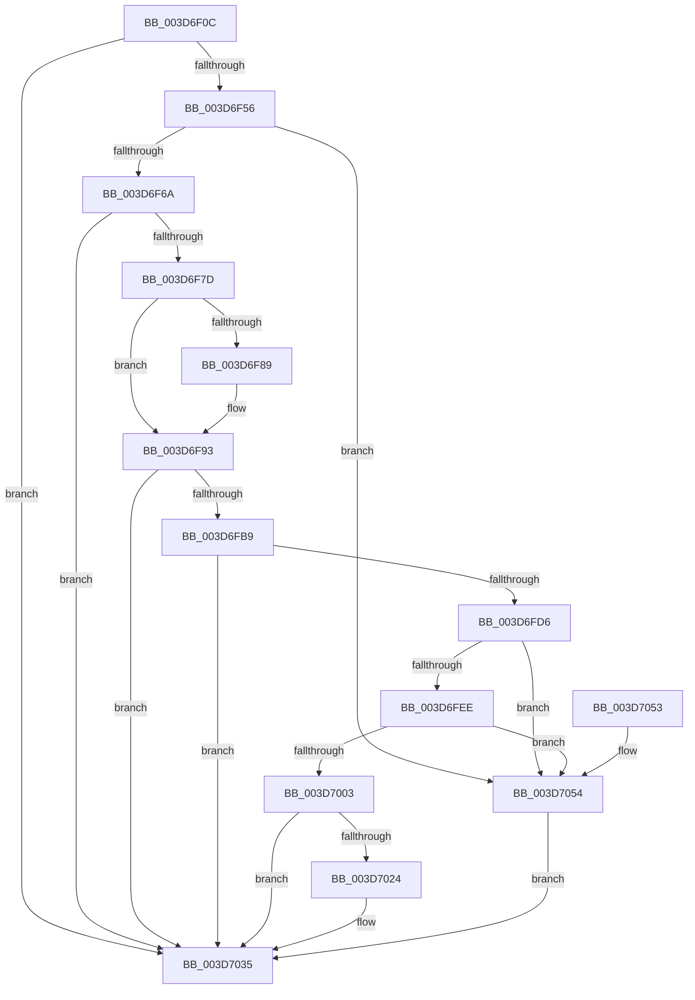

# KiUnwindUserSspForApcContextCopyBypass

- RVA: `0x003D6F0C`–`0x003D705B` (길이 `335` bytes)
- VA: `0x00000001403D6F0C`
- 실행 섹션: `.text`
- PDB 이름 있음: `예`; PDB Function 태그: `아니요`
- unwind 정보 RVA: `0x00093B8C`
- 디코드: `93`개 명령, `335/335` bytes 표시
- 미해석 바이트: `0` (있으면 어셈블리에 `.byte`로 보존)

> 이 문서는 커널 이미지의 기계어와 PDB 기호를 분석해 생성했습니다. 4번과 5번은 함수 원형과 자료형을 바이너리 사용 방식에서 추정한 C 해석이며 원본 소스 복구 결과는 아닙니다.

## 1. Dependencies

- 직접 호출 지점: **8**; 고유 호출 대상: **8**
- 직접 호출자로 확인된 함수: **1**
- RIP 상대 이미지 참조: **1**

### Outgoing calls
- `0x003D6F49` → [RtlpSanitizeContextFlags](RtlpSanitizeContextFlags_function_003D7070.md) (function, `0x003D7070`)
- `0x003D6F70` → [RtlGetExtendedContextLength](RtlGetExtendedContextLength_function_003D7190.md) (function, `0x003D7190`)
- `0x003D6F9A` → [_chkstk](../6B/_chkstk_function_006BA960.md) (function, `0x006BA960`)
- `0x003D6FB0` → [RtlInitializeExtendedContext](RtlInitializeExtendedContext_function_003D7220.md) (function, `0x003D7220`)
- `0x003D6FCD` → [RtlpReadExtendedContext](../../page/8D/RtlpReadExtendedContext_function_008D61D0.md) (function, `0x008D61D0`)
- `0x003D6FE1` → [RtlLocateExtendedFeature](RtlLocateExtendedFeature_function_003D72A0.md) (function, `0x003D72A0`)
- `0x003D701B` → [KiVerifyContextXStateCetUEnabled](KiVerifyContextXStateCetUEnabled_function_003D75C0.md) (function, `0x003D75C0`)
- `0x003D703C` → [_security_check_cookie](../6A/_security_check_cookie_function_006AC640.md) (function, `0x006AC640`)

### Direct callers
- [KiInitializeUserApc](KiInitializeUserApc_function_003D8D38.md) at `0x003D911D`

### Static image references
- `0x003D6F23` → RVA `0x00E0A740` (`.data`; read)

## 2. Other-region calls and transfers

- 다른 실행 섹션으로 향하는 call: **1**
  - `0x003D6FCD` → [RtlpReadExtendedContext](../../page/8D/RtlpReadExtendedContext_function_008D61D0.md) (`.text` → `PAGE`)
- 별도 외부 분기/꼬리 이동을 확인하지 못했습니다.

## 3. Assembly (complete function range)

```asm
003D6F0C  40 55                           push rbp
003D6F0E  48 83 EC 50                     sub rsp, 0x50
003D6F12  48 8D 6C 24 30                  lea rbp, [rsp + 0x30]
003D6F17  48 89 5D 30                     mov qword ptr [rbp + 0x30], rbx
003D6F1B  48 89 75 38                     mov qword ptr [rbp + 0x38], rsi
003D6F1F  48 89 7D 40                     mov qword ptr [rbp + 0x40], rdi
003D6F23  48 8B 05 16 38 A3 00            mov rax, qword ptr [rip + 0xa33816]
003D6F2A  48 33 C5                        xor rax, rbp
003D6F2D  48 89 45 10                     mov qword ptr [rbp + 0x10], rax
003D6F31  8B 41 30                        mov eax, dword ptr [rcx + 0x30]
003D6F34  48 8B F1                        mov rsi, rcx
003D6F37  48 83 65 08 00                  and qword ptr [rbp + 8], 0
003D6F3C  48 8D 4D 00                     lea rcx, [rbp]
003D6F40  83 65 04 00                     and dword ptr [rbp + 4], 0
003D6F44  B2 01                           mov dl, 1
003D6F46  89 45 00                        mov dword ptr [rbp], eax
003D6F49  E8 22 01 00 00                  call 0x1403d7070
003D6F4E  85 C0                           test eax, eax
003D6F50  0F 88 DF 00 00 00               js 0x1403d7035
003D6F56  8B 5D 00                        mov ebx, dword ptr [rbp]
003D6F59  B9 40 00 10 00                  mov ecx, 0x100040
003D6F5E  8B C3                           mov eax, ebx
003D6F60  23 C1                           and eax, ecx
003D6F62  3B C1                           cmp eax, ecx
003D6F64  0F 85 EA 00 00 00               jne 0x1403d7054
003D6F6A  48 8D 55 04                     lea rdx, [rbp + 4]
003D6F6E  8B CB                           mov ecx, ebx
003D6F70  E8 1B 02 00 00                  call 0x1403d7190
003D6F75  85 C0                           test eax, eax
003D6F77  0F 88 B8 00 00 00               js 0x1403d7035
003D6F7D  8B 45 04                        mov eax, dword ptr [rbp + 4]
003D6F80  48 8D 48 0F                     lea rcx, [rax + 0xf]
003D6F84  48 3B C8                        cmp rcx, rax
003D6F87  77 0A                           ja 0x1403d6f93
003D6F89  48 B9 F0 FF FF FF FF FF FF 0F   movabs rcx, 0xffffffffffffff0
003D6F93  48 83 E1 F0                     and rcx, 0xfffffffffffffff0
003D6F97  48 8B C1                        mov rax, rcx
003D6F9A  E8 C1 39 2E 00                  call 0x1406ba960
003D6F9F  48 2B E1                        sub rsp, rcx
003D6FA2  4C 8D 45 08                     lea r8, [rbp + 8]
003D6FA6  8B D3                           mov edx, ebx
003D6FA8  48 8D 7C 24 30                  lea rdi, [rsp + 0x30]
003D6FAD  48 8B CF                        mov rcx, rdi
003D6FB0  E8 6B 02 00 00                  call 0x1403d7220
003D6FB5  85 C0                           test eax, eax
003D6FB7  78 7C                           js 0x1403d7035
003D6FB9  48 83 64 24 28 00               and qword ptr [rsp + 0x28], 0
003D6FBF  44 8B CB                        mov r9d, ebx
003D6FC2  4C 8B 45 08                     mov r8, qword ptr [rbp + 8]
003D6FC6  B2 01                           mov dl, 1
003D6FC8  48 89 74 24 20                  mov qword ptr [rsp + 0x20], rsi
003D6FCD  E8 FE F1 4F 00                  call 0x1408d61d0
003D6FD2  85 C0                           test eax, eax
003D6FD4  78 5F                           js 0x1403d7035
003D6FD6  48 8B 4D 08                     mov rcx, qword ptr [rbp + 8]
003D6FDA  45 33 C0                        xor r8d, r8d
003D6FDD  41 8D 50 0B                     lea edx, [r8 + 0xb]
003D6FE1  E8 BA 02 00 00                  call 0x1403d72a0
003D6FE6  48 8B D8                        mov rbx, rax
003D6FE9  48 85 C0                        test rax, rax
003D6FEC  74 66                           je 0x1403d7054
003D6FEE  48 63 8F E0 04 00 00            movsxd rcx, dword ptr [rdi + 0x4e0]
003D6FF5  8B 94 39 D0 04 00 00            mov edx, dword ptr [rcx + rdi + 0x4d0]
003D6FFC  48 0F BA E2 0B                  bt rdx, 0xb
003D7001  73 51                           jae 0x1403d7054
003D7003  48 83 68 08 08                  sub qword ptr [rax + 8], 8
003D7008  BF A7 06 00 00                  mov edi, 0x6a7
003D700D  8B CF                           mov ecx, edi
003D700F  0F 32                           rdmsr
003D7011  48 C1 E2 20                     shl rdx, 0x20
003D7015  48 8B CB                        mov rcx, rbx
003D7018  48 0B D0                        or rdx, rax
003D701B  E8 A0 05 00 00                  call 0x1403d75c0
003D7020  85 C0                           test eax, eax
003D7022  78 11                           js 0x1403d7035
003D7024  48 8B 53 08                     mov rdx, qword ptr [rbx + 8]
003D7028  8B CF                           mov ecx, edi
003D702A  48 8B C2                        mov rax, rdx
003D702D  48 C1 EA 20                     shr rdx, 0x20
003D7031  0F 30                           wrmsr
003D7033  33 C0                           xor eax, eax
003D7035  48 8B 4D 10                     mov rcx, qword ptr [rbp + 0x10]
003D7039  48 33 CD                        xor rcx, rbp
003D703C  E8 FF 55 2D 00                  call 0x1406ac640
003D7041  48 8B 5D 30                     mov rbx, qword ptr [rbp + 0x30]
003D7045  48 8B 75 38                     mov rsi, qword ptr [rbp + 0x38]
003D7049  48 8B 7D 40                     mov rdi, qword ptr [rbp + 0x40]
003D704D  48 8D 65 20                     lea rsp, [rbp + 0x20]
003D7051  5D                              pop rbp
003D7052  C3                              ret
003D7053  CC                              int3
003D7054  B8 01 00 00 C0                  mov eax, 0xc0000001
003D7059  EB DA                           jmp 0x1403d7035
```

## 4. C-style interpretation (structured pseudocode)

```c
__int64 __fastcall KiUnwindUserSspForApcContextCopyBypass(__int64 a1)
{
    __int64 result;
    __int64 v_rsp;
    unsigned __int64 v_stack_m18;
    unsigned __int64 v_stack_m20;
    unsigned int v_stack_m24;
    unsigned __int64 v_stack_m28;
    unsigned __int64 v_stack_m30;
    unsigned __int64 v_stack_m38;
    unsigned __int64 v_stack_m8;
    unsigned __int64 v_stack_p10;
    unsigned __int64 v_stack_p18;
    unsigned __int64 v_stack_p8;

    v_rsp = (v_rsp) - (80);
    v_stack_p8 = v_rbx;
    v_stack_p10 = v_rsi;
    v_stack_p18 = v_rdi;
    result = (*(unsigned __int64 *)(v_rip + 10696726)) ^ (v_stack_m28);
    v_stack_m18 = result;
    v_stack_m28 = (unsigned int)((unsigned int)(*(unsigned int *)(a1 + 48)));
    result = RtlpSanitizeContextFlags(v_stack_m28, 1, a3, a4);
    if (sign_flag) goto loc_003D7035;
    result = (unsigned int)(((unsigned int)((unsigned int)((unsigned int)(v_stack_m28)))) & ((unsigned int)((unsigned int)(0x100040ULL))));
    if (((unsigned int)(result)) != ((unsigned int)((unsigned int)(0x100040ULL)))) goto loc_003D7054;
    result = RtlGetExtendedContextLength((unsigned int)((unsigned int)((unsigned int)(v_stack_m28))), v_stack_m24, a3, a4);
    if (sign_flag) goto loc_003D7035;
    if (((unsigned int)(v_stack_m24) + 15) <= ((unsigned int)(v_stack_m24))) {
    }
    a1 = ((unsigned int)(v_stack_m24) + 15) & (-16);
    result = _chkstk(a1, v_stack_m24, a3, a4);
    v_rsp = (v_rsp) - (a1);
    result = RtlInitializeExtendedContext(v_stack_m28, (unsigned int)((unsigned int)((unsigned int)(v_stack_m28))), v_stack_m20, a4);
    if (sign_flag) goto loc_003D7035;
    v_stack_m38 = a1;
    result = RtlpReadExtendedContext(v_stack_m28, 1, v_stack_m20, (unsigned int)((unsigned int)((unsigned int)(v_stack_m28))));
    if (sign_flag) goto loc_003D7035;
    a3 = 0;
    result = RtlLocateExtendedFeature(v_stack_m20, a3 + 11, a3, (unsigned int)((unsigned int)((unsigned int)(v_stack_m28))));
    if (result == 0) goto loc_003D7054;
    if (condition_is_above_or_equal) goto loc_003D7054;
    a2 = ((unsigned int)(*(unsigned int *)((int)(*(unsigned int *)(v_stack_m28 + 1248)) + v_stack_m28 * 1 + 1232))) << (32);
    a2 = (a2) | (result);
    result = KiVerifyContextXStateCetUEnabled(result, a2, a3, (unsigned int)((unsigned int)((unsigned int)(v_stack_m28))));
    if (!(sign_flag)) {
        a2 = *(unsigned __int64 *)(result + 8);
        a1 = (unsigned int)((unsigned int)(0x6A7ULL));
        result = a2;
        a2 = (a2) >> (32);
        result = 0;
    }
    a1 = (v_stack_m18) ^ (v_stack_m28);
    result = _security_check_cookie(a1, a2, a3, (unsigned int)((unsigned int)((unsigned int)(v_stack_m28))));
    return result;
loc_003D7054:
    goto loc_003D7035;
}
```

## 5. (Beta) C Style

```c
int64_t KiUnwindUserSspForApcContextCopyBypass(void *Arg1)
{
    uint8_t *arg1 = (uint8_t *)Arg1;

    int64_t result;
    int64_t local_rsp;
    uint64_t v_stack_m18;
    uint64_t v_stack_m20;
    uint32_t v_stack_m24;
    uint64_t v_stack_m28;
    uint64_t v_stack_m30;
    uint64_t v_stack_m38;
    uint64_t v_stack_m8;
    uint64_t v_stack_p10;
    uint64_t v_stack_p18;
    uint64_t v_stack_p8;

    local_rsp = (local_rsp) - (80);
    v_stack_p8 = local_rbx;
    v_stack_p10 = local_rsi;
    v_stack_p18 = local_rdi;
    result = (*(uint64_t *)(v_rip + 0xA33816)) ^ (v_stack_m28);
    v_stack_m18 = result;
    v_stack_m28 = (uint32_t)((uint32_t)(*(uint32_t *)(arg1 + 0x30)));
    result = RtlpSanitizeContextFlags(v_stack_m28, 1, a3, a4);
    if (sign_flag) goto loc_003D7035;
    result = (uint32_t)(((uint32_t)((uint32_t)((uint32_t)(v_stack_m28)))) & ((uint32_t)((uint32_t)(0x100040ULL))));
    if (((uint32_t)(result)) != ((uint32_t)((uint32_t)(0x100040ULL)))) goto loc_003D7054;
    result = RtlGetExtendedContextLength((uint32_t)((uint32_t)((uint32_t)(v_stack_m28))), v_stack_m24, a3, a4);
    if (sign_flag) goto loc_003D7035;
    if (((uint32_t)(v_stack_m24) + 15) <= ((uint32_t)(v_stack_m24))) {
    }
    Arg1 = ((uint32_t)(v_stack_m24) + 15) & (-16);
    result = _chkstk(Arg1, v_stack_m24, a3, a4);
    local_rsp = (local_rsp) - (Arg1);
    result = RtlInitializeExtendedContext(v_stack_m28, (uint32_t)((uint32_t)((uint32_t)(v_stack_m28))), v_stack_m20, a4);
    if (sign_flag) goto loc_003D7035;
    v_stack_m38 = Arg1;
    result = RtlpReadExtendedContext(v_stack_m28, 1, v_stack_m20, (uint32_t)((uint32_t)((uint32_t)(v_stack_m28))));
    if (sign_flag) goto loc_003D7035;
    a3 = 0;
    result = RtlLocateExtendedFeature(v_stack_m20, a3 + 11, a3, (uint32_t)((uint32_t)((uint32_t)(v_stack_m28))));
    if (result == 0) goto loc_003D7054;
    if (condition_is_above_or_equal) goto loc_003D7054;
    a2 = ((uint32_t)(*(uint32_t *)((int32_t)(*(uint32_t *)(v_stack_m28 + 0x4E0)) + v_stack_m28 * 1 + 0x4D0))) << (32);
    a2 = (a2) | (result);
    result = KiVerifyContextXStateCetUEnabled(result, a2, a3, (uint32_t)((uint32_t)((uint32_t)(v_stack_m28))));
    if (!(sign_flag)) {
        a2 = *(uint64_t *)(result + 0x8);
        Arg1 = (uint32_t)((uint32_t)(0x6A7ULL));
        result = a2;
        a2 = (a2) >> (32);
        result = 0;
    }
    Arg1 = (v_stack_m18) ^ (v_stack_m28);
    result = _security_check_cookie(Arg1, a2, a3, (uint32_t)((uint32_t)((uint32_t)(v_stack_m28))));
    return result;
loc_003D7054:
    goto loc_003D7035;
}
```

### 관측된 메모리 오프셋

구조체 형식이 확인되지 않은 접근은 인자 기준의 오프셋으로만 기록했습니다.

| 기준 인자 | 오프셋 표현 | 폭 (bit) | 접근 |
|---|---:|---:|---|
| `Arg1` | `+ 0x30` | `32` | `R` |

## 6. Execution-region graph

[열기: 2D/3D 그래프와 함수 탐색 컨트롤 패널](../../../control-panel.html?section=text&rva=0x003D6F0C&view=graph)

- 2D 그래프는 위에서 아래로 흐르고, 3D 그래프는 빈 공간을 드래그해 회전합니다. Shift+드래그는 이동, 휠은 확대·축소, 함수 노드 선택은 대상 보고서 이동입니다.

### Static fallback


