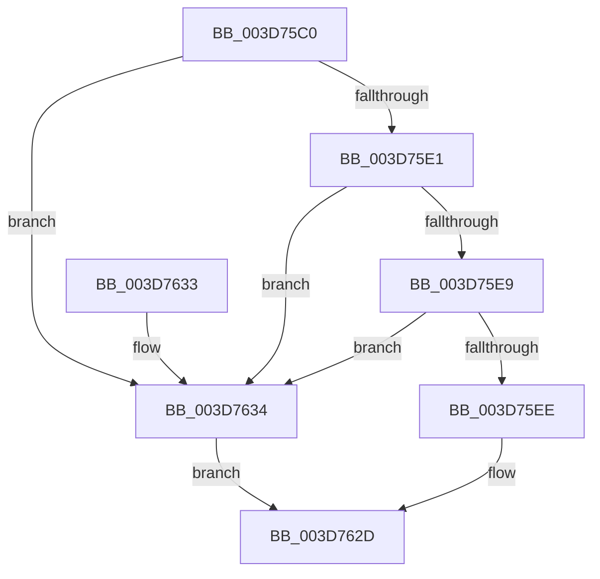

# KiVerifyContextXStateCetUEnabled

- RVA: `0x003D75C0`–`0x003D763B` (길이 `123` bytes)
- VA: `0x00000001403D75C0`
- 실행 섹션: `.text`
- PDB 이름 있음: `예`; PDB Function 태그: `아니요`
- unwind 정보 RVA: `0x00093C04`
- 디코드: `32`개 명령, `123/123` bytes 표시
- 미해석 바이트: `0` (있으면 어셈블리에 `.byte`로 보존)

> 이 문서는 커널 이미지의 기계어와 PDB 기호를 분석해 생성했습니다. 4번과 5번은 함수 원형과 자료형을 바이너리 사용 방식에서 추정한 C 해석이며 원본 소스 복구 결과는 아닙니다.

## 1. Dependencies

- 직접 호출 지점: **1**; 고유 호출 대상: **1**
- 직접 호출자로 확인된 함수: **3**
- RIP 상대 이미지 참조: **0**

### Outgoing calls
- `0x003D760C` → [ZwQueryVirtualMemory](../6A/ZwQueryVirtualMemory_function_006AD530.md) (function, `0x006AD530`)

### Direct callers
- [KiContinuePreviousModeUser](../2F/KiContinuePreviousModeUser_function_002F9B10.md) at `0x002F9E65`
- [KiUnwindUserSspForApcContextCopyBypass](KiUnwindUserSspForApcContextCopyBypass_function_003D6F0C.md) at `0x003D701B`
- [KeVerifyContextXStateCetU](KeVerifyContextXStateCetU_function_003D72D0.md) at `0x003D7543`

### Static image references
- 디코드된 RIP-relative 메모리 참조가 없습니다.

## 2. Other-region calls and transfers

- 다른 실행 섹션으로 향하는 call: **0**
- 별도 외부 분기/꼬리 이동을 확인하지 못했습니다.

## 3. Assembly (complete function range)

```asm
003D75C0  40 53                           push rbx
003D75C2  48 83 EC 60                     sub rsp, 0x60
003D75C6  48 83 39 01                     cmp qword ptr [rcx], 1
003D75CA  0F 57 C0                        xorps xmm0, xmm0
003D75CD  0F 11 44 24 30                  movups xmmword ptr [rsp + 0x30], xmm0
003D75D2  48 8B D9                        mov rbx, rcx
003D75D5  0F 11 44 24 40                  movups xmmword ptr [rsp + 0x40], xmm0
003D75DA  0F 11 44 24 50                  movups xmmword ptr [rsp + 0x50], xmm0
003D75DF  75 53                           jne 0x1403d7634
003D75E1  48 8B 41 08                     mov rax, qword ptr [rcx + 8]
003D75E5  A8 07                           test al, 7
003D75E7  75 4B                           jne 0x1403d7634
003D75E9  48 3B C2                        cmp rax, rdx
003D75EC  72 46                           jb 0x1403d7634
003D75EE  48 83 64 24 28 00               and qword ptr [rsp + 0x28], 0
003D75F4  4C 8D 4C 24 30                  lea r9, [rsp + 0x30]
003D75F9  41 B8 03 00 00 00               mov r8d, 3
003D75FF  48 C7 44 24 20 30 00 00 00      mov qword ptr [rsp + 0x20], 0x30
003D7608  48 83 C9 FF                     or rcx, 0xffffffffffffffff
003D760C  E8 1F 5F 2D 00                  call 0x1406ad530
003D7611  48 8B 4C 24 30                  mov rcx, qword ptr [rsp + 0x30]
003D7616  48 81 C1 00 F0 FF FF            add rcx, -0x1000
003D761D  48 03 4C 24 40                  add rcx, qword ptr [rsp + 0x40]
003D7622  48 3B 4B 08                     cmp rcx, qword ptr [rbx + 8]
003D7626  1B C0                           sbb eax, eax
003D7628  25 0A 06 00 C0                  and eax, 0xc000060a
003D762D  48 83 C4 60                     add rsp, 0x60
003D7631  5B                              pop rbx
003D7632  C3                              ret
003D7633  CC                              int3
003D7634  B8 0A 06 00 C0                  mov eax, 0xc000060a
003D7639  EB F2                           jmp 0x1403d762d
```

## 4. C-style interpretation (structured pseudocode)

```c
__int64 __fastcall KiVerifyContextXStateCetUEnabled(__int64 a1, __int64 a2)
{
    __int64 result;
    __int64 v_rsp;
    unsigned __int64 v_stack_m18;
    unsigned __int64 v_stack_m28;
    unsigned __int64 v_stack_m38;
    unsigned __int64 v_stack_m40;
    unsigned __int64 v_stack_m48;

    v_rsp = (v_rsp) - (96);
    v_stack_m38 = v_xmm0;
    v_stack_m28 = v_xmm0;
    v_stack_m18 = v_xmm0;
    if ((*(unsigned __int64 *)(a1)) != 1) goto loc_003D7634;
    if ((((unsigned __int8)(*(unsigned __int64 *)(a1 + 8))) & (7)) != 0) goto loc_003D7634;
    if ((*(unsigned __int64 *)(a1 + 8)) < a2) goto loc_003D7634;
    v_stack_m48 = 48;
    a1 = (a1) | (-1);
    result = ZwQueryVirtualMemory(a1, a2, 3, v_stack_m38);
    a1 = (v_stack_m38) + (0xFFFFFFFFFFFFF000ULL);
    a1 = (a1) + (v_stack_m28);
    result = (unsigned int)((result) & (0xC000060AULL));
loc_003D762D:
    v_rsp = (v_rsp) + (96);
    return result;
loc_003D7634:
    goto loc_003D762D;
}
```

## 5. (Beta) C Style

```c
int64_t KiVerifyContextXStateCetUEnabled(void *Arg1, int64_t Arg2)
{
    uint8_t *arg1 = (uint8_t *)Arg1;

    int64_t result;
    int64_t local_rsp;
    uint64_t v_stack_m18;
    uint64_t v_stack_m28;
    uint64_t v_stack_m38;
    uint64_t v_stack_m40;
    uint64_t v_stack_m48;

    local_rsp = (local_rsp) - (96);
    v_stack_m38 = v_xmm0;
    v_stack_m28 = v_xmm0;
    v_stack_m18 = v_xmm0;
    if ((*(uint64_t *)(arg1)) != 1) goto loc_003D7634;
    if ((((uint8_t)(*(uint64_t *)(arg1 + 0x8))) & (7)) != 0) goto loc_003D7634;
    if ((*(uint64_t *)(arg1 + 0x8)) < Arg2) goto loc_003D7634;
    v_stack_m48 = 48;
    Arg1 = (Arg1) | (-1);
    result = ZwQueryVirtualMemory(Arg1, Arg2, 3, v_stack_m38);
    Arg1 = (v_stack_m38) + (0xFFFFFFFFFFFFF000ULL);
    Arg1 = (Arg1) + (v_stack_m28);
    result = (uint32_t)((result) & (0xC000060AULL));
loc_003D762D:
    local_rsp = (local_rsp) + (96);
    return result;
loc_003D7634:
    goto loc_003D762D;
}
```

### 관측된 메모리 오프셋

구조체 형식이 확인되지 않은 접근은 인자 기준의 오프셋으로만 기록했습니다.

| 기준 인자 | 오프셋 표현 | 폭 (bit) | 접근 |
|---|---:|---:|---|
| `Arg1` | `+ 0x0` | `64` | `R` |
| `Arg1` | `+ 0x8` | `64` | `R` |

## 6. Execution-region graph

[열기: 2D/3D 그래프와 함수 탐색 컨트롤 패널](../../../control-panel.html?section=text&rva=0x003D75C0&view=graph)

- 2D 그래프는 위에서 아래로 흐르고, 3D 그래프는 빈 공간을 드래그해 회전합니다. Shift+드래그는 이동, 휠은 확대·축소, 함수 노드 선택은 대상 보고서 이동입니다.

### Static fallback


