# KxContextToKframes

- RVA: `0x003D6850`–`0x003D6DB6` (길이 `1,382` bytes)
- VA: `0x00000001403D6850`
- 실행 섹션: `.text`
- PDB 이름 있음: `예`; PDB Function 태그: `아니요`
- unwind 정보 RVA: `0x00093B58`
- 디코드: `276`개 명령, `1,382/1,382` bytes 표시
- 미해석 바이트: `0` (있으면 어셈블리에 `.byte`로 보존)

> 이 문서는 커널 이미지의 기계어와 PDB 기호를 분석해 생성했습니다. 4번과 5번은 함수 원형과 자료형을 바이너리 사용 방식에서 추정한 C 해석이며 원본 소스 복구 결과는 아닙니다.

## 1. Dependencies

- 직접 호출 지점: **3**; 고유 호출 대상: **3**
- 직접 호출자로 확인된 함수: **2**
- RIP 상대 이미지 참조: **1**

### Outgoing calls
- `0x003D6C35` → [RtlXRestore](RtlXRestore_function_003D6DBC.md) (function, `0x003D6DBC`)
- `0x003D6D2C` → [VslKernelShadowStackAssist](VslKernelShadowStackAssist_function_003D5BA0.md) (function, `0x003D5BA0`)
- `0x003D6DAC` → [RtlCopyXStateArea](RtlCopyXStateArea_function_003D5850.md) (function, `0x003D5850`)

### Direct callers
- [KiInitializeContextThread](KiInitializeContextThread_function_003D6400.md) at `0x003D65AC`
- [KeContextToKframes](../4F/KeContextToKframes_function_004FD790.md) at `0x004FD808`

### Static image references
- `0x003D6B5A` → RVA `0x00FC5114` (`ALMOSTRO`; read)

## 2. Other-region calls and transfers

- 다른 실행 섹션으로 향하는 call: **0**
- 별도 외부 분기/꼬리 이동을 확인하지 못했습니다.

## 3. Assembly (complete function range)

```asm
003D6850  48 89 5C 24 08                  mov qword ptr [rsp + 8], rbx
003D6855  48 89 6C 24 10                  mov qword ptr [rsp + 0x10], rbp
003D685A  48 89 74 24 18                  mov qword ptr [rsp + 0x18], rsi
003D685F  57                              push rdi
003D6860  41 56                           push r14
003D6862  41 57                           push r15
003D6864  48 83 EC 30                     sub rsp, 0x30
003D6868  44 0F B6 74 24 70               movzx r14d, byte ptr [rsp + 0x70]
003D686E  41 8B C1                        mov eax, r9d
003D6871  25 01 00 10 00                  and eax, 0x100001
003D6876  45 32 FF                        xor r15b, r15b
003D6879  41 8B F1                        mov esi, r9d
003D687C  49 8B D8                        mov rbx, r8
003D687F  48 8B EA                        mov rbp, rdx
003D6882  48 8B F9                        mov rdi, rcx
003D6885  3D 01 00 10 00                  cmp eax, 0x100001
003D688A  0F 85 87 00 00 00               jne 0x1403d6917
003D6890  45 8B 40 44                     mov r8d, dword ptr [r8 + 0x44]
003D6894  41 8B C0                        mov eax, r8d
003D6897  41 81 E0 D5 0D 21 00            and r8d, 0x210dd5
003D689E  25 D5 0F 25 00                  and eax, 0x250fd5
003D68A3  41 0F BA E8 09                  bts r8d, 9
003D68A8  45 84 F6                        test r14b, r14b
003D68AB  44 0F 44 C0                     cmove r8d, eax
003D68AF  44 89 81 78 01 00 00            mov dword ptr [rcx + 0x178], r8d
003D68B6  48 8B 8B F8 00 00 00            mov rcx, qword ptr [rbx + 0xf8]
003D68BD  48 89 8F 68 01 00 00            mov qword ptr [rdi + 0x168], rcx
003D68C4  48 8B 83 98 00 00 00            mov rax, qword ptr [rbx + 0x98]
003D68CB  48 89 87 80 01 00 00            mov qword ptr [rdi + 0x180], rax
003D68D2  41 80 FE 01                     cmp r14b, 1
003D68D6  0F 85 63 03 00 00               jne 0x1403d6c3f
003D68DC  BA 33 00 00 00                  mov edx, 0x33
003D68E1  66 C7 87 88 01 00 00 2B 00      mov word ptr [rdi + 0x188], 0x2b
003D68EA  66 39 53 38                     cmp word ptr [rbx + 0x38], dx
003D68EE  B8 23 00 00 00                  mov eax, 0x23
003D68F3  66 0F 44 C2                     cmove ax, dx
003D68F7  66 89 87 70 01 00 00            mov word ptr [rdi + 0x170], ax
003D68FE  66 83 F8 23                     cmp ax, 0x23
003D6902  0F 84 4E 03 00 00               je 0x1403d6c56
003D6908  48 C1 E1 10                     shl rcx, 0x10
003D690C  48 C1 F9 10                     sar rcx, 0x10
003D6910  48 89 8F 68 01 00 00            mov qword ptr [rdi + 0x168], rcx
003D6917  8B C6                           mov eax, esi
003D6919  25 02 00 10 00                  and eax, 0x100002
003D691E  3D 02 00 10 00                  cmp eax, 0x100002
003D6923  0F 85 BA 00 00 00               jne 0x1403d69e3
003D6929  48 8B 43 78                     mov rax, qword ptr [rbx + 0x78]
003D692D  48 89 47 30                     mov qword ptr [rdi + 0x30], rax
003D6931  48 8B 83 80 00 00 00            mov rax, qword ptr [rbx + 0x80]
003D6938  48 89 47 38                     mov qword ptr [rdi + 0x38], rax
003D693C  48 8B 83 88 00 00 00            mov rax, qword ptr [rbx + 0x88]
003D6943  48 89 47 40                     mov qword ptr [rdi + 0x40], rax
003D6947  48 8B 83 B8 00 00 00            mov rax, qword ptr [rbx + 0xb8]
003D694E  48 89 47 48                     mov qword ptr [rdi + 0x48], rax
003D6952  48 8B 83 C0 00 00 00            mov rax, qword ptr [rbx + 0xc0]
003D6959  48 89 47 50                     mov qword ptr [rdi + 0x50], rax
003D695D  48 8B 83 C8 00 00 00            mov rax, qword ptr [rbx + 0xc8]
003D6964  48 89 47 58                     mov qword ptr [rdi + 0x58], rax
003D6968  48 8B 83 D0 00 00 00            mov rax, qword ptr [rbx + 0xd0]
003D696F  48 89 47 60                     mov qword ptr [rdi + 0x60], rax
003D6973  48 8B 83 A0 00 00 00            mov rax, qword ptr [rbx + 0xa0]
003D697A  48 89 87 58 01 00 00            mov qword ptr [rdi + 0x158], rax
003D6981  48 8B 83 90 00 00 00            mov rax, qword ptr [rbx + 0x90]
003D6988  48 89 85 00 01 00 00            mov qword ptr [rbp + 0x100], rax
003D698F  48 8B 83 A8 00 00 00            mov rax, qword ptr [rbx + 0xa8]
003D6996  48 89 85 10 01 00 00            mov qword ptr [rbp + 0x110], rax
003D699D  48 8B 83 B0 00 00 00            mov rax, qword ptr [rbx + 0xb0]
003D69A4  48 89 85 08 01 00 00            mov qword ptr [rbp + 0x108], rax
003D69AB  48 8B 83 D8 00 00 00            mov rax, qword ptr [rbx + 0xd8]
003D69B2  48 89 85 18 01 00 00            mov qword ptr [rbp + 0x118], rax
003D69B9  48 8B 83 E0 00 00 00            mov rax, qword ptr [rbx + 0xe0]
003D69C0  48 89 85 20 01 00 00            mov qword ptr [rbp + 0x120], rax
003D69C7  48 8B 83 E8 00 00 00            mov rax, qword ptr [rbx + 0xe8]
003D69CE  48 89 85 28 01 00 00            mov qword ptr [rbp + 0x128], rax
003D69D5  48 8B 83 F0 00 00 00            mov rax, qword ptr [rbx + 0xf0]
003D69DC  48 89 85 30 01 00 00            mov qword ptr [rbp + 0x130], rax
003D69E3  8B C6                           mov eax, esi
003D69E5  25 40 00 10 00                  and eax, 0x100040
003D69EA  3D 40 00 10 00                  cmp eax, 0x100040
003D69EF  75 74                           jne 0x1403d6a65
003D69F1  41 80 FE 01                     cmp r14b, 1
003D69F5  75 6E                           jne 0x1403d6a65
003D69F7  65 48 8B 04 25 88 01 00 00      mov rax, qword ptr gs:[0x188]
003D6A00  4C 63 83 E0 04 00 00            movsxd r8, dword ptr [rbx + 0x4e0]
003D6A07  49 81 C0 D0 02 00 00            add r8, 0x2d0
003D6A0E  4C 03 C3                        add r8, rbx
003D6A11  48 8B 88 98 01 00 00            mov rcx, qword ptr [rax + 0x198]
003D6A18  48 85 C9                        test rcx, rcx
003D6A1B  0F 85 51 03 00 00               jne 0x1403d6d72
003D6A21  48 B8 E0 03 00 00 80 F7 FF FF   movabs rax, 0xfffff780000003e0
003D6A2B  48 B9 08 07 00 00 80 F7 FF FF   movabs rcx, 0xfffff78000000708
003D6A35  48 8B 09                        mov rcx, qword ptr [rcx]
003D6A38  48 0B 08                        or rcx, qword ptr [rax]
003D6A3B  A1 EC 03 00 00 80 F7 FF FF      movabs eax, dword ptr [0xfffff780000003ec]
003D6A44  48 83 E1 FC                     and rcx, 0xfffffffffffffffc
003D6A48  A8 02                           test al, 2
003D6A4A  0F 84 DF 01 00 00               je 0x1403d6c2f
003D6A50  49 8B 90 08 02 00 00            mov rdx, qword ptr [r8 + 0x208]
003D6A57  48 23 D1                        and rdx, rcx
003D6A5A  48 8B C2                        mov rax, rdx
003D6A5D  48 C1 EA 20                     shr rdx, 0x20
003D6A61  41 0F C7 18                     xrstors ptr [r8]
003D6A65  8B C6                           mov eax, esi
003D6A67  25 80 00 10 00                  and eax, 0x100080
003D6A6C  3D 80 00 10 00                  cmp eax, 0x100080
003D6A71  0F 84 5F 02 00 00               je 0x1403d6cd6
003D6A77  8B C6                           mov eax, esi
003D6A79  25 08 00 10 00                  and eax, 0x100008
003D6A7E  3D 08 00 10 00                  cmp eax, 0x100008
003D6A83  0F 85 FF 00 00 00               jne 0x1403d6b88
003D6A89  0F 10 83 A0 01 00 00            movups xmm0, xmmword ptr [rbx + 0x1a0]
003D6A90  0F 11 47 70                     movups xmmword ptr [rdi + 0x70], xmm0
003D6A94  0F 10 83 B0 01 00 00            movups xmm0, xmmword ptr [rbx + 0x1b0]
003D6A9B  0F 11 87 80 00 00 00            movups xmmword ptr [rdi + 0x80], xmm0
003D6AA2  0F 10 83 C0 01 00 00            movups xmm0, xmmword ptr [rbx + 0x1c0]
003D6AA9  0F 11 87 90 00 00 00            movups xmmword ptr [rdi + 0x90], xmm0
003D6AB0  0F 10 83 D0 01 00 00            movups xmm0, xmmword ptr [rbx + 0x1d0]
003D6AB7  0F 11 87 A0 00 00 00            movups xmmword ptr [rdi + 0xa0], xmm0
003D6ABE  0F 10 83 E0 01 00 00            movups xmm0, xmmword ptr [rbx + 0x1e0]
003D6AC5  0F 11 87 B0 00 00 00            movups xmmword ptr [rdi + 0xb0], xmm0
003D6ACC  0F 10 83 F0 01 00 00            movups xmm0, xmmword ptr [rbx + 0x1f0]
003D6AD3  0F 11 87 C0 00 00 00            movups xmmword ptr [rdi + 0xc0], xmm0
003D6ADA  0F 10 83 00 02 00 00            movups xmm0, xmmword ptr [rbx + 0x200]
003D6AE1  0F 11 45 30                     movups xmmword ptr [rbp + 0x30], xmm0
003D6AE5  0F 10 83 10 02 00 00            movups xmm0, xmmword ptr [rbx + 0x210]
003D6AEC  0F 11 45 40                     movups xmmword ptr [rbp + 0x40], xmm0
003D6AF0  0F 10 83 20 02 00 00            movups xmm0, xmmword ptr [rbx + 0x220]
003D6AF7  0F 11 45 50                     movups xmmword ptr [rbp + 0x50], xmm0
003D6AFB  0F 10 83 30 02 00 00            movups xmm0, xmmword ptr [rbx + 0x230]
003D6B02  0F 11 45 60                     movups xmmword ptr [rbp + 0x60], xmm0
003D6B06  0F 10 83 40 02 00 00            movups xmm0, xmmword ptr [rbx + 0x240]
003D6B0D  0F 11 45 70                     movups xmmword ptr [rbp + 0x70], xmm0
003D6B11  0F 10 83 50 02 00 00            movups xmm0, xmmword ptr [rbx + 0x250]
003D6B18  0F 11 85 80 00 00 00            movups xmmword ptr [rbp + 0x80], xmm0
003D6B1F  0F 10 83 60 02 00 00            movups xmm0, xmmword ptr [rbx + 0x260]
003D6B26  0F 11 85 90 00 00 00            movups xmmword ptr [rbp + 0x90], xmm0
003D6B2D  0F 10 83 70 02 00 00            movups xmm0, xmmword ptr [rbx + 0x270]
003D6B34  0F 11 85 A0 00 00 00            movups xmmword ptr [rbp + 0xa0], xmm0
003D6B3B  0F 10 83 80 02 00 00            movups xmm0, xmmword ptr [rbx + 0x280]
003D6B42  0F 11 85 B0 00 00 00            movups xmmword ptr [rbp + 0xb0], xmm0
003D6B49  0F 10 83 90 02 00 00            movups xmm0, xmmword ptr [rbx + 0x290]
003D6B50  0F 11 85 C0 00 00 00            movups xmmword ptr [rbp + 0xc0], xmm0
003D6B57  8B 43 34                        mov eax, dword ptr [rbx + 0x34]
003D6B5A  23 05 B4 E5 BE 00               and eax, dword ptr [rip + 0xbee5b4]
003D6B60  89 47 2C                        mov dword ptr [rdi + 0x2c], eax
003D6B63  41 80 FE 01                     cmp r14b, 1
003D6B67  75 1F                           jne 0x1403d6b88
003D6B69  45 0F B6 FE                     movzx r15d, r14b
003D6B6D  0F AE 5C 24 68                  stmxcsr dword ptr [rsp + 0x68]
003D6B72  8B 44 24 68                     mov eax, dword ptr [rsp + 0x68]
003D6B76  89 83 18 01 00 00               mov dword ptr [rbx + 0x118], eax
003D6B7C  B8 3F 1F 00 00                  mov eax, 0x1f3f
003D6B81  66 21 83 00 01 00 00            and word ptr [rbx + 0x100], ax
003D6B88  81 E6 10 00 10 00               and esi, 0x100010
003D6B8E  81 FE 10 00 10 00               cmp esi, 0x100010
003D6B94  0F 85 8F 00 00 00               jne 0x1403d6c29
003D6B9A  48 8B 43 48                     mov rax, qword ptr [rbx + 0x48]
003D6B9E  45 84 F6                        test r14b, r14b
003D6BA1  0F 85 B6 00 00 00               jne 0x1403d6c5d
003D6BA7  48 89 87 D8 00 00 00            mov qword ptr [rdi + 0xd8], rax
003D6BAE  48 8B 43 50                     mov rax, qword ptr [rbx + 0x50]
003D6BB2  48 89 87 E0 00 00 00            mov qword ptr [rdi + 0xe0], rax
003D6BB9  48 8B 43 58                     mov rax, qword ptr [rbx + 0x58]
003D6BBD  48 89 87 E8 00 00 00            mov qword ptr [rdi + 0xe8], rax
003D6BC4  48 8B 43 60                     mov rax, qword ptr [rbx + 0x60]
003D6BC8  48 89 87 F0 00 00 00            mov qword ptr [rdi + 0xf0], rax
003D6BCF  B9 55 03 FF FF                  mov ecx, 0xffff0355
003D6BD4  48 C7 87 F8 00 00 00 00 00 00 00  mov qword ptr [rdi + 0xf8], 0
003D6BDF  8B 43 70                        mov eax, dword ptr [rbx + 0x70]
003D6BE2  48 23 C1                        and rax, rcx
003D6BE5  48 89 87 00 01 00 00            mov qword ptr [rdi + 0x100], rax
003D6BEC  45 84 F6                        test r14b, r14b
003D6BEF  74 38                           je 0x1403d6c29
003D6BF1  65 48 8B 0C 25 88 01 00 00      mov rcx, qword ptr gs:[0x188]
003D6BFA  48 A9 55 03 00 00               test rax, 0x355
003D6C00  41 0F B6 C7                     movzx eax, r15b
003D6C04  0F 85 C2 00 00 00               jne 0x1403d6ccc
003D6C0A  F0 0F BA 31 18                  lock btr dword ptr [rcx], 0x18
003D6C0F  48 8B 5C 24 50                  mov rbx, qword ptr [rsp + 0x50]
003D6C14  48 8B 6C 24 58                  mov rbp, qword ptr [rsp + 0x58]
003D6C19  48 8B 74 24 60                  mov rsi, qword ptr [rsp + 0x60]
003D6C1E  48 83 C4 30                     add rsp, 0x30
003D6C22  41 5F                           pop r15
003D6C24  41 5E                           pop r14
003D6C26  5F                              pop rdi
003D6C27  C3                              ret
003D6C28  CC                              int3
003D6C29  41 0F B6 C7                     movzx eax, r15b
003D6C2D  EB E0                           jmp 0x1403d6c0f
003D6C2F  48 8B D1                        mov rdx, rcx
003D6C32  49 8B C8                        mov rcx, r8
003D6C35  E8 82 01 00 00                  call 0x1403d6dbc
003D6C3A  E9 26 FE FF FF                  jmp 0x1403d6a65
003D6C3F  66 C7 87 88 01 00 00 18 00      mov word ptr [rdi + 0x188], 0x18
003D6C48  66 C7 87 70 01 00 00 10 00      mov word ptr [rdi + 0x170], 0x10
003D6C51  E9 BA FC FF FF                  jmp 0x1403d6910
003D6C56  8B C9                           mov ecx, ecx
003D6C58  E9 B3 FC FF FF                  jmp 0x1403d6910
003D6C5D  48 BA FF FF FE FF FF 7F 00 00   movabs rdx, 0x7ffffffeffff
003D6C67  48 3B C2                        cmp rax, rdx
003D6C6A  77 39                           ja 0x1403d6ca5
003D6C6C  48 89 87 D8 00 00 00            mov qword ptr [rdi + 0xd8], rax
003D6C73  48 8B 43 50                     mov rax, qword ptr [rbx + 0x50]
003D6C77  48 3B C2                        cmp rax, rdx
003D6C7A  77 36                           ja 0x1403d6cb2
003D6C7C  48 89 87 E0 00 00 00            mov qword ptr [rdi + 0xe0], rax
003D6C83  48 8B 43 58                     mov rax, qword ptr [rbx + 0x58]
003D6C87  48 3B C2                        cmp rax, rdx
003D6C8A  77 33                           ja 0x1403d6cbf
003D6C8C  48 89 87 E8 00 00 00            mov qword ptr [rdi + 0xe8], rax
003D6C93  48 8B 4B 60                     mov rcx, qword ptr [rbx + 0x60]
003D6C97  33 C0                           xor eax, eax
003D6C99  48 3B CA                        cmp rcx, rdx
003D6C9C  48 0F 46 C1                     cmovbe rax, rcx
003D6CA0  E9 23 FF FF FF                  jmp 0x1403d6bc8
003D6CA5  48 C7 87 D8 00 00 00 00 00 00 00  mov qword ptr [rdi + 0xd8], 0
003D6CB0  EB C1                           jmp 0x1403d6c73
003D6CB2  48 C7 87 E0 00 00 00 00 00 00 00  mov qword ptr [rdi + 0xe0], 0
003D6CBD  EB C4                           jmp 0x1403d6c83
003D6CBF  48 C7 87 E8 00 00 00 00 00 00 00  mov qword ptr [rdi + 0xe8], 0
003D6CCA  EB C7                           jmp 0x1403d6c93
003D6CCC  F0 0F BA 29 18                  lock bts dword ptr [rcx], 0x18
003D6CD1  E9 39 FF FF FF                  jmp 0x1403d6c0f
003D6CD6  45 84 F6                        test r14b, r14b
003D6CD9  0F 85 98 FD FF FF               jne 0x1403d6a77
003D6CDF  48 63 83 E8 04 00 00            movsxd rax, dword ptr [rbx + 0x4e8]
003D6CE6  48 8B 97 D8 00 00 00            mov rdx, qword ptr [rdi + 0xd8]
003D6CED  4C 8B 84 18 D8 04 00 00         mov r8, qword ptr [rax + rbx + 0x4d8]
003D6CF5  48 8D 0C 18                     lea rcx, [rax + rbx]
003D6CF9  4C 8B 4A 08                     mov r9, qword ptr [rdx + 8]
003D6CFD  4D 3B C8                        cmp r9, r8
003D6D00  74 34                           je 0x1403d6d36
003D6D02  0F B7 81 E2 04 00 00            movzx eax, word ptr [rcx + 0x4e2]
003D6D09  A8 01                           test al, 1
003D6D0B  75 37                           jne 0x1403d6d44
003D6D0D  A8 02                           test al, 2
003D6D0F  74 5C                           je 0x1403d6d6d
003D6D11  4C 8B 0A                        mov r9, qword ptr [rdx]
003D6D14  49 83 C1 08                     add r9, 8
003D6D18  C7 44 24 28 04 00 00 00         mov dword ptr [rsp + 0x28], 4
003D6D20  4C 89 44 24 20                  mov qword ptr [rsp + 0x20], r8
003D6D25  45 33 C0                        xor r8d, r8d
003D6D28  41 8D 48 03                     lea ecx, [r8 + 3]
003D6D2C  E8 6F EE FF FF                  call 0x1403d5ba0
003D6D31  E9 41 FD FF FF                  jmp 0x1403d6a77
003D6D36  F6 81 E2 04 00 00 02            test byte ptr [rcx + 0x4e2], 2
003D6D3D  75 C3                           jne 0x1403d6d02
003D6D3F  E9 33 FD FF FF                  jmp 0x1403d6a77
003D6D44  4D 3B C8                        cmp r9, r8
003D6D47  74 06                           je 0x1403d6d4f
003D6D49  4C 0F 38 F6 42 08               wrssq qword ptr [rdx + 8], r8
003D6D4F  F6 81 E2 04 00 00 02            test byte ptr [rcx + 0x4e2], 2
003D6D56  0F 84 1B FD FF FF               je 0x1403d6a77
003D6D5C  48 8B 02                        mov rax, qword ptr [rdx]
003D6D5F  48 83 C0 08                     add rax, 8
003D6D63  48 0F 38 F6 02                  wrssq qword ptr [rdx], rax
003D6D68  E9 0A FD FF FF                  jmp 0x1403d6a77
003D6D6D  45 33 C9                        xor r9d, r9d
003D6D70  EB A6                           jmp 0x1403d6d18
003D6D72  48 8B 11                        mov rdx, qword ptr [rcx]
003D6D75  48 85 D2                        test rdx, rdx
003D6D78  74 14                           je 0x1403d6d8e
003D6D7A  66 0F 1F 44 00 00               nop word ptr [rax + rax]
003D6D80  48 8B 02                        mov rax, qword ptr [rdx]
003D6D83  48 8B CA                        mov rcx, rdx
003D6D86  48 8B D0                        mov rdx, rax
003D6D89  48 85 C0                        test rax, rax
003D6D8C  75 F2                           jne 0x1403d6d80
003D6D8E  48 8B 49 28                     mov rcx, qword ptr [rcx + 0x28]
003D6D92  48 85 C9                        test rcx, rcx
003D6D95  0F 84 86 FC FF FF               je 0x1403d6a21
003D6D9B  48 A1 E0 03 00 00 80 F7 FF FF   movabs rax, qword ptr [0xfffff780000003e0]
003D6DA5  48 83 E0 FC                     and rax, 0xfffffffffffffffc
003D6DA9  48 8B D0                        mov rdx, rax
003D6DAC  E8 9F EA FF FF                  call 0x1403d5850
003D6DB1  E9 AF FC FF FF                  jmp 0x1403d6a65
```

## 4. C-style interpretation (structured pseudocode)

```c
__int64 __fastcall KxContextToKframes(__int64 a1, __int64 a2, __int64 a3, int a4, unsigned __int8 a5)
{
    __int64 result;
    __int64 v_r15;
    __int64 v_rsi;
    __int64 v_rsp;
    unsigned __int64 v_stack_p10;
    unsigned __int64 v_stack_p18;
    unsigned int v_stack_p20;
    unsigned int v_stack_p28;
    unsigned __int64 v_stack_p8;

    v_stack_p8 = v_rbx;
    v_stack_p10 = v_rbp;
    v_stack_p18 = v_rsi;
    v_rsp = (v_rsp) - (48);
    result = (unsigned int)(((unsigned int)(a4)) & (0x100001ULL));
    v_r15 = 0;
    if (((unsigned int)(result)) != 0x100001ULL) goto loc_003D6917;
    a3 = (unsigned int)(((unsigned int)(*(unsigned int *)(a3 + 68))) & (0x210DD5ULL));
    result = (unsigned int)(((unsigned int)((unsigned int)((unsigned int)(*(unsigned int *)(a3 + 68))))) & (0x250FD5ULL));
    if (a5 == 0) { a3 = (unsigned int)(result); }
    *(unsigned int *)(a1 + 376) = (unsigned int)(a3);
    *(unsigned __int64 *)(a1 + 360) = *(unsigned __int64 *)(a3 + 248);
    *(unsigned __int64 *)(a1 + 384) = *(unsigned __int64 *)(a3 + 152);
    if (a5 != 1) goto loc_003D6C3F;
    *(unsigned __int16 *)(a1 + 392) = 43;
    result = 35;
    if ((*(unsigned __int16 *)(a3 + 56)) == 51) { result = 51; }
    *(unsigned __int16 *)(a1 + 368) = (unsigned __int16)(result);
    if (((unsigned __int16)(result)) == 35) goto loc_003D6C56;
    a1 = (*(unsigned __int64 *)(a3 + 248)) << (16);
    a1 = (a1) >> (16);
loc_003D6910:
    *(unsigned __int64 *)(a1 + 360) = a1;
loc_003D6917:
    result = (unsigned int)(((unsigned int)((unsigned int)((unsigned int)(a4)))) & (0x100002ULL));
    if (((unsigned int)(result)) == 0x100002ULL) {
        result = *(unsigned __int64 *)(a3 + 120);
        *(unsigned __int64 *)(a1 + 48) = result;
        result = *(unsigned __int64 *)(a3 + 128);
        *(unsigned __int64 *)(a1 + 56) = result;
        result = *(unsigned __int64 *)(a3 + 136);
        *(unsigned __int64 *)(a1 + 64) = result;
        result = *(unsigned __int64 *)(a3 + 184);
        *(unsigned __int64 *)(a1 + 72) = result;
        result = *(unsigned __int64 *)(a3 + 192);
        *(unsigned __int64 *)(a1 + 80) = result;
        result = *(unsigned __int64 *)(a3 + 200);
        *(unsigned __int64 *)(a1 + 88) = result;
        result = *(unsigned __int64 *)(a3 + 208);
        *(unsigned __int64 *)(a1 + 96) = result;
        result = *(unsigned __int64 *)(a3 + 160);
        *(unsigned __int64 *)(a1 + 344) = result;
        result = *(unsigned __int64 *)(a3 + 144);
        *(unsigned __int64 *)(a2 + 256) = result;
        result = *(unsigned __int64 *)(a3 + 168);
        *(unsigned __int64 *)(a2 + 272) = result;
        result = *(unsigned __int64 *)(a3 + 176);
        *(unsigned __int64 *)(a2 + 264) = result;
        result = *(unsigned __int64 *)(a3 + 216);
        *(unsigned __int64 *)(a2 + 280) = result;
        result = *(unsigned __int64 *)(a3 + 224);
        *(unsigned __int64 *)(a2 + 288) = result;
        result = *(unsigned __int64 *)(a3 + 232);
        *(unsigned __int64 *)(a2 + 296) = result;
        result = *(unsigned __int64 *)(a3 + 240);
        *(unsigned __int64 *)(a2 + 304) = result;
    }
    result = (unsigned int)(((unsigned int)((unsigned int)((unsigned int)(a4)))) & (0x100040ULL));
    if (((unsigned int)(result)) != 0x100040ULL) goto loc_003D6A65;
    if (a5 != 1) goto loc_003D6A65;
    a3 = ((int)(*(unsigned int *)(a3 + 1248))) + (720);
    a3 = (a3) + (a3);
    if (*(unsigned __int64 *)(*(unsigned __int64 *)(gs_base + (0 + 392)) + 408) != 0) goto loc_003D6D72;
loc_003D6A21:
    a1 = (*(unsigned __int64 *)(*(unsigned __int64 *)(*(unsigned __int64 *)(gs_base + (0 + 392)) + 408))) | (*(unsigned __int64 *)(*(unsigned __int64 *)(gs_base + (0 + 392))));
    a1 = (a1) & (-4);
    if ((((unsigned __int8)(*(unsigned __int64 *)(gs_base + (0 + 392)))) & (2)) == 0) goto loc_003D6C2F;
    a2 = (*(unsigned __int64 *)(a3 + 520)) & (a1);
    a2 = (a2) >> (32);
loc_003D6A65:
    result = (unsigned int)(((unsigned int)((unsigned int)((unsigned int)(a4)))) & (0x100080ULL));
    if (((unsigned int)(result)) == 0x100080ULL) goto loc_003D6CD6;
loc_003D6A77:
    result = (unsigned int)(((unsigned int)((unsigned int)((unsigned int)(a4)))) & (0x100008ULL));
    if (((unsigned int)(result)) != 0x100008ULL) goto loc_003D6B88;
    *(unsigned __int64 *)(a1 + 112) = v_xmm0;
    *(unsigned __int64 *)(a1 + 128) = v_xmm0;
    *(unsigned __int64 *)(a1 + 144) = v_xmm0;
    *(unsigned __int64 *)(a1 + 160) = v_xmm0;
    *(unsigned __int64 *)(a1 + 176) = v_xmm0;
    *(unsigned __int64 *)(a1 + 192) = v_xmm0;
    *(unsigned __int64 *)(a2 + 48) = v_xmm0;
    *(unsigned __int64 *)(a2 + 64) = v_xmm0;
    *(unsigned __int64 *)(a2 + 80) = v_xmm0;
    *(unsigned __int64 *)(a2 + 96) = v_xmm0;
    *(unsigned __int64 *)(a2 + 112) = v_xmm0;
    *(unsigned __int64 *)(a2 + 128) = v_xmm0;
    *(unsigned __int64 *)(a2 + 144) = v_xmm0;
    *(unsigned __int64 *)(a2 + 160) = v_xmm0;
    *(unsigned __int64 *)(a2 + 176) = v_xmm0;
    *(unsigned __int64 *)(a2 + 192) = v_xmm0;
    result = (unsigned int)(((unsigned int)(*(unsigned int *)(a3 + 52))) & (*(unsigned int *)(v_rip + 12510644)));
    *(unsigned int *)(a1 + 44) = (unsigned int)(result);
    if (a5 == 1) {
        v_r15 = a5;
        result = v_stack_p20;
        *(unsigned int *)(a3 + 280) = (unsigned int)(result);
        result = 0x1F3FULL;
    }
    v_rsi = (unsigned int)(((unsigned int)(a4)) & (0x100010ULL));
    if (((unsigned int)(v_rsi)) != 0x100010ULL) goto loc_003D6C29;
    if (a5 != 0) goto loc_003D6C5D;
    *(unsigned __int64 *)(a1 + 216) = *(unsigned __int64 *)(a3 + 72);
    *(unsigned __int64 *)(a1 + 224) = *(unsigned __int64 *)(a3 + 80);
    *(unsigned __int64 *)(a1 + 232) = *(unsigned __int64 *)(a3 + 88);
loc_003D6BC8:
    *(unsigned __int64 *)(a1 + 240) = *(unsigned __int64 *)(a3 + 96);
    *(unsigned __int64 *)(a1 + 248) = 0;
    result = ((unsigned int)(*(unsigned int *)(a3 + 112))) & ((unsigned int)(0xFFFF0355ULL));
    *(unsigned __int64 *)(a1 + 256) = result;
    if (a5 == 0) goto loc_003D6C29;
    if (((result) & (853)) != 0) goto loc_003D6CCC;
loc_003D6C0F:
    v_rsp = (v_rsp) + (48);
    return (unsigned __int8)(v_r15);
loc_003D6C29:
    goto loc_003D6C0F;
loc_003D6C2F:
    result = RtlXRestore(a3, *(unsigned __int64 *)(gs_base + (0 + 392)), a3, a4);
    goto loc_003D6A65;
loc_003D6C3F:
    *(unsigned __int16 *)(a1 + 392) = 24;
    *(unsigned __int16 *)(a1 + 368) = 16;
    goto loc_003D6910;
loc_003D6C56:
    goto loc_003D6910;
loc_003D6C5D:
    if (result > (*(unsigned __int64 *)(gs_base + (0 + 392)))) goto loc_003D6CA5;
    *(unsigned __int64 *)(a1 + 216) = result;
loc_003D6C73:
    if ((*(unsigned __int64 *)(v_stack_p8 + 80)) > (*(unsigned __int64 *)(gs_base + (0 + 392)))) goto loc_003D6CB2;
    *(unsigned __int64 *)(a1 + 224) = *(unsigned __int64 *)(v_stack_p8 + 80);
loc_003D6C83:
    if ((*(unsigned __int64 *)(v_stack_p8 + 88)) > (*(unsigned __int64 *)(gs_base + (0 + 392)))) goto loc_003D6CBF;
    *(unsigned __int64 *)(a1 + 232) = *(unsigned __int64 *)(v_stack_p8 + 88);
loc_003D6C93:
    result = 0;
    if ((*(unsigned __int64 *)(v_stack_p8 + 96)) <= (*(unsigned __int64 *)(gs_base + (0 + 392)))) { result = *(unsigned __int64 *)(v_stack_p8 + 96); }
    goto loc_003D6BC8;
loc_003D6CA5:
    *(unsigned __int64 *)(a1 + 216) = 0;
    goto loc_003D6C73;
loc_003D6CB2:
    *(unsigned __int64 *)(a1 + 224) = 0;
    goto loc_003D6C83;
loc_003D6CBF:
    *(unsigned __int64 *)(a1 + 232) = 0;
    goto loc_003D6C93;
loc_003D6CCC:
    goto loc_003D6C0F;
loc_003D6CD6:
    if (a5 != 0) goto loc_003D6A77;
    if ((*(unsigned __int64 *)(*(unsigned __int64 *)(a1 + 216) + 8)) == (*(unsigned __int64 *)((int)(*(unsigned int *)(v_stack_p8 + 1256)) + v_stack_p8 * 1 + 1240))) goto loc_003D6D36;
loc_003D6D02:
    if ((((unsigned __int8)(*(unsigned __int16 *)((int)(*(unsigned int *)(v_stack_p8 + 1256)) + v_stack_p8 * 1 + 1250))) & (1)) != 0) goto loc_003D6D44;
    if ((((unsigned __int8)(*(unsigned __int16 *)((int)(*(unsigned int *)(v_stack_p8 + 1256)) + v_stack_p8 * 1 + 1250))) & (2)) == 0) goto loc_003D6D6D;
    a4 = (*(unsigned __int64 *)(*(unsigned __int64 *)(a1 + 216))) + (8);
loc_003D6D18:
    v_stack_p28 = 4;
    v_stack_p20 = *(unsigned __int64 *)((int)(*(unsigned int *)(v_stack_p8 + 1256)) + v_stack_p8 * 1 + 1240);
    a3 = 0;
    result = VslKernelShadowStackAssist(a3 + 3, *(unsigned __int64 *)(a1 + 216), a3, a4);
    goto loc_003D6A77;
loc_003D6D36:
    if (((*(unsigned __int8 *)(a3 + 3 + 1250)) & (2)) != 0) goto loc_003D6D02;
    goto loc_003D6A77;
loc_003D6D44:
    if (a4 != 0) {
    }
    if (((*(unsigned __int8 *)(a3 + 3 + 1250)) & (2)) == 0) goto loc_003D6A77;
    result = (*(unsigned __int64 *)(*(unsigned __int64 *)(a1 + 216))) + (8);
    goto loc_003D6A77;
loc_003D6D6D:
    a4 = 0;
    goto loc_003D6D18;
loc_003D6D72:
    if (*(unsigned __int64 *)(a3 + 3) == 0) goto loc_003D6D8E;
loc_003D6D80:
    if (*(unsigned __int64 *)(*(unsigned __int64 *)(a3 + 3)) != 0) goto loc_003D6D80;
loc_003D6D8E:
    if (*(unsigned __int64 *)(*(unsigned __int64 *)(a3 + 3) + 40) == 0) goto loc_003D6A21;
    result = (*(unsigned __int64 *)(*(unsigned __int64 *)(a3 + 3))) & (-4);
    result = RtlCopyXStateArea(*(unsigned __int64 *)(*(unsigned __int64 *)(a3 + 3) + 40), result, a3, a4);
    goto loc_003D6A65;
}
```

## 5. (Beta) C Style

```c
int64_t KxContextToKframes(void *Arg1, void *Arg2, void *Arg3, int32_t Arg4, uint8_t Arg5)
{
    uint8_t *arg1 = (uint8_t *)Arg1;
    uint8_t *arg2 = (uint8_t *)Arg2;
    uint8_t *arg3 = (uint8_t *)Arg3;

    int64_t result;
    int64_t local_r15;
    int64_t local_rsi;
    int64_t local_rsp;
    uint64_t v_stack_p10;
    uint64_t v_stack_p18;
    uint32_t v_stack_p20;
    uint32_t v_stack_p28;
    uint64_t v_stack_p8;

    v_stack_p8 = local_rbx;
    v_stack_p10 = local_rbp;
    v_stack_p18 = local_rsi;
    local_rsp = (local_rsp) - (48);
    result = (uint32_t)(((uint32_t)(Arg4)) & (0x100001ULL));
    local_r15 = 0;
    if (((uint32_t)(result)) != 0x100001ULL) goto loc_003D6917;
    Arg3 = (uint32_t)(((uint32_t)(*(uint32_t *)(arg3 + 0x44))) & (0x210DD5ULL));
    result = (uint32_t)(((uint32_t)((uint32_t)((uint32_t)(*(uint32_t *)(arg3 + 0x44))))) & (0x250FD5ULL));
    if (Arg5 == 0) { Arg3 = (uint32_t)(result); }
    *(uint32_t *)(arg1 + 0x178) = (uint32_t)(Arg3);
    *(uint64_t *)(arg1 + 0x168) = *(uint64_t *)(arg3 + 0xF8);
    *(uint64_t *)(arg1 + 0x180) = *(uint64_t *)(arg3 + 0x98);
    if (Arg5 != 1) goto loc_003D6C3F;
    *(uint16_t *)(arg1 + 0x188) = 43;
    result = 35;
    if ((*(uint16_t *)(arg3 + 0x38)) == 51) { result = 51; }
    *(uint16_t *)(arg1 + 0x170) = (uint16_t)(result);
    if (((uint16_t)(result)) == 35) goto loc_003D6C56;
    Arg1 = (*(uint64_t *)(arg3 + 0xF8)) << (16);
    Arg1 = (Arg1) >> (16);
loc_003D6910:
    *(void **)(arg1 + 0x168) = Arg1;
loc_003D6917:
    result = (uint32_t)(((uint32_t)((uint32_t)((uint32_t)(Arg4)))) & (0x100002ULL));
    if (((uint32_t)(result)) == 0x100002ULL) {
        result = *(uint64_t *)(arg3 + 0x78);
        *(uint64_t *)(arg1 + 0x30) = result;
        result = *(uint64_t *)(arg3 + 0x80);
        *(uint64_t *)(arg1 + 0x38) = result;
        result = *(uint64_t *)(arg3 + 0x88);
        *(uint64_t *)(arg1 + 0x40) = result;
        result = *(uint64_t *)(arg3 + 0xB8);
        *(uint64_t *)(arg1 + 0x48) = result;
        result = *(uint64_t *)(arg3 + 0xC0);
        *(uint64_t *)(arg1 + 0x50) = result;
        result = *(uint64_t *)(arg3 + 0xC8);
        *(uint64_t *)(arg1 + 0x58) = result;
        result = *(uint64_t *)(arg3 + 0xD0);
        *(uint64_t *)(arg1 + 0x60) = result;
        result = *(uint64_t *)(arg3 + 0xA0);
        *(uint64_t *)(arg1 + 0x158) = result;
        result = *(uint64_t *)(arg3 + 0x90);
        *(uint64_t *)(arg2 + 0x100) = result;
        result = *(uint64_t *)(arg3 + 0xA8);
        *(uint64_t *)(arg2 + 0x110) = result;
        result = *(uint64_t *)(arg3 + 0xB0);
        *(uint64_t *)(arg2 + 0x108) = result;
        result = *(uint64_t *)(arg3 + 0xD8);
        *(uint64_t *)(arg2 + 0x118) = result;
        result = *(uint64_t *)(arg3 + 0xE0);
        *(uint64_t *)(arg2 + 0x120) = result;
        result = *(uint64_t *)(arg3 + 0xE8);
        *(uint64_t *)(arg2 + 0x128) = result;
        result = *(uint64_t *)(arg3 + 0xF0);
        *(uint64_t *)(arg2 + 0x130) = result;
    }
    result = (uint32_t)(((uint32_t)((uint32_t)((uint32_t)(Arg4)))) & (0x100040ULL));
    if (((uint32_t)(result)) != 0x100040ULL) goto loc_003D6A65;
    if (Arg5 != 1) goto loc_003D6A65;
    Arg3 = ((int32_t)(*(uint32_t *)(arg3 + 0x4E0))) + (720);
    Arg3 = (Arg3) + (Arg3);
    if (*(uint64_t *)(*(uint64_t *)(gs_base + (0 + 0x188)) + 0x198) != 0) goto loc_003D6D72;
loc_003D6A21:
    Arg1 = (*(uint64_t *)(*(uint64_t *)(*(uint64_t *)(gs_base + (0 + 0x188)) + 0x198))) | (*(uint64_t *)(*(uint64_t *)(gs_base + (0 + 0x188))));
    Arg1 = (Arg1) & (-4);
    if ((((uint8_t)(*(uint64_t *)(gs_base + (0 + 0x188)))) & (2)) == 0) goto loc_003D6C2F;
    Arg2 = (*(uint64_t *)(arg3 + 0x208)) & (Arg1);
    Arg2 = (Arg2) >> (32);
loc_003D6A65:
    result = (uint32_t)(((uint32_t)((uint32_t)((uint32_t)(Arg4)))) & (0x100080ULL));
    if (((uint32_t)(result)) == 0x100080ULL) goto loc_003D6CD6;
loc_003D6A77:
    result = (uint32_t)(((uint32_t)((uint32_t)((uint32_t)(Arg4)))) & (0x100008ULL));
    if (((uint32_t)(result)) != 0x100008ULL) goto loc_003D6B88;
    *(uint64_t *)(arg1 + 0x70) = v_xmm0;
    *(uint64_t *)(arg1 + 0x80) = v_xmm0;
    *(uint64_t *)(arg1 + 0x90) = v_xmm0;
    *(uint64_t *)(arg1 + 0xA0) = v_xmm0;
    *(uint64_t *)(arg1 + 0xB0) = v_xmm0;
    *(uint64_t *)(arg1 + 0xC0) = v_xmm0;
    *(uint64_t *)(arg2 + 0x30) = v_xmm0;
    *(uint64_t *)(arg2 + 0x40) = v_xmm0;
    *(uint64_t *)(arg2 + 0x50) = v_xmm0;
    *(uint64_t *)(arg2 + 0x60) = v_xmm0;
    *(uint64_t *)(arg2 + 0x70) = v_xmm0;
    *(uint64_t *)(arg2 + 0x80) = v_xmm0;
    *(uint64_t *)(arg2 + 0x90) = v_xmm0;
    *(uint64_t *)(arg2 + 0xA0) = v_xmm0;
    *(uint64_t *)(arg2 + 0xB0) = v_xmm0;
    *(uint64_t *)(arg2 + 0xC0) = v_xmm0;
    result = (uint32_t)(((uint32_t)(*(uint32_t *)(arg3 + 0x34))) & (*(uint32_t *)(v_rip + 0xBEE5B4)));
    *(uint32_t *)(arg1 + 0x2C) = (uint32_t)(result);
    if (Arg5 == 1) {
        local_r15 = Arg5;
        result = v_stack_p20;
        *(uint32_t *)(arg3 + 0x118) = (uint32_t)(result);
        result = 0x1F3FULL;
    }
    local_rsi = (uint32_t)(((uint32_t)(Arg4)) & (0x100010ULL));
    if (((uint32_t)(local_rsi)) != 0x100010ULL) goto loc_003D6C29;
    if (Arg5 != 0) goto loc_003D6C5D;
    *(uint64_t *)(arg1 + 0xD8) = *(uint64_t *)(arg3 + 0x48);
    *(uint64_t *)(arg1 + 0xE0) = *(uint64_t *)(arg3 + 0x50);
    *(uint64_t *)(arg1 + 0xE8) = *(uint64_t *)(arg3 + 0x58);
loc_003D6BC8:
    *(uint64_t *)(arg1 + 0xF0) = *(uint64_t *)(arg3 + 0x60);
    *(uint64_t *)(arg1 + 0xF8) = 0;
    result = ((uint32_t)(*(uint32_t *)(arg3 + 0x70))) & ((uint32_t)(0xFFFF0355ULL));
    *(uint64_t *)(arg1 + 0x100) = result;
    if (Arg5 == 0) goto loc_003D6C29;
    if (((result) & (853)) != 0) goto loc_003D6CCC;
loc_003D6C0F:
    local_rsp = (local_rsp) + (48);
    return (uint8_t)(local_r15);
loc_003D6C29:
    goto loc_003D6C0F;
loc_003D6C2F:
    result = RtlXRestore(Arg3, *(uint64_t *)(gs_base + (0 + 0x188)), Arg3, Arg4);
    goto loc_003D6A65;
loc_003D6C3F:
    *(uint16_t *)(arg1 + 0x188) = 24;
    *(uint16_t *)(arg1 + 0x170) = 16;
    goto loc_003D6910;
loc_003D6C56:
    goto loc_003D6910;
loc_003D6C5D:
    if (result > (*(uint64_t *)(gs_base + (0 + 0x188)))) goto loc_003D6CA5;
    *(uint64_t *)(arg1 + 0xD8) = result;
loc_003D6C73:
    if ((*(uint64_t *)(v_stack_p8 + 0x50)) > (*(uint64_t *)(gs_base + (0 + 0x188)))) goto loc_003D6CB2;
    *(uint64_t *)(arg1 + 0xE0) = *(uint64_t *)(v_stack_p8 + 0x50);
loc_003D6C83:
    if ((*(uint64_t *)(v_stack_p8 + 0x58)) > (*(uint64_t *)(gs_base + (0 + 0x188)))) goto loc_003D6CBF;
    *(uint64_t *)(arg1 + 0xE8) = *(uint64_t *)(v_stack_p8 + 0x58);
loc_003D6C93:
    result = 0;
    if ((*(uint64_t *)(v_stack_p8 + 0x60)) <= (*(uint64_t *)(gs_base + (0 + 0x188)))) { result = *(uint64_t *)(v_stack_p8 + 0x60); }
    goto loc_003D6BC8;
loc_003D6CA5:
    *(uint64_t *)(arg1 + 0xD8) = 0;
    goto loc_003D6C73;
loc_003D6CB2:
    *(uint64_t *)(arg1 + 0xE0) = 0;
    goto loc_003D6C83;
loc_003D6CBF:
    *(uint64_t *)(arg1 + 0xE8) = 0;
    goto loc_003D6C93;
loc_003D6CCC:
    goto loc_003D6C0F;
loc_003D6CD6:
    if (Arg5 != 0) goto loc_003D6A77;
    if ((*(uint64_t *)(*(uint64_t *)(arg1 + 0xD8) + 0x8)) == (*(uint64_t *)((int32_t)(*(uint32_t *)(v_stack_p8 + 0x4E8)) + v_stack_p8 * 1 + 0x4D8))) goto loc_003D6D36;
loc_003D6D02:
    if ((((uint8_t)(*(uint16_t *)((int32_t)(*(uint32_t *)(v_stack_p8 + 0x4E8)) + v_stack_p8 * 1 + 0x4E2))) & (1)) != 0) goto loc_003D6D44;
    if ((((uint8_t)(*(uint16_t *)((int32_t)(*(uint32_t *)(v_stack_p8 + 0x4E8)) + v_stack_p8 * 1 + 0x4E2))) & (2)) == 0) goto loc_003D6D6D;
    Arg4 = (*(uint64_t *)(*(uint64_t *)(arg1 + 0xD8))) + (8);
loc_003D6D18:
    v_stack_p28 = 4;
    v_stack_p20 = *(uint64_t *)((int32_t)(*(uint32_t *)(v_stack_p8 + 0x4E8)) + v_stack_p8 * 1 + 0x4D8);
    Arg3 = 0;
    result = VslKernelShadowStackAssist(Arg3 + 3, *(uint64_t *)(arg1 + 0xD8), Arg3, Arg4);
    goto loc_003D6A77;
loc_003D6D36:
    if (((*(uint8_t *)(arg3 + 0x3 + 0x4E2)) & (2)) != 0) goto loc_003D6D02;
    goto loc_003D6A77;
loc_003D6D44:
    if (Arg4 != 0) {
    }
    if (((*(uint8_t *)(arg3 + 0x3 + 0x4E2)) & (2)) == 0) goto loc_003D6A77;
    result = (*(uint64_t *)(*(uint64_t *)(arg1 + 0xD8))) + (8);
    goto loc_003D6A77;
loc_003D6D6D:
    Arg4 = 0;
    goto loc_003D6D18;
loc_003D6D72:
    if (*(uint64_t *)(arg3 + 0x3) == 0) goto loc_003D6D8E;
loc_003D6D80:
    if (*(uint64_t *)(*(uint64_t *)(arg3 + 0x3)) != 0) goto loc_003D6D80;
loc_003D6D8E:
    if (*(uint64_t *)(*(uint64_t *)(arg3 + 0x3) + 0x28) == 0) goto loc_003D6A21;
    result = (*(uint64_t *)(*(uint64_t *)(arg3 + 0x3))) & (-4);
    result = RtlCopyXStateArea(*(uint64_t *)(*(uint64_t *)(arg3 + 0x3) + 0x28), result, Arg3, Arg4);
    goto loc_003D6A65;
}
```

### 관측된 메모리 오프셋

구조체 형식이 확인되지 않은 접근은 인자 기준의 오프셋으로만 기록했습니다.

| 기준 인자 | 오프셋 표현 | 폭 (bit) | 접근 |
|---|---:|---:|---|
| `Arg1` | `+ 0x2C` | `32` | `W` |
| `Arg1` | `+ 0x30` | `64` | `W` |
| `Arg1` | `+ 0x38` | `64` | `W` |
| `Arg1` | `+ 0x40` | `64` | `W` |
| `Arg1` | `+ 0x48` | `64` | `W` |
| `Arg1` | `+ 0x50` | `64` | `W` |
| `Arg1` | `+ 0x58` | `64` | `W` |
| `Arg1` | `+ 0x60` | `64` | `W` |
| `Arg1` | `+ 0x70` | `128` | `R` |
| `Arg1` | `+ 0x80` | `128` | `R` |
| `Arg1` | `+ 0x90` | `128` | `R` |
| `Arg1` | `+ 0xA0` | `128` | `R` |
| `Arg1` | `+ 0xB0` | `128` | `R` |
| `Arg1` | `+ 0xC0` | `128` | `R` |
| `Arg1` | `+ 0xD8` | `64` | `R` |
| `Arg1` | `+ 0xD8` | `64` | `W` |
| `Arg1` | `+ 0xE0` | `64` | `W` |
| `Arg1` | `+ 0xE8` | `64` | `W` |
| `Arg1` | `+ 0xF0` | `64` | `W` |
| `Arg1` | `+ 0xF8` | `64` | `W` |
| `Arg1` | `+ 0x100` | `64` | `W` |
| `Arg1` | `+ 0x158` | `64` | `W` |
| `Arg1` | `+ 0x168` | `64` | `W` |
| `Arg1` | `+ 0x170` | `16` | `W` |
| `Arg1` | `+ 0x178` | `32` | `W` |
| `Arg1` | `+ 0x180` | `64` | `W` |
| `Arg1` | `+ 0x188` | `16` | `W` |
| `Arg2` | `+ 0x30` | `128` | `R` |
| `Arg2` | `+ 0x40` | `128` | `R` |
| `Arg2` | `+ 0x50` | `128` | `R` |
| `Arg2` | `+ 0x60` | `128` | `R` |
| `Arg2` | `+ 0x70` | `128` | `R` |

추가 오프셋 57개는 표에서 생략했습니다.

## 6. Execution-region graph

[열기: 2D/3D 그래프와 함수 탐색 컨트롤 패널](../../../control-panel.html?section=text&rva=0x003D6850&view=graph)

- 2D 그래프는 위에서 아래로 흐르고, 3D 그래프는 빈 공간을 드래그해 회전합니다. Shift+드래그는 이동, 휠은 확대·축소, 함수 노드 선택은 대상 보고서 이동입니다.

### Static fallback

```mermaid
flowchart TD
  bb_003D6850[BB_003D6850]
  bb_003D6890[BB_003D6890]
  bb_003D68DC[BB_003D68DC]
  bb_003D6908[BB_003D6908]
  bb_003D6910[BB_003D6910]
  bb_003D6917[BB_003D6917]
  bb_003D6929[BB_003D6929]
  bb_003D69E3[BB_003D69E3]
  bb_003D69F1[BB_003D69F1]
  bb_003D69F7[BB_003D69F7]
  bb_003D6A21[BB_003D6A21]
  bb_003D6A50[BB_003D6A50]
  bb_003D6A65[BB_003D6A65]
  bb_003D6A77[BB_003D6A77]
  bb_003D6A89[BB_003D6A89]
  bb_003D6B69[BB_003D6B69]
  bb_003D6B88[BB_003D6B88]
  bb_003D6B9A[BB_003D6B9A]
  bb_003D6BA7[BB_003D6BA7]
  bb_003D6BC8[BB_003D6BC8]
  bb_003D6BF1[BB_003D6BF1]
  bb_003D6C0A[BB_003D6C0A]
  bb_003D6C0F[BB_003D6C0F]
  bb_003D6C28[BB_003D6C28]
  bb_003D6C29[BB_003D6C29]
  bb_003D6C2F[BB_003D6C2F]
  bb_003D6C3F[BB_003D6C3F]
  bb_003D6C56[BB_003D6C56]
  bb_003D6C5D[BB_003D6C5D]
  bb_003D6C6C[BB_003D6C6C]
  bb_003D6C73[BB_003D6C73]
  bb_003D6C7C[BB_003D6C7C]
  bb_003D6C83[BB_003D6C83]
  bb_003D6C8C[BB_003D6C8C]
  bb_003D6C93[BB_003D6C93]
  bb_003D6CA5[BB_003D6CA5]
  bb_003D6CB2[BB_003D6CB2]
  bb_003D6CBF[BB_003D6CBF]
  bb_003D6CCC[BB_003D6CCC]
  bb_003D6CD6[BB_003D6CD6]
  bb_003D6CDF[BB_003D6CDF]
  bb_003D6D02[BB_003D6D02]
  bb_003D6D0D[BB_003D6D0D]
  bb_003D6D11[BB_003D6D11]
  bb_003D6D18[BB_003D6D18]
  bb_003D6D36[BB_003D6D36]
  bb_003D6D3F[BB_003D6D3F]
  bb_003D6D44[BB_003D6D44]
  bb_003D6D49[BB_003D6D49]
  bb_003D6D4F[BB_003D6D4F]
  bb_003D6D5C[BB_003D6D5C]
  bb_003D6D6D[BB_003D6D6D]
  bb_003D6D72[BB_003D6D72]
  bb_003D6D7A[BB_003D6D7A]
  bb_003D6D80[BB_003D6D80]
  bb_003D6D8E[BB_003D6D8E]
  bb_003D6D9B[BB_003D6D9B]
  bb_003D6850 -->|branch| bb_003D6917
  bb_003D6850 -->|fallthrough| bb_003D6890
  bb_003D6890 -->|branch| bb_003D6C3F
  bb_003D6890 -->|fallthrough| bb_003D68DC
  bb_003D68DC -->|branch| bb_003D6C56
  bb_003D68DC -->|fallthrough| bb_003D6908
  bb_003D6908 -->|flow| bb_003D6910
  bb_003D6910 -->|flow| bb_003D6917
  bb_003D6917 -->|branch| bb_003D69E3
  bb_003D6917 -->|fallthrough| bb_003D6929
  bb_003D6929 -->|flow| bb_003D69E3
  bb_003D69E3 -->|branch| bb_003D6A65
  bb_003D69E3 -->|fallthrough| bb_003D69F1
  bb_003D69F1 -->|branch| bb_003D6A65
  bb_003D69F1 -->|fallthrough| bb_003D69F7
  bb_003D69F7 -->|branch| bb_003D6D72
  bb_003D69F7 -->|fallthrough| bb_003D6A21
  bb_003D6A21 -->|branch| bb_003D6C2F
  bb_003D6A21 -->|fallthrough| bb_003D6A50
  bb_003D6A50 -->|flow| bb_003D6A65
  bb_003D6A65 -->|branch| bb_003D6CD6
  bb_003D6A65 -->|fallthrough| bb_003D6A77
  bb_003D6A77 -->|branch| bb_003D6B88
  bb_003D6A77 -->|fallthrough| bb_003D6A89
  bb_003D6A89 -->|branch| bb_003D6B88
  bb_003D6A89 -->|fallthrough| bb_003D6B69
  bb_003D6B69 -->|flow| bb_003D6B88
  bb_003D6B88 -->|branch| bb_003D6C29
  bb_003D6B88 -->|fallthrough| bb_003D6B9A
  bb_003D6B9A -->|branch| bb_003D6C5D
  bb_003D6B9A -->|fallthrough| bb_003D6BA7
  bb_003D6BA7 -->|flow| bb_003D6BC8
  bb_003D6BC8 -->|branch| bb_003D6C29
  bb_003D6BC8 -->|fallthrough| bb_003D6BF1
  bb_003D6BF1 -->|branch| bb_003D6CCC
  bb_003D6BF1 -->|fallthrough| bb_003D6C0A
  bb_003D6C0A -->|flow| bb_003D6C0F
  bb_003D6C28 -->|flow| bb_003D6C29
  bb_003D6C29 -->|branch| bb_003D6C0F
  bb_003D6C2F -->|branch| bb_003D6A65
  bb_003D6C3F -->|branch| bb_003D6910
  bb_003D6C56 -->|branch| bb_003D6910
  bb_003D6C5D -->|branch| bb_003D6CA5
  bb_003D6C5D -->|fallthrough| bb_003D6C6C
  bb_003D6C6C -->|flow| bb_003D6C73
  bb_003D6C73 -->|branch| bb_003D6CB2
  bb_003D6C73 -->|fallthrough| bb_003D6C7C
  bb_003D6C7C -->|flow| bb_003D6C83
  bb_003D6C83 -->|branch| bb_003D6CBF
  bb_003D6C83 -->|fallthrough| bb_003D6C8C
  bb_003D6C8C -->|flow| bb_003D6C93
  bb_003D6C93 -->|branch| bb_003D6BC8
  bb_003D6CA5 -->|branch| bb_003D6C73
  bb_003D6CB2 -->|branch| bb_003D6C83
  bb_003D6CBF -->|branch| bb_003D6C93
  bb_003D6CCC -->|branch| bb_003D6C0F
  bb_003D6CD6 -->|branch| bb_003D6A77
  bb_003D6CD6 -->|fallthrough| bb_003D6CDF
  bb_003D6CDF -->|branch| bb_003D6D36
  bb_003D6CDF -->|fallthrough| bb_003D6D02
  bb_003D6D02 -->|branch| bb_003D6D44
  bb_003D6D02 -->|fallthrough| bb_003D6D0D
  bb_003D6D0D -->|branch| bb_003D6D6D
  bb_003D6D0D -->|fallthrough| bb_003D6D11
  bb_003D6D11 -->|flow| bb_003D6D18
  bb_003D6D18 -->|branch| bb_003D6A77
  bb_003D6D36 -->|branch| bb_003D6D02
  bb_003D6D36 -->|fallthrough| bb_003D6D3F
  bb_003D6D3F -->|branch| bb_003D6A77
  bb_003D6D44 -->|branch| bb_003D6D4F
  bb_003D6D44 -->|fallthrough| bb_003D6D49
  bb_003D6D49 -->|flow| bb_003D6D4F
  bb_003D6D4F -->|branch| bb_003D6A77
  bb_003D6D4F -->|fallthrough| bb_003D6D5C
  bb_003D6D5C -->|branch| bb_003D6A77
  bb_003D6D6D -->|branch| bb_003D6D18
  bb_003D6D72 -->|branch| bb_003D6D8E
  bb_003D6D72 -->|fallthrough| bb_003D6D7A
  bb_003D6D7A -->|flow| bb_003D6D80
  bb_003D6D80 -->|branch| bb_003D6D80
  bb_003D6D80 -->|fallthrough| bb_003D6D8E
  bb_003D6D8E -->|branch| bb_003D6A21
  bb_003D6D8E -->|fallthrough| bb_003D6D9B
  bb_003D6D9B -->|branch| bb_003D6A65
```


