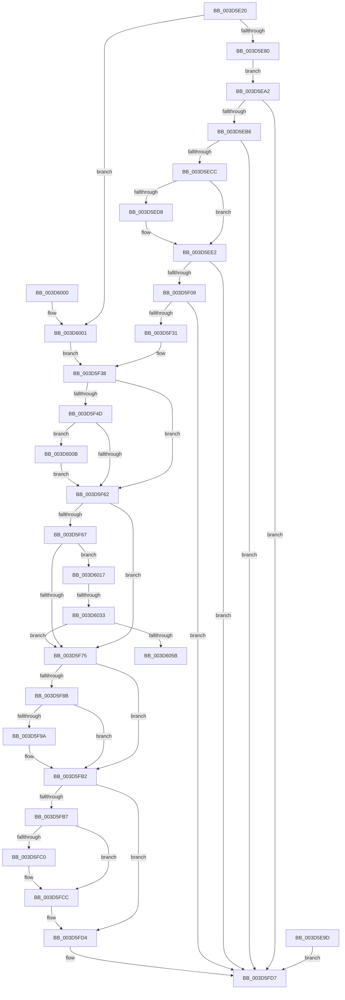

# KyRaiseException

- RVA: `0x003D5E20`–`0x003D6060` (길이 `576` bytes)
- VA: `0x00000001403D5E20`
- 실행 섹션: `.text`
- PDB 이름 있음: `예`; PDB Function 태그: `예`
- unwind 정보 RVA: `0x00093AC8`
- 디코드: `148`개 명령, `576/576` bytes 표시
- 미해석 바이트: `0` (있으면 어셈블리에 `.byte`로 보존)

> 이 문서는 커널 이미지의 기계어와 PDB 기호를 분석해 생성했습니다. 4번과 5번은 함수 원형과 자료형을 바이너리 사용 방식에서 추정한 C 해석이며 원본 소스 복구 결과는 아닙니다.

## 1. Dependencies

- 직접 호출 지점: **12**; 고유 호출 대상: **12**
- 직접 호출자로 확인된 함수: **1**
- RIP 상대 이미지 참조: **2**

### Outgoing calls
- `0x003D5EA9` → [RtlpSanitizeContextFlags](RtlpSanitizeContextFlags_function_003D7070.md) (function, `0x003D7070`)
- `0x003D5EBF` → [RtlGetExtendedContextLength](RtlGetExtendedContextLength_function_003D7190.md) (function, `0x003D7190`)
- `0x003D5EE9` → [_chkstk](../6B/_chkstk_function_006BA960.md) (function, `0x006BA960`)
- `0x003D5EFC` → [RtlInitializeExtendedContext](RtlInitializeExtendedContext_function_003D7220.md) (function, `0x003D7220`)
- `0x003D5F24` → [RtlpReadExtendedContext](../../page/8D/RtlpReadExtendedContext_function_008D61D0.md) (function, `0x008D61D0`)
- `0x003D5F7F` → [RtlpValidateContextXStateDisabledFeatures](RtlpValidateContextXStateDisabledFeatures_function_003D6068.md) (function, `0x003D6068`)
- `0x003D5FAD` → [KeContextToKframes](../4F/KeContextToKframes_function_004FD790.md) (function, `0x004FD790`)
- `0x003D5FC7` → [KiLowerIrqlProcessIrqlFlags](../4F/KiLowerIrqlProcessIrqlFlags_function_004F5698.md) (function, `0x004F5698`)
- `0x003D5FDE` → [_security_check_cookie](../6A/_security_check_cookie_function_006AC640.md) (function, `0x006AC640`)
- `0x003D600D` → [KiRaiseIrqlProcessIrqlFlags](../4F/KiRaiseIrqlProcessIrqlFlags_function_004F56FC.md) (function, `0x004F56FC`)
- `0x003D6026` → [KeVerifyContextXStateCetU](KeVerifyContextXStateCetU_function_003D72D0.md) (function, `0x003D72D0`)
- `0x003D604E` → [KeVerifyContextRecord](../40/KeVerifyContextRecord_function_0040BE90.md) (function, `0x0040BE90`)

### Direct callers
- [KiRaiseException](KiRaiseException_function_003D5CA0.md) at `0x003D5D78`

### Static image references
- `0x003D5E42` → RVA `0x00E0A740` (`.data`; read)
- `0x003D5F55` → RVA `0x00FC6D20` (`ALMOSTRO`; read)

## 2. Other-region calls and transfers

- 다른 실행 섹션으로 향하는 call: **1**
  - `0x003D5F24` → [RtlpReadExtendedContext](../../page/8D/RtlpReadExtendedContext_function_008D61D0.md) (`.text` → `PAGE`)
- call이 아닌 외부 분기/꼬리 이동: **2**
  - `0x003D602D` → [sub_006E9864](../6E/Unknown_function_006E9864.md) (`tail-transfer`)
  - `0x003D605B` → [sub_006E9864](../6E/Unknown_function_006E9864.md) (`tail-transfer`)

## 3. Assembly (complete function range)

```asm
003D5E20  40 55                           push rbp
003D5E22  41 54                           push r12
003D5E24  41 55                           push r13
003D5E26  41 56                           push r14
003D5E28  41 57                           push r15
003D5E2A  48 83 EC 70                     sub rsp, 0x70
003D5E2E  48 8D 6C 24 30                  lea rbp, [rsp + 0x30]
003D5E33  48 89 5D 70                     mov qword ptr [rbp + 0x70], rbx
003D5E37  48 89 75 78                     mov qword ptr [rbp + 0x78], rsi
003D5E3B  48 89 BD 80 00 00 00            mov qword ptr [rbp + 0x80], rdi
003D5E42  48 8B 05 F7 48 A3 00            mov rax, qword ptr [rip + 0xa348f7]
003D5E49  48 33 C5                        xor rax, rbp
003D5E4C  48 89 45 38                     mov qword ptr [rbp + 0x38], rax
003D5E50  4C 89 4D 10                     mov qword ptr [rbp + 0x10], r9
003D5E54  4C 89 45 18                     mov qword ptr [rbp + 0x18], r8
003D5E58  48 8B F2                        mov rsi, rdx
003D5E5B  4C 8B E9                        mov r13, rcx
003D5E5E  33 FF                           xor edi, edi
003D5E60  48 89 7D 08                     mov qword ptr [rbp + 8], rdi
003D5E64  89 7D 04                        mov dword ptr [rbp + 4], edi
003D5E67  65 48 8B 04 25 88 01 00 00      mov rax, qword ptr gs:[0x188]
003D5E70  44 8A B8 32 02 00 00            mov r15b, byte ptr [rax + 0x232]
003D5E77  45 84 FF                        test r15b, r15b
003D5E7A  0F 84 81 01 00 00               je 0x1403d6001
003D5E80  48 8D 42 30                     lea rax, [rdx + 0x30]
003D5E84  48 B9 00 00 FF FF FF 7F 00 00   movabs rcx, 0x7fffffff0000
003D5E8E  48 3B C1                        cmp rax, rcx
003D5E91  48 0F 43 C1                     cmovae rax, rcx
003D5E95  90                              nop
003D5E96  8B 00                           mov eax, dword ptr [rax]
003D5E98  89 45 00                        mov dword ptr [rbp], eax
003D5E9B  EB 05                           jmp 0x1403d5ea2
003D5E9D  E9 35 01 00 00                  jmp 0x1403d5fd7
003D5EA2  41 8A D7                        mov dl, r15b
003D5EA5  48 8D 4D 00                     lea rcx, [rbp]
003D5EA9  E8 C2 11 00 00                  call 0x1403d7070
003D5EAE  85 C0                           test eax, eax
003D5EB0  0F 88 21 01 00 00               js 0x1403d5fd7
003D5EB6  48 8D 55 04                     lea rdx, [rbp + 4]
003D5EBA  8B 5D 00                        mov ebx, dword ptr [rbp]
003D5EBD  8B CB                           mov ecx, ebx
003D5EBF  E8 CC 12 00 00                  call 0x1403d7190
003D5EC4  85 C0                           test eax, eax
003D5EC6  0F 88 0B 01 00 00               js 0x1403d5fd7
003D5ECC  8B 45 04                        mov eax, dword ptr [rbp + 4]
003D5ECF  48 8D 48 0F                     lea rcx, [rax + 0xf]
003D5ED3  48 3B C8                        cmp rcx, rax
003D5ED6  77 0A                           ja 0x1403d5ee2
003D5ED8  48 B9 F0 FF FF FF FF FF FF 0F   movabs rcx, 0xffffffffffffff0
003D5EE2  48 83 E1 F0                     and rcx, 0xfffffffffffffff0
003D5EE6  48 8B C1                        mov rax, rcx
003D5EE9  E8 72 4A 2E 00                  call 0x1406ba960
003D5EEE  48 2B E1                        sub rsp, rcx
003D5EF1  48 8D 4C 24 30                  lea rcx, [rsp + 0x30]
003D5EF6  4C 8D 45 08                     lea r8, [rbp + 8]
003D5EFA  8B D3                           mov edx, ebx
003D5EFC  E8 1F 13 00 00                  call 0x1403d7220
003D5F01  85 C0                           test eax, eax
003D5F03  0F 88 CE 00 00 00               js 0x1403d5fd7
003D5F09  48 89 7C 24 28                  mov qword ptr [rsp + 0x28], rdi
003D5F0E  48 89 74 24 20                  mov qword ptr [rsp + 0x20], rsi
003D5F13  44 8B CB                        mov r9d, ebx
003D5F16  48 8B 75 08                     mov rsi, qword ptr [rbp + 8]
003D5F1A  4C 8B C6                        mov r8, rsi
003D5F1D  BB 01 00 00 00                  mov ebx, 1
003D5F22  8A D3                           mov dl, bl
003D5F24  E8 A7 02 50 00                  call 0x1408d61d0
003D5F29  85 C0                           test eax, eax
003D5F2B  0F 88 A6 00 00 00               js 0x1403d5fd7
003D5F31  48 81 C6 30 FB FF FF            add rsi, -0x4d0
003D5F38  65 4C 8B 34 25 88 01 00 00      mov r14, qword ptr gs:[0x188]
003D5F41  44 8B E3                        mov r12d, ebx
003D5F44  44 0F 20 C7                     mov rdi, cr8
003D5F48  40 3A FB                        cmp dil, bl
003D5F4B  73 15                           jae 0x1403d5f62
003D5F4D  44 0F 20 C1                     mov rcx, cr8
003D5F51  44 0F 22 C3                     mov cr8, rbx
003D5F55  83 3D C4 0D BF 00 00            cmp dword ptr [rip + 0xbf0dc4], 0
003D5F5C  0F 85 A9 00 00 00               jne 0x1403d600b
003D5F62  45 84 FF                        test r15b, r15b
003D5F65  74 0E                           je 0x1403d5f75
003D5F67  41 F7 46 74 00 00 10 00         test dword ptr [r14 + 0x74], 0x100000
003D5F6F  0F 85 A2 00 00 00               jne 0x1403d6017
003D5F75  49 8B 96 28 04 00 00            mov rdx, qword ptr [r14 + 0x428]
003D5F7C  48 8B CE                        mov rcx, rsi
003D5F7F  E8 E4 00 00 00                  call 0x1403d6068
003D5F84  44 8B F0                        mov r14d, eax
003D5F87  85 C0                           test eax, eax
003D5F89  78 27                           js 0x1403d5fb2
003D5F8B  48 8B 45 10                     mov rax, qword ptr [rbp + 0x10]
003D5F8F  88 58 2B                        mov byte ptr [rax + 0x2b], bl
003D5F92  45 33 F6                        xor r14d, r14d
003D5F95  45 85 E4                        test r12d, r12d
003D5F98  74 18                           je 0x1403d5fb2
003D5F9A  44 88 7C 24 20                  mov byte ptr [rsp + 0x20], r15b
003D5F9F  44 8B 4E 30                     mov r9d, dword ptr [rsi + 0x30]
003D5FA3  4C 8B C6                        mov r8, rsi
003D5FA6  48 8B 55 18                     mov rdx, qword ptr [rbp + 0x18]
003D5FAA  48 8B C8                        mov rcx, rax
003D5FAD  E8 DE 77 12 00                  call 0x1404fd790
003D5FB2  40 3A FB                        cmp dil, bl
003D5FB5  73 1D                           jae 0x1403d5fd4
003D5FB7  83 3D 62 0D BF 00 00            cmp dword ptr [rip + 0xbf0d62], 0
003D5FBE  74 0C                           je 0x1403d5fcc
003D5FC0  44 0F 20 C1                     mov rcx, cr8
003D5FC4  40 8A D7                        mov dl, dil
003D5FC7  E8 CC F6 11 00                  call 0x1404f5698
003D5FCC  40 0F B6 C7                     movzx eax, dil
003D5FD0  44 0F 22 C0                     mov cr8, rax
003D5FD4  41 8B C6                        mov eax, r14d
003D5FD7  48 8B 4D 38                     mov rcx, qword ptr [rbp + 0x38]
003D5FDB  48 33 CD                        xor rcx, rbp
003D5FDE  E8 5D 66 2D 00                  call 0x1406ac640
003D5FE3  48 8B 5D 70                     mov rbx, qword ptr [rbp + 0x70]
003D5FE7  48 8B 75 78                     mov rsi, qword ptr [rbp + 0x78]
003D5FEB  48 8B BD 80 00 00 00            mov rdi, qword ptr [rbp + 0x80]
003D5FF2  48 8D 65 40                     lea rsp, [rbp + 0x40]
003D5FF6  41 5F                           pop r15
003D5FF8  41 5E                           pop r14
003D5FFA  41 5D                           pop r13
003D5FFC  41 5C                           pop r12
003D5FFE  5D                              pop rbp
003D5FFF  C3                              ret
003D6000  CC                              int3
003D6001  BB 01 00 00 00                  mov ebx, 1
003D6006  E9 2D FF FF FF                  jmp 0x1403d5f38
003D600B  8A D3                           mov dl, bl
003D600D  E8 EA F6 11 00                  call 0x1404f56fc
003D6012  E9 4B FF FF FF                  jmp 0x1403d5f62
003D6017  48 83 65 08 00                  and qword ptr [rbp + 8], 0
003D601C  4C 8D 45 08                     lea r8, [rbp + 8]
003D6020  48 8B D6                        mov rdx, rsi
003D6023  49 8B CE                        mov rcx, r14
003D6026  E8 A5 12 00 00                  call 0x1403d72d0
003D602B  85 C0                           test eax, eax
003D602D  0F 88 31 38 31 00               js 0x1406e9864
003D6033  0F 57 C0                        xorps xmm0, xmm0
003D6036  33 C0                           xor eax, eax
003D6038  0F 11 45 20                     movups xmmword ptr [rbp + 0x20], xmm0
003D603C  48 89 45 30                     mov qword ptr [rbp + 0x30], rax
003D6040  4C 8D 4D 08                     lea r9, [rbp + 8]
003D6044  4C 8D 45 20                     lea r8, [rbp + 0x20]
003D6048  48 8B D6                        mov rdx, rsi
003D604B  49 8B CE                        mov rcx, r14
003D604E  E8 3D 5E 03 00                  call 0x14040be90
003D6053  85 C0                           test eax, eax
003D6055  0F 89 1A FF FF FF               jns 0x1403d5f75
003D605B  E9 04 38 31 00                  jmp 0x1406e9864
```

## 4. C-style interpretation (structured pseudocode)

```c
__int64 __fastcall KyRaiseException(__int64 a1, __int64 a2, __int64 a3, __int64 a4)
{
    __int64 result;
    __int64 v_r14;
    __int64 v_rdi;
    __int64 v_rsi;
    __int64 v_rsp;
    unsigned __int64 v_stack_m28;
    unsigned __int64 v_stack_m30;
    unsigned __int64 v_stack_m38;
    unsigned __int64 v_stack_m48;
    unsigned __int64 v_stack_m50;
    unsigned __int64 v_stack_m58;
    unsigned __int64 v_stack_m60;
    unsigned int v_stack_m64;
    unsigned __int64 v_stack_m68;
    unsigned __int64 v_stack_m70;
    unsigned __int64 v_stack_m78;
    unsigned __int64 v_stack_p10;
    unsigned __int64 v_stack_p18;
    unsigned __int64 v_stack_p8;

    v_rsp = (v_rsp) - (112);
    v_stack_p8 = v_rbx;
    v_stack_p10 = v_rsi;
    v_stack_p18 = v_rdi;
    result = (*(unsigned __int64 *)(v_rip + 10701047)) ^ (v_stack_m68);
    v_stack_m30 = result;
    v_stack_m58 = a4;
    v_stack_m50 = a3;
    v_rdi = 0;
    v_stack_m60 = 0;
    v_stack_m64 = 0;
    if ((unsigned __int8)(*(unsigned __int8 *)(*(unsigned __int64 *)(gs_base + (0 + 392)) + 562)) == 0) goto loc_003D6001;
    result = a2 + 48;
    if ((a2 + 48) >= a1) { result = a1; }
    v_stack_m68 = (unsigned int)((unsigned int)(*(unsigned int *)(result)));
    goto loc_003D5EA2;
loc_003D5EA2:
    result = RtlpSanitizeContextFlags(v_stack_m68, (unsigned __int8)(*(unsigned __int8 *)(*(unsigned __int64 *)(gs_base + (0 + 392)) + 562)), a3, a4);
    if (sign_flag) goto loc_003D5FD7;
    result = RtlGetExtendedContextLength((unsigned int)((unsigned int)((unsigned int)(v_stack_m68))), v_stack_m64, a3, a4);
    if (sign_flag) goto loc_003D5FD7;
    if (((unsigned int)(v_stack_m64) + 15) <= ((unsigned int)(v_stack_m64))) {
    }
    a1 = ((unsigned int)(v_stack_m64) + 15) & (-16);
    result = _chkstk(a1, v_stack_m64, a3, a4);
    v_rsp = (v_rsp) - (a1);
    result = RtlInitializeExtendedContext(v_stack_m68, (unsigned int)((unsigned int)((unsigned int)(v_stack_m68))), v_stack_m60, a4);
    if (sign_flag) goto loc_003D5FD7;
    v_stack_m70 = 0;
    v_stack_m78 = a2;
    result = RtlpReadExtendedContext(v_stack_m68, 1, v_stack_m60, (unsigned int)((unsigned int)((unsigned int)(v_stack_m68))));
    if (sign_flag) goto loc_003D5FD7;
    v_rsi = (v_stack_m60) + (0xFFFFFFFFFFFFFB30ULL);
loc_003D5F38:
    if (((unsigned __int8)(v_cr8)) >= 1) goto loc_003D5F62;
    if ((*(unsigned int *)(v_rip + 12520900)) != 0) goto loc_003D600B;
loc_003D5F62:
    if ((unsigned __int8)(*(unsigned __int8 *)(*(unsigned __int64 *)(gs_base + (0 + 392)) + 562)) == 0) goto loc_003D5F75;
    if (((*(unsigned int *)(*(unsigned __int64 *)(gs_base + (0 + 392)) + 116)) & (0x100000ULL)) != 0) goto loc_003D6017;
loc_003D5F75:
    result = RtlpValidateContextXStateDisabledFeatures(v_rsi, *(unsigned __int64 *)(*(unsigned __int64 *)(gs_base + (0 + 392)) + 1064), v_stack_m60, (unsigned int)((unsigned int)((unsigned int)(v_stack_m68))));
    if (sign_flag) goto loc_003D5FB2;
    *(unsigned __int8 *)(v_stack_m58 + 43) = 1;
    v_r14 = 0;
    result = v_stack_m58;
    if (1 != 0) {
        v_stack_m78 = (unsigned __int8)(*(unsigned __int8 *)(*(unsigned __int64 *)(gs_base + (0 + 392)) + 562));
        a4 = *(unsigned int *)(v_rsi + 48);
        a3 = v_rsi;
        a2 = v_stack_m50;
        a1 = v_stack_m58;
        result = KeContextToKframes(a1, a2, a3, a4);
    }
    if (((unsigned __int8)(v_cr8)) >= 1) goto loc_003D5FD4;
    if ((*(unsigned int *)(v_rip + 12520802)) != 0) {
        a1 = 1;
        a2 = (unsigned __int8)(v_cr8);
        result = KiLowerIrqlProcessIrqlFlags(a1, a2, a3, a4);
    }
loc_003D5FD4:
loc_003D5FD7:
    a1 = (v_stack_m30) ^ (v_stack_m68);
    result = _security_check_cookie(a1, a2, a3, a4);
    return result;
loc_003D6001:
    goto loc_003D5F38;
loc_003D600B:
    result = KiRaiseIrqlProcessIrqlFlags(a1, 1, a3, a4);
    goto loc_003D5F62;
loc_003D6017:
    result = KeVerifyContextXStateCetU(0, v_stack_p10, v_stack_m60, a4);
    result = 0;
    v_stack_m48 = v_xmm0;
    v_stack_m38 = 0;
    result = KeVerifyContextRecord(0, v_stack_p10, v_stack_m48, v_stack_m60);
    if (!sign_flag) goto loc_003D5F75;
}
```

## 5. (Beta) C Style

```c
int64_t KyRaiseException(int64_t Arg1, void *Arg2, int64_t Arg3, int64_t Arg4)
{
    uint8_t *arg2 = (uint8_t *)Arg2;

    int64_t result;
    int64_t local_r14;
    int64_t local_rdi;
    int64_t local_rsi;
    int64_t local_rsp;
    uint64_t v_stack_m28;
    uint64_t v_stack_m30;
    uint64_t v_stack_m38;
    uint64_t v_stack_m48;
    uint64_t v_stack_m50;
    uint64_t v_stack_m58;
    uint64_t v_stack_m60;
    uint32_t v_stack_m64;
    uint64_t v_stack_m68;
    uint64_t v_stack_m70;
    uint64_t v_stack_m78;
    uint64_t v_stack_p10;
    uint64_t v_stack_p18;
    uint64_t v_stack_p8;

    local_rsp = (local_rsp) - (112);
    v_stack_p8 = local_rbx;
    v_stack_p10 = local_rsi;
    v_stack_p18 = local_rdi;
    result = (*(uint64_t *)(v_rip + 0xA348F7)) ^ (v_stack_m68);
    v_stack_m30 = result;
    v_stack_m58 = Arg4;
    v_stack_m50 = Arg3;
    local_rdi = 0;
    v_stack_m60 = 0;
    v_stack_m64 = 0;
    if ((uint8_t)(*(uint8_t *)(*(uint64_t *)(gs_base + (0 + 0x188)) + 0x232)) == 0) goto loc_003D6001;
    result = Arg2 + 48;
    if ((Arg2 + 48) >= Arg1) { result = Arg1; }
    v_stack_m68 = (uint32_t)((uint32_t)(*(uint32_t *)(result)));
    goto loc_003D5EA2;
loc_003D5EA2:
    result = RtlpSanitizeContextFlags(v_stack_m68, (uint8_t)(*(uint8_t *)(*(uint64_t *)(gs_base + (0 + 0x188)) + 0x232)), Arg3, Arg4);
    if (sign_flag) goto loc_003D5FD7;
    result = RtlGetExtendedContextLength((uint32_t)((uint32_t)((uint32_t)(v_stack_m68))), v_stack_m64, Arg3, Arg4);
    if (sign_flag) goto loc_003D5FD7;
    if (((uint32_t)(v_stack_m64) + 15) <= ((uint32_t)(v_stack_m64))) {
    }
    Arg1 = ((uint32_t)(v_stack_m64) + 15) & (-16);
    result = _chkstk(Arg1, v_stack_m64, Arg3, Arg4);
    local_rsp = (local_rsp) - (Arg1);
    result = RtlInitializeExtendedContext(v_stack_m68, (uint32_t)((uint32_t)((uint32_t)(v_stack_m68))), v_stack_m60, Arg4);
    if (sign_flag) goto loc_003D5FD7;
    v_stack_m70 = 0;
    v_stack_m78 = Arg2;
    result = RtlpReadExtendedContext(v_stack_m68, 1, v_stack_m60, (uint32_t)((uint32_t)((uint32_t)(v_stack_m68))));
    if (sign_flag) goto loc_003D5FD7;
    local_rsi = (v_stack_m60) + (0xFFFFFFFFFFFFFB30ULL);
loc_003D5F38:
    if (((uint8_t)(v_cr8)) >= 1) goto loc_003D5F62;
    if ((*(uint32_t *)(v_rip + 0xBF0DC4)) != 0) goto loc_003D600B;
loc_003D5F62:
    if ((uint8_t)(*(uint8_t *)(*(uint64_t *)(gs_base + (0 + 0x188)) + 0x232)) == 0) goto loc_003D5F75;
    if (((*(uint32_t *)(*(uint64_t *)(gs_base + (0 + 0x188)) + 0x74)) & (0x100000ULL)) != 0) goto loc_003D6017;
loc_003D5F75:
    result = RtlpValidateContextXStateDisabledFeatures(local_rsi, *(uint64_t *)(*(uint64_t *)(gs_base + (0 + 0x188)) + 0x428), v_stack_m60, (uint32_t)((uint32_t)((uint32_t)(v_stack_m68))));
    if (sign_flag) goto loc_003D5FB2;
    *(uint8_t *)(v_stack_m58 + 0x2B) = 1;
    local_r14 = 0;
    result = v_stack_m58;
    if (1 != 0) {
        v_stack_m78 = (uint8_t)(*(uint8_t *)(*(uint64_t *)(gs_base + (0 + 0x188)) + 0x232));
        Arg4 = *(uint32_t *)(local_rsi + 0x30);
        Arg3 = local_rsi;
        Arg2 = v_stack_m50;
        Arg1 = v_stack_m58;
        result = KeContextToKframes(Arg1, Arg2, Arg3, Arg4);
    }
    if (((uint8_t)(v_cr8)) >= 1) goto loc_003D5FD4;
    if ((*(uint32_t *)(v_rip + 0xBF0D62)) != 0) {
        Arg1 = 1;
        Arg2 = (uint8_t)(v_cr8);
        result = KiLowerIrqlProcessIrqlFlags(Arg1, Arg2, Arg3, Arg4);
    }
loc_003D5FD4:
loc_003D5FD7:
    Arg1 = (v_stack_m30) ^ (v_stack_m68);
    result = _security_check_cookie(Arg1, Arg2, Arg3, Arg4);
    return result;
loc_003D6001:
    goto loc_003D5F38;
loc_003D600B:
    result = KiRaiseIrqlProcessIrqlFlags(Arg1, 1, Arg3, Arg4);
    goto loc_003D5F62;
loc_003D6017:
    result = KeVerifyContextXStateCetU(0, v_stack_p10, v_stack_m60, Arg4);
    result = 0;
    v_stack_m48 = v_xmm0;
    v_stack_m38 = 0;
    result = KeVerifyContextRecord(0, v_stack_p10, v_stack_m48, v_stack_m60);
    if (!sign_flag) goto loc_003D5F75;
}
```

### 관측된 메모리 오프셋

구조체 형식이 확인되지 않은 접근은 인자 기준의 오프셋으로만 기록했습니다.

| 기준 인자 | 오프셋 표현 | 폭 (bit) | 접근 |
|---|---:|---:|---|
| `Arg2` | `+ 0x30` | `64` | `R` |

## 6. Execution-region graph

[열기: 2D/3D 그래프와 함수 탐색 컨트롤 패널](../../../control-panel.html?section=text&rva=0x003D5E20&view=graph)

- 2D 그래프는 위에서 아래로 흐르고, 3D 그래프는 빈 공간을 드래그해 회전합니다. Shift+드래그는 이동, 휠은 확대·축소, 함수 노드 선택은 대상 보고서 이동입니다.

### Static fallback


