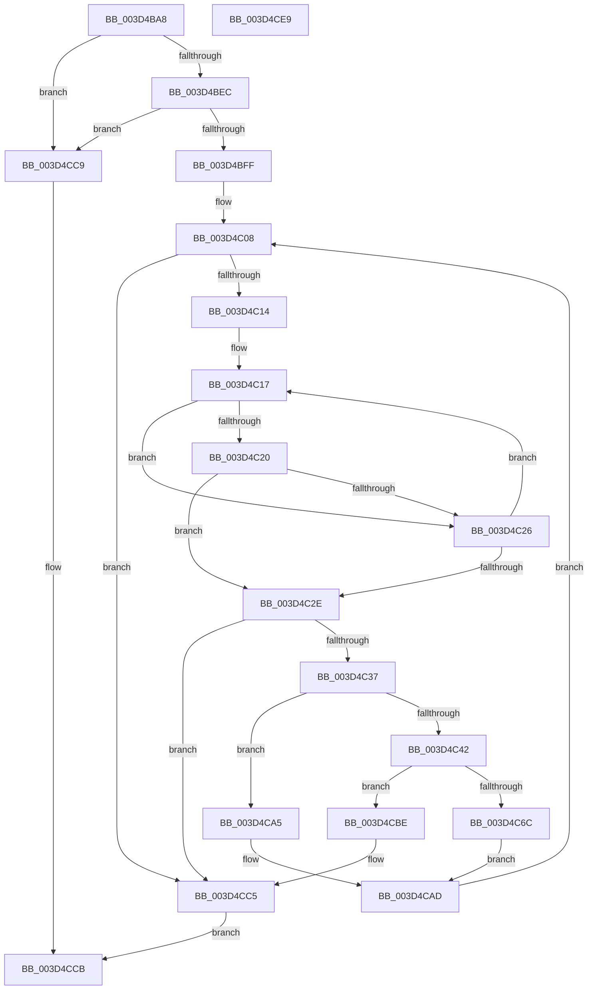

# MiCheckHoldFaultForHotPatch

- RVA: `0x003D4BA8`–`0x003D4CEA` (길이 `322` bytes)
- VA: `0x00000001403D4BA8`
- 실행 섹션: `.text`
- PDB 이름 있음: `예`; PDB Function 태그: `아니요`
- unwind 정보 RVA: `0x00092598`
- 디코드: `91`개 명령, `322/322` bytes 표시
- 미해석 바이트: `0` (있으면 어셈블리에 `.byte`로 보존)

> 이 문서는 커널 이미지의 기계어와 PDB 기호를 분석해 생성했습니다. 4번과 5번은 함수 원형과 자료형을 바이너리 사용 방식에서 추정한 C 해석이며 원본 소스 복구 결과는 아닙니다.

## 1. Dependencies

- 직접 호출 지점: **4**; 고유 호출 대상: **3**
- 직접 호출자로 확인된 함수: **1**
- RIP 상대 이미지 참조: **0**

### Outgoing calls
- `0x003D4C86` → [MiUnlockFaultWorkingSet](../49/MiUnlockFaultWorkingSet_function_00498664.md) (function, `0x00498664`)
- `0x003D4C9E` → [KeWaitForSingleObject](../20/KeWaitForSingleObject_function_0020E6B0.md) (function, `0x0020E6B0`)
- `0x003D4CA8` → [MiUnlockFaultWorkingSet](../49/MiUnlockFaultWorkingSet_function_00498664.md) (function, `0x00498664`)
- `0x003D4CB0` → [MiLockWorkingSetExclusive](../32/MiLockWorkingSetExclusive_function_003238A0.md) (function, `0x003238A0`)

### Direct callers
- [MiUserFault](../32/MiUserFault_function_00329840.md) at `0x0032A06B`

### Static image references
- 디코드된 RIP-relative 메모리 참조가 없습니다.

## 2. Other-region calls and transfers

- 다른 실행 섹션으로 향하는 call: **0**
- 별도 외부 분기/꼬리 이동을 확인하지 못했습니다.

## 3. Assembly (complete function range)

```asm
003D4BA8  48 8B C4                        mov rax, rsp
003D4BAB  48 89 58 08                     mov qword ptr [rax + 8], rbx
003D4BAF  48 89 70 10                     mov qword ptr [rax + 0x10], rsi
003D4BB3  48 89 78 18                     mov qword ptr [rax + 0x18], rdi
003D4BB7  4C 89 60 20                     mov qword ptr [rax + 0x20], r12
003D4BBB  55                              push rbp
003D4BBC  41 56                           push r14
003D4BBE  41 57                           push r15
003D4BC0  48 8B EC                        mov rbp, rsp
003D4BC3  48 83 EC 60                     sub rsp, 0x60
003D4BC7  33 C0                           xor eax, eax
003D4BC9  4C 8D 72 38                     lea r14, [rdx + 0x38]
003D4BCD  F6 42 08 02                     test byte ptr [rdx + 8], 2
003D4BD1  0F 57 C0                        xorps xmm0, xmm0
003D4BD4  4D 8B 26                        mov r12, qword ptr [r14]
003D4BD7  48 8B DA                        mov rbx, rdx
003D4BDA  0F 11 45 D0                     movups xmmword ptr [rbp - 0x30], xmm0
003D4BDE  48 89 45 F0                     mov qword ptr [rbp - 0x10], rax
003D4BE2  0F 11 45 E0                     movups xmmword ptr [rbp - 0x20], xmm0
003D4BE6  0F 84 DD 00 00 00               je 0x1403d4cc9
003D4BEC  48 B8 FF FF FE FF FF 7F 00 00   movabs rax, 0x7ffffffeffff
003D4BF6  48 39 02                        cmp qword ptr [rdx], rax
003D4BF9  0F 87 CA 00 00 00               ja 0x1403d4cc9
003D4BFF  33 F6                           xor esi, esi
003D4C01  48 8D 79 18                     lea rdi, [rcx + 0x18]
003D4C05  45 33 FF                        xor r15d, r15d
003D4C08  48 8B 07                        mov rax, qword ptr [rdi]
003D4C0B  48 3B C7                        cmp rax, rdi
003D4C0E  0F 84 B1 00 00 00               je 0x1403d4cc5
003D4C14  48 8B 0B                        mov rcx, qword ptr [rbx]
003D4C17  4C 8B F8                        mov r15, rax
003D4C1A  48 3B 48 10                     cmp rcx, qword ptr [rax + 0x10]
003D4C1E  72 06                           jb 0x1403d4c26
003D4C20  48 3B 48 18                     cmp rcx, qword ptr [rax + 0x18]
003D4C24  76 08                           jbe 0x1403d4c2e
003D4C26  48 8B 00                        mov rax, qword ptr [rax]
003D4C29  48 3B C7                        cmp rax, rdi
003D4C2C  75 E9                           jne 0x1403d4c17
003D4C2E  48 3B C7                        cmp rax, rdi
003D4C31  0F 84 8E 00 00 00               je 0x1403d4cc5
003D4C37  BE 01 00 00 00                  mov esi, 1
003D4C3C  40 84 73 45                     test byte ptr [rbx + 0x45], sil
003D4C40  74 63                           je 0x1403d4ca5
003D4C42  66 83 65 E0 00                  and word ptr [rbp - 0x20], 0
003D4C47  48 8D 45 E8                     lea rax, [rbp - 0x18]
003D4C4B  83 65 E4 00                     and dword ptr [rbp - 0x1c], 0
003D4C4F  48 89 45 F0                     mov qword ptr [rbp - 0x10], rax
003D4C53  48 8D 45 E8                     lea rax, [rbp - 0x18]
003D4C57  48 89 45 E8                     mov qword ptr [rbp - 0x18], rax
003D4C5B  49 8D 47 20                     lea rax, [r15 + 0x20]
003D4C5F  C6 45 E2 06                     mov byte ptr [rbp - 0x1e], 6
003D4C63  48 8B 48 08                     mov rcx, qword ptr [rax + 8]
003D4C67  48 39 01                        cmp qword ptr [rcx], rax
003D4C6A  75 52                           jne 0x1403d4cbe
003D4C6C  48 89 4D D8                     mov qword ptr [rbp - 0x28], rcx
003D4C70  48 8D 55 D0                     lea rdx, [rbp - 0x30]
003D4C74  48 89 45 D0                     mov qword ptr [rbp - 0x30], rax
003D4C78  48 89 11                        mov qword ptr [rcx], rdx
003D4C7B  48 8D 4D D0                     lea rcx, [rbp - 0x30]
003D4C7F  48 89 48 08                     mov qword ptr [rax + 8], rcx
003D4C83  49 8B CE                        mov rcx, r14
003D4C86  E8 D9 39 0C 00                  call 0x140498664
003D4C8B  48 83 64 24 20 00               and qword ptr [rsp + 0x20], 0
003D4C91  8D 56 19                        lea edx, [rsi + 0x19]
003D4C94  45 33 C9                        xor r9d, r9d
003D4C97  48 8D 4D E0                     lea rcx, [rbp - 0x20]
003D4C9B  45 33 C0                        xor r8d, r8d
003D4C9E  E8 0D 9A E3 FF                  call 0x14020e6b0
003D4CA3  EB 08                           jmp 0x1403d4cad
003D4CA5  49 8B CE                        mov rcx, r14
003D4CA8  E8 B7 39 0C 00                  call 0x140498664
003D4CAD  49 8B CC                        mov rcx, r12
003D4CB0  E8 EB EB F4 FF                  call 0x1403238a0
003D4CB5  40 08 73 45                     or byte ptr [rbx + 0x45], sil
003D4CB9  E9 4A FF FF FF                  jmp 0x1403d4c08
003D4CBE  B9 03 00 00 00                  mov ecx, 3
003D4CC3  CD 29                           int 0x29
003D4CC5  8B C6                           mov eax, esi
003D4CC7  EB 02                           jmp 0x1403d4ccb
003D4CC9  33 C0                           xor eax, eax
003D4CCB  4C 8D 5C 24 60                  lea r11, [rsp + 0x60]
003D4CD0  49 8B 5B 20                     mov rbx, qword ptr [r11 + 0x20]
003D4CD4  49 8B 73 28                     mov rsi, qword ptr [r11 + 0x28]
003D4CD8  49 8B 7B 30                     mov rdi, qword ptr [r11 + 0x30]
003D4CDC  4D 8B 63 38                     mov r12, qword ptr [r11 + 0x38]
003D4CE0  49 8B E3                        mov rsp, r11
003D4CE3  41 5F                           pop r15
003D4CE5  41 5E                           pop r14
003D4CE7  5D                              pop rbp
003D4CE8  C3                              ret
003D4CE9  CC                              int3
```

## 4. C-style interpretation (structured pseudocode)

```c
__int64 __fastcall MiCheckHoldFaultForHotPatch(__int64 a1, __int64 a2, int a3, int a4)
{
    __int64 result;
    __int64 v_r15;
    __int64 v_rsi;
    __int64 v_rsp;
    unsigned __int64 v_stack_m18;
    unsigned __int64 v_stack_m28;
    unsigned __int64 v_stack_m30;
    unsigned int v_stack_m34;
    unsigned __int8 v_stack_m36;
    unsigned __int64 v_stack_m38;
    unsigned __int64 v_stack_m40;
    unsigned __int64 v_stack_m48;
    unsigned __int64 v_stack_m58;

    *(unsigned __int64 *)(v_rsp + 8) = v_rbx;
    *(unsigned __int64 *)(v_rsp + 16) = v_rsi;
    *(unsigned __int64 *)(v_rsp + 24) = v_rdi;
    *(unsigned __int64 *)(v_rsp + 32) = v_r12;
    v_rsp = (v_rsp) - (96);
    result = 0;
    v_stack_m48 = v_xmm0;
    v_stack_m28 = 0;
    v_stack_m38 = v_xmm0;
    if (((*(unsigned __int8 *)(a2 + 8)) & (2)) == 0) goto loc_003D4CC9;
    if ((*(unsigned __int64 *)(a2)) > 0) goto loc_003D4CC9;
    v_rsi = 0;
    v_r15 = 0;
loc_003D4C08:
    if ((*(unsigned __int64 *)(a1 + 24)) == (a1 + 24)) goto loc_003D4CC5;
loc_003D4C17:
    if ((*(unsigned __int64 *)(a2)) < (*(unsigned __int64 *)(*(unsigned __int64 *)(a1 + 24) + 16))) goto loc_003D4C26;
    if ((*(unsigned __int64 *)(a2)) <= (*(unsigned __int64 *)(*(unsigned __int64 *)(a1 + 24) + 24))) goto loc_003D4C2E;
loc_003D4C26:
    if ((*(unsigned __int64 *)(*(unsigned __int64 *)(a1 + 24))) != (a1 + 24)) goto loc_003D4C17;
loc_003D4C2E:
    if ((*(unsigned __int64 *)(*(unsigned __int64 *)(a1 + 24))) == (a1 + 24)) goto loc_003D4CC5;
    if (((*(unsigned __int8 *)(a2 + 69)) & (1)) == 0) goto loc_003D4CA5;
    v_stack_m28 = v_stack_m30;
    v_stack_m30 = v_stack_m30;
    v_stack_m36 = 6;
    if ((*(unsigned __int64 *)(*(unsigned __int64 *)(*(unsigned __int64 *)(a1 + 24) + 32 + 8))) != (*(unsigned __int64 *)(a1 + 24) + 32)) goto loc_003D4CBE;
    v_stack_m40 = *(unsigned __int64 *)(*(unsigned __int64 *)(a1 + 24) + 32 + 8);
    v_stack_m48 = *(unsigned __int64 *)(a1 + 24) + 32;
    *(unsigned __int64 *)(*(unsigned __int64 *)(*(unsigned __int64 *)(a1 + 24) + 32 + 8)) = v_stack_m48;
    *(unsigned __int64 *)(*(unsigned __int64 *)(a1 + 24) + 32 + 8) = v_stack_m48;
    result = MiUnlockFaultWorkingSet(a2 + 56, v_stack_m48, a3, a4);
    a4 = 0;
    a3 = 0;
    result = KeWaitForSingleObject(v_stack_m38, 1 + 25, a3, a4);
    goto loc_003D4CAD;
loc_003D4CA5:
    result = MiUnlockFaultWorkingSet(a2 + 56, 1 + 25, a3, a4);
loc_003D4CAD:
    result = MiLockWorkingSetExclusive(*(unsigned __int64 *)(a2 + 56), 1 + 25, a3, a4);
    goto loc_003D4C08;
loc_003D4CBE:
loc_003D4CC5:
    goto loc_003D4CCB;
loc_003D4CC9:
    result = 0;
loc_003D4CCB:
    return result;
}
```

## 5. (Beta) C Style

```c
int64_t MiCheckHoldFaultForHotPatch(void *Arg1, void *Arg2, int32_t Arg3, int32_t Arg4)
{
    uint8_t *arg1 = (uint8_t *)Arg1;
    uint8_t *arg2 = (uint8_t *)Arg2;

    int64_t result;
    int64_t local_r15;
    int64_t local_rsi;
    int64_t local_rsp;
    uint64_t v_stack_m18;
    uint64_t v_stack_m28;
    uint64_t v_stack_m30;
    uint32_t v_stack_m34;
    uint8_t v_stack_m36;
    uint64_t v_stack_m38;
    uint64_t v_stack_m40;
    uint64_t v_stack_m48;
    uint64_t v_stack_m58;

    *(uint64_t *)(local_rsp + 0x8) = local_rbx;
    *(uint64_t *)(local_rsp + 0x10) = local_rsi;
    *(uint64_t *)(local_rsp + 0x18) = local_rdi;
    *(uint64_t *)(local_rsp + 0x20) = local_r12;
    local_rsp = (local_rsp) - (96);
    result = 0;
    v_stack_m48 = v_xmm0;
    v_stack_m28 = 0;
    v_stack_m38 = v_xmm0;
    if (((*(uint8_t *)(arg2 + 0x8)) & (2)) == 0) goto loc_003D4CC9;
    if ((*(uint64_t *)(arg2)) > 0) goto loc_003D4CC9;
    local_rsi = 0;
    local_r15 = 0;
loc_003D4C08:
    if ((*(uint64_t *)(arg1 + 0x18)) == (Arg1 + 24)) goto loc_003D4CC5;
loc_003D4C17:
    if ((*(uint64_t *)(arg2)) < (*(uint64_t *)(*(uint64_t *)(arg1 + 0x18) + 0x10))) goto loc_003D4C26;
    if ((*(uint64_t *)(arg2)) <= (*(uint64_t *)(*(uint64_t *)(arg1 + 0x18) + 0x18))) goto loc_003D4C2E;
loc_003D4C26:
    if ((*(uint64_t *)(*(uint64_t *)(arg1 + 0x18))) != (Arg1 + 24)) goto loc_003D4C17;
loc_003D4C2E:
    if ((*(uint64_t *)(*(uint64_t *)(arg1 + 0x18))) == (Arg1 + 24)) goto loc_003D4CC5;
    if (((*(uint8_t *)(arg2 + 0x45)) & (1)) == 0) goto loc_003D4CA5;
    v_stack_m28 = v_stack_m30;
    v_stack_m30 = v_stack_m30;
    v_stack_m36 = 6;
    if ((*(uint64_t *)(*(uint64_t *)(*(uint64_t *)(arg1 + 0x18) + 0x20 + 0x8))) != (*(uint64_t *)(arg1 + 0x18) + 32)) goto loc_003D4CBE;
    v_stack_m40 = *(uint64_t *)(*(uint64_t *)(arg1 + 0x18) + 0x20 + 0x8);
    v_stack_m48 = *(uint64_t *)(arg1 + 0x18) + 32;
    *(uint64_t *)(*(uint64_t *)(*(uint64_t *)(arg1 + 0x18) + 0x20 + 0x8)) = v_stack_m48;
    *(uint64_t *)(*(uint64_t *)(arg1 + 0x18) + 0x20 + 0x8) = v_stack_m48;
    result = MiUnlockFaultWorkingSet(Arg2 + 56, v_stack_m48, Arg3, Arg4);
    Arg4 = 0;
    Arg3 = 0;
    result = KeWaitForSingleObject(v_stack_m38, 1 + 25, Arg3, Arg4);
    goto loc_003D4CAD;
loc_003D4CA5:
    result = MiUnlockFaultWorkingSet(Arg2 + 56, 1 + 25, Arg3, Arg4);
loc_003D4CAD:
    result = MiLockWorkingSetExclusive(*(uint64_t *)(arg2 + 0x38), 1 + 25, Arg3, Arg4);
    goto loc_003D4C08;
loc_003D4CBE:
loc_003D4CC5:
    goto loc_003D4CCB;
loc_003D4CC9:
    result = 0;
loc_003D4CCB:
    return result;
}
```

### 관측된 메모리 오프셋

구조체 형식이 확인되지 않은 접근은 인자 기준의 오프셋으로만 기록했습니다.

| 기준 인자 | 오프셋 표현 | 폭 (bit) | 접근 |
|---|---:|---:|---|
| `Arg1` | `+ 0x0` | `64` | `R` |
| `Arg1` | `+ 0x18` | `64` | `R` |
| `Arg2` | `+ 0x0` | `64` | `R` |
| `Arg2` | `+ 0x8` | `8` | `R` |
| `Arg2` | `+ 0x38` | `64` | `R` |
| `Arg2` | `+ 0x45` | `8` | `R` |
| `Arg2` | `+ 0x45` | `8` | `R/W` |

## 6. Execution-region graph

[열기: 2D/3D 그래프와 함수 탐색 컨트롤 패널](../../../control-panel.html?section=text&rva=0x003D4BA8&view=graph)

- 2D 그래프는 위에서 아래로 흐르고, 3D 그래프는 빈 공간을 드래그해 회전합니다. Shift+드래그는 이동, 휠은 확대·축소, 함수 노드 선택은 대상 보고서 이동입니다.

### Static fallback


