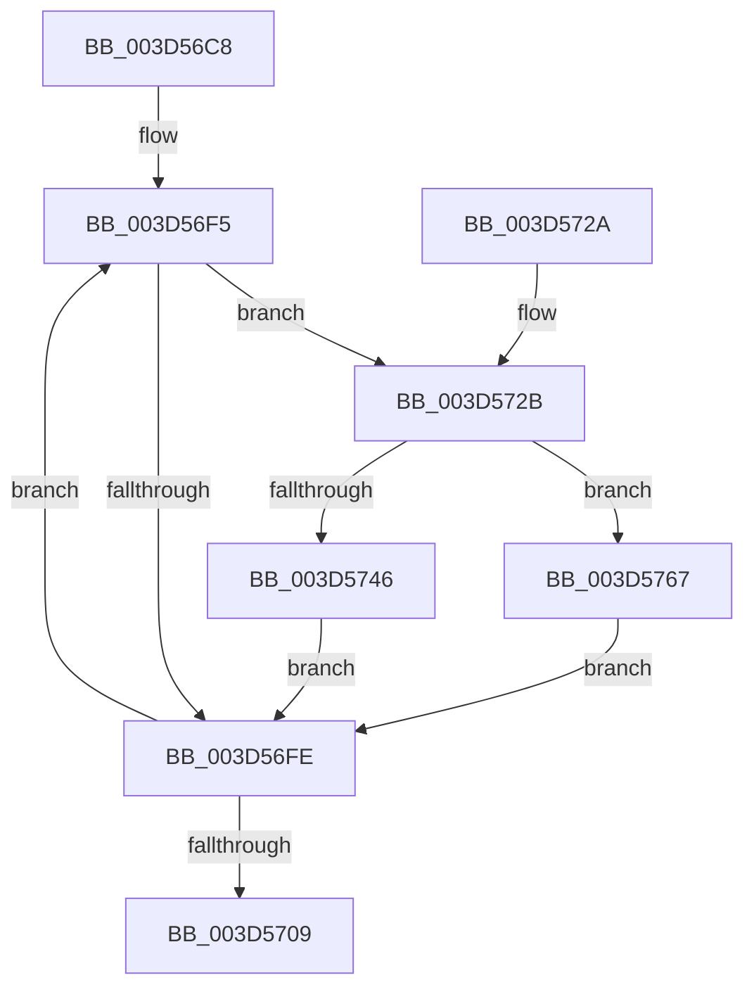

# MiClearEntireStandbyLookasideList

- RVA: `0x003D56C8`–`0x003D576B` (길이 `163` bytes)
- VA: `0x00000001403D56C8`
- 실행 섹션: `.text`
- PDB 이름 있음: `예`; PDB Function 태그: `아니요`
- unwind 정보 RVA: `0x000939F4`
- 디코드: `46`개 명령, `163/163` bytes 표시
- 미해석 바이트: `0` (있으면 어셈블리에 `.byte`로 보존)

> 이 문서는 커널 이미지의 기계어와 PDB 기호를 분석해 생성했습니다. 4번과 5번은 함수 원형과 자료형을 바이너리 사용 방식에서 추정한 C 해석이며 원본 소스 복구 결과는 아닙니다.

## 1. Dependencies

- 직접 호출 지점: **1**; 고유 호출 대상: **1**
- 직접 호출자로 확인된 함수: **1**
- RIP 상대 이미지 참조: **0**

### Outgoing calls
- `0x003D5751` → [MiWriteStandbyLookasideEntry](../33/MiWriteStandbyLookasideEntry_function_0033B530.md) (function, `0x0033B530`)

### Direct callers
- [sub_003D5182](Unknown_function_003D5182.md) at `0x003D51A5`

### Static image references
- 디코드된 RIP-relative 메모리 참조가 없습니다.

## 2. Other-region calls and transfers

- 다른 실행 섹션으로 향하는 call: **0**
- 별도 외부 분기/꼬리 이동을 확인하지 못했습니다.

## 3. Assembly (complete function range)

```asm
003D56C8  48 8B C4                        mov rax, rsp
003D56CB  48 89 58 08                     mov qword ptr [rax + 8], rbx
003D56CF  48 89 68 10                     mov qword ptr [rax + 0x10], rbp
003D56D3  48 89 70 18                     mov qword ptr [rax + 0x18], rsi
003D56D7  48 89 78 20                     mov qword ptr [rax + 0x20], rdi
003D56DB  41 54                           push r12
003D56DD  41 56                           push r14
003D56DF  41 57                           push r15
003D56E1  48 83 EC 20                     sub rsp, 0x20
003D56E5  45 8B F8                        mov r15d, r8d
003D56E8  4C 8B F2                        mov r14, rdx
003D56EB  BE 01 00 00 00                  mov esi, 1
003D56F0  33 DB                           xor ebx, ebx
003D56F2  48 8B FA                        mov rdi, rdx
003D56F5  48 8B 07                        mov rax, qword ptr [rdi]
003D56F8  48 83 F8 FF                     cmp rax, -1
003D56FC  75 2D                           jne 0x1403d572b
003D56FE  FF C3                           inc ebx
003D5700  48 83 C7 08                     add rdi, 8
003D5704  83 FB 40                        cmp ebx, 0x40
003D5707  72 EC                           jb 0x1403d56f5
003D5709  48 8B 5C 24 40                  mov rbx, qword ptr [rsp + 0x40]
003D570E  8B C6                           mov eax, esi
003D5710  48 8B 74 24 50                  mov rsi, qword ptr [rsp + 0x50]
003D5715  48 8B 6C 24 48                  mov rbp, qword ptr [rsp + 0x48]
003D571A  48 8B 7C 24 58                  mov rdi, qword ptr [rsp + 0x58]
003D571F  48 83 C4 20                     add rsp, 0x20
003D5723  41 5F                           pop r15
003D5725  41 5E                           pop r14
003D5727  41 5C                           pop r12
003D5729  C3                              ret
003D572A  CC                              int3
003D572B  48 8D 2C 40                     lea rbp, [rax + rax*2]
003D572F  48 C1 E5 04                     shl rbp, 4
003D5733  49 BC 18 00 00 00 00 DE FF FF   movabs r12, 0xffffde0000000018
003D573D  F0 49 0F BA 2C 2C 3F            lock bts qword ptr [r12 + rbp], 0x3f
003D5744  72 21                           jb 0x1403d5767
003D5746  49 8D 0C DE                     lea rcx, [r14 + rbx*8]
003D574A  49 83 C8 FF                     or r8, 0xffffffffffffffff
003D574E  41 8B D7                        mov edx, r15d
003D5751  E8 DA 5D F6 FF                  call 0x14033b530
003D5756  48 B8 FF FF FF FF FF FF FF 7F   movabs rax, 0x7fffffffffffffff
003D5760  F0 49 21 04 2C                  lock and qword ptr [r12 + rbp], rax
003D5765  EB 97                           jmp 0x1403d56fe
003D5767  33 F6                           xor esi, esi
003D5769  EB 93                           jmp 0x1403d56fe
```

## 4. C-style interpretation (structured pseudocode)

```c
__int64 __fastcall MiClearEntireStandbyLookasideList(__int64 a1, __int64 a2, __int64 a3)
{
    __int64 result;
    __int64 v_rbp;
    __int64 v_rbx;
    __int64 v_rdi;
    __int64 v_rsi;
    __int64 v_rsp;
    unsigned __int64 v_stack_p10;
    unsigned __int64 v_stack_p18;
    unsigned __int64 v_stack_p20;
    unsigned __int64 v_stack_p8;

    *(unsigned __int64 *)(v_rsp + 8) = v_rbx;
    *(unsigned __int64 *)(v_rsp + 16) = v_rbp;
    *(unsigned __int64 *)(v_rsp + 24) = v_rsi;
    *(unsigned __int64 *)(v_rsp + 32) = v_rdi;
    v_rsp = (v_rsp) - (32);
    v_rbx = 0;
loc_003D56F5:
    if ((*(unsigned __int64 *)(a2)) != -1) goto loc_003D572B;
loc_003D56FE:
    v_rbx = (unsigned int)((v_rbx) + 1);
    v_rdi = (a2) + (8);
    if (((unsigned int)(v_rbx)) < 64) goto loc_003D56F5;
    v_rsp = (v_rsp) + (32);
    return 1;
loc_003D572B:
    v_rbp = (1 + 1 * 2) << (4);
    if (condition_is_below) goto loc_003D5767;
    a3 = (a3) | (-1);
    result = MiWriteStandbyLookasideEntry(a2 + v_stack_p8 * 8, (unsigned int)((unsigned int)((unsigned int)((unsigned int)(a3)))), a3, a4);
    goto loc_003D56FE;
loc_003D5767:
    v_rsi = 0;
    goto loc_003D56FE;
}
```

## 5. (Beta) C Style

```c
int64_t MiClearEntireStandbyLookasideList(int64_t Arg1, void *Arg2, int64_t Arg3)
{
    uint8_t *arg2 = (uint8_t *)Arg2;

    int64_t result;
    int64_t local_rbp;
    int64_t local_rbx;
    int64_t local_rdi;
    int64_t local_rsi;
    int64_t local_rsp;
    uint64_t v_stack_p10;
    uint64_t v_stack_p18;
    uint64_t v_stack_p20;
    uint64_t v_stack_p8;

    *(uint64_t *)(local_rsp + 0x8) = local_rbx;
    *(uint64_t *)(local_rsp + 0x10) = local_rbp;
    *(uint64_t *)(local_rsp + 0x18) = local_rsi;
    *(uint64_t *)(local_rsp + 0x20) = local_rdi;
    local_rsp = (local_rsp) - (32);
    local_rbx = 0;
loc_003D56F5:
    if ((*(uint64_t *)(arg2)) != -1) goto loc_003D572B;
loc_003D56FE:
    local_rbx = (uint32_t)((local_rbx) + 1);
    local_rdi = (Arg2) + (8);
    if (((uint32_t)(local_rbx)) < 64) goto loc_003D56F5;
    local_rsp = (local_rsp) + (32);
    return 1;
loc_003D572B:
    local_rbp = (1 + 1 * 2) << (4);
    if (condition_is_below) goto loc_003D5767;
    Arg3 = (Arg3) | (-1);
    result = MiWriteStandbyLookasideEntry(Arg2 + v_stack_p8 * 8, (uint32_t)((uint32_t)((uint32_t)((uint32_t)(Arg3)))), Arg3, a4);
    goto loc_003D56FE;
loc_003D5767:
    local_rsi = 0;
    goto loc_003D56FE;
}
```

### 관측된 메모리 오프셋

구조체 형식이 확인되지 않은 접근은 인자 기준의 오프셋으로만 기록했습니다.

| 기준 인자 | 오프셋 표현 | 폭 (bit) | 접근 |
|---|---:|---:|---|
| `Arg2` | `+ 0x0` | `64` | `R` |
| `Arg2` | `+ 0x0 + rbx*8` | `64` | `R` |

## 6. Execution-region graph

[열기: 2D/3D 그래프와 함수 탐색 컨트롤 패널](../../../control-panel.html?section=text&rva=0x003D56C8&view=graph)

- 2D 그래프는 위에서 아래로 흐르고, 3D 그래프는 빈 공간을 드래그해 회전합니다. Shift+드래그는 이동, 휠은 확대·축소, 함수 노드 선택은 대상 보고서 이동입니다.

### Static fallback


