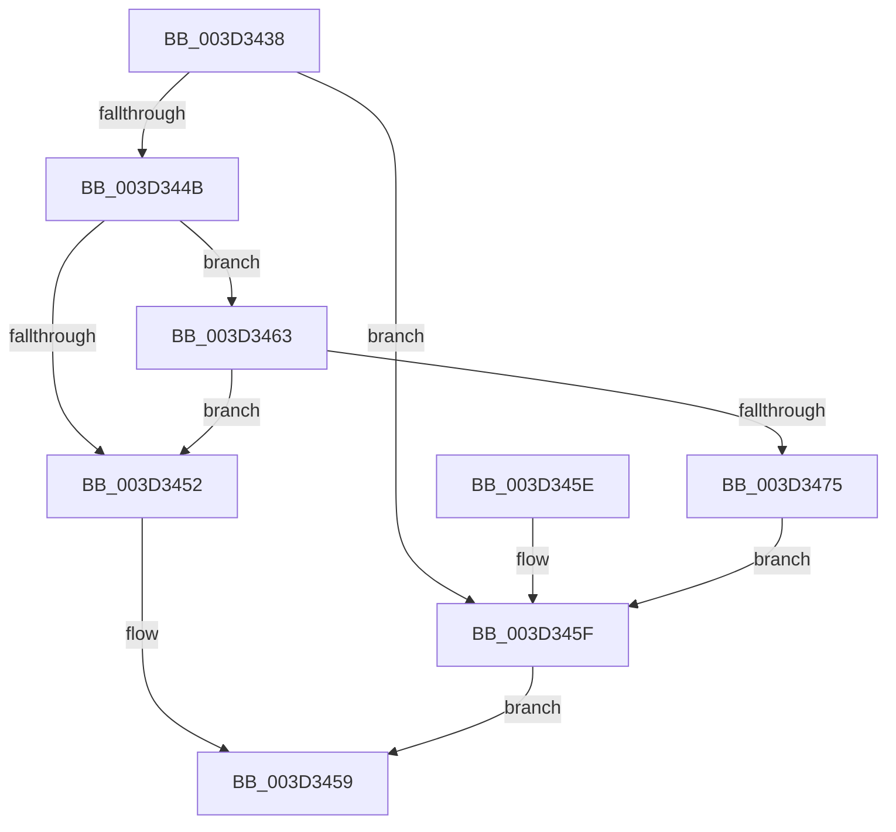

# MiComputePreferredNode

- RVA: `0x003D3438`–`0x003D3477` (길이 `63` bytes)
- VA: `0x00000001403D3438`
- 실행 섹션: `.text`
- PDB 이름 있음: `예`; PDB Function 태그: `아니요`
- unwind 정보 RVA: `0x00065F4C`
- 디코드: `22`개 명령, `63/63` bytes 표시
- 미해석 바이트: `0` (있으면 어셈블리에 `.byte`로 보존)

> 이 문서는 커널 이미지의 기계어와 PDB 기호를 분석해 생성했습니다. 4번과 5번은 함수 원형과 자료형을 바이너리 사용 방식에서 추정한 C 해석이며 원본 소스 복구 결과는 아닙니다.

## 1. Dependencies

- 직접 호출 지점: **1**; 고유 호출 대상: **1**
- 직접 호출자로 확인된 함수: **4**
- RIP 상대 이미지 참조: **0**

### Outgoing calls
- `0x003D3454` → [MiThreadIdealNode](MiThreadIdealNode_function_003D3480.md) (function, `0x003D3480`)

### Direct callers
- [MiCommitExistingVad](../32/MiCommitExistingVad_function_0032A860.md) at `0x0032B1B2`
- [MiMapUserLargePages](MiMapUserLargePages_function_003D26F4.md) at `0x003D277A`
- [MiCreateLargePfnList](MiCreateLargePfnList_function_003D2DA8.md) at `0x003D2EB7`
- [MiAllocateLargeProcessPagesFromCache](../69/MiAllocateLargeProcessPagesFromCache_function_0069818C.md) at `0x006982BF`

### Static image references
- 디코드된 RIP-relative 메모리 참조가 없습니다.

## 2. Other-region calls and transfers

- 다른 실행 섹션으로 향하는 call: **0**
- 별도 외부 분기/꼬리 이동을 확인하지 못했습니다.

## 3. Assembly (complete function range)

```asm
003D3438  48 83 EC 28                     sub rsp, 0x28
003D343C  44 8B 42 30                     mov r8d, dword ptr [rdx + 0x30]
003D3440  41 8B C0                        mov eax, r8d
003D3443  C1 E8 0C                        shr eax, 0xc
003D3446  83 E0 7F                        and eax, 0x7f
003D3449  75 14                           jne 0x1403d345f
003D344B  41 0F BA E0 15                  bt r8d, 0x15
003D3450  73 11                           jae 0x1403d3463
003D3452  33 D2                           xor edx, edx
003D3454  E8 27 00 00 00                  call 0x1403d3480
003D3459  48 83 C4 28                     add rsp, 0x28
003D345D  C3                              ret
003D345E  CC                              int3
003D345F  FF C8                           dec eax
003D3461  EB F6                           jmp 0x1403d3459
003D3463  48 8B 42 48                     mov rax, qword ptr [rdx + 0x48]
003D3467  48 8B 00                        mov rax, qword ptr [rax]
003D346A  8B 40 38                        mov eax, dword ptr [rax + 0x38]
003D346D  C1 E8 14                        shr eax, 0x14
003D3470  83 E0 7F                        and eax, 0x7f
003D3473  74 DD                           je 0x1403d3452
003D3475  EB E8                           jmp 0x1403d345f
```

## 4. C-style interpretation (structured pseudocode)

```c
__int64 __fastcall MiComputePreferredNode(__int64 a1, __int64 a2)
{
    __int64 result;
    __int64 v_rsp;

    v_rsp = (v_rsp) - (40);
    result = (unsigned int)(((unsigned int)((unsigned int)((unsigned int)(*(unsigned int *)(a2 + 48))))) >> (12));
    result = (unsigned int)((result) & (127));
    if (condition_is_not_equal) goto loc_003D345F;
    if (condition_is_above_or_equal) goto loc_003D3463;
loc_003D3452:
    a2 = 0;
    result = MiThreadIdealNode(a1, a2, (unsigned int)(*(unsigned int *)(a2 + 48)), a4);
loc_003D3459:
    v_rsp = (v_rsp) + (40);
    return result;
loc_003D345F:
    result = (unsigned int)((result) - 1);
    goto loc_003D3459;
loc_003D3463:
    result = (unsigned int)(((unsigned int)(*(unsigned int *)(*(unsigned __int64 *)(*(unsigned __int64 *)(a2 + 72)) + 56))) >> (20));
    result = (unsigned int)((result) & (127));
    if (condition_is_equal) goto loc_003D3452;
    goto loc_003D345F;
}
```

## 5. (Beta) C Style

```c
int64_t MiComputePreferredNode(int64_t Arg1, void *Arg2)
{
    uint8_t *arg2 = (uint8_t *)Arg2;

    int64_t result;
    int64_t local_rsp;

    local_rsp = (local_rsp) - (40);
    result = (uint32_t)(((uint32_t)((uint32_t)((uint32_t)(*(uint32_t *)(arg2 + 0x30))))) >> (12));
    result = (uint32_t)((result) & (127));
    if (condition_is_not_equal) goto loc_003D345F;
    if (condition_is_above_or_equal) goto loc_003D3463;
loc_003D3452:
    Arg2 = 0;
    result = MiThreadIdealNode(Arg1, Arg2, (uint32_t)(*(uint32_t *)(arg2 + 0x30)), a4);
loc_003D3459:
    local_rsp = (local_rsp) + (40);
    return result;
loc_003D345F:
    result = (uint32_t)((result) - 1);
    goto loc_003D3459;
loc_003D3463:
    result = (uint32_t)(((uint32_t)(*(uint32_t *)(*(uint64_t *)(*(uint64_t *)(arg2 + 0x48)) + 0x38))) >> (20));
    result = (uint32_t)((result) & (127));
    if (condition_is_equal) goto loc_003D3452;
    goto loc_003D345F;
}
```

### 관측된 메모리 오프셋

구조체 형식이 확인되지 않은 접근은 인자 기준의 오프셋으로만 기록했습니다.

| 기준 인자 | 오프셋 표현 | 폭 (bit) | 접근 |
|---|---:|---:|---|
| `Arg2` | `+ 0x30` | `32` | `R` |
| `Arg2` | `+ 0x48` | `64` | `R` |

## 6. Execution-region graph

[열기: 2D/3D 그래프와 함수 탐색 컨트롤 패널](../../../control-panel.html?section=text&rva=0x003D3438&view=graph)

- 2D 그래프는 위에서 아래로 흐르고, 3D 그래프는 빈 공간을 드래그해 회전합니다. Shift+드래그는 이동, 휠은 확대·축소, 함수 노드 선택은 대상 보고서 이동입니다.

### Static fallback


