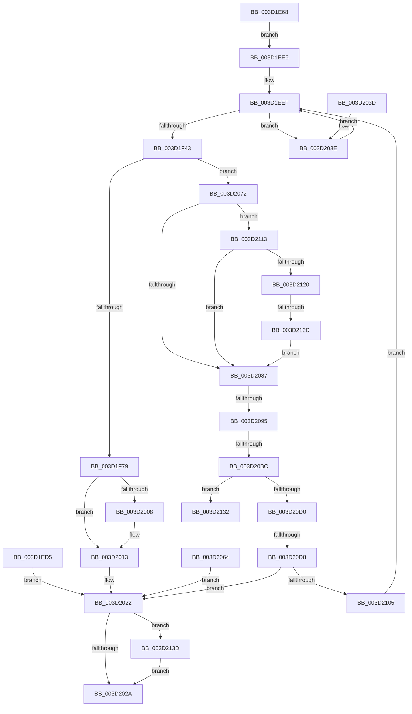

# MiCopyToUserVa

- RVA: `0x003D1E68`–`0x003D214F` (길이 `743` bytes)
- VA: `0x00000001403D1E68`
- 실행 섹션: `.text`
- PDB 이름 있음: `예`; PDB Function 태그: `예`
- unwind 정보 RVA: `0x00091358`
- 디코드: `175`개 명령, `743/743` bytes 표시
- 미해석 바이트: `0` (있으면 어셈블리에 `.byte`로 보존)

> 이 문서는 커널 이미지의 기계어와 PDB 기호를 분석해 생성했습니다. 4번과 5번은 함수 원형과 자료형을 바이너리 사용 방식에서 추정한 C 해석이며 원본 소스 복구 결과는 아닙니다.

## 1. Dependencies

- 직접 호출 지점: **14**; 고유 호출 대상: **10**
- 직접 호출자로 확인된 함수: **1**
- RIP 상대 이미지 참조: **1**

### Outgoing calls
- `0x003D1EF2` → [MiLockWorkingSetShared](../27/MiLockWorkingSetShared_function_0027CBF0.md) (function, `0x0027CBF0`)
- `0x003D1F31` → [MiMakeSystemAddressValid](../27/MiMakeSystemAddressValid_function_0027FF70.md) (function, `0x0027FF70`)
- `0x003D1F81` → [MiMapPageInHyperSpaceWorker](../33/MiMapPageInHyperSpaceWorker_function_00332B10.md) (function, `0x00332B10`)
- `0x003D1FAA` → [memcpy](../6C/memcpy_function_006C6840.md) (function, `0x006C6840`)
- `0x003D1FFE` → [MiLockPageAndSetDirty](../28/MiLockPageAndSetDirty_function_002857A0.md) (function, `0x002857A0`)
- `0x003D200E` → [MiUnlockPageTable](../21/MiUnlockPageTable_function_00216EC0.md) (function, `0x00216EC0`)
- `0x003D201A` → [MiUnlockWorkingSetShared](../27/MiUnlockWorkingSetShared_function_0027D690.md) (function, `0x0027D690`)
- `0x003D2044` → [MiUnlockPageTable](../21/MiUnlockPageTable_function_00216EC0.md) (function, `0x00216EC0`)
- `0x003D204F` → [MiUnlockWorkingSetShared](../27/MiUnlockWorkingSetShared_function_0027D690.md) (function, `0x0027D690`)
- `0x003D20A9` → [MiLocateCloneAddress](MiLocateCloneAddress_function_003D26B4.md) (function, `0x003D26B4`)
- `0x003D20DE` → [MiUnlockPageTable](../21/MiUnlockPageTable_function_00216EC0.md) (function, `0x00216EC0`)
- `0x003D20EA` → [MiUnlockWorkingSetShared](../27/MiUnlockWorkingSetShared_function_0027D690.md) (function, `0x0027D690`)
- `0x003D20F5` → [MiChargeFullProcessCommitment](../../page/88/MiChargeFullProcessCommitment_function_00887630.md) (function, `0x00887630`)
- `0x003D2145` → [MiReturnFullProcessCommitment](../../page/9E/MiReturnFullProcessCommitment_function_009E5D58.md) (function, `0x009E5D58`)

### Direct callers
- [MiCopyToCfgBitMap](../../page/8D/MiCopyToCfgBitMap_function_008D1140.md) at `0x008D1299`

### Static image references
- `0x003D1FE4` → RVA `0x00010880` (`.rdata`; read)

## 2. Other-region calls and transfers

- 다른 실행 섹션으로 향하는 call: **2**
  - `0x003D20F5` → [MiChargeFullProcessCommitment](../../page/88/MiChargeFullProcessCommitment_function_00887630.md) (`.text` → `PAGE`)
  - `0x003D2145` → [MiReturnFullProcessCommitment](../../page/9E/MiReturnFullProcessCommitment_function_009E5D58.md) (`.text` → `PAGE`)
- call이 아닌 외부 분기/꼬리 이동: **5**
  - `0x003D208F` → [sub_006E94B4](../6E/Unknown_function_006E94B4.md) (`tail-transfer`)
  - `0x003D20B6` → [sub_006E94B4](../6E/Unknown_function_006E94B4.md) (`tail-transfer`)
  - `0x003D20D2` → [sub_006E94B4](../6E/Unknown_function_006E94B4.md) (`tail-transfer`)
  - `0x003D2127` → [sub_006E94B4](../6E/Unknown_function_006E94B4.md) (`tail-transfer`)
  - `0x003D2138` → [sub_006E94B4](../6E/Unknown_function_006E94B4.md) (`tail-transfer`)

## 3. Assembly (complete function range)

```asm
003D1E68  48 8B C4                        mov rax, rsp
003D1E6B  4C 89 48 20                     mov qword ptr [rax + 0x20], r9
003D1E6F  4C 89 40 18                     mov qword ptr [rax + 0x18], r8
003D1E73  48 89 48 08                     mov qword ptr [rax + 8], rcx
003D1E77  53                              push rbx
003D1E78  56                              push rsi
003D1E79  57                              push rdi
003D1E7A  41 54                           push r12
003D1E7C  41 55                           push r13
003D1E7E  41 56                           push r14
003D1E80  41 57                           push r15
003D1E82  48 83 EC 60                     sub rsp, 0x60
003D1E86  48 83 60 B0 00                  and qword ptr [rax - 0x50], 0
003D1E8B  65 48 8B 04 25 88 01 00 00      mov rax, qword ptr gs:[0x188]
003D1E94  4C 8B B8 B8 00 00 00            mov r15, qword ptr [rax + 0xb8]
003D1E9B  4C 89 7C 24 50                  mov qword ptr [rsp + 0x50], r15
003D1EA0  49 8D BF 00 04 00 00            lea rdi, [r15 + 0x400]
003D1EA7  4C 8B E9                        mov r13, rcx
003D1EAA  49 C1 ED 09                     shr r13, 9
003D1EAE  48 B8 F8 FF FF FF 7F 00 00 00   movabs rax, 0x7ffffffff8
003D1EB8  4C 23 E8                        and r13, rax
003D1EBB  48 B8 00 00 00 00 80 F6 FF FF   movabs rax, 0xfffff68000000000
003D1EC5  48 8B C0                        mov rax, rax
003D1EC8  4C 03 E8                        add r13, rax
003D1ECB  33 F6                           xor esi, esi
003D1ECD  89 74 24 34                     mov dword ptr [rsp + 0x34], esi
003D1ED1  8A 01                           mov al, byte ptr [rcx]
003D1ED3  EB 11                           jmp 0x1403d1ee6
003D1ED5  44 8B F0                        mov r14d, eax
003D1ED8  4C 8B 7C 24 50                  mov r15, qword ptr [rsp + 0x50]
003D1EDD  8B 74 24 34                     mov esi, dword ptr [rsp + 0x34]
003D1EE1  E9 3C 01 00 00                  jmp 0x1403d2022
003D1EE6  8B 5A 30                        mov ebx, dword ptr [rdx + 0x30]
003D1EE9  C1 EB 0C                        shr ebx, 0xc
003D1EEC  83 E3 7F                        and ebx, 0x7f
003D1EEF  48 8B CF                        mov rcx, rdi
003D1EF2  E8 F9 AC EA FF                  call 0x14027cbf0
003D1EF7  88 44 24 30                     mov byte ptr [rsp + 0x30], al
003D1EFB  44 8A F0                        mov r14b, al
003D1EFE  89 74 24 38                     mov dword ptr [rsp + 0x38], esi
003D1F02  4D 8B E5                        mov r12, r13
003D1F05  49 C1 EC 09                     shr r12, 9
003D1F09  48 B8 F8 FF FF FF 7F 00 00 00   movabs rax, 0x7ffffffff8
003D1F13  4C 23 E0                        and r12, rax
003D1F16  48 B8 00 00 00 00 80 F6 FF FF   movabs rax, 0xfffff68000000000
003D1F20  48 8B C8                        mov rcx, rax
003D1F23  4C 03 E1                        add r12, rcx
003D1F26  45 33 C9                        xor r9d, r9d
003D1F29  45 8A C6                        mov r8b, r14b
003D1F2C  8B D3                           mov edx, ebx
003D1F2E  49 8B CD                        mov rcx, r13
003D1F31  E8 3A E0 EA FF                  call 0x14027ff70
003D1F36  49 8B 4D 00                     mov rcx, qword ptr [r13]
003D1F3A  F6 C1 01                        test cl, 1
003D1F3D  0F 84 FB 00 00 00               je 0x1403d203e
003D1F43  48 C1 E9 0C                     shr rcx, 0xc
003D1F47  48 B8 FF FF FF FF FF 00 00 00   movabs rax, 0xffffffffff
003D1F51  48 23 C8                        and rcx, rax
003D1F54  4C 8D 34 49                     lea r14, [rcx + rcx*2]
003D1F58  49 C1 E6 04                     shl r14, 4
003D1F5C  48 B8 00 00 00 00 00 DE FF FF   movabs rax, 0xffffde0000000000
003D1F66  48 8B C0                        mov rax, rax
003D1F69  4C 03 F0                        add r14, rax
003D1F6C  49 8B 46 28                     mov rax, qword ptr [r14 + 0x28]
003D1F70  48 85 C0                        test rax, rax
003D1F73  0F 88 F9 00 00 00               js 0x1403d2072
003D1F79  33 D2                           xor edx, edx
003D1F7B  41 B8 00 00 00 80               mov r8d, 0x80000000
003D1F81  E8 8A 0B F6 FF                  call 0x140332b10
003D1F86  48 8B D8                        mov rbx, rax
003D1F89  48 8B 8C 24 A0 00 00 00         mov rcx, qword ptr [rsp + 0xa0]
003D1F91  81 E1 FF 0F 00 00               and ecx, 0xfff
003D1F97  48 03 C8                        add rcx, rax
003D1F9A  4C 8B 84 24 B8 00 00 00         mov r8, qword ptr [rsp + 0xb8]
003D1FA2  48 8B 94 24 B0 00 00 00         mov rdx, qword ptr [rsp + 0xb0]
003D1FAA  E8 91 48 2F 00                  call 0x1406c6840
003D1FAF  48 C1 EB 09                     shr rbx, 9
003D1FB3  48 B8 F8 FF FF FF 7F 00 00 00   movabs rax, 0x7ffffffff8
003D1FBD  48 23 D8                        and rbx, rax
003D1FC0  48 B8 00 00 00 00 80 F6 FF FF   movabs rax, 0xfffff68000000000
003D1FCA  48 8B C0                        mov rax, rax
003D1FCD  48 03 D8                        add rbx, rax
003D1FD0  65 48 8B 04 25 20 00 00 00      mov rax, qword ptr gs:[0x20]
003D1FD9  48 8B 88 38 88 00 00            mov rcx, qword ptr [rax + 0x8838]
003D1FE0  48 83 21 00                     and qword ptr [rcx], 0
003D1FE4  48 8B 05 95 E8 C3 FF            mov rax, qword ptr [rip - 0x3c176b]
003D1FEB  48 89 84 24 A0 00 00 00         mov qword ptr [rsp + 0xa0], rax
003D1FF3  48 89 03                        mov qword ptr [rbx], rax
003D1FF6  BA 01 00 00 00                  mov edx, 1
003D1FFB  49 8B CE                        mov rcx, r14
003D1FFE  E8 9D 37 EB FF                  call 0x1402857a0
003D2003  4D 85 E4                        test r12, r12
003D2006  74 0B                           je 0x1403d2013
003D2008  49 8B D4                        mov rdx, r12
003D200B  48 8B CF                        mov rcx, rdi
003D200E  E8 AD 4E E4 FF                  call 0x140216ec0
003D2013  8A 54 24 30                     mov dl, byte ptr [rsp + 0x30]
003D2017  48 8B CF                        mov rcx, rdi
003D201A  E8 71 B6 EA FF                  call 0x14027d690
003D201F  45 33 F6                        xor r14d, r14d
003D2022  85 F6                           test esi, esi
003D2024  0F 85 13 01 00 00               jne 0x1403d213d
003D202A  41 8B C6                        mov eax, r14d
003D202D  48 83 C4 60                     add rsp, 0x60
003D2031  41 5F                           pop r15
003D2033  41 5E                           pop r14
003D2035  41 5D                           pop r13
003D2037  41 5C                           pop r12
003D2039  5F                              pop rdi
003D203A  5E                              pop rsi
003D203B  5B                              pop rbx
003D203C  C3                              ret
003D203D  CC                              int3
003D203E  49 8B D4                        mov rdx, r12
003D2041  48 8B CF                        mov rcx, rdi
003D2044  E8 77 4E E4 FF                  call 0x140216ec0
003D2049  41 8A D6                        mov dl, r14b
003D204C  48 8B CF                        mov rcx, rdi
003D204F  E8 3C B6 EA FF                  call 0x14027d690
003D2054  90                              nop
003D2055  48 8B 84 24 A0 00 00 00         mov rax, qword ptr [rsp + 0xa0]
003D205D  8A 00                           mov al, byte ptr [rax]
003D205F  E9 8B FE FF FF                  jmp 0x1403d1eef
003D2064  44 8B F0                        mov r14d, eax
003D2067  4C 8B 7C 24 50                  mov r15, qword ptr [rsp + 0x50]
003D206C  8B 74 24 34                     mov esi, dword ptr [rsp + 0x34]
003D2070  EB B0                           jmp 0x1403d2022
003D2072  48 83 64 24 40 00               and qword ptr [rsp + 0x40], 0
003D2078  49 8B 46 28                     mov rax, qword ptr [r14 + 0x28]
003D207C  48 0F BA E0 28                  bt rax, 0x28
003D2081  0F 83 8C 00 00 00               jae 0x1403d2113
003D2087  49 83 BF 80 02 00 00 00         cmp qword ptr [r15 + 0x280], 0
003D208F  0F 84 1F 74 31 00               je 0x1406e94b4
003D2095  49 8B 56 08                     mov rdx, qword ptr [r14 + 8]
003D2099  48 B8 00 00 00 00 00 00 00 80   movabs rax, 0x8000000000000000
003D20A3  48 0B D0                        or rdx, rax
003D20A6  49 8B CF                        mov rcx, r15
003D20A9  E8 06 06 00 00                  call 0x1403d26b4
003D20AE  48 89 44 24 40                  mov qword ptr [rsp + 0x40], rax
003D20B3  48 85 C0                        test rax, rax
003D20B6  0F 84 F8 73 31 00               je 0x1406e94b4
003D20BC  4D 8B 87 10 04 00 00            mov r8, qword ptr [r15 + 0x410]
003D20C3  48 8B 48 60                     mov rcx, qword ptr [rax + 0x60]
003D20C7  49 39 88 28 04 00 00            cmp qword ptr [r8 + 0x428], rcx
003D20CE  76 62                           jbe 0x1403d2132
003D20D0  85 F6                           test esi, esi
003D20D2  0F 85 DC 73 31 00               jne 0x1406e94b4
003D20D8  49 8B D4                        mov rdx, r12
003D20DB  48 8B CF                        mov rcx, rdi
003D20DE  E8 DD 4D E4 FF                  call 0x140216ec0
003D20E3  8A 54 24 30                     mov dl, byte ptr [rsp + 0x30]
003D20E7  48 8B CF                        mov rcx, rdi
003D20EA  E8 A1 B5 EA FF                  call 0x14027d690
003D20EF  8D 56 01                        lea edx, [rsi + 1]
003D20F2  49 8B CF                        mov rcx, r15
003D20F5  E8 36 55 4B 00                  call 0x140887630
003D20FA  44 8B F0                        mov r14d, eax
003D20FD  85 C0                           test eax, eax
003D20FF  0F 88 1D FF FF FF               js 0x1403d2022
003D2105  BE 01 00 00 00                  mov esi, 1
003D210A  89 74 24 34                     mov dword ptr [rsp + 0x34], esi
003D210E  E9 DC FD FF FF                  jmp 0x1403d1eef
003D2113  49 8B 46 08                     mov rax, qword ptr [r14 + 8]
003D2117  48 85 C0                        test rax, rax
003D211A  0F 88 67 FF FF FF               js 0x1403d2087
003D2120  49 8B 46 08                     mov rax, qword ptr [r14 + 8]
003D2124  48 85 C0                        test rax, rax
003D2127  0F 85 87 73 31 00               jne 0x1406e94b4
003D212D  E9 55 FF FF FF                  jmp 0x1403d2087
003D2132  48 83 64 24 40 00               and qword ptr [rsp + 0x40], 0
003D2138  E9 77 73 31 00                  jmp 0x1406e94b4
003D213D  BA 01 00 00 00                  mov edx, 1
003D2142  49 8B CF                        mov rcx, r15
003D2145  E8 0E 3C 61 00                  call 0x1409e5d58
003D214A  E9 DB FE FF FF                  jmp 0x1403d202a
```

## 4. C-style interpretation (structured pseudocode)

```c
__int64 __fastcall MiCopyToUserVa(__int64 a1, __int64 a2, __int64 a3, __int64 a4)
{
    __int64 result;
    __int64 v_r12;
    __int64 v_r13;
    __int64 v_r14;
    __int64 v_rbx;
    __int64 v_rsi;
    __int64 v_rsp;
    unsigned __int64 v_stack_m48;
    unsigned int v_stack_m60;
    unsigned int v_stack_m64;
    unsigned __int8 v_stack_m68;
    unsigned __int64 v_stack_p18;
    unsigned __int64 v_stack_p20;
    unsigned __int8 v_stack_p30;
    unsigned int v_stack_p34;
    unsigned __int64 v_stack_p40;
    unsigned __int64 v_stack_p50;
    unsigned __int64 v_stack_p8;
    unsigned __int64 v_stack_pA0;

    *(unsigned __int64 *)(v_rsp + 32) = a4;
    *(unsigned __int64 *)(v_rsp + 24) = a3;
    *(unsigned __int64 *)(v_rsp + 8) = a1;
    v_rsp = (v_rsp) - (96);
    v_stack_m48 = *(unsigned __int64 *)(*(unsigned __int64 *)(gs_base + (0 + 392)) + 184);
    v_r13 = (a1) >> (9);
    v_r13 = (v_r13) & (*(unsigned __int64 *)(gs_base + (0 + 392)));
    v_r13 = (v_r13) + (*(unsigned __int64 *)(gs_base + (0 + 392)));
    v_rsi = 0;
    v_stack_m64 = 0;
    goto loc_003D1EE6;
loc_003D1EE6:
    v_rbx = (unsigned int)(((unsigned int)(*(unsigned int *)(a2 + 48))) >> (12));
    v_rbx = (unsigned int)((v_rbx) & (127));
loc_003D1EEF:
    result = MiLockWorkingSetShared(*(unsigned __int64 *)(*(unsigned __int64 *)(gs_base + (0 + 392)) + 184) + 1024, a2, a3, a4);
    v_stack_m68 = (unsigned __int8)(result);
    v_stack_m60 = 0;
    v_r12 = (v_r13) >> (9);
    v_r12 = (v_r12) & (result);
    v_r12 = (v_r12) + (result);
    a4 = 0;
    result = MiMakeSystemAddressValid(v_r13, (unsigned int)((unsigned int)(v_rbx)), (unsigned __int8)((unsigned __int8)(result)), a4);
    if ((((unsigned __int8)(*(unsigned __int64 *)(v_r13))) & (1)) == 0) goto loc_003D203E;
    a1 = (*(unsigned __int64 *)(v_r13)) >> (12);
    a1 = (a1) & (result);
    v_r14 = (a1 + a1 * 2) << (4);
    v_r14 = (v_r14) + (result);
    if (sign_flag) goto loc_003D2072;
    a2 = 0;
    result = MiMapPageInHyperSpaceWorker(a1, a2, (unsigned int)(0x80000000ULL), a4);
    a1 = (unsigned int)((v_stack_p8) & (0xFFFULL));
    a1 = (a1) + (result);
    result = memcpy(a1, v_stack_p18, v_stack_p20, a4);
    v_rbx = (result) >> (9);
    v_rbx = (v_rbx) & (result);
    v_rbx = (v_rbx) + (result);
    v_stack_p8 = *(unsigned __int64 *)(v_rip - 3938155);
    *(unsigned __int64 *)(v_rbx) = *(unsigned __int64 *)(v_rip - 3938155);
    result = MiLockPageAndSetDirty(v_r14, 1, v_stack_p20, a4);
    if (v_r12 != 0) {
        a2 = v_r12;
        a1 = *(unsigned __int64 *)(*(unsigned __int64 *)(gs_base + (0 + 392)) + 184) + 1024;
        result = MiUnlockPageTable(a1, a2, v_stack_p20, a4);
    }
    result = MiUnlockWorkingSetShared(*(unsigned __int64 *)(*(unsigned __int64 *)(gs_base + (0 + 392)) + 184) + 1024, v_stack_m68, v_stack_p20, a4);
    v_r14 = 0;
loc_003D2022:
    if (0 != 0) goto loc_003D213D;
loc_003D202A:
    v_rsp = (v_rsp) + (96);
    return 0;
loc_003D203E:
    result = MiUnlockPageTable(*(unsigned __int64 *)(*(unsigned __int64 *)(gs_base + (0 + 392)) + 184) + 1024, v_r12, v_stack_p20, a4);
    result = MiUnlockWorkingSetShared(*(unsigned __int64 *)(*(unsigned __int64 *)(gs_base + (0 + 392)) + 184) + 1024, 0, v_stack_p20, a4);
    goto loc_003D1EEF;
loc_003D2072:
    if (condition_is_above_or_equal) goto loc_003D2113;
loc_003D2087:
    a2 = (*(unsigned __int64 *)(v_r14 + 8)) | (*(unsigned __int64 *)(v_r14 + 40));
    result = MiLocateCloneAddress(*(unsigned __int64 *)(*(unsigned __int64 *)(gs_base + (0 + 392)) + 184), a2, v_stack_p20, a4);
    v_stack_p40 = result;
    if ((*(unsigned __int64 *)(*(unsigned __int64 *)(*(unsigned __int64 *)(*(unsigned __int64 *)(gs_base + (0 + 392)) + 184) + 1040) + 1064)) <= (*(unsigned __int64 *)(result + 96))) goto loc_003D2132;
    result = MiUnlockPageTable(*(unsigned __int64 *)(*(unsigned __int64 *)(gs_base + (0 + 392)) + 184) + 1024, v_r12, *(unsigned __int64 *)(*(unsigned __int64 *)(*(unsigned __int64 *)(gs_base + (0 + 392)) + 184) + 1040), a4);
    result = MiUnlockWorkingSetShared(*(unsigned __int64 *)(*(unsigned __int64 *)(gs_base + (0 + 392)) + 184) + 1024, v_stack_p30, *(unsigned __int64 *)(*(unsigned __int64 *)(*(unsigned __int64 *)(gs_base + (0 + 392)) + 184) + 1040), a4);
    result = MiChargeFullProcessCommitment(*(unsigned __int64 *)(*(unsigned __int64 *)(gs_base + (0 + 392)) + 184), v_rsi + 1, *(unsigned __int64 *)(*(unsigned __int64 *)(*(unsigned __int64 *)(gs_base + (0 + 392)) + 184) + 1040), a4);
    if (sign_flag) goto loc_003D2022;
    v_stack_p34 = 1;
    goto loc_003D1EEF;
loc_003D2113:
    if (sign_flag) goto loc_003D2087;
    goto loc_003D2087;
loc_003D2132:
loc_003D213D:
    result = MiReturnFullProcessCommitment(*(unsigned __int64 *)(*(unsigned __int64 *)(gs_base + (0 + 392)) + 184), 1, *(unsigned __int64 *)(*(unsigned __int64 *)(*(unsigned __int64 *)(gs_base + (0 + 392)) + 184) + 1040), a4);
    goto loc_003D202A;
}
```

## 5. (Beta) C Style

```c
int64_t MiCopyToUserVa(void *Arg1, void *Arg2, int64_t Arg3, int64_t Arg4)
{
    uint8_t *arg1 = (uint8_t *)Arg1;
    uint8_t *arg2 = (uint8_t *)Arg2;

    int64_t result;
    int64_t local_r12;
    int64_t local_r13;
    int64_t local_r14;
    int64_t local_rbx;
    int64_t local_rsi;
    int64_t local_rsp;
    uint64_t v_stack_m48;
    uint32_t v_stack_m60;
    uint32_t v_stack_m64;
    uint8_t v_stack_m68;
    uint64_t v_stack_p18;
    uint64_t v_stack_p20;
    uint8_t v_stack_p30;
    uint32_t v_stack_p34;
    uint64_t v_stack_p40;
    uint64_t v_stack_p50;
    uint64_t v_stack_p8;
    uint64_t v_stack_pA0;

    *(uint64_t *)(local_rsp + 0x20) = Arg4;
    *(uint64_t *)(local_rsp + 0x18) = Arg3;
    *(void **)(local_rsp + 0x8) = Arg1;
    local_rsp = (local_rsp) - (96);
    v_stack_m48 = *(uint64_t *)(*(uint64_t *)(gs_base + (0 + 0x188)) + 0xB8);
    local_r13 = (Arg1) >> (9);
    local_r13 = (local_r13) & (*(uint64_t *)(gs_base + (0 + 0x188)));
    local_r13 = (local_r13) + (*(uint64_t *)(gs_base + (0 + 0x188)));
    local_rsi = 0;
    v_stack_m64 = 0;
    goto loc_003D1EE6;
loc_003D1EE6:
    local_rbx = (uint32_t)(((uint32_t)(*(uint32_t *)(arg2 + 0x30))) >> (12));
    local_rbx = (uint32_t)((local_rbx) & (127));
loc_003D1EEF:
    result = MiLockWorkingSetShared(*(uint64_t *)(*(uint64_t *)(gs_base + (0 + 0x188)) + 0xB8) + 1024, Arg2, Arg3, Arg4);
    v_stack_m68 = (uint8_t)(result);
    v_stack_m60 = 0;
    local_r12 = (local_r13) >> (9);
    local_r12 = (local_r12) & (result);
    local_r12 = (local_r12) + (result);
    Arg4 = 0;
    result = MiMakeSystemAddressValid(local_r13, (uint32_t)((uint32_t)(local_rbx)), (uint8_t)((uint8_t)(result)), Arg4);
    if ((((uint8_t)(*(uint64_t *)(local_r13))) & (1)) == 0) goto loc_003D203E;
    Arg1 = (*(uint64_t *)(local_r13)) >> (12);
    Arg1 = (Arg1) & (result);
    local_r14 = (Arg1 + Arg1 * 2) << (4);
    local_r14 = (local_r14) + (result);
    if (sign_flag) goto loc_003D2072;
    Arg2 = 0;
    result = MiMapPageInHyperSpaceWorker(Arg1, Arg2, (uint32_t)(0x80000000ULL), Arg4);
    Arg1 = (uint32_t)((v_stack_p8) & (0xFFFULL));
    Arg1 = (Arg1) + (result);
    result = memcpy(Arg1, v_stack_p18, v_stack_p20, Arg4);
    local_rbx = (result) >> (9);
    local_rbx = (local_rbx) & (result);
    local_rbx = (local_rbx) + (result);
    v_stack_p8 = *(uint64_t *)(v_rip - 0x3C176B);
    *(uint64_t *)(local_rbx) = *(uint64_t *)(v_rip - 0x3C176B);
    result = MiLockPageAndSetDirty(local_r14, 1, v_stack_p20, Arg4);
    if (local_r12 != 0) {
        Arg2 = local_r12;
        Arg1 = *(uint64_t *)(*(uint64_t *)(gs_base + (0 + 0x188)) + 0xB8) + 1024;
        result = MiUnlockPageTable(Arg1, Arg2, v_stack_p20, Arg4);
    }
    result = MiUnlockWorkingSetShared(*(uint64_t *)(*(uint64_t *)(gs_base + (0 + 0x188)) + 0xB8) + 1024, v_stack_m68, v_stack_p20, Arg4);
    local_r14 = 0;
loc_003D2022:
    if (0 != 0) goto loc_003D213D;
loc_003D202A:
    local_rsp = (local_rsp) + (96);
    return 0;
loc_003D203E:
    result = MiUnlockPageTable(*(uint64_t *)(*(uint64_t *)(gs_base + (0 + 0x188)) + 0xB8) + 1024, local_r12, v_stack_p20, Arg4);
    result = MiUnlockWorkingSetShared(*(uint64_t *)(*(uint64_t *)(gs_base + (0 + 0x188)) + 0xB8) + 1024, 0, v_stack_p20, Arg4);
    goto loc_003D1EEF;
loc_003D2072:
    if (condition_is_above_or_equal) goto loc_003D2113;
loc_003D2087:
    Arg2 = (*(uint64_t *)(local_r14 + 0x8)) | (*(uint64_t *)(local_r14 + 0x28));
    result = MiLocateCloneAddress(*(uint64_t *)(*(uint64_t *)(gs_base + (0 + 0x188)) + 0xB8), Arg2, v_stack_p20, Arg4);
    v_stack_p40 = result;
    if ((*(uint64_t *)(*(uint64_t *)(*(uint64_t *)(*(uint64_t *)(gs_base + (0 + 0x188)) + 0xB8) + 0x410) + 0x428)) <= (*(uint64_t *)(result + 0x60))) goto loc_003D2132;
    result = MiUnlockPageTable(*(uint64_t *)(*(uint64_t *)(gs_base + (0 + 0x188)) + 0xB8) + 1024, local_r12, *(uint64_t *)(*(uint64_t *)(*(uint64_t *)(gs_base + (0 + 0x188)) + 0xB8) + 0x410), Arg4);
    result = MiUnlockWorkingSetShared(*(uint64_t *)(*(uint64_t *)(gs_base + (0 + 0x188)) + 0xB8) + 1024, v_stack_p30, *(uint64_t *)(*(uint64_t *)(*(uint64_t *)(gs_base + (0 + 0x188)) + 0xB8) + 0x410), Arg4);
    result = MiChargeFullProcessCommitment(*(uint64_t *)(*(uint64_t *)(gs_base + (0 + 0x188)) + 0xB8), local_rsi + 1, *(uint64_t *)(*(uint64_t *)(*(uint64_t *)(gs_base + (0 + 0x188)) + 0xB8) + 0x410), Arg4);
    if (sign_flag) goto loc_003D2022;
    v_stack_p34 = 1;
    goto loc_003D1EEF;
loc_003D2113:
    if (sign_flag) goto loc_003D2087;
    goto loc_003D2087;
loc_003D2132:
loc_003D213D:
    result = MiReturnFullProcessCommitment(*(uint64_t *)(*(uint64_t *)(gs_base + (0 + 0x188)) + 0xB8), 1, *(uint64_t *)(*(uint64_t *)(*(uint64_t *)(gs_base + (0 + 0x188)) + 0xB8) + 0x410), Arg4);
    goto loc_003D202A;
}
```

### 관측된 메모리 오프셋

구조체 형식이 확인되지 않은 접근은 인자 기준의 오프셋으로만 기록했습니다.

| 기준 인자 | 오프셋 표현 | 폭 (bit) | 접근 |
|---|---:|---:|---|
| `Arg1` | `+ 0x0` | `8` | `R` |
| `Arg2` | `+ 0x30` | `32` | `R` |

## 6. Execution-region graph

[열기: 2D/3D 그래프와 함수 탐색 컨트롤 패널](../../../control-panel.html?section=text&rva=0x003D1E68&view=graph)

- 2D 그래프는 위에서 아래로 흐르고, 3D 그래프는 빈 공간을 드래그해 회전합니다. Shift+드래그는 이동, 휠은 확대·축소, 함수 노드 선택은 대상 보고서 이동입니다.

### Static fallback


