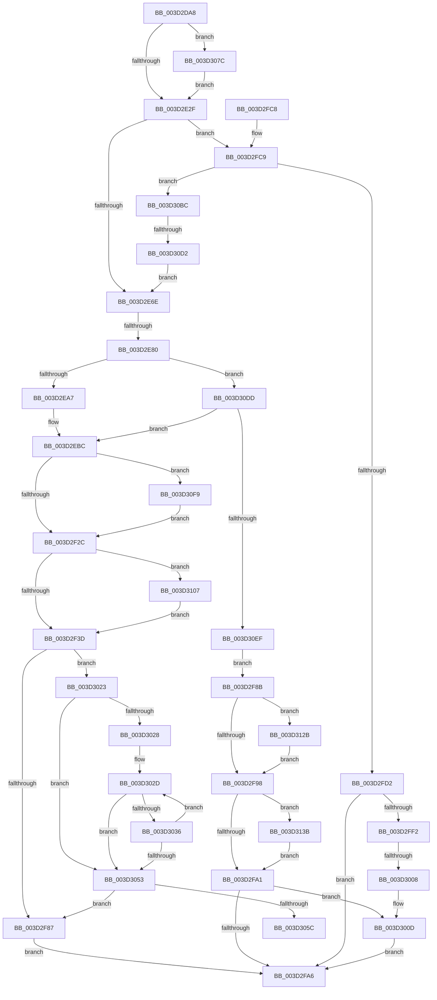

# MiCreateLargePfnList

- RVA: `0x003D2DA8`–`0x003D314E` (길이 `934` bytes)
- VA: `0x00000001403D2DA8`
- 실행 섹션: `.text`
- PDB 이름 있음: `예`; PDB Function 태그: `예`
- unwind 정보 RVA: `0x00091740`
- 디코드: `235`개 명령, `934/934` bytes 표시
- 미해석 바이트: `0` (있으면 어셈블리에 `.byte`로 보존)

> 이 문서는 커널 이미지의 기계어와 PDB 기호를 분석해 생성했습니다. 4번과 5번은 함수 원형과 자료형을 바이너리 사용 방식에서 추정한 C 해석이며 원본 소스 복구 결과는 아닙니다.

## 1. Dependencies

- 직접 호출 지점: **13**; 고유 호출 대상: **12**
- 직접 호출자로 확인된 함수: **4**
- RIP 상대 이미지 참조: **5**

### Outgoing calls
- `0x003D2EB7` → [MiComputePreferredNode](MiComputePreferredNode_function_003D3438.md) (function, `0x003D3438`)
- `0x003D2F5E` → [MiInitializeDemandCoalesceContext](MiInitializeDemandCoalesceContext_function_003D3350.md) (function, `0x003D3350`)
- `0x003D2F70` → [MiAllocateLargeZeroPages](../3B/MiAllocateLargeZeroPages_function_003B743C.md) (function, `0x003B743C`)
- `0x003D2FAF` → [_security_check_cookie](../6A/_security_check_cookie_function_006AC640.md) (function, `0x006AC640`)
- `0x003D2FE7` → [MiGetCrossPartitionCharges](../32/MiGetCrossPartitionCharges_function_00325BFC.md) (function, `0x00325BFC`)
- `0x003D2FFB` → [MiChargeCommit](../28/MiChargeCommit_function_00286EB0.md) (function, `0x00286EB0`)
- `0x003D301C` → [MiReturnCrossPartitionCharges](../28/MiReturnCrossPartitionCharges_function_002867D0.md) (function, `0x002867D0`)
- `0x003D3040` → [MiAllocateLargeZeroPages](../3B/MiAllocateLargeZeroPages_function_003B743C.md) (function, `0x003B743C`)
- `0x003D3071` → [MiFreeLargeZeroPages](../3B/MiFreeLargeZeroPages_function_003B5F0C.md) (function, `0x003B5F0C`)
- `0x003D30C5` → [MiChargeResident](../28/MiChargeResident_function_0028A0F0.md) (function, `0x0028A0F0`)
- `0x003D311C` → [MiComputeIdealLargePage](../69/MiComputeIdealLargePage_function_006987C0.md) (function, `0x006987C0`)
- `0x003D3131` → [MiReturnResident](../28/MiReturnResident_function_00286890.md) (function, `0x00286890`)
- `0x003D3144` → [MiReturnCommit](../24/MiReturnCommit_function_00248410.md) (function, `0x00248410`)

### Direct callers
- [MiCommitExistingVad](../32/MiCommitExistingVad_function_0032A860.md) at `0x0032B4FE`
- [MiMapUserLargePages](MiMapUserLargePages_function_003D26F4.md) at `0x003D2846`
- [MiAllocateLargeProcessPagesFromCache](../69/MiAllocateLargeProcessPagesFromCache_function_0069818C.md) at `0x006985E8`
- [MiAllocateFastAwePages](../../page/80/MiAllocateFastAwePages_function_0080969C.md) at `0x008097A1`

### Static image references
- `0x003D2DC1` → RVA `0x00E0A740` (`.data`; read)
- `0x003D2E1B` → RVA `0x00000000` (`image boundary/outside`; read)
- `0x003D2E5A` → RVA `0x00E30088` (`.data`; read)
- `0x003D2EBC` → RVA `0x00FC5000` (`ALMOSTRO`; read)
- `0x003D2EC7` → RVA `0x00E2DBD0` (`.data`; read)

## 2. Other-region calls and transfers

- 다른 실행 섹션으로 향하는 call: **0**
- call이 아닌 외부 분기/꼬리 이동: **4**
  - `0x003D2E7A` → [sub_006E962C + 0xD](../6E/Unknown_function_006E962C.md) (`tail-transfer`)
  - `0x003D3002` → [sub_006E962C](../6E/Unknown_function_006E962C.md) (`tail-transfer`)
  - `0x003D3077` → [sub_006E962C + 0x74](../6E/Unknown_function_006E962C.md) (`tail-transfer`)
  - `0x003D30CC` → [sub_006E962C + 0x74](../6E/Unknown_function_006E962C.md) (`tail-transfer`)

## 3. Assembly (complete function range)

```asm
003D2DA8  40 55                           push rbp
003D2DAA  53                              push rbx
003D2DAB  56                              push rsi
003D2DAC  57                              push rdi
003D2DAD  41 54                           push r12
003D2DAF  41 55                           push r13
003D2DB1  41 56                           push r14
003D2DB3  41 57                           push r15
003D2DB5  48 8D 6C 24 E8                  lea rbp, [rsp - 0x18]
003D2DBA  48 81 EC 18 01 00 00            sub rsp, 0x118
003D2DC1  48 8B 05 78 79 A3 00            mov rax, qword ptr [rip + 0xa37978]
003D2DC8  48 33 C4                        xor rax, rsp
003D2DCB  48 89 45 00                     mov qword ptr [rbp], rax
003D2DCF  48 8B 85 A0 00 00 00            mov rax, qword ptr [rbp + 0xa0]
003D2DD6  0F 57 C0                        xorps xmm0, xmm0
003D2DD9  4C 8B 95 90 00 00 00            mov r10, qword ptr [rbp + 0x90]
003D2DE0  4C 8B E9                        mov r13, rcx
003D2DE3  48 89 44 24 30                  mov qword ptr [rsp + 0x30], rax
003D2DE8  49 8B F0                        mov rsi, r8
003D2DEB  33 C0                           xor eax, eax
003D2DED  4C 89 4C 24 50                  mov qword ptr [rsp + 0x50], r9
003D2DF2  48 89 45 F0                     mov qword ptr [rbp - 0x10], rax
003D2DF6  89 45 F8                        mov dword ptr [rbp - 8], eax
003D2DF9  0F 11 45 C0                     movups xmmword ptr [rbp - 0x40], xmm0
003D2DFD  48 89 54 24 48                  mov qword ptr [rsp + 0x48], rdx
003D2E02  0F 11 45 D0                     movups xmmword ptr [rbp - 0x30], xmm0
003D2E06  48 89 44 24 60                  mov qword ptr [rsp + 0x60], rax
003D2E0B  0F 11 45 E0                     movups xmmword ptr [rbp - 0x20], xmm0
003D2E0F  65 4C 8B 1C 25 88 01 00 00      mov r11, qword ptr gs:[0x188]
003D2E18  4C 8B 09                        mov r9, qword ptr [rcx]
003D2E1B  48 8D 0D DE D1 C2 FF            lea rcx, [rip - 0x3d2e22]
003D2E22  48 89 45 90                     mov qword ptr [rbp - 0x70], rax
003D2E26  4D 85 C9                        test r9, r9
003D2E29  0F 85 4D 02 00 00               jne 0x1403d307c
003D2E2F  41 8B 45 14                     mov eax, dword ptr [r13 + 0x14]
003D2E33  33 DB                           xor ebx, ebx
003D2E35  41 8B 55 08                     mov edx, dword ptr [r13 + 8]
003D2E39  45 33 FF                        xor r15d, r15d
003D2E3C  89 44 24 3C                     mov dword ptr [rsp + 0x3c], eax
003D2E40  49 8B 83 B8 00 00 00            mov rax, qword ptr [r11 + 0xb8]
003D2E47  48 89 44 24 40                  mov qword ptr [rsp + 0x40], rax
003D2E4C  8D 7B 04                        lea edi, [rbx + 4]
003D2E4F  89 54 24 38                     mov dword ptr [rsp + 0x38], edx
003D2E53  0F B7 88 AE 04 00 00            movzx ecx, word ptr [rax + 0x4ae]
003D2E5A  48 8B 05 27 D2 A5 00            mov rax, qword ptr [rip + 0xa5d227]
003D2E61  4C 8B 34 C8                     mov r14, qword ptr [rax + rcx*8]
003D2E65  4D 85 C9                        test r9, r9
003D2E68  0F 85 5B 01 00 00               jne 0x1403d2fc9
003D2E6E  8B BD 80 00 00 00               mov edi, dword ptr [rbp + 0x80]
003D2E74  45 33 E4                        xor r12d, r12d
003D2E77  4D 85 FF                        test r15, r15
003D2E7A  0F 84 B9 67 31 00               je 0x1406e9639
003D2E80  44 8A BD 88 00 00 00            mov r15b, byte ptr [rbp + 0x88]
003D2E87  4C 8B 5C 24 30                  mov r11, qword ptr [rsp + 0x30]
003D2E8C  8B 44 24 3C                     mov eax, dword ptr [rsp + 0x3c]
003D2E90  4C 8D 15 69 D1 C2 FF            lea r10, [rip - 0x3d2e97]
003D2E97  45 8B 94 82 70 10 01 00         mov r10d, dword ptr [r10 + rax*4 + 0x11070]
003D2E9F  85 FF                           test edi, edi
003D2EA1  0F 85 36 02 00 00               jne 0x1403d30dd
003D2EA7  48 8B 4C 24 40                  mov rcx, qword ptr [rsp + 0x40]
003D2EAC  49 8B 55 00                     mov rdx, qword ptr [r13]
003D2EB0  48 81 C1 00 04 00 00            add rcx, 0x400
003D2EB7  E8 7C 05 00 00                  call 0x1403d3438
003D2EBC  44 0F B7 05 3C 21 BF 00         movzx r8d, word ptr [rip + 0xbf213c]
003D2EC4  45 33 C9                        xor r9d, r9d
003D2EC7  48 8B 0D 02 AD A5 00            mov rcx, qword ptr [rip + 0xa5ad02]
003D2ECE  41 8B D0                        mov edx, r8d
003D2ED1  0F AF D0                        imul edx, eax
003D2ED4  45 39 4D 10                     cmp dword ptr [r13 + 0x10], r9d
003D2ED8  89 45 80                        mov dword ptr [rbp - 0x80], eax
003D2EDB  48 8B 44 24 48                  mov rax, qword ptr [rsp + 0x48]
003D2EE0  4C 89 74 24 68                  mov qword ptr [rsp + 0x68], r14
003D2EE5  4C 89 65 A8                     mov qword ptr [rbp - 0x58], r12
003D2EE9  48 89 74 24 70                  mov qword ptr [rsp + 0x70], rsi
003D2EEE  44 89 55 84                     mov dword ptr [rbp - 0x7c], r10d
003D2EF2  48 8D 3C 91                     lea rdi, [rcx + rdx*4]
003D2EF6  48 89 45 98                     mov qword ptr [rbp - 0x68], rax
003D2EFA  4A 8D 0C 87                     lea rcx, [rdi + r8*4]
003D2EFE  48 89 4C 24 40                  mov qword ptr [rsp + 0x40], rcx
003D2F03  41 8D 49 04                     lea ecx, [r9 + 4]
003D2F07  44 0F 45 C9                     cmovne r9d, ecx
003D2F0B  48 83 4D 88 FF                  or qword ptr [rbp - 0x78], 0xffffffffffffffff
003D2F10  F6 85 98 00 00 00 08            test byte ptr [rbp + 0x98], 8
003D2F17  48 8B 4C 24 50                  mov rcx, qword ptr [rsp + 0x50]
003D2F1C  44 89 4C 24 60                  mov dword ptr [rsp + 0x60], r9d
003D2F21  48 89 4C 24 78                  mov qword ptr [rsp + 0x78], rcx
003D2F26  0F 85 CD 01 00 00               jne 0x1403d30f9
003D2F2C  49 8B 4D 00                     mov rcx, qword ptr [r13]
003D2F30  4C 89 5D B0                     mov qword ptr [rbp - 0x50], r11
003D2F34  48 85 C9                        test rcx, rcx
003D2F37  0F 85 CA 01 00 00               jne 0x1403d3107
003D2F3D  33 D2                           xor edx, edx
003D2F3F  41 C1 E9 03                     shr r9d, 3
003D2F43  48 8B C6                        mov rax, rsi
003D2F46  48 8D 4D C0                     lea rcx, [rbp - 0x40]
003D2F4A  49 2B C4                        sub rax, r12
003D2F4D  41 83 E1 01                     and r9d, 1
003D2F51  48 F7 74 24 50                  div qword ptr [rsp + 0x50]
003D2F56  48 8B 54 24 50                  mov rdx, qword ptr [rsp + 0x50]
003D2F5B  4C 8B C0                        mov r8, rax
003D2F5E  E8 ED 03 00 00                  call 0x1403d3350
003D2F63  4C 8D 45 C0                     lea r8, [rbp - 0x40]
003D2F67  48 8D 4C 24 60                  lea rcx, [rsp + 0x60]
003D2F6C  4C 89 45 A0                     mov qword ptr [rbp - 0x60], r8
003D2F70  E8 C7 44 FE FF                  call 0x1403b743c
003D2F75  48 8B 45 A8                     mov rax, qword ptr [rbp - 0x58]
003D2F79  48 8B 4C 24 70                  mov rcx, qword ptr [rsp + 0x70]
003D2F7E  48 3B C1                        cmp rax, rcx
003D2F81  0F 85 9C 00 00 00               jne 0x1403d3023
003D2F87  33 FF                           xor edi, edi
003D2F89  EB 1B                           jmp 0x1403d2fa6
003D2F8B  B8 04 00 00 00                  mov eax, 4
003D2F90  3B D8                           cmp ebx, eax
003D2F92  0F 83 93 01 00 00               jae 0x1403d312b
003D2F98  F6 C3 02                        test bl, 2
003D2F9B  0F 85 9A 01 00 00               jne 0x1403d313b
003D2FA1  F6 C3 01                        test bl, 1
003D2FA4  75 67                           jne 0x1403d300d
003D2FA6  8B C7                           mov eax, edi
003D2FA8  48 8B 4D 00                     mov rcx, qword ptr [rbp]
003D2FAC  48 33 CC                        xor rcx, rsp
003D2FAF  E8 8C 96 2D 00                  call 0x1406ac640
003D2FB4  48 81 C4 18 01 00 00            add rsp, 0x118
003D2FBB  41 5F                           pop r15
003D2FBD  41 5E                           pop r14
003D2FBF  41 5D                           pop r13
003D2FC1  41 5C                           pop r12
003D2FC3  5F                              pop rdi
003D2FC4  5E                              pop rsi
003D2FC5  5B                              pop rbx
003D2FC6  5D                              pop rbp
003D2FC7  C3                              ret
003D2FC8  CC                              int3
003D2FC9  4D 85 D2                        test r10, r10
003D2FCC  0F 84 EA 00 00 00               je 0x1403d30bc
003D2FD2  4D 8B 3A                        mov r15, qword ptr [r10]
003D2FD5  BA 02 00 00 00                  mov edx, 2
003D2FDA  4C 8B CE                        mov r9, rsi
003D2FDD  49 8B CF                        mov rcx, r15
003D2FE0  4D 8B F7                        mov r14, r15
003D2FE3  44 8D 42 FF                     lea r8d, [rdx - 1]
003D2FE7  E8 10 2C F5 FF                  call 0x140325bfc
003D2FEC  8B F8                           mov edi, eax
003D2FEE  85 C0                           test eax, eax
003D2FF0  78 B4                           js 0x1403d2fa6
003D2FF2  45 33 C0                        xor r8d, r8d
003D2FF5  48 8B D6                        mov rdx, rsi
003D2FF8  49 8B CF                        mov rcx, r15
003D2FFB  E8 B0 3E EB FF                  call 0x140286eb0
003D3000  85 C0                           test eax, eax
003D3002  0F 85 24 66 31 00               jne 0x1406e962c
003D3008  BF 2D 01 00 C0                  mov edi, 0xc000012d
003D300D  BA 02 00 00 00                  mov edx, 2
003D3012  4C 8B CE                        mov r9, rsi
003D3015  49 8B CE                        mov rcx, r14
003D3018  44 8D 42 FF                     lea r8d, [rdx - 1]
003D301C  E8 AF 37 EB FF                  call 0x1402867d0
003D3021  EB 83                           jmp 0x1403d2fa6
003D3023  45 84 FF                        test r15b, r15b
003D3026  75 2B                           jne 0x1403d3053
003D3028  4C 8B 7C 24 40                  mov r15, qword ptr [rsp + 0x40]
003D302D  48 83 C7 04                     add rdi, 4
003D3031  49 3B FF                        cmp rdi, r15
003D3034  74 1D                           je 0x1403d3053
003D3036  8B 07                           mov eax, dword ptr [rdi]
003D3038  48 8D 4C 24 60                  lea rcx, [rsp + 0x60]
003D303D  89 45 80                        mov dword ptr [rbp - 0x80], eax
003D3040  E8 F7 43 FE FF                  call 0x1403b743c
003D3045  48 8B 45 A8                     mov rax, qword ptr [rbp - 0x58]
003D3049  48 8B 4C 24 70                  mov rcx, qword ptr [rsp + 0x70]
003D304E  48 3B C1                        cmp rax, rcx
003D3051  75 DA                           jne 0x1403d302d
003D3053  48 3B C1                        cmp rax, rcx
003D3056  0F 84 2B FF FF FF               je 0x1403d2f87
003D305C  44 8B 44 24 60                  mov r8d, dword ptr [rsp + 0x60]
003D3061  49 8B CE                        mov rcx, r14
003D3064  48 8B 54 24 30                  mov rdx, qword ptr [rsp + 0x30]
003D3069  41 C1 E8 02                     shr r8d, 2
003D306D  41 83 E0 01                     and r8d, 1
003D3071  E8 96 2E FE FF                  call 0x1403b5f0c
003D3076  90                              nop
003D3077  E9 24 66 31 00                  jmp 0x1406e96a0
003D307C  41 8B 41 30                     mov eax, dword ptr [r9 + 0x30]
003D3080  BB 00 00 A0 01                  mov ebx, 0x1a00000
003D3085  48 C1 E8 13                     shr rax, 0x13
003D3089  83 E0 03                        and eax, 3
003D308C  48 8B 84 C1 78 45 01 00         mov rax, qword ptr [rcx + rax*8 + 0x14578]
003D3094  49 89 45 08                     mov qword ptr [r13 + 8], rax
003D3098  41 8B 41 30                     mov eax, dword ptr [r9 + 0x30]
003D309C  C1 E8 07                        shr eax, 7
003D309F  83 E0 1F                        and eax, 0x1f
003D30A2  41 89 45 14                     mov dword ptr [r13 + 0x14], eax
003D30A6  33 C0                           xor eax, eax
003D30A8  41 8B 49 30                     mov ecx, dword ptr [r9 + 0x30]
003D30AC  23 CB                           and ecx, ebx
003D30AE  3B CB                           cmp ecx, ebx
003D30B0  0F 94 C0                        sete al
003D30B3  41 89 45 10                     mov dword ptr [r13 + 0x10], eax
003D30B7  E9 73 FD FF FF                  jmp 0x1403d2e2f
003D30BC  45 33 C0                        xor r8d, r8d
003D30BF  48 8B D6                        mov rdx, rsi
003D30C2  49 8B CE                        mov rcx, r14
003D30C5  E8 26 70 EB FF                  call 0x14028a0f0
003D30CA  85 C0                           test eax, eax
003D30CC  0F 84 CE 65 31 00               je 0x1406e96a0
003D30D2  8B 54 24 38                     mov edx, dword ptr [rsp + 0x38]
003D30D6  0B DF                           or ebx, edi
003D30D8  E9 91 FD FF FF                  jmp 0x1403d2e6e
003D30DD  0F B7 0D 1C 1F BF 00            movzx ecx, word ptr [rip + 0xbf1f1c]
003D30E4  8D 47 FF                        lea eax, [rdi - 1]
003D30E7  3B C1                           cmp eax, ecx
003D30E9  0F 82 CD FD FF FF               jb 0x1403d2ebc
003D30EF  BF 0D 00 00 C0                  mov edi, 0xc000000d
003D30F4  E9 92 FE FF FF                  jmp 0x1403d2f8b
003D30F9  41 83 C9 08                     or r9d, 8
003D30FD  44 89 4C 24 60                  mov dword ptr [rsp + 0x60], r9d
003D3102  E9 25 FE FF FF                  jmp 0x1403d2f2c
003D3107  49 8B D4                        mov rdx, r12
003D310A  4C 8D 4C 24 60                  lea r9, [rsp + 0x60]
003D310F  48 C1 E2 0C                     shl rdx, 0xc
003D3113  4C 8B C6                        mov r8, rsi
003D3116  48 03 D0                        add rdx, rax
003D3119  4D 2B C4                        sub r8, r12
003D311C  E8 9F 56 2C 00                  call 0x1406987c0
003D3121  44 8B 4C 24 60                  mov r9d, dword ptr [rsp + 0x60]
003D3126  E9 12 FE FF FF                  jmp 0x1403d2f3d
003D312B  48 8B D6                        mov rdx, rsi
003D312E  49 8B CE                        mov rcx, r14
003D3131  E8 5A 37 EB FF                  call 0x140286890
003D3136  E9 5D FE FF FF                  jmp 0x1403d2f98
003D313B  45 33 C0                        xor r8d, r8d
003D313E  48 8B D6                        mov rdx, rsi
003D3141  49 8B CE                        mov rcx, r14
003D3144  E8 C7 52 E7 FF                  call 0x140248410
003D3149  E9 53 FE FF FF                  jmp 0x1403d2fa1
```

## 4. C-style interpretation (structured pseudocode)

```c
__int64 __fastcall MiCreateLargePfnList(__int64 a1, __int64 a2, __int64 a3, __int64 a4, unsigned int a5, unsigned __int8 a6, __int64 a7, unsigned __int8 a8, __int64 a9)
{
    __int64 result;
    __int64 v_r12;
    __int64 v_r15;
    __int64 v_rbx;
    __int64 v_rdi;
    __int64 v_rsp;
    unsigned __int64 v_stack_m108;
    unsigned __int64 v_stack_m110;
    unsigned __int64 v_stack_m118;
    unsigned int v_stack_m11C;
    unsigned int v_stack_m120;
    unsigned __int64 v_stack_m128;
    unsigned __int64 v_stack_m58;
    unsigned int v_stack_m60;
    unsigned __int64 v_stack_m68;
    unsigned __int64 v_stack_m78;
    unsigned __int64 v_stack_m88;
    unsigned __int64 v_stack_m98;
    unsigned __int64 v_stack_mA8;
    unsigned __int64 v_stack_mB0;
    unsigned __int64 v_stack_mB8;
    unsigned __int64 v_stack_mC0;
    unsigned __int64 v_stack_mC8;
    unsigned __int64 v_stack_mD0;
    unsigned int v_stack_mD4;
    unsigned int v_stack_mD8;
    unsigned __int64 v_stack_mE0;
    unsigned __int64 v_stack_mE8;
    unsigned __int64 v_stack_mF0;
    unsigned __int64 v_stack_mF8;
    unsigned __int64 v_stack_p30;
    unsigned int v_stack_p38;
    unsigned __int64 v_stack_p40;
    unsigned __int64 v_stack_p60;
    unsigned __int64 v_stack_p70;

    v_rsp = (v_rsp) - (280);
    result = (*(unsigned __int64 *)(v_rip + 10713464)) ^ (v_rsp);
    v_stack_m58 = result;
    v_stack_m128 = a9;
    result = 0;
    v_stack_m108 = a4;
    v_stack_m68 = 0;
    v_stack_m60 = 0;
    v_stack_m98 = v_xmm0;
    v_stack_m110 = a2;
    v_stack_m88 = v_xmm0;
    v_stack_mF8 = 0;
    v_stack_m78 = v_xmm0;
    v_stack_mC8 = 0;
    if (*(unsigned __int64 *)(a1) != 0) goto loc_003D307C;
loc_003D2E2F:
    v_rbx = 0;
    v_r15 = 0;
    v_stack_m11C = (unsigned int)((unsigned int)(*(unsigned int *)(a1 + 20)));
    v_stack_m118 = *(unsigned __int64 *)(*(unsigned __int64 *)(gs_base + (0 + 392)) + 184);
    v_stack_m120 = (unsigned int)((unsigned int)(*(unsigned int *)(a1 + 8)));
    if (*(unsigned __int64 *)(a1) != 0) goto loc_003D2FC9;
loc_003D2E6E:
    v_r12 = 0;
    if ((unsigned int)((unsigned int)(a5)) != 0) goto loc_003D30DD;
    a1 = (v_stack_m118) + (0x400ULL);
    result = MiComputePreferredNode(a1, *(unsigned __int64 *)(a1), a3, *(unsigned __int64 *)(a1));
loc_003D2EBC:
    a4 = 0;
    a2 = (unsigned int)(((unsigned int)((unsigned int)(*(unsigned __int16 *)(v_rip + 12525884)))) * ((unsigned int)(result)));
    v_stack_mD8 = (unsigned int)(result);
    v_stack_mF0 = *(unsigned __int64 *)(*(unsigned __int64 *)(v_rip + 10867239) + *(unsigned __int16 *)(*(unsigned __int64 *)(*(unsigned __int64 *)(gs_base + (0 + 392)) + 184) + 1198) * 8);
    v_stack_mB0 = 0;
    v_stack_mE8 = a3;
    v_stack_mD4 = (unsigned int)((unsigned int)(*(unsigned int *)(v_rip - 4009623 + (unsigned int)(v_stack_m11C) * 4 + 69744)));
    v_stack_mC0 = v_stack_m110;
    v_stack_m118 = *(unsigned __int64 *)(v_rip + 10857730) + a2 * 4 + *(unsigned __int16 *)(v_rip + 12525884) * 4;
    if ((*(unsigned int *)(a1 + 16)) != 0) { a4 = (unsigned int)(a4 + 4); }
    v_stack_mF8 = (unsigned int)(a4);
    v_stack_mE0 = v_stack_m108;
    if (((a8) & (8)) != 0) goto loc_003D30F9;
loc_003D2F2C:
    v_stack_mA8 = v_stack_m128;
    if (*(unsigned __int64 *)(a1) != 0) goto loc_003D3107;
loc_003D2F3D:
    a2 = 0;
    a4 = (unsigned int)((a4) >> (3));
    result = (a3) - (0);
    a4 = (unsigned int)((a4) & (1));
    result = MiInitializeDemandCoalesceContext(v_stack_m98, v_stack_m108, result, a4);
    v_stack_mB8 = v_stack_m98;
    result = MiAllocateLargeZeroPages(v_stack_mF8, v_stack_m108, v_stack_m98, a4);
    if (v_stack_mB0 != v_stack_mE8) goto loc_003D3023;
loc_003D2F87:
    v_rdi = 0;
    goto loc_003D2FA6;
loc_003D2F8B:
    if (0 >= 4) goto loc_003D312B;
loc_003D2F98:
    if (((0) & (2)) != 0) goto loc_003D313B;
loc_003D2FA1:
    if (((0) & (1)) != 0) goto loc_003D300D;
loc_003D2FA6:
    a1 = (v_stack_m58) ^ (v_rsp);
    result = _security_check_cookie(a1, v_stack_m108, v_stack_m98, a4);
    v_rsp = (v_rsp) + (280);
    return result;
loc_003D2FC9:
    if ((unsigned int)(*(unsigned int *)(v_rip - 4009623 + (unsigned int)(v_stack_m11C) * 4 + 69744)) == 0) goto loc_003D30BC;
    result = MiGetCrossPartitionCharges(*(unsigned __int64 *)((unsigned int)(*(unsigned int *)(v_rip - 4009623 + (unsigned int)(v_stack_m11C) * 4 + 69744))), 2, 2 - 1, a3);
    if (sign_flag) goto loc_003D2FA6;
    a3 = 0;
    result = MiChargeCommit(*(unsigned __int64 *)((unsigned int)(*(unsigned int *)(v_rip - 4009623 + (unsigned int)(v_stack_m11C) * 4 + 69744))), 0, a3, a3);
loc_003D300D:
    result = MiReturnCrossPartitionCharges(*(unsigned __int64 *)((unsigned int)(*(unsigned int *)(v_rip - 4009623 + (unsigned int)(v_stack_m11C) * 4 + 69744))), 2, 2 - 1, 0);
    goto loc_003D2FA6;
loc_003D3023:
    if ((unsigned __int8)(*(unsigned __int64 *)((unsigned int)(*(unsigned int *)(v_rip - 4009623 + (unsigned int)(v_stack_m11C) * 4 + 69744)))) != 0) goto loc_003D3053;
loc_003D302D:
    v_rdi = ((unsigned int)(0xC000012DULL)) + (4);
    if (v_rdi == v_stack_p40) goto loc_003D3053;
    v_stack_mD8 = (unsigned int)((unsigned int)(*(unsigned int *)(v_rdi)));
    result = MiAllocateLargeZeroPages(v_stack_p60, 2, 2 - 1, 0);
    if (v_stack_mB0 != v_stack_p70) goto loc_003D302D;
loc_003D3053:
    if (v_stack_mB0 == v_stack_p70) goto loc_003D2F87;
    a3 = (unsigned int)(((unsigned int)(v_stack_p60)) >> (2));
    a3 = (unsigned int)((a3) & (1));
    result = MiFreeLargeZeroPages(*(unsigned __int64 *)((unsigned int)(*(unsigned int *)(v_rip - 4009623 + (unsigned int)(v_stack_m11C) * 4 + 69744))), v_stack_p30, a3, 0);
loc_003D307C:
    result = ((unsigned int)(*(unsigned int *)(0 + 48))) >> (19);
    result = (unsigned int)((result) & (3));
    *(unsigned __int64 *)(a1 + 8) = *(unsigned __int64 *)(*(unsigned __int64 *)((unsigned int)(*(unsigned int *)(v_rip - 4009623 + (unsigned int)(v_stack_m11C) * 4 + 69744))) + result * 8 + 83320);
    result = (unsigned int)(((unsigned int)(*(unsigned int *)(0 + 48))) >> (7));
    result = (unsigned int)((result) & (31));
    *(unsigned int *)(a1 + 20) = (unsigned int)(result);
    result = 0;
    a1 = (unsigned int)(((unsigned int)(*(unsigned int *)(0 + 48))) & ((unsigned int)((unsigned int)(0x1A00000ULL))));
    result = (((unsigned int)(a1)) == ((unsigned int)((unsigned int)(0x1A00000ULL)))) ? 1 : 0;
    *(unsigned int *)(a1 + 16) = (unsigned int)(result);
    goto loc_003D2E2F;
loc_003D30BC:
    a3 = 0;
    result = MiChargeResident(*(unsigned __int64 *)((unsigned int)(*(unsigned int *)(v_rip - 4009623 + (unsigned int)(v_stack_m11C) * 4 + 69744))), 0, a3, 0);
    v_rbx = (unsigned int)(((unsigned int)(0x1A00000ULL)) | ((unsigned int)(v_rdi)));
    goto loc_003D2E6E;
loc_003D30DD:
    if (((unsigned int)(v_rdi - 1)) < ((unsigned int)(*(unsigned __int16 *)(v_rip + 12525340)))) goto loc_003D2EBC;
    goto loc_003D2F8B;
loc_003D30F9:
    a4 = (unsigned int)((0) | (8));
    v_stack_p60 = (unsigned int)(a4);
    goto loc_003D2F2C;
loc_003D3107:
    a2 = (0) << (12);
    a2 = (a2) + (v_rdi - 1);
    a3 = (0) - (0);
    result = MiComputeIdealLargePage(*(unsigned __int16 *)(v_rip + 12525340), a2, a3, v_stack_p60);
    goto loc_003D2F3D;
loc_003D312B:
    result = MiReturnResident(*(unsigned __int64 *)((unsigned int)(*(unsigned int *)(v_rip - 4009623 + (unsigned int)(v_stack_m11C) * 4 + 69744))), a3, a3, (unsigned int)(v_stack_p60));
    goto loc_003D2F98;
loc_003D313B:
    a3 = 0;
    result = MiReturnCommit(*(unsigned __int64 *)((unsigned int)(*(unsigned int *)(v_rip - 4009623 + (unsigned int)(v_stack_m11C) * 4 + 69744))), 0, a3, (unsigned int)(v_stack_p60));
    goto loc_003D2FA1;
}
```

## 5. (Beta) C Style

```c
int64_t MiCreateLargePfnList(void *Arg1, int64_t Arg2, int64_t Arg3, int64_t Arg4, uint32_t Arg5, uint8_t Arg6, int64_t Arg7, uint8_t Arg8, int64_t Arg9)
{
    uint8_t *arg1 = (uint8_t *)Arg1;

    int64_t result;
    int64_t local_r12;
    int64_t local_r15;
    int64_t local_rbx;
    int64_t local_rdi;
    int64_t local_rsp;
    uint64_t v_stack_m108;
    uint64_t v_stack_m110;
    uint64_t v_stack_m118;
    uint32_t v_stack_m11C;
    uint32_t v_stack_m120;
    uint64_t v_stack_m128;
    uint64_t v_stack_m58;
    uint32_t v_stack_m60;
    uint64_t v_stack_m68;
    uint64_t v_stack_m78;
    uint64_t v_stack_m88;
    uint64_t v_stack_m98;
    uint64_t v_stack_mA8;
    uint64_t v_stack_mB0;
    uint64_t v_stack_mB8;
    uint64_t v_stack_mC0;
    uint64_t v_stack_mC8;
    uint64_t v_stack_mD0;
    uint32_t v_stack_mD4;
    uint32_t v_stack_mD8;
    uint64_t v_stack_mE0;
    uint64_t v_stack_mE8;
    uint64_t v_stack_mF0;
    uint64_t v_stack_mF8;
    uint64_t v_stack_p30;
    uint32_t v_stack_p38;
    uint64_t v_stack_p40;
    uint64_t v_stack_p60;
    uint64_t v_stack_p70;

    local_rsp = (local_rsp) - (280);
    result = (*(uint64_t *)(v_rip + 0xA37978)) ^ (local_rsp);
    v_stack_m58 = result;
    v_stack_m128 = Arg9;
    result = 0;
    v_stack_m108 = Arg4;
    v_stack_m68 = 0;
    v_stack_m60 = 0;
    v_stack_m98 = v_xmm0;
    v_stack_m110 = Arg2;
    v_stack_m88 = v_xmm0;
    v_stack_mF8 = 0;
    v_stack_m78 = v_xmm0;
    v_stack_mC8 = 0;
    if (*(uint64_t *)(arg1) != 0) goto loc_003D307C;
loc_003D2E2F:
    local_rbx = 0;
    local_r15 = 0;
    v_stack_m11C = (uint32_t)((uint32_t)(*(uint32_t *)(arg1 + 0x14)));
    v_stack_m118 = *(uint64_t *)(*(uint64_t *)(gs_base + (0 + 0x188)) + 0xB8);
    v_stack_m120 = (uint32_t)((uint32_t)(*(uint32_t *)(arg1 + 0x8)));
    if (*(uint64_t *)(arg1) != 0) goto loc_003D2FC9;
loc_003D2E6E:
    local_r12 = 0;
    if ((uint32_t)((uint32_t)(Arg5)) != 0) goto loc_003D30DD;
    Arg1 = (v_stack_m118) + (0x400ULL);
    result = MiComputePreferredNode(Arg1, *(uint64_t *)(arg1), Arg3, *(uint64_t *)(arg1));
loc_003D2EBC:
    Arg4 = 0;
    Arg2 = (uint32_t)(((uint32_t)((uint32_t)(*(uint16_t *)(v_rip + 0xBF213C)))) * ((uint32_t)(result)));
    v_stack_mD8 = (uint32_t)(result);
    v_stack_mF0 = *(uint64_t *)(*(uint64_t *)(v_rip + 0xA5D227) + *(uint16_t *)(*(uint64_t *)(*(uint64_t *)(gs_base + (0 + 0x188)) + 0xB8) + 0x4AE) * 8);
    v_stack_mB0 = 0;
    v_stack_mE8 = Arg3;
    v_stack_mD4 = (uint32_t)((uint32_t)(*(uint32_t *)(v_rip - 0x3D2E97 + (uint32_t)(v_stack_m11C) * 4 + 0x11070)));
    v_stack_mC0 = v_stack_m110;
    v_stack_m118 = *(uint64_t *)(v_rip + 0xA5AD02) + Arg2 * 4 + *(uint16_t *)(v_rip + 0xBF213C) * 4;
    if ((*(uint32_t *)(arg1 + 0x10)) != 0) { Arg4 = (uint32_t)(Arg4 + 4); }
    v_stack_mF8 = (uint32_t)(Arg4);
    v_stack_mE0 = v_stack_m108;
    if (((Arg8) & (8)) != 0) goto loc_003D30F9;
loc_003D2F2C:
    v_stack_mA8 = v_stack_m128;
    if (*(uint64_t *)(arg1) != 0) goto loc_003D3107;
loc_003D2F3D:
    Arg2 = 0;
    Arg4 = (uint32_t)((Arg4) >> (3));
    result = (Arg3) - (0);
    Arg4 = (uint32_t)((Arg4) & (1));
    result = MiInitializeDemandCoalesceContext(v_stack_m98, v_stack_m108, result, Arg4);
    v_stack_mB8 = v_stack_m98;
    result = MiAllocateLargeZeroPages(v_stack_mF8, v_stack_m108, v_stack_m98, Arg4);
    if (v_stack_mB0 != v_stack_mE8) goto loc_003D3023;
loc_003D2F87:
    local_rdi = 0;
    goto loc_003D2FA6;
loc_003D2F8B:
    if (0 >= 4) goto loc_003D312B;
loc_003D2F98:
    if (((0) & (2)) != 0) goto loc_003D313B;
loc_003D2FA1:
    if (((0) & (1)) != 0) goto loc_003D300D;
loc_003D2FA6:
    Arg1 = (v_stack_m58) ^ (local_rsp);
    result = _security_check_cookie(Arg1, v_stack_m108, v_stack_m98, Arg4);
    local_rsp = (local_rsp) + (280);
    return result;
loc_003D2FC9:
    if ((uint32_t)(*(uint32_t *)(v_rip - 0x3D2E97 + (uint32_t)(v_stack_m11C) * 4 + 0x11070)) == 0) goto loc_003D30BC;
    result = MiGetCrossPartitionCharges(*(uint64_t *)((uint32_t)(*(uint32_t *)(v_rip - 0x3D2E97 + (uint32_t)(v_stack_m11C) * 4 + 0x11070))), 2, 2 - 1, Arg3);
    if (sign_flag) goto loc_003D2FA6;
    Arg3 = 0;
    result = MiChargeCommit(*(uint64_t *)((uint32_t)(*(uint32_t *)(v_rip - 0x3D2E97 + (uint32_t)(v_stack_m11C) * 4 + 0x11070))), 0, Arg3, Arg3);
loc_003D300D:
    result = MiReturnCrossPartitionCharges(*(uint64_t *)((uint32_t)(*(uint32_t *)(v_rip - 0x3D2E97 + (uint32_t)(v_stack_m11C) * 4 + 0x11070))), 2, 2 - 1, 0);
    goto loc_003D2FA6;
loc_003D3023:
    if ((uint8_t)(*(uint64_t *)((uint32_t)(*(uint32_t *)(v_rip - 0x3D2E97 + (uint32_t)(v_stack_m11C) * 4 + 0x11070)))) != 0) goto loc_003D3053;
loc_003D302D:
    local_rdi = ((uint32_t)(0xC000012DULL)) + (4);
    if (local_rdi == v_stack_p40) goto loc_003D3053;
    v_stack_mD8 = (uint32_t)((uint32_t)(*(uint32_t *)(local_rdi)));
    result = MiAllocateLargeZeroPages(v_stack_p60, 2, 2 - 1, 0);
    if (v_stack_mB0 != v_stack_p70) goto loc_003D302D;
loc_003D3053:
    if (v_stack_mB0 == v_stack_p70) goto loc_003D2F87;
    Arg3 = (uint32_t)(((uint32_t)(v_stack_p60)) >> (2));
    Arg3 = (uint32_t)((Arg3) & (1));
    result = MiFreeLargeZeroPages(*(uint64_t *)((uint32_t)(*(uint32_t *)(v_rip - 0x3D2E97 + (uint32_t)(v_stack_m11C) * 4 + 0x11070))), v_stack_p30, Arg3, 0);
loc_003D307C:
    result = ((uint32_t)(*(uint32_t *)(0 + 0x30))) >> (19);
    result = (uint32_t)((result) & (3));
    *(uint64_t *)(arg1 + 0x8) = *(uint64_t *)(*(uint64_t *)((uint32_t)(*(uint32_t *)(v_rip - 0x3D2E97 + (uint32_t)(v_stack_m11C) * 4 + 0x11070))) + result * 8 + 0x14578);
    result = (uint32_t)(((uint32_t)(*(uint32_t *)(0 + 0x30))) >> (7));
    result = (uint32_t)((result) & (31));
    *(uint32_t *)(arg1 + 0x14) = (uint32_t)(result);
    result = 0;
    Arg1 = (uint32_t)(((uint32_t)(*(uint32_t *)(0 + 0x30))) & ((uint32_t)((uint32_t)(0x1A00000ULL))));
    result = (((uint32_t)(Arg1)) == ((uint32_t)((uint32_t)(0x1A00000ULL)))) ? 1 : 0;
    *(uint32_t *)(arg1 + 0x10) = (uint32_t)(result);
    goto loc_003D2E2F;
loc_003D30BC:
    Arg3 = 0;
    result = MiChargeResident(*(uint64_t *)((uint32_t)(*(uint32_t *)(v_rip - 0x3D2E97 + (uint32_t)(v_stack_m11C) * 4 + 0x11070))), 0, Arg3, 0);
    local_rbx = (uint32_t)(((uint32_t)(0x1A00000ULL)) | ((uint32_t)(local_rdi)));
    goto loc_003D2E6E;
loc_003D30DD:
    if (((uint32_t)(local_rdi - 1)) < ((uint32_t)(*(uint16_t *)(v_rip + 0xBF1F1C)))) goto loc_003D2EBC;
    goto loc_003D2F8B;
loc_003D30F9:
    Arg4 = (uint32_t)((0) | (8));
    v_stack_p60 = (uint32_t)(Arg4);
    goto loc_003D2F2C;
loc_003D3107:
    Arg2 = (0) << (12);
    Arg2 = (Arg2) + (local_rdi - 1);
    Arg3 = (0) - (0);
    result = MiComputeIdealLargePage(*(uint16_t *)(v_rip + 0xBF1F1C), Arg2, Arg3, v_stack_p60);
    goto loc_003D2F3D;
loc_003D312B:
    result = MiReturnResident(*(uint64_t *)((uint32_t)(*(uint32_t *)(v_rip - 0x3D2E97 + (uint32_t)(v_stack_m11C) * 4 + 0x11070))), Arg3, Arg3, (uint32_t)(v_stack_p60));
    goto loc_003D2F98;
loc_003D313B:
    Arg3 = 0;
    result = MiReturnCommit(*(uint64_t *)((uint32_t)(*(uint32_t *)(v_rip - 0x3D2E97 + (uint32_t)(v_stack_m11C) * 4 + 0x11070))), 0, Arg3, (uint32_t)(v_stack_p60));
    goto loc_003D2FA1;
}
```

### 관측된 메모리 오프셋

구조체 형식이 확인되지 않은 접근은 인자 기준의 오프셋으로만 기록했습니다.

| 기준 인자 | 오프셋 표현 | 폭 (bit) | 접근 |
|---|---:|---:|---|
| `Arg1` | `+ 0x0` | `64` | `R` |
| `Arg1` | `+ 0x8` | `32` | `R` |
| `Arg1` | `+ 0x8` | `64` | `W` |
| `Arg1` | `+ 0x10` | `32` | `R` |
| `Arg1` | `+ 0x10` | `32` | `W` |
| `Arg1` | `+ 0x14` | `32` | `R` |
| `Arg1` | `+ 0x14` | `32` | `W` |

## 6. Execution-region graph

[열기: 2D/3D 그래프와 함수 탐색 컨트롤 패널](../../../control-panel.html?section=text&rva=0x003D2DA8&view=graph)

- 2D 그래프는 위에서 아래로 흐르고, 3D 그래프는 빈 공간을 드래그해 회전합니다. Shift+드래그는 이동, 휠은 확대·축소, 함수 노드 선택은 대상 보고서 이동입니다.

### Static fallback


