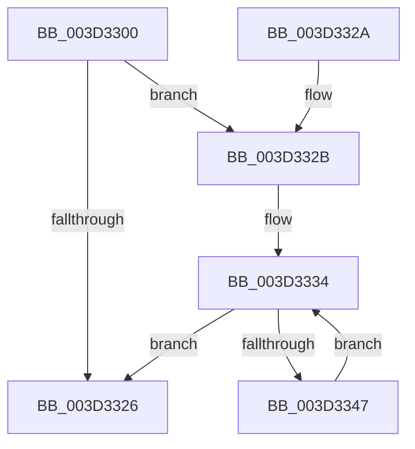

# MiGetLargePteAddress

- RVA: `0x003D3300`–`0x003D3349` (길이 `73` bytes)
- VA: `0x00000001403D3300`
- 실행 섹션: `.text`
- PDB 이름 있음: `예`; PDB Function 태그: `아니요`
- unwind 정보 RVA: `0x000DB714`
- 디코드: `21`개 명령, `73/73` bytes 표시
- 미해석 바이트: `0` (있으면 어셈블리에 `.byte`로 보존)

> 이 문서는 커널 이미지의 기계어와 PDB 기호를 분석해 생성했습니다. 4번과 5번은 함수 원형과 자료형을 바이너리 사용 방식에서 추정한 C 해석이며 원본 소스 복구 결과는 아닙니다.

## 1. Dependencies

- 직접 호출 지점: **0**; 고유 호출 대상: **0**
- 직접 호출자로 확인된 함수: **4**
- RIP 상대 이미지 참조: **0**

### Outgoing calls
- 직접 디코드된 call 명령이 없습니다.

### Direct callers
- [MiMapWithLargePages](../3B/MiMapWithLargePages_function_003B6624.md) at `0x003B67AF`
- [MiInsertLargeUserMapping](MiInsertLargeUserMapping_function_003D3154.md) at `0x003D31AE`
- [MiProtectLargeKernelHalRange](../../page/7F/MiProtectLargeKernelHalRange_function_007F8D20.md) at `0x007F8D5A`
- [MiProtectLargeKernelHalRange](../../page/7F/MiProtectLargeKernelHalRange_function_007F8D20.md) at `0x007F8D67`
- [MxMapVa](../../init/C6/MxMapVa_function_00C63EC4.md) at `0x00C63F19`
- [MxMapVa](../../init/C6/MxMapVa_function_00C63EC4.md) at `0x00C63F3B`
- [MxMapVa](../../init/C6/MxMapVa_function_00C63EC4.md) at `0x00C64060`
- [MxMapVa](../../init/C6/MxMapVa_function_00C63EC4.md) at `0x00C6407D`

### Static image references
- 디코드된 RIP-relative 메모리 참조가 없습니다.

## 2. Other-region calls and transfers

- 다른 실행 섹션으로 향하는 call: **0**
- 별도 외부 분기/꼬리 이동을 확인하지 못했습니다.

## 3. Assembly (complete function range)

```asm
003D3300  48 C1 E9 09                     shr rcx, 9
003D3304  49 B9 F8 FF FF FF 7F 00 00 00   movabs r9, 0x7ffffffff8
003D330E  49 23 C9                        and rcx, r9
003D3311  49 B8 00 00 00 00 80 F6 FF FF   movabs r8, 0xfffff68000000000
003D331B  49 8B C0                        mov rax, r8
003D331E  48 03 C8                        add rcx, rax
003D3321  83 FA 01                        cmp edx, 1
003D3324  76 05                           jbe 0x1403d332b
003D3326  48 8B C1                        mov rax, rcx
003D3329  C3                              ret
003D332A  CC                              int3
003D332B  B8 02 00 00 00                  mov eax, 2
003D3330  2B C2                           sub eax, edx
003D3332  8B D0                           mov edx, eax
003D3334  48 C1 E9 09                     shr rcx, 9
003D3338  49 23 C9                        and rcx, r9
003D333B  49 8B C0                        mov rax, r8
003D333E  48 03 C8                        add rcx, rax
003D3341  48 83 EA 01                     sub rdx, 1
003D3345  74 DF                           je 0x1403d3326
003D3347  EB EB                           jmp 0x1403d3334
```

## 4. C-style interpretation (structured pseudocode)

```c
__int64 __fastcall MiGetLargePteAddress(__int64 a1, int a2)
{
    __int64 result;

    a1 = (a1) >> (9);
    a1 = (a1) & (a4);
    a1 = (a1) + (a3);
    if (a2 <= 1) goto loc_003D332B;
loc_003D3326:
    return a1;
loc_003D332B:
    result = (unsigned int)((2) - (a2));
loc_003D3334:
    a1 = (a1) >> (9);
    a1 = (a1) & (a4);
    a1 = (a1) + (a3);
    a2 = ((unsigned int)((unsigned int)(result))) - (1);
    if (condition_is_equal) goto loc_003D3326;
    goto loc_003D3334;
}
```

## 5. (Beta) C Style

```c
int64_t MiGetLargePteAddress(int64_t Arg1, int32_t Arg2)
{
    int64_t result;

    Arg1 = (Arg1) >> (9);
    Arg1 = (Arg1) & (a4);
    Arg1 = (Arg1) + (a3);
    if (Arg2 <= 1) goto loc_003D332B;
loc_003D3326:
    return Arg1;
loc_003D332B:
    result = (uint32_t)((2) - (Arg2));
loc_003D3334:
    Arg1 = (Arg1) >> (9);
    Arg1 = (Arg1) & (a4);
    Arg1 = (Arg1) + (a3);
    Arg2 = ((uint32_t)((uint32_t)(result))) - (1);
    if (condition_is_equal) goto loc_003D3326;
    goto loc_003D3334;
}
```

## 6. Execution-region graph

[열기: 2D/3D 그래프와 함수 탐색 컨트롤 패널](../../../control-panel.html?section=text&rva=0x003D3300&view=graph)

- 2D 그래프는 위에서 아래로 흐르고, 3D 그래프는 빈 공간을 드래그해 회전합니다. Shift+드래그는 이동, 휠은 확대·축소, 함수 노드 선택은 대상 보고서 이동입니다.

### Static fallback


