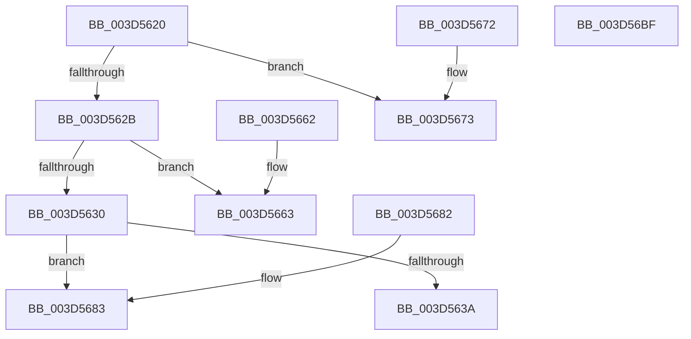

# MiGetStandbyLookaside

- RVA: `0x003D5620`–`0x003D56C0` (길이 `160` bytes)
- VA: `0x00000001403D5620`
- 실행 섹션: `.text`
- PDB 이름 있음: `예`; PDB Function 태그: `아니요`
- unwind 정보 RVA: `0x000DB714`
- 디코드: `46`개 명령, `160/160` bytes 표시
- 미해석 바이트: `0` (있으면 어셈블리에 `.byte`로 보존)

> 이 문서는 커널 이미지의 기계어와 PDB 기호를 분석해 생성했습니다. 4번과 5번은 함수 원형과 자료형을 바이너리 사용 방식에서 추정한 C 해석이며 원본 소스 복구 결과는 아닙니다.

## 1. Dependencies

- 직접 호출 지점: **0**; 고유 호출 대상: **0**
- 직접 호출자로 확인된 함수: **2**
- RIP 상대 이미지 참조: **0**

### Outgoing calls
- 직접 디코드된 call 명령이 없습니다.

### Direct callers
- [MiRebuildStandbyLookasideList](MiRebuildStandbyLookasideList_function_003D50E0.md) at `0x003D5146`
- [sub_006DBD20](../6D/Unknown_function_006DBD20.md) at `0x006DBE50`
- [sub_006DBD20](../6D/Unknown_function_006DBD20.md) at `0x006DBEA6`

### Static image references
- 디코드된 RIP-relative 메모리 참조가 없습니다.

## 2. Other-region calls and transfers

- 다른 실행 섹션으로 향하는 call: **0**
- 별도 외부 분기/꼬리 이동을 확인하지 못했습니다.

## 3. Assembly (complete function range)

```asm
003D5620  4C 8B 09                        mov r9, qword ptr [rcx]
003D5623  44 8B 41 1C                     mov r8d, dword ptr [rcx + 0x1c]
003D5627  85 D2                           test edx, edx
003D5629  74 48                           je 0x1403d5673
003D562B  83 FA 01                        cmp edx, 1
003D562E  74 33                           je 0x1403d5663
003D5630  4C 63 59 24                     movsxd r11, dword ptr [rcx + 0x24]
003D5634  41 83 FB 09                     cmp r11d, 9
003D5638  7C 49                           jl 0x1403d5683
003D563A  0F B6 41 20                     movzx eax, byte ptr [rcx + 0x20]
003D563E  8B 51 18                        mov edx, dword ptr [rcx + 0x18]
003D5641  48 69 CA 80 DF 00 00            imul rcx, rdx, 0xdf80
003D5648  4C 8D 14 C5 0D 00 00 00         lea r10, [rax*8 + 0xd]
003D5650  4D 03 D0                        add r10, r8
003D5653  49 C1 E2 09                     shl r10, 9
003D5657  4C 03 D1                        add r10, rcx
003D565A  4D 03 51 10                     add r10, qword ptr [r9 + 0x10]
003D565E  49 8B C2                        mov rax, r10
003D5661  C3                              ret
003D5662  CC                              int3
003D5663  49 C1 E0 09                     shl r8, 9
003D5667  49 8D 81 40 2E 00 00            lea rax, [r9 + 0x2e40]
003D566E  49 03 C0                        add rax, r8
003D5671  C3                              ret
003D5672  CC                              int3
003D5673  49 C1 E0 09                     shl r8, 9
003D5677  49 8D 81 40 1E 00 00            lea rax, [r9 + 0x1e40]
003D567E  49 03 C0                        add rax, r8
003D5681  C3                              ret
003D5682  CC                              int3
003D5683  0F B6 41 28                     movzx eax, byte ptr [rcx + 0x28]
003D5687  33 D2                           xor edx, edx
003D5689  41 83 FB 08                     cmp r11d, 8
003D568D  0F 44 D0                        cmove edx, eax
003D5690  0F B6 C2                        movzx eax, dl
003D5693  4D 8D 14 C0                     lea r10, [r8 + rax*8]
003D5697  8B 41 18                        mov eax, dword ptr [rcx + 0x18]
003D569A  48 69 D0 80 DF 00 00            imul rdx, rax, 0xdf80
003D56A1  49 69 CB E8 00 00 00            imul rcx, r11, 0xe8
003D56A8  49 8B 41 10                     mov rax, qword ptr [r9 + 0x10]
003D56AC  49 C1 E2 09                     shl r10, 9
003D56B0  48 03 D1                        add rdx, rcx
003D56B3  4C 03 94 02 90 3D 00 00         add r10, qword ptr [rdx + rax + 0x3d90]
003D56BB  49 8B C2                        mov rax, r10
003D56BE  C3                              ret
003D56BF  CC                              int3
```

## 4. C-style interpretation (structured pseudocode)

```c
__int64 __fastcall MiGetStandbyLookaside(__int64 a1, int a2)
{
    __int64 result;
    __int64 v_r10;

    if (a2 == 0) goto loc_003D5673;
    if (a2 == 1) goto loc_003D5663;
    if (((unsigned int)((int)(*(unsigned int *)(a1 + 36)))) < 9) goto loc_003D5683;
    a1 = (a1) * ((unsigned int)(*(unsigned int *)(a1 + 24)));
    v_r10 = (*(unsigned __int8 *)(a1 + 32) * 8 + 13) + ((unsigned int)(*(unsigned int *)(a1 + 28)));
    v_r10 = (v_r10) << (9);
    v_r10 = (v_r10) + (a1);
    v_r10 = (v_r10) + (*(unsigned __int64 *)(*(unsigned __int64 *)(a1) + 16));
    return v_r10;
loc_003D5663:
    a3 = ((unsigned int)(*(unsigned int *)(a1 + 28))) << (9);
    result = (*(unsigned __int64 *)(a1) + 11840) + (a3);
    return result;
loc_003D5673:
    a3 = (a3) << (9);
    result = (*(unsigned __int64 *)(a1) + 7744) + (a3);
    return result;
loc_003D5683:
    a2 = 0;
    if (((unsigned int)((int)(*(unsigned int *)(a1 + 36)))) == 8) { a2 = (unsigned int)(*(unsigned __int8 *)(a1 + 40)); }
    a2 = (a2) * ((unsigned int)(*(unsigned int *)(a1 + 24)));
    a1 = (a1) * ((int)(*(unsigned int *)(a1 + 36)));
    v_r10 = (a3 + (unsigned __int8)(a2) * 8) << (9);
    a2 = (a2) + (a1);
    v_r10 = (v_r10) + (*(unsigned __int64 *)(a2 + *(unsigned __int64 *)(*(unsigned __int64 *)(a1) + 16) * 1 + 15760));
    return v_r10;
}
```

## 5. (Beta) C Style

```c
int64_t MiGetStandbyLookaside(void *Arg1, int32_t Arg2)
{
    uint8_t *arg1 = (uint8_t *)Arg1;

    int64_t result;
    int64_t local_r10;

    if (Arg2 == 0) goto loc_003D5673;
    if (Arg2 == 1) goto loc_003D5663;
    if (((uint32_t)((int32_t)(*(uint32_t *)(arg1 + 0x24)))) < 9) goto loc_003D5683;
    Arg1 = (Arg1) * ((uint32_t)(*(uint32_t *)(arg1 + 0x18)));
    local_r10 = (*(uint8_t *)(arg1 + 0x20) * 8 + 13) + ((uint32_t)(*(uint32_t *)(arg1 + 0x1C)));
    local_r10 = (local_r10) << (9);
    local_r10 = (local_r10) + (Arg1);
    local_r10 = (local_r10) + (*(uint64_t *)(*(uint64_t *)(arg1) + 0x10));
    return local_r10;
loc_003D5663:
    a3 = ((uint32_t)(*(uint32_t *)(arg1 + 0x1C))) << (9);
    result = (*(uint64_t *)(arg1) + 11840) + (a3);
    return result;
loc_003D5673:
    a3 = (a3) << (9);
    result = (*(uint64_t *)(arg1) + 7744) + (a3);
    return result;
loc_003D5683:
    Arg2 = 0;
    if (((uint32_t)((int32_t)(*(uint32_t *)(arg1 + 0x24)))) == 8) { Arg2 = (uint32_t)(*(uint8_t *)(arg1 + 0x28)); }
    Arg2 = (Arg2) * ((uint32_t)(*(uint32_t *)(arg1 + 0x18)));
    Arg1 = (Arg1) * ((int32_t)(*(uint32_t *)(arg1 + 0x24)));
    local_r10 = (a3 + (uint8_t)(Arg2) * 8) << (9);
    Arg2 = (Arg2) + (Arg1);
    local_r10 = (local_r10) + (*(uint64_t *)(Arg2 + *(uint64_t *)(*(uint64_t *)(arg1) + 0x10) * 1 + 0x3D90));
    return local_r10;
}
```

### 관측된 메모리 오프셋

구조체 형식이 확인되지 않은 접근은 인자 기준의 오프셋으로만 기록했습니다.

| 기준 인자 | 오프셋 표현 | 폭 (bit) | 접근 |
|---|---:|---:|---|
| `Arg1` | `+ 0x0` | `64` | `R` |
| `Arg1` | `+ 0x18` | `32` | `R` |
| `Arg1` | `+ 0x1C` | `32` | `R` |
| `Arg1` | `+ 0x20` | `8` | `R` |
| `Arg1` | `+ 0x24` | `32` | `R` |
| `Arg1` | `+ 0x28` | `8` | `R` |

## 6. Execution-region graph

[열기: 2D/3D 그래프와 함수 탐색 컨트롤 패널](../../../control-panel.html?section=text&rva=0x003D5620&view=graph)

- 2D 그래프는 위에서 아래로 흐르고, 3D 그래프는 빈 공간을 드래그해 회전합니다. Shift+드래그는 이동, 휠은 확대·축소, 함수 노드 선택은 대상 보고서 이동입니다.

### Static fallback


