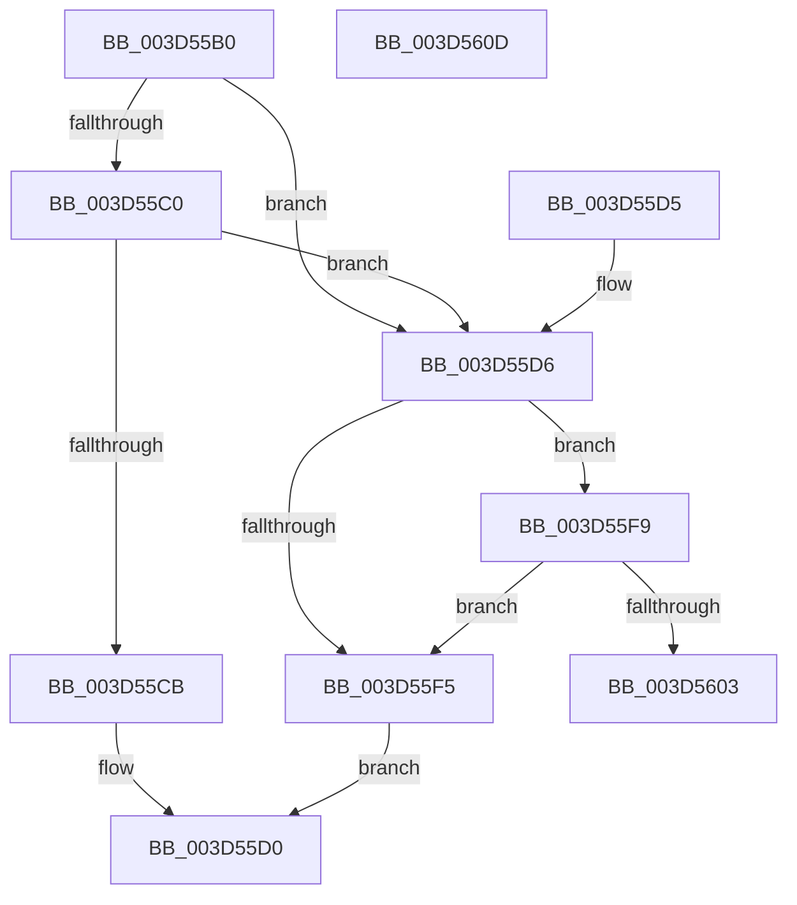

# MiGetStandbyPageType

- RVA: `0x003D55B0`–`0x003D560E` (길이 `94` bytes)
- VA: `0x00000001403D55B0`
- 실행 섹션: `.text`
- PDB 이름 있음: `예`; PDB Function 태그: `아니요`
- unwind 정보 RVA: `0x000939E4`
- 디코드: `28`개 명령, `94/94` bytes 표시
- 미해석 바이트: `0` (있으면 어셈블리에 `.byte`로 보존)

> 이 문서는 커널 이미지의 기계어와 PDB 기호를 분석해 생성했습니다. 4번과 5번은 함수 원형과 자료형을 바이너리 사용 방식에서 추정한 C 해석이며 원본 소스 복구 결과는 아닙니다.

## 1. Dependencies

- 직접 호출 지점: **1**; 고유 호출 대상: **1**
- 직접 호출자로 확인된 함수: **2**
- RIP 상대 이미지 참조: **1**

### Outgoing calls
- `0x003D55F9` → [MiGetPfnSlabType](../28/MiGetPfnSlabType_function_0028E2D0.md) (function, `0x0028E2D0`)

### Direct callers
- [MiFindSuitableLookasideReplacement](../33/MiFindSuitableLookasideReplacement_function_0033A0C0.md) at `0x0033A632`
- [sub_003D52D1](Unknown_function_003D52D1.md) at `0x003D52F2`
- [sub_003D52D1](Unknown_function_003D52D1.md) at `0x003D533F`

### Static image references
- `0x003D55B4` → RVA `0x00E35C00` (`.data`; read)

## 2. Other-region calls and transfers

- 다른 실행 섹션으로 향하는 call: **0**
- 별도 외부 분기/꼬리 이동을 확인하지 못했습니다.

## 3. Assembly (complete function range)

```asm
003D55B0  48 83 EC 28                     sub rsp, 0x28
003D55B4  48 8B 05 45 06 A6 00            mov rax, qword ptr [rip + 0xa60645]
003D55BB  48 3B C8                        cmp rcx, rax
003D55BE  72 16                           jb 0x1403d55d6
003D55C0  48 05 00 08 00 00               add rax, 0x800
003D55C6  48 3B C8                        cmp rcx, rax
003D55C9  73 0B                           jae 0x1403d55d6
003D55CB  B8 01 00 00 00                  mov eax, 1
003D55D0  48 83 C4 28                     add rsp, 0x28
003D55D4  C3                              ret
003D55D5  CC                              int3
003D55D6  48 8D 0C 49                     lea rcx, [rcx + rcx*2]
003D55DA  48 C1 E1 04                     shl rcx, 4
003D55DE  48 B8 00 00 00 00 00 DE FF FF   movabs rax, 0xffffde0000000000
003D55E8  48 03 C8                        add rcx, rax
003D55EB  8B 41 20                        mov eax, dword ptr [rcx + 0x20]
003D55EE  C1 E8 18                        shr eax, 0x18
003D55F1  A8 08                           test al, 8
003D55F3  75 04                           jne 0x1403d55f9
003D55F5  33 C0                           xor eax, eax
003D55F7  EB D7                           jmp 0x1403d55d0
003D55F9  E8 D2 8C EB FF                  call 0x14028e2d0
003D55FE  83 F8 09                        cmp eax, 9
003D5601  75 F2                           jne 0x1403d55f5
003D5603  B8 02 00 00 00                  mov eax, 2
003D5608  48 83 C4 28                     add rsp, 0x28
003D560C  C3                              ret
003D560D  CC                              int3
```

## 4. C-style interpretation (structured pseudocode)

```c
__int64 __fastcall MiGetStandbyPageType(__int64 a1)
{
    __int64 result;
    __int64 v_rsp;

    v_rsp = (v_rsp) - (40);
    if (a1 < (*(unsigned __int64 *)(v_rip + 10880581))) goto loc_003D55D6;
    result = (*(unsigned __int64 *)(v_rip + 10880581)) + (0x800ULL);
    if (a1 >= result) goto loc_003D55D6;
loc_003D55D0:
    v_rsp = (v_rsp) + (40);
    return 1;
loc_003D55D6:
    a1 = (a1 + a1 * 2) << (4);
    a1 = (a1) + (1);
    result = (unsigned int)(((unsigned int)(*(unsigned int *)(a1 + 32))) >> (24));
    if ((((unsigned __int8)(result)) & (8)) != 0) goto loc_003D55F9;
loc_003D55F5:
    result = 0;
    goto loc_003D55D0;
loc_003D55F9:
    result = MiGetPfnSlabType(a1, a2, a3, a4);
    if (((unsigned int)(result)) != 9) goto loc_003D55F5;
    v_rsp = (v_rsp) + (40);
    return 2;
}
```

## 5. (Beta) C Style

```c
int64_t MiGetStandbyPageType(int64_t Arg1)
{
    int64_t result;
    int64_t local_rsp;

    local_rsp = (local_rsp) - (40);
    if (Arg1 < (*(uint64_t *)(v_rip + 0xA60645))) goto loc_003D55D6;
    result = (*(uint64_t *)(v_rip + 0xA60645)) + (0x800ULL);
    if (Arg1 >= result) goto loc_003D55D6;
loc_003D55D0:
    local_rsp = (local_rsp) + (40);
    return 1;
loc_003D55D6:
    Arg1 = (Arg1 + Arg1 * 2) << (4);
    Arg1 = (Arg1) + (1);
    result = (uint32_t)(((uint32_t)(*(uint32_t *)(Arg1 + 0x20))) >> (24));
    if ((((uint8_t)(result)) & (8)) != 0) goto loc_003D55F9;
loc_003D55F5:
    result = 0;
    goto loc_003D55D0;
loc_003D55F9:
    result = MiGetPfnSlabType(Arg1, a2, a3, a4);
    if (((uint32_t)(result)) != 9) goto loc_003D55F5;
    local_rsp = (local_rsp) + (40);
    return 2;
}
```

## 6. Execution-region graph

[열기: 2D/3D 그래프와 함수 탐색 컨트롤 패널](../../../control-panel.html?section=text&rva=0x003D55B0&view=graph)

- 2D 그래프는 위에서 아래로 흐르고, 3D 그래프는 빈 공간을 드래그해 회전합니다. Shift+드래그는 이동, 휠은 확대·축소, 함수 노드 선택은 대상 보고서 이동입니다.

### Static fallback


