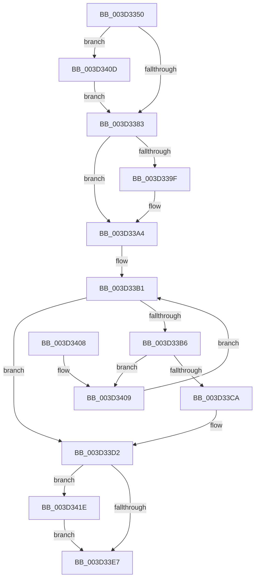

# MiInitializeDemandCoalesceContext

- RVA: `0x003D3350`–`0x003D3430` (길이 `224` bytes)
- VA: `0x00000001403D3350`
- 실행 섹션: `.text`
- PDB 이름 있음: `예`; PDB Function 태그: `아니요`
- unwind 정보 RVA: `0x00091790`
- 디코드: `58`개 명령, `224/224` bytes 표시
- 미해석 바이트: `0` (있으면 어셈블리에 `.byte`로 보존)

> 이 문서는 커널 이미지의 기계어와 PDB 기호를 분석해 생성했습니다. 4번과 5번은 함수 원형과 자료형을 바이너리 사용 방식에서 추정한 C 해석이며 원본 소스 복구 결과는 아닙니다.

## 1. Dependencies

- 직접 호출 지점: **0**; 고유 호출 대상: **0**
- 직접 호출자로 확인된 함수: **9**
- RIP 상대 이미지 참조: **2**

### Outgoing calls
- 직접 디코드된 call 명령이 없습니다.

### Direct callers
- [MiGetLargePoolPages](../32/MiGetLargePoolPages_function_00327FF8.md) at `0x00328057`
- [MiCreateSlabEntry](../37/MiCreateSlabEntry_function_00374DEC.md) at `0x00374FA8`
- [MiCreateLargePfnList](MiCreateLargePfnList_function_003D2DA8.md) at `0x003D2F5E`
- [MiValidateMdlAllocationRequest](../4A/MiValidateMdlAllocationRequest_function_004A280C.md) at `0x004A2B2C`
- [MiProcessVaContiguityInformation](../69/MiProcessVaContiguityInformation_function_006939C0.md) at `0x00693A74`
- [MiAllocatePartitionPhysicalPages](../../page/80/MiAllocatePartitionPhysicalPages_function_0080C9D4.md) at `0x0080CB6D`
- [MiPfPrepareSequentialReadList](../../page/93/MiPfPrepareSequentialReadList_function_0093D8E8.md) at `0x0093DA0A`
- [MiGetLargePagesForSystemMapping](../../page/AC/MiGetLargePagesForSystemMapping_function_00AC5094.md) at `0x00AC51E9`
- [sub_00B2AD32](../../page/B2/Unknown_function_00B2AD32.md) at `0x00B2ADC1`

### Static image references
- `0x003D3364` → RVA `0x00FC5000` (`ALMOSTRO`; read)
- `0x003D33A6` → RVA `0x00000000` (`image boundary/outside`; read)

## 2. Other-region calls and transfers

- 다른 실행 섹션으로 향하는 call: **0**
- 별도 외부 분기/꼬리 이동을 확인하지 못했습니다.

## 3. Assembly (complete function range)

```asm
003D3350  48 89 5C 24 08                  mov qword ptr [rsp + 8], rbx
003D3355  48 89 6C 24 10                  mov qword ptr [rsp + 0x10], rbp
003D335A  48 89 74 24 18                  mov qword ptr [rsp + 0x18], rsi
003D335F  48 89 7C 24 20                  mov qword ptr [rsp + 0x20], rdi
003D3364  0F B7 1D 95 1C BF 00            movzx ebx, word ptr [rip + 0xbf1c95]
003D336B  48 8B EA                        mov rbp, rdx
003D336E  4C 8B D1                        mov r10, rcx
003D3371  48 8B F1                        mov rsi, rcx
003D3374  41 BB 03 00 00 00               mov r11d, 3
003D337A  F6 C1 04                        test cl, 4
003D337D  0F 85 8A 00 00 00               jne 0x1403d340d
003D3383  48 8B C3                        mov rax, rbx
003D3386  49 8B CB                        mov rcx, r11
003D3389  48 C1 E0 20                     shl rax, 0x20
003D338D  48 8B FE                        mov rdi, rsi
003D3390  48 0B C3                        or rax, rbx
003D3393  48 D1 E9                        shr rcx, 1
003D3396  F3 48 AB                        rep stosq qword ptr [rdi], rax
003D3399  41 F6 C3 01                     test r11b, 1
003D339D  74 05                           je 0x1403d33a4
003D339F  42 89 5C 9E FC                  mov dword ptr [rsi + r11*4 - 4], ebx
003D33A4  33 FF                           xor edi, edi
003D33A6  4C 8D 1D 53 CC C2 FF            lea r11, [rip - 0x3d33ad]
003D33AD  8B CF                           mov ecx, edi
003D33AF  8B D7                           mov edx, edi
003D33B1  83 FA 03                        cmp edx, 3
003D33B4  73 1C                           jae 0x1403d33d2
003D33B6  8B C2                           mov eax, edx
003D33B8  48 8D 04 C5 00 00 00 00         lea rax, [rax*8]
003D33C0  4A 3B AC 18 60 1C 01 00         cmp rbp, qword ptr [rax + r11 + 0x11c60]
003D33C8  75 3F                           jne 0x1403d3409
003D33CA  4A 8B 8C 18 D0 EC E0 00         mov rcx, qword ptr [rax + r11 + 0xe0ecd0]
003D33D2  B8 08 00 00 00                  mov eax, 8
003D33D7  4C 3B C0                        cmp r8, rax
003D33DA  49 0F 42 C0                     cmovb rax, r8
003D33DE  48 0F AF C8                     imul rcx, rax
003D33E2  45 85 C9                        test r9d, r9d
003D33E5  74 37                           je 0x1403d341e
003D33E7  48 8B 5C 24 08                  mov rbx, qword ptr [rsp + 8]
003D33EC  48 8B 6C 24 10                  mov rbp, qword ptr [rsp + 0x10]
003D33F1  48 8B 74 24 18                  mov rsi, qword ptr [rsp + 0x18]
003D33F6  49 89 7A 30                     mov qword ptr [r10 + 0x30], rdi
003D33FA  49 89 7A 38                     mov qword ptr [r10 + 0x38], rdi
003D33FE  48 8B 7C 24 20                  mov rdi, qword ptr [rsp + 0x20]
003D3403  49 89 4A 28                     mov qword ptr [r10 + 0x28], rcx
003D3407  C3                              ret
003D3408  CC                              int3
003D3409  FF C2                           inc edx
003D340B  EB A4                           jmp 0x1403d33b1
003D340D  89 19                           mov dword ptr [rcx], ebx
003D340F  48 8D 71 04                     lea rsi, [rcx + 4]
003D3413  41 BB 02 00 00 00               mov r11d, 2
003D3419  E9 65 FF FF FF                  jmp 0x1403d3383
003D341E  48 C1 E1 07                     shl rcx, 7
003D3422  B8 40 42 0F 00                  mov eax, 0xf4240
003D3427  48 3B C8                        cmp rcx, rax
003D342A  48 0F 43 C8                     cmovae rcx, rax
003D342E  EB B7                           jmp 0x1403d33e7
```

## 4. C-style interpretation (structured pseudocode)

```c
__int64 __fastcall MiInitializeDemandCoalesceContext(__int64 a1, __int64 a2, __int64 a3, int a4)
{
    __int64 result;
    __int64 v_rdi;
    unsigned __int64 v_stack_p10;
    unsigned __int64 v_stack_p18;
    unsigned __int64 v_stack_p20;
    unsigned __int64 v_stack_p8;

    v_stack_p8 = v_rbx;
    v_stack_p10 = v_rbp;
    v_stack_p18 = v_rsi;
    v_stack_p20 = v_rdi;
    if ((((unsigned __int8)(a1)) & (4)) != 0) goto loc_003D340D;
loc_003D3383:
    result = (*(unsigned __int16 *)(v_rip + 12524693)) << (32);
    result = (result) | (*(unsigned __int16 *)(v_rip + 12524693));
    a1 = (3) >> (1);
    if (((3) & (1)) != 0) {
        *(unsigned int *)(a1 + 3 * 4 - 4) = (unsigned int)(*(unsigned __int16 *)(v_rip + 12524693));
    }
    v_rdi = 0;
loc_003D33B1:
    if (0 >= 3) goto loc_003D33D2;
    if (a2 != (*(unsigned __int64 *)(0 * 8 + v_rip - 4010925 * 1 + 72800))) goto loc_003D3409;
loc_003D33D2:
    result = 8;
    if (a3 < 8) { result = a3; }
    a1 = (*(unsigned __int64 *)(0 * 8 + v_rip - 4010925 * 1 + 14740688)) * (result);
    if (a4 == 0) goto loc_003D341E;
loc_003D33E7:
    *(unsigned __int64 *)(a1 + 48) = 0;
    *(unsigned __int64 *)(a1 + 56) = 0;
    *(unsigned __int64 *)(a1 + 40) = a1;
    return result;
loc_003D3409:
    a2 = (unsigned int)((0) + 1);
    goto loc_003D33B1;
loc_003D340D:
    *(unsigned int *)(a1) = (unsigned int)(v_stack_p8);
    goto loc_003D3383;
loc_003D341E:
    a1 = (a1) << (7);
    if (a1 >= ((unsigned int)(0xF4240ULL))) { a1 = (unsigned int)(0xF4240ULL); }
    goto loc_003D33E7;
}
```

## 5. (Beta) C Style

```c
int64_t MiInitializeDemandCoalesceContext(void *Arg1, int64_t Arg2, int64_t Arg3, int32_t Arg4)
{
    uint8_t *arg1 = (uint8_t *)Arg1;

    int64_t result;
    int64_t local_rdi;
    uint64_t v_stack_p10;
    uint64_t v_stack_p18;
    uint64_t v_stack_p20;
    uint64_t v_stack_p8;

    v_stack_p8 = local_rbx;
    v_stack_p10 = local_rbp;
    v_stack_p18 = local_rsi;
    v_stack_p20 = local_rdi;
    if ((((uint8_t)(Arg1)) & (4)) != 0) goto loc_003D340D;
loc_003D3383:
    result = (*(uint16_t *)(v_rip + 0xBF1C95)) << (32);
    result = (result) | (*(uint16_t *)(v_rip + 0xBF1C95));
    Arg1 = (3) >> (1);
    if (((3) & (1)) != 0) {
        *(uint32_t *)(arg1 + 0x3 * 4 - 0x4) = (uint32_t)(*(uint16_t *)(v_rip + 0xBF1C95));
    }
    local_rdi = 0;
loc_003D33B1:
    if (0 >= 3) goto loc_003D33D2;
    if (Arg2 != (*(uint64_t *)(0 * 8 + v_rip - 0x3D33AD * 1 + 0x11C60))) goto loc_003D3409;
loc_003D33D2:
    result = 8;
    if (Arg3 < 8) { result = Arg3; }
    Arg1 = (*(uint64_t *)(0 * 8 + v_rip - 0x3D33AD * 1 + 0xE0ECD0)) * (result);
    if (Arg4 == 0) goto loc_003D341E;
loc_003D33E7:
    *(uint64_t *)(arg1 + 0x30) = 0;
    *(uint64_t *)(arg1 + 0x38) = 0;
    *(void **)(arg1 + 0x28) = Arg1;
    return result;
loc_003D3409:
    Arg2 = (uint32_t)((0) + 1);
    goto loc_003D33B1;
loc_003D340D:
    *(uint32_t *)(arg1) = (uint32_t)(v_stack_p8);
    goto loc_003D3383;
loc_003D341E:
    Arg1 = (Arg1) << (7);
    if (Arg1 >= ((uint32_t)(0xF4240ULL))) { Arg1 = (uint32_t)(0xF4240ULL); }
    goto loc_003D33E7;
}
```

### 관측된 메모리 오프셋

구조체 형식이 확인되지 않은 접근은 인자 기준의 오프셋으로만 기록했습니다.

| 기준 인자 | 오프셋 표현 | 폭 (bit) | 접근 |
|---|---:|---:|---|
| `Arg1` | `+ 0x28` | `64` | `W` |
| `Arg1` | `+ 0x30` | `64` | `W` |
| `Arg1` | `+ 0x38` | `64` | `W` |

## 6. Execution-region graph

[열기: 2D/3D 그래프와 함수 탐색 컨트롤 패널](../../../control-panel.html?section=text&rva=0x003D3350&view=graph)

- 2D 그래프는 위에서 아래로 흐르고, 3D 그래프는 빈 공간을 드래그해 회전합니다. Shift+드래그는 이동, 휠은 확대·축소, 함수 노드 선택은 대상 보고서 이동입니다.

### Static fallback


