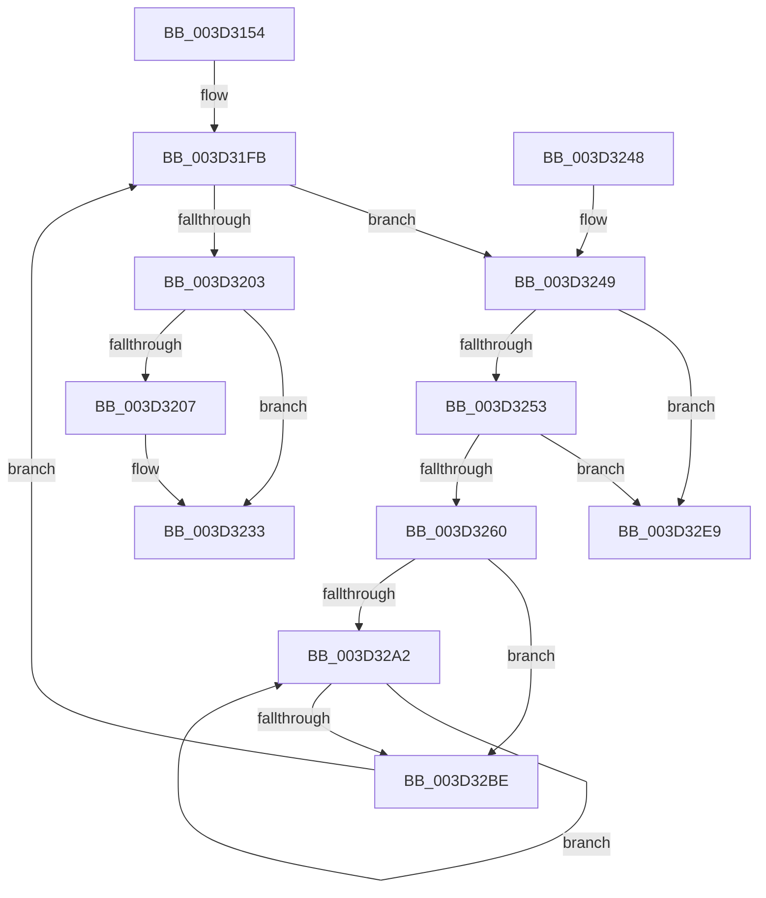

# MiInsertLargeUserMapping

- RVA: `0x003D3154`–`0x003D32F0` (길이 `412` bytes)
- VA: `0x00000001403D3154`
- 실행 섹션: `.text`
- PDB 이름 있음: `예`; PDB Function 태그: `아니요`
- unwind 정보 RVA: `0x00091774`
- 디코드: `108`개 명령, `412/412` bytes 표시
- 미해석 바이트: `0` (있으면 어셈블리에 `.byte`로 보존)

> 이 문서는 커널 이미지의 기계어와 PDB 기호를 분석해 생성했습니다. 4번과 5번은 함수 원형과 자료형을 바이너리 사용 방식에서 추정한 C 해석이며 원본 소스 복구 결과는 아닙니다.

## 1. Dependencies

- 직접 호출 지점: **5**; 고유 호출 대상: **5**
- 직접 호출자로 확인된 함수: **2**
- RIP 상대 이미지 참조: **1**

### Outgoing calls
- `0x003D31A0` → [MiGetLeafVa](../27/MiGetLeafVa_function_0027C0A0.md) (function, `0x0027C0A0`)
- `0x003D31AE` → [MiGetLargePteAddress](MiGetLargePteAddress_function_003D3300.md) (function, `0x003D3300`)
- `0x003D322E` → [MiIncreaseUsedPtes](../24/MiIncreaseUsedPtes_function_00243630.md) (function, `0x00243630`)
- `0x003D3291` → [MiInitializeLargeUserBasePfn](../4F/MiInitializeLargeUserBasePfn_function_004F6268.md) (function, `0x004F6268`)
- `0x003D32D1` → [MiWriteLargePte](../2C/MiWriteLargePte_function_002C6DE0.md) (function, `0x002C6DE0`)

### Direct callers
- [MiCommitExistingVad](../32/MiCommitExistingVad_function_0032A860.md) at `0x0032B233`
- [MiMapUserLargePages](MiMapUserLargePages_function_003D26F4.md) at `0x003D2BD6`

### Static image references
- `0x003D3176` → RVA `0x00000000` (`image boundary/outside`; read)

## 2. Other-region calls and transfers

- 다른 실행 섹션으로 향하는 call: **0**
- 별도 외부 분기/꼬리 이동을 확인하지 못했습니다.

## 3. Assembly (complete function range)

```asm
003D3154  48 89 5C 24 10                  mov qword ptr [rsp + 0x10], rbx
003D3159  44 89 4C 24 20                  mov dword ptr [rsp + 0x20], r9d
003D315E  55                              push rbp
003D315F  56                              push rsi
003D3160  57                              push rdi
003D3161  41 54                           push r12
003D3163  41 55                           push r13
003D3165  41 56                           push r14
003D3167  41 57                           push r15
003D3169  48 83 EC 20                     sub rsp, 0x20
003D316D  65 48 8B 04 25 88 01 00 00      mov rax, qword ptr gs:[0x188]
003D3176  48 8D 35 83 CE C2 FF            lea rsi, [rip - 0x3d317d]
003D317D  4C 8B D1                        mov r10, rcx
003D3180  41 8B F9                        mov edi, r9d
003D3183  48 8B CA                        mov rcx, rdx
003D3186  4D 8B F0                        mov r14, r8
003D3189  4C 8B FA                        mov r15, rdx
003D318C  48 8B 80 B8 00 00 00            mov rax, qword ptr [rax + 0xb8]
003D3193  4C 8B AC FE 60 1C 01 00         mov r13, qword ptr [rsi + rdi*8 + 0x11c60]
003D319B  48 89 44 24 60                  mov qword ptr [rsp + 0x60], rax
003D31A0  E8 FB 8E EA FF                  call 0x14027c0a0
003D31A5  41 8B D1                        mov edx, r9d
003D31A8  48 8B C8                        mov rcx, rax
003D31AB  48 8B E8                        mov rbp, rax
003D31AE  E8 4D 01 00 00                  call 0x1403d3300
003D31B3  8B 94 24 80 00 00 00            mov edx, dword ptr [rsp + 0x80]
003D31BA  4C 8B E0                        mov r12, rax
003D31BD  41 8B 4A 30                     mov ecx, dword ptr [r10 + 0x30]
003D31C1  48 8B D8                        mov rbx, rax
003D31C4  0F BA EA 1F                     bts edx, 0x1f
003D31C8  B8 00 00 60 00                  mov eax, 0x600000
003D31CD  23 C8                           and ecx, eax
003D31CF  3B C8                           cmp ecx, eax
003D31D1  48 8B 84 FE A8 45 01 00         mov rax, qword ptr [rsi + rdi*8 + 0x145a8]
003D31D9  48 89 44 24 70                  mov qword ptr [rsp + 0x70], rax
003D31DE  0F 44 94 24 80 00 00 00         cmove edx, dword ptr [rsp + 0x80]
003D31E6  8B C2                           mov eax, edx
003D31E8  0F BA E8 1A                     bts eax, 0x1a
003D31EC  83 FF 02                        cmp edi, 2
003D31EF  0F 44 C2                        cmove eax, edx
003D31F2  33 FF                           xor edi, edi
003D31F4  89 84 24 80 00 00 00            mov dword ptr [rsp + 0x80], eax
003D31FB  49 8B 0E                        mov rcx, qword ptr [r14]
003D31FE  49 3B CE                        cmp rcx, r14
003D3201  75 46                           jne 0x1403d3249
003D3203  85 FF                           test edi, edi
003D3205  74 2C                           je 0x1403d3233
003D3207  48 C1 EB 09                     shr rbx, 9
003D320B  48 BA F8 FF FF FF 7F 00 00 00   movabs rdx, 0x7ffffffff8
003D3215  48 23 D3                        and rdx, rbx
003D3218  48 B8 00 00 00 00 80 F6 FF FF   movabs rax, 0xfffff68000000000
003D3222  48 03 D0                        add rdx, rax
003D3225  41 B9 02 00 00 00               mov r9d, 2
003D322B  44 8B C7                        mov r8d, edi
003D322E  E8 FD 03 E7 FF                  call 0x140243630
003D3233  48 8B 5C 24 68                  mov rbx, qword ptr [rsp + 0x68]
003D3238  48 83 C4 20                     add rsp, 0x20
003D323C  41 5F                           pop r15
003D323E  41 5E                           pop r14
003D3240  41 5D                           pop r13
003D3242  41 5C                           pop r12
003D3244  5F                              pop rdi
003D3245  5E                              pop rsi
003D3246  5D                              pop rbp
003D3247  C3                              ret
003D3248  CC                              int3
003D3249  4C 39 71 08                     cmp qword ptr [rcx + 8], r14
003D324D  0F 85 96 00 00 00               jne 0x1403d32e9
003D3253  48 8B 01                        mov rax, qword ptr [rcx]
003D3256  48 39 48 08                     cmp qword ptr [rax + 8], rcx
003D325A  0F 85 89 00 00 00               jne 0x1403d32e9
003D3260  49 89 06                        mov qword ptr [r14], rax
003D3263  4C 89 70 08                     mov qword ptr [rax + 8], r14
003D3267  48 B8 00 00 00 00 00 DE FF FF   movabs rax, 0xffffde0000000000
003D3271  4C 8B 44 24 60                  mov r8, qword ptr [rsp + 0x60]
003D3276  48 8B F1                        mov rsi, rcx
003D3279  48 2B F0                        sub rsi, rax
003D327C  49 8B D7                        mov rdx, r15
003D327F  48 B8 AB AA AA AA AA AA AA AA   movabs rax, 0xaaaaaaaaaaaaaaab
003D3289  48 C1 FE 04                     sar rsi, 4
003D328D  48 0F AF F0                     imul rsi, rax
003D3291  E8 D2 2F 12 00                  call 0x1404f6268
003D3296  4C 8B 44 24 70                  mov r8, qword ptr [rsp + 0x70]
003D329B  33 D2                           xor edx, edx
003D329D  4D 85 C0                        test r8, r8
003D32A0  74 1C                           je 0x1403d32be
003D32A2  49 8B 04 24                     mov rax, qword ptr [r12]
003D32A6  8D 4F 01                        lea ecx, [rdi + 1]
003D32A9  48 85 C0                        test rax, rax
003D32AC  0F 45 CF                        cmovne ecx, edi
003D32AF  FF C2                           inc edx
003D32B1  8B C2                           mov eax, edx
003D32B3  49 83 C4 08                     add r12, 8
003D32B7  8B F9                           mov edi, ecx
003D32B9  49 3B C0                        cmp rax, r8
003D32BC  72 E4                           jb 0x1403d32a2
003D32BE  44 8B 8C 24 80 00 00 00         mov r9d, dword ptr [rsp + 0x80]
003D32C6  48 8B D6                        mov rdx, rsi
003D32C9  44 8B 44 24 78                  mov r8d, dword ptr [rsp + 0x78]
003D32CE  48 8B CD                        mov rcx, rbp
003D32D1  E8 0A 3B EF FF                  call 0x1402c6de0
003D32D6  49 8B C5                        mov rax, r13
003D32D9  4F 8D 3C EF                     lea r15, [r15 + r13*8]
003D32DD  48 C1 E0 0C                     shl rax, 0xc
003D32E1  48 03 E8                        add rbp, rax
003D32E4  E9 12 FF FF FF                  jmp 0x1403d31fb
003D32E9  B9 03 00 00 00                  mov ecx, 3
003D32EE  CD 29                           int 0x29
```

## 4. C-style interpretation (structured pseudocode)

```c
__int64 __fastcall MiInsertLargeUserMapping(__int64 a1, __int64 a2, __int64 a3, int a4, unsigned int a5)
{
    __int64 result;
    __int64 v_r12;
    __int64 v_rbp;
    __int64 v_rbx;
    __int64 v_rdi;
    __int64 v_rsi;
    __int64 v_rsp;
    unsigned __int64 v_stack_p10;
    unsigned __int64 v_stack_p18;
    unsigned int v_stack_p20;
    unsigned int v_stack_p28;
    unsigned __int64 v_stack_p60;
    unsigned __int64 v_stack_p70;
    unsigned int v_stack_p78;
    unsigned __int64 v_stack_p8;

    v_stack_p10 = v_rbx;
    v_stack_p20 = a4;
    v_rsp = (v_rsp) - (32);
    v_stack_p8 = *(unsigned __int64 *)(*(unsigned __int64 *)(gs_base + (0 + 392)) + 184);
    result = MiGetLeafVa(a2, a2, a3, a4);
    result = MiGetLargePteAddress(result, (unsigned int)(a4), a3, a4);
    a1 = (unsigned int)(((unsigned int)(*(unsigned int *)(a1 + 48))) & ((unsigned int)((unsigned int)(0x600000ULL))));
    v_stack_p18 = *(unsigned __int64 *)(v_rip - 4010365 + (unsigned int)(a4) * 8 + 83368);
    a2 = (unsigned int)(a5);
    if (((unsigned int)(a1)) == ((unsigned int)((unsigned int)(0x600000ULL)))) { a2 = a5; }
    result = (unsigned int)((unsigned int)(a2));
    if (((unsigned int)((unsigned int)(a4))) == 2) { result = (unsigned int)(a2); }
    v_rdi = 0;
    v_stack_p28 = (unsigned int)(result);
loc_003D31FB:
    if ((*(unsigned __int64 *)(a3)) != a3) goto loc_003D3249;
    v_rbx = result;
    if (0 != 0) {
        v_rbx = (result) >> (9);
        a2 = (a2) & (v_rbx);
        a2 = (a2) + (result);
        a4 = 2;
        a3 = 0;
        result = MiIncreaseUsedPtes(*(unsigned __int64 *)(a3), a2, a3, a4);
    }
    v_rsp = (v_rsp) + (32);
    return result;
loc_003D3249:
    if ((*(unsigned __int64 *)(*(unsigned __int64 *)(a3) + 8)) != a3) goto loc_003D32E9;
    if ((*(unsigned __int64 *)(*(unsigned __int64 *)(*(unsigned __int64 *)(a3)) + 8)) != (*(unsigned __int64 *)(a3))) goto loc_003D32E9;
    *(unsigned __int64 *)(a3) = *(unsigned __int64 *)(*(unsigned __int64 *)(a3));
    *(unsigned __int64 *)(*(unsigned __int64 *)(*(unsigned __int64 *)(a3)) + 8) = a3;
    v_rsi = (*(unsigned __int64 *)(a3)) - (*(unsigned __int64 *)(*(unsigned __int64 *)(a3)));
    v_rsi = (v_rsi) >> (4);
    v_rsi = (v_rsi) * (*(unsigned __int64 *)(*(unsigned __int64 *)(a3)));
    result = MiInitializeLargeUserBasePfn(*(unsigned __int64 *)(a3), a2, v_stack_p60, a4);
    a2 = 0;
    if (v_stack_p70 == 0) goto loc_003D32BE;
loc_003D32A2:
    a1 = v_rdi + 1;
    if (*(unsigned __int64 *)(result) != 0) { a1 = 0; }
    a2 = (unsigned int)((a2) + 1);
    v_r12 = (result) + (8);
    if (((unsigned int)((unsigned int)(a2))) < v_stack_p70) goto loc_003D32A2;
loc_003D32BE:
    result = MiWriteLargePte(result, v_rsi, (unsigned int)(v_stack_p78), (unsigned int)(a5));
    result = (*(unsigned __int64 *)(v_rip - 4010365 + (unsigned int)(a4) * 8 + 72800)) << (12);
    v_rbp = (result) + (result);
    goto loc_003D31FB;
loc_003D32E9:
    return result;
}
```

## 5. (Beta) C Style

```c
int64_t MiInsertLargeUserMapping(int64_t Arg1, void *Arg2, void *Arg3, int32_t Arg4, uint32_t Arg5)
{
    uint8_t *arg2 = (uint8_t *)Arg2;
    uint8_t *arg3 = (uint8_t *)Arg3;

    int64_t result;
    int64_t local_r12;
    int64_t local_rbp;
    int64_t local_rbx;
    int64_t local_rdi;
    int64_t local_rsi;
    int64_t local_rsp;
    uint64_t v_stack_p10;
    uint64_t v_stack_p18;
    uint32_t v_stack_p20;
    uint32_t v_stack_p28;
    uint64_t v_stack_p60;
    uint64_t v_stack_p70;
    uint32_t v_stack_p78;
    uint64_t v_stack_p8;

    v_stack_p10 = local_rbx;
    v_stack_p20 = Arg4;
    local_rsp = (local_rsp) - (32);
    v_stack_p8 = *(uint64_t *)(*(uint64_t *)(gs_base + (0 + 0x188)) + 0xB8);
    result = MiGetLeafVa(Arg2, Arg2, Arg3, Arg4);
    result = MiGetLargePteAddress(result, (uint32_t)(Arg4), Arg3, Arg4);
    Arg1 = (uint32_t)(((uint32_t)(*(uint32_t *)(Arg1 + 0x30))) & ((uint32_t)((uint32_t)(0x600000ULL))));
    v_stack_p18 = *(uint64_t *)(v_rip - 0x3D317D + (uint32_t)(Arg4) * 8 + 0x145A8);
    Arg2 = (uint32_t)(Arg5);
    if (((uint32_t)(Arg1)) == ((uint32_t)((uint32_t)(0x600000ULL)))) { Arg2 = Arg5; }
    result = (uint32_t)((uint32_t)(Arg2));
    if (((uint32_t)((uint32_t)(Arg4))) == 2) { result = (uint32_t)(Arg2); }
    local_rdi = 0;
    v_stack_p28 = (uint32_t)(result);
loc_003D31FB:
    if ((*(uint64_t *)(arg3)) != Arg3) goto loc_003D3249;
    local_rbx = result;
    if (0 != 0) {
        local_rbx = (result) >> (9);
        Arg2 = (Arg2) & (local_rbx);
        Arg2 = (Arg2) + (result);
        Arg4 = 2;
        Arg3 = 0;
        result = MiIncreaseUsedPtes(*(uint64_t *)(arg3), Arg2, Arg3, Arg4);
    }
    local_rsp = (local_rsp) + (32);
    return result;
loc_003D3249:
    if ((*(uint64_t *)(*(uint64_t *)(arg3) + 0x8)) != Arg3) goto loc_003D32E9;
    if ((*(uint64_t *)(*(uint64_t *)(*(uint64_t *)(arg3)) + 0x8)) != (*(uint64_t *)(arg3))) goto loc_003D32E9;
    *(uint64_t *)(arg3) = *(uint64_t *)(*(uint64_t *)(arg3));
    *(void **)(*(uint64_t *)(*(uint64_t *)(arg3)) + 0x8) = Arg3;
    local_rsi = (*(uint64_t *)(arg3)) - (*(uint64_t *)(*(uint64_t *)(arg3)));
    local_rsi = (local_rsi) >> (4);
    local_rsi = (local_rsi) * (*(uint64_t *)(*(uint64_t *)(arg3)));
    result = MiInitializeLargeUserBasePfn(*(uint64_t *)(arg3), Arg2, v_stack_p60, Arg4);
    Arg2 = 0;
    if (v_stack_p70 == 0) goto loc_003D32BE;
loc_003D32A2:
    Arg1 = local_rdi + 1;
    if (*(uint64_t *)(result) != 0) { Arg1 = 0; }
    Arg2 = (uint32_t)((Arg2) + 1);
    local_r12 = (result) + (8);
    if (((uint32_t)((uint32_t)(Arg2))) < v_stack_p70) goto loc_003D32A2;
loc_003D32BE:
    result = MiWriteLargePte(result, local_rsi, (uint32_t)(v_stack_p78), (uint32_t)(Arg5));
    result = (*(uint64_t *)(v_rip - 0x3D317D + (uint32_t)(Arg4) * 8 + 0x11C60)) << (12);
    local_rbp = (result) + (result);
    goto loc_003D31FB;
loc_003D32E9:
    return result;
}
```

### 관측된 메모리 오프셋

구조체 형식이 확인되지 않은 접근은 인자 기준의 오프셋으로만 기록했습니다.

| 기준 인자 | 오프셋 표현 | 폭 (bit) | 접근 |
|---|---:|---:|---|
| `Arg2` | `+ 0x0 + r13*8` | `64` | `R` |
| `Arg3` | `+ 0x0` | `64` | `R` |
| `Arg3` | `+ 0x0` | `64` | `W` |

## 6. Execution-region graph

[열기: 2D/3D 그래프와 함수 탐색 컨트롤 패널](../../../control-panel.html?section=text&rva=0x003D3154&view=graph)

- 2D 그래프는 위에서 아래로 흐르고, 3D 그래프는 빈 공간을 드래그해 회전합니다. Shift+드래그는 이동, 휠은 확대·축소, 함수 노드 선택은 대상 보고서 이동입니다.

### Static fallback


