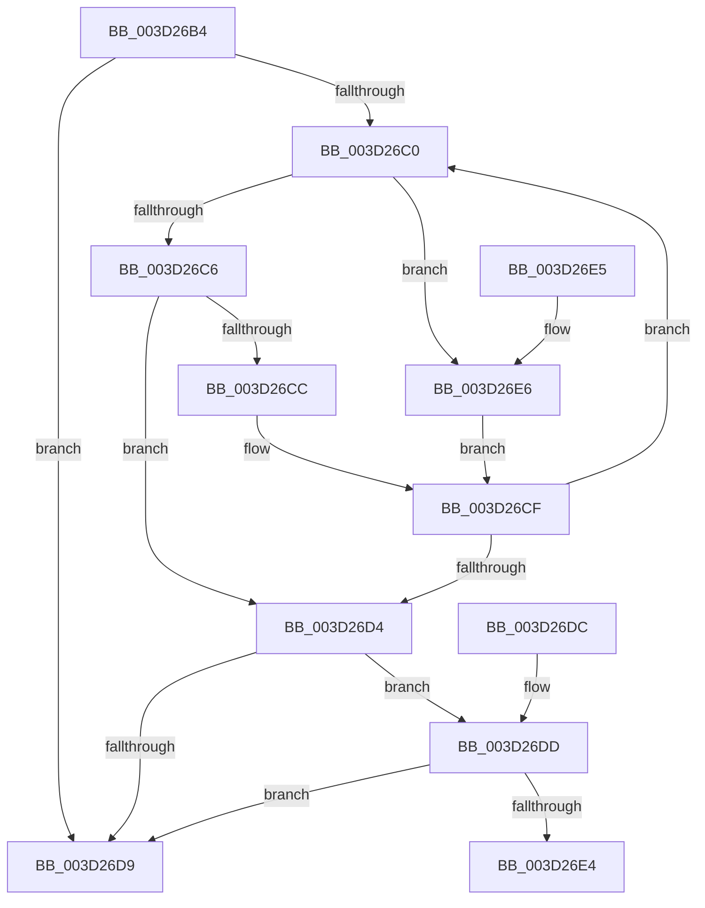

# MiLocateCloneAddress

- RVA: `0x003D26B4`–`0x003D26EC` (길이 `56` bytes)
- VA: `0x00000001403D26B4`
- 실행 섹션: `.text`
- PDB 이름 있음: `예`; PDB Function 태그: `아니요`
- unwind 정보 RVA: `0x000DB714`
- 디코드: `21`개 명령, `56/56` bytes 표시
- 미해석 바이트: `0` (있으면 어셈블리에 `.byte`로 보존)

> 이 문서는 커널 이미지의 기계어와 PDB 기호를 분석해 생성했습니다. 4번과 5번은 함수 원형과 자료형을 바이너리 사용 방식에서 추정한 C 해석이며 원본 소스 복구 결과는 아닙니다.

## 1. Dependencies

- 직접 호출 지점: **0**; 고유 호출 대상: **0**
- 직접 호출자로 확인된 함수: **14**
- RIP 상대 이미지 참조: **0**

### Outgoing calls
- 직접 디코드된 call 명령이 없습니다.

### Direct callers
- [sub_0023DA90](../23/Unknown_function_0023DA90.md) at `0x0023DAA2`
- [sub_0023DBF0](../23/Unknown_function_0023DBF0.md) at `0x0023DC1D`
- [sub_002C3A7C](../2C/Unknown_function_002C3A7C.md) at `0x002C3F47`
- [MiComputePageCommitment](../2C/MiComputePageCommitment_function_002C5C34.md) at `0x002C5EEA`
- [MiMakeProtoPrivate](../2C/MiMakeProtoPrivate_function_002C64A4.md) at `0x002C6591`
- [MiGetPfnProtection](../32/MiGetPfnProtection_function_0032A650.md) at `0x0032A750`
- [sub_0032BA64](../32/Unknown_function_0032BA64.md) at `0x0032BBC8`
- [MiCompleteProtoPteFault](../34/MiCompleteProtoPteFault_function_00345710.md) at `0x00345E65`
- [MiCopyOnWrite](../36/MiCopyOnWrite_function_00362A0C.md) at `0x00363034`
- [MiCopyToUserVa](MiCopyToUserVa_function_003D1E68.md) at `0x003D20A9`
- [MiQueryLeafPte](MiQueryLeafPte_function_003D2160.md) at `0x003D244D`
- [MiSplitReducedCommitClonePage](../4F/MiSplitReducedCommitClonePage_function_004FA808.md) at `0x004FA940`
- [MiCheckCommitReleaseFromVad](../66/MiCheckCommitReleaseFromVad_function_0066EB90.md) at `0x0066ED99`
- [MiCheckCommitReleaseFromVad](../66/MiCheckCommitReleaseFromVad_function_0066EB90.md) at `0x0066EE1D`
- [sub_006DA5A4](../6D/Unknown_function_006DA5A4.md) at `0x006DA5EC`

### Static image references
- 디코드된 RIP-relative 메모리 참조가 없습니다.

## 2. Other-region calls and transfers

- 다른 실행 섹션으로 향하는 call: **0**
- 별도 외부 분기/꼬리 이동을 확인하지 못했습니다.

## 3. Assembly (complete function range)

```asm
003D26B4  48 8B 81 80 02 00 00            mov rax, qword ptr [rcx + 0x280]
003D26BB  48 85 C0                        test rax, rax
003D26BE  74 19                           je 0x1403d26d9
003D26C0  48 3B 50 20                     cmp rdx, qword ptr [rax + 0x20]
003D26C4  77 20                           ja 0x1403d26e6
003D26C6  48 3B 50 18                     cmp rdx, qword ptr [rax + 0x18]
003D26CA  73 08                           jae 0x1403d26d4
003D26CC  48 8B 00                        mov rax, qword ptr [rax]
003D26CF  48 85 C0                        test rax, rax
003D26D2  75 EC                           jne 0x1403d26c0
003D26D4  48 85 C0                        test rax, rax
003D26D7  75 04                           jne 0x1403d26dd
003D26D9  33 C0                           xor eax, eax
003D26DB  C3                              ret
003D26DC  CC                              int3
003D26DD  48 83 78 30 00                  cmp qword ptr [rax + 0x30], 0
003D26E2  74 F5                           je 0x1403d26d9
003D26E4  C3                              ret
003D26E5  CC                              int3
003D26E6  48 8B 40 08                     mov rax, qword ptr [rax + 8]
003D26EA  EB E3                           jmp 0x1403d26cf
```

## 4. C-style interpretation (structured pseudocode)

```c
__int64 __fastcall MiLocateCloneAddress(__int64 a1, __int64 a2)
{
    __int64 result;

    if (*(unsigned __int64 *)(a1 + 640) == 0) goto loc_003D26D9;
loc_003D26C0:
    if (a2 > (*(unsigned __int64 *)(*(unsigned __int64 *)(a1 + 640) + 32))) goto loc_003D26E6;
    if (a2 >= (*(unsigned __int64 *)(*(unsigned __int64 *)(a1 + 640) + 24))) goto loc_003D26D4;
loc_003D26CF:
    if (*(unsigned __int64 *)(*(unsigned __int64 *)(a1 + 640)) != 0) goto loc_003D26C0;
loc_003D26D4:
    if (*(unsigned __int64 *)(*(unsigned __int64 *)(a1 + 640)) != 0) goto loc_003D26DD;
loc_003D26D9:
    result = 0;
    return result;
loc_003D26DD:
    if ((*(unsigned __int64 *)(result + 48)) == 0) goto loc_003D26D9;
    return result;
loc_003D26E6:
    goto loc_003D26CF;
}
```

## 5. (Beta) C Style

```c
int64_t MiLocateCloneAddress(void *Arg1, int64_t Arg2)
{
    uint8_t *arg1 = (uint8_t *)Arg1;

    int64_t result;

    if (*(uint64_t *)(arg1 + 0x280) == 0) goto loc_003D26D9;
loc_003D26C0:
    if (Arg2 > (*(uint64_t *)(*(uint64_t *)(arg1 + 0x280) + 0x20))) goto loc_003D26E6;
    if (Arg2 >= (*(uint64_t *)(*(uint64_t *)(arg1 + 0x280) + 0x18))) goto loc_003D26D4;
loc_003D26CF:
    if (*(uint64_t *)(*(uint64_t *)(arg1 + 0x280)) != 0) goto loc_003D26C0;
loc_003D26D4:
    if (*(uint64_t *)(*(uint64_t *)(arg1 + 0x280)) != 0) goto loc_003D26DD;
loc_003D26D9:
    result = 0;
    return result;
loc_003D26DD:
    if ((*(uint64_t *)(result + 0x30)) == 0) goto loc_003D26D9;
    return result;
loc_003D26E6:
    goto loc_003D26CF;
}
```

### 관측된 메모리 오프셋

구조체 형식이 확인되지 않은 접근은 인자 기준의 오프셋으로만 기록했습니다.

| 기준 인자 | 오프셋 표현 | 폭 (bit) | 접근 |
|---|---:|---:|---|
| `Arg1` | `+ 0x280` | `64` | `R` |

## 6. Execution-region graph

[열기: 2D/3D 그래프와 함수 탐색 컨트롤 패널](../../../control-panel.html?section=text&rva=0x003D26B4&view=graph)

- 2D 그래프는 위에서 아래로 흐르고, 3D 그래프는 빈 공간을 드래그해 회전합니다. Shift+드래그는 이동, 휠은 확대·축소, 함수 노드 선택은 대상 보고서 이동입니다.

### Static fallback


