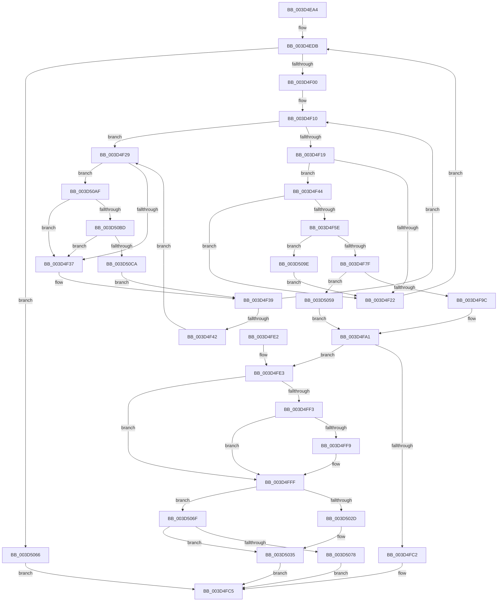

# MiLockStandbyOldestPage

- RVA: `0x003D4EA4`–`0x003D50D6` (길이 `562` bytes)
- VA: `0x00000001403D4EA4`
- 실행 섹션: `.text`
- PDB 이름 있음: `예`; PDB Function 태그: `아니요`
- unwind 정보 RVA: `0x000938AC`
- 디코드: `140`개 명령, `562/562` bytes 표시
- 미해석 바이트: `0` (있으면 어셈블리에 `.byte`로 보존)

> 이 문서는 커널 이미지의 기계어와 PDB 기호를 분석해 생성했습니다. 4번과 5번은 함수 원형과 자료형을 바이너리 사용 방식에서 추정한 C 해석이며 원본 소스 복구 결과는 아닙니다.

## 1. Dependencies

- 직접 호출 지점: **13**; 고유 호출 대상: **9**
- 직접 호출자로 확인된 함수: **1**
- RIP 상대 이미지 참조: **4**

### Outgoing calls
- `0x003D4F69` → [ExAcquireSpinLockExclusiveAtDpcLevel](../24/ExAcquireSpinLockExclusiveAtDpcLevel_function_00248E80.md) (function, `0x00248E80`)
- `0x003D4F87` → [MiRebuildStandbyLookasideList](MiRebuildStandbyLookasideList_function_003D50E0.md) (function, `0x003D50E0`)
- `0x003D4F8F` → [MiIsDecayPfn](../2B/MiIsDecayPfn_function_002B9240.md) (function, `0x002B9240`)
- `0x003D4FB1` → [MiReplaceStandbyLookaside](../33/MiReplaceStandbyLookaside_function_003397D0.md) (function, `0x003397D0`)
- `0x003D4FB9` → [MiIsDecayPfn](../2B/MiIsDecayPfn_function_002B9240.md) (function, `0x002B9240`)
- `0x003D5030` → [MiRepurposeDecayNode](MiRepurposeDecayNode_function_003D5774.md) (function, `0x003D5774`)
- `0x003D503F` → [ExReleaseSpinLockExclusiveFromDpcLevel](../24/ExReleaseSpinLockExclusiveFromDpcLevel_function_002497E0.md) (function, `0x002497E0`)
- `0x003D505C` → [MiGetPfnSlabType](../28/MiGetPfnSlabType_function_0028E2D0.md) (function, `0x0028E2D0`)
- `0x003D5080` → [MiGetPfnSlabType](../28/MiGetPfnSlabType_function_0028E2D0.md) (function, `0x0028E2D0`)
- `0x003D5091` → [MiReplaceStandbyLookaside](../33/MiReplaceStandbyLookaside_function_003397D0.md) (function, `0x003397D0`)
- `0x003D50A5` → [ExReleaseSpinLockExclusiveFromDpcLevel](../24/ExReleaseSpinLockExclusiveFromDpcLevel_function_002497E0.md) (function, `0x002497E0`)
- `0x003D50BD` → [KiCheckVpBackingLongSpinWaitHypercall](../30/KiCheckVpBackingLongSpinWaitHypercall_function_0030F490.md) (function, `0x0030F490`)
- `0x003D50CC` → [HvlNotifyLongSpinWait](../30/HvlNotifyLongSpinWait_function_0030F460.md) (function, `0x0030F460`)

### Direct callers
- [MiRemoveLowestPriorityStandbyPage](../33/MiRemoveLowestPriorityStandbyPage_function_00334600.md) at `0x0033498A`

### Static image references
- `0x003D4F2B` → RVA `0x00FC52AC` (`ALMOSTRO`; reference)
- `0x003D4F48` → RVA `0x00E30088` (`.data`; read)
- `0x003D4FE3` → RVA `0x00E2DC80` (`.data`; read)
- `0x003D50AF` → RVA `0x00FC6AB8` (`ALMOSTRO`; read)

## 2. Other-region calls and transfers

- 다른 실행 섹션으로 향하는 call: **0**
- 별도 외부 분기/꼬리 이동을 확인하지 못했습니다.

## 3. Assembly (complete function range)

```asm
003D4EA4  48 89 5C 24 08                  mov qword ptr [rsp + 8], rbx
003D4EA9  48 89 6C 24 10                  mov qword ptr [rsp + 0x10], rbp
003D4EAE  48 89 74 24 18                  mov qword ptr [rsp + 0x18], rsi
003D4EB3  57                              push rdi
003D4EB4  41 54                           push r12
003D4EB6  41 55                           push r13
003D4EB8  41 56                           push r14
003D4EBA  41 57                           push r15
003D4EBC  48 83 EC 20                     sub rsp, 0x20
003D4EC0  41 83 21 00                     and dword ptr [r9], 0
003D4EC4  4D 8B E1                        mov r12, r9
003D4EC7  41 8B C0                        mov eax, r8d
003D4ECA  48 8B E9                        mov rbp, rcx
003D4ECD  4C 6B F8 58                     imul r15, rax, 0x58
003D4ED1  49 BD FF FF FF FF FF FF FF 7F   movabs r13, 0x7fffffffffffffff
003D4EDB  4D 8B B4 2F D0 0C 00 00         mov r14, qword ptr [r15 + rbp + 0xcd0]
003D4EE3  48 B8 FF FF FF FF 3F 00 00 00   movabs rax, 0x3fffffffff
003D4EED  48 B9 00 00 00 00 00 DE FF FF   movabs rcx, 0xffffde0000000000
003D4EF7  4C 3B F0                        cmp r14, rax
003D4EFA  0F 84 66 01 00 00               je 0x1403d5066
003D4F00  4B 8D 1C 76                     lea rbx, [r14 + r14*2]
003D4F04  48 C1 E3 04                     shl rbx, 4
003D4F08  48 8B C1                        mov rax, rcx
003D4F0B  48 03 D8                        add rbx, rax
003D4F0E  33 FF                           xor edi, edi
003D4F10  F0 48 0F BA 6B 18 3F            lock bts qword ptr [rbx + 0x18], 0x3f
003D4F17  72 10                           jb 0x1403d4f29
003D4F19  8A 43 22                        mov al, byte ptr [rbx + 0x22]
003D4F1C  24 07                           and al, 7
003D4F1E  3C 02                           cmp al, 2
003D4F20  74 22                           je 0x1403d4f44
003D4F22  F0 4C 21 6B 18                  lock and qword ptr [rbx + 0x18], r13
003D4F27  EB B2                           jmp 0x1403d4edb
003D4F29  FF C7                           inc edi
003D4F2B  85 3D 7B 03 BF 00               test dword ptr [rip + 0xbf037b], edi
003D4F31  0F 84 78 01 00 00               je 0x1403d50af
003D4F37  F3 90                           pause
003D4F39  48 8B 43 18                     mov rax, qword ptr [rbx + 0x18]
003D4F3D  48 85 C0                        test rax, rax
003D4F40  79 CE                           jns 0x1403d4f10
003D4F42  EB E5                           jmp 0x1403d4f29
003D4F44  48 8B 43 28                     mov rax, qword ptr [rbx + 0x28]
003D4F48  48 8B 0D 39 B1 A5 00            mov rcx, qword ptr [rip + 0xa5b139]
003D4F4F  48 C1 E8 2B                     shr rax, 0x2b
003D4F53  25 FF 03 00 00                  and eax, 0x3ff
003D4F58  48 39 2C C1                     cmp qword ptr [rcx + rax*8], rbp
003D4F5C  75 C4                           jne 0x1403d4f22
003D4F5E  49 8D 3C 2F                     lea rdi, [r15 + rbp]
003D4F62  48 8D 8F E0 0C 00 00            lea rcx, [rdi + 0xce0]
003D4F69  E8 12 3F E7 FF                  call 0x140248e80
003D4F6E  49 8B 84 2F D0 0C 00 00         mov rax, qword ptr [r15 + rbp + 0xcd0]
003D4F76  4C 3B F0                        cmp r14, rax
003D4F79  0F 85 1F 01 00 00               jne 0x1403d509e
003D4F7F  41 B0 01                        mov r8b, 1
003D4F82  33 D2                           xor edx, edx
003D4F84  48 8B CB                        mov rcx, rbx
003D4F87  E8 54 01 00 00                  call 0x1403d50e0
003D4F8C  49 8B CE                        mov rcx, r14
003D4F8F  E8 AC 42 EE FF                  call 0x1402b9240
003D4F94  85 C0                           test eax, eax
003D4F96  0F 84 BD 00 00 00               je 0x1403d5059
003D4F9C  B8 09 00 00 00                  mov eax, 9
003D4FA1  48 83 CE FF                     or rsi, 0xffffffffffffffff
003D4FA5  45 33 C9                        xor r9d, r9d
003D4FA8  48 8B D6                        mov rdx, rsi
003D4FAB  44 8B C0                        mov r8d, eax
003D4FAE  49 8B CE                        mov rcx, r14
003D4FB1  E8 1A 48 F6 FF                  call 0x1403397d0
003D4FB6  49 8B CE                        mov rcx, r14
003D4FB9  E8 82 42 EE FF                  call 0x1402b9240
003D4FBE  85 C0                           test eax, eax
003D4FC0  75 21                           jne 0x1403d4fe3
003D4FC2  49 8B C6                        mov rax, r14
003D4FC5  48 8B 5C 24 50                  mov rbx, qword ptr [rsp + 0x50]
003D4FCA  48 8B 6C 24 58                  mov rbp, qword ptr [rsp + 0x58]
003D4FCF  48 8B 74 24 60                  mov rsi, qword ptr [rsp + 0x60]
003D4FD4  48 83 C4 20                     add rsp, 0x20
003D4FD8  41 5F                           pop r15
003D4FDA  41 5E                           pop r14
003D4FDC  41 5D                           pop r13
003D4FDE  41 5C                           pop r12
003D4FE0  5F                              pop rdi
003D4FE1  C3                              ret
003D4FE2  CC                              int3
003D4FE3  48 8B 05 96 8C A5 00            mov rax, qword ptr [rip + 0xa58c96]
003D4FEA  48 8B 7B 10                     mov rdi, qword ptr [rbx + 0x10]
003D4FEE  48 85 C0                        test rax, rax
003D4FF1  74 0C                           je 0x1403d4fff
003D4FF3  40 F6 C7 10                     test dil, 0x10
003D4FF7  75 06                           jne 0x1403d4fff
003D4FF9  48 F7 D0                        not rax
003D4FFC  48 23 F8                        and rdi, rax
003D4FFF  48 B8 FF FF FF FF FF 00 00 00   movabs rax, 0xffffffffff
003D5009  48 C1 EF 0C                     shr rdi, 0xc
003D500D  48 23 F8                        and rdi, rax
003D5010  48 B9 00 00 00 00 00 DE FF FF   movabs rcx, 0xffffde0000000000
003D501A  48 8D 04 7F                     lea rax, [rdi + rdi*2]
003D501E  48 C1 E0 04                     shl rax, 4
003D5022  48 8B C9                        mov rcx, rcx
003D5025  48 03 C1                        add rax, rcx
003D5028  49 3B FE                        cmp rdi, r14
003D502B  75 42                           jne 0x1403d506f
003D502D  48 8B CB                        mov rcx, rbx
003D5030  E8 3F 07 00 00                  call 0x1403d5774
003D5035  48 8D 8D E0 0C 00 00            lea rcx, [rbp + 0xce0]
003D503C  49 03 CF                        add rcx, r15
003D503F  E8 9C 47 E7 FF                  call 0x1402497e0
003D5044  F0 4C 21 6B 18                  lock and qword ptr [rbx + 0x18], r13
003D5049  41 C7 04 24 01 00 00 00         mov dword ptr [r12], 1
003D5051  48 8B C6                        mov rax, rsi
003D5054  E9 6C FF FF FF                  jmp 0x1403d4fc5
003D5059  48 8B CB                        mov rcx, rbx
003D505C  E8 6F 92 EB FF                  call 0x14028e2d0
003D5061  E9 3B FF FF FF                  jmp 0x1403d4fa1
003D5066  48 83 C8 FF                     or rax, 0xffffffffffffffff
003D506A  E9 56 FF FF FF                  jmp 0x1403d4fc5
003D506F  F0 48 0F BA 68 18 3F            lock bts qword ptr [rax + 0x18], 0x3f
003D5076  72 BD                           jb 0x1403d5035
003D5078  F0 4C 21 6B 18                  lock and qword ptr [rbx + 0x18], r13
003D507D  48 8B C8                        mov rcx, rax
003D5080  E8 4B 92 EB FF                  call 0x14028e2d0
003D5085  44 8B C0                        mov r8d, eax
003D5088  48 8B D6                        mov rdx, rsi
003D508B  48 8B CF                        mov rcx, rdi
003D508E  45 33 C9                        xor r9d, r9d
003D5091  E8 3A 47 F6 FF                  call 0x1403397d0
003D5096  48 8B C7                        mov rax, rdi
003D5099  E9 27 FF FF FF                  jmp 0x1403d4fc5
003D509E  48 8D 8F E0 0C 00 00            lea rcx, [rdi + 0xce0]
003D50A5  E8 36 47 E7 FF                  call 0x1402497e0
003D50AA  E9 73 FE FF FF                  jmp 0x1403d4f22
003D50AF  8B 05 03 1A BF 00               mov eax, dword ptr [rip + 0xbf1a03]
003D50B5  A8 40                           test al, 0x40
003D50B7  0F 84 7A FE FF FF               je 0x1403d4f37
003D50BD  E8 CE A3 F3 FF                  call 0x14030f490
003D50C2  84 C0                           test al, al
003D50C4  0F 84 6D FE FF FF               je 0x1403d4f37
003D50CA  8B CF                           mov ecx, edi
003D50CC  E8 8F A3 F3 FF                  call 0x14030f460
003D50D1  E9 63 FE FF FF                  jmp 0x1403d4f39
```

## 4. C-style interpretation (structured pseudocode)

```c
__int64 __fastcall MiLockStandbyOldestPage(__int64 a1, int a2, int a3, __int64 a4)
{
    __int64 result;
    __int64 v_r15;
    __int64 v_rbx;
    __int64 v_rdi;
    __int64 v_rsi;
    __int64 v_rsp;
    unsigned __int64 v_stack_p10;
    unsigned __int64 v_stack_p18;
    unsigned __int64 v_stack_p8;

    v_stack_p8 = v_rbx;
    v_stack_p10 = v_rbp;
    v_stack_p18 = v_rsi;
    v_rsp = (v_rsp) - (32);
    v_r15 = (v_r15) * ((unsigned int)(a3));
loc_003D4EDB:
    if ((*(unsigned __int64 *)(v_r15 + a1 * 1 + 3280)) == ((unsigned int)(a3))) goto loc_003D5066;
    v_rbx = (*(unsigned __int64 *)(v_r15 + a1 * 1 + 3280) + *(unsigned __int64 *)(v_r15 + a1 * 1 + 3280) * 2) << (4);
    v_rbx = (v_rbx) + (a1);
    v_rdi = 0;
loc_003D4F10:
    if (condition_is_below) goto loc_003D4F29;
    result = (unsigned __int8)((*(unsigned __int8 *)(v_rbx + 34)) & (7));
    if (((unsigned __int8)(result)) == 2) goto loc_003D4F44;
loc_003D4F22:
    goto loc_003D4EDB;
loc_003D4F29:
    v_rdi = (unsigned int)((v_rdi) + 1);
    if (((*(unsigned int *)(v_rip + 12518267)) & ((unsigned int)(v_rdi))) == 0) goto loc_003D50AF;
loc_003D4F37:
loc_003D4F39:
    if (!sign_flag) goto loc_003D4F10;
    goto loc_003D4F29;
loc_003D4F44:
    result = (*(unsigned __int64 *)(v_rbx + 40)) >> (43);
    result = (unsigned int)((result) & (0x3FFULL));
    if ((*(unsigned __int64 *)(*(unsigned __int64 *)(v_rip + 10858809) + result * 8)) != a1) goto loc_003D4F22;
    result = ExAcquireSpinLockExclusiveAtDpcLevel(v_r15 + a1 * 1 + 3296, a2, a3, a4);
    if ((*(unsigned __int64 *)(v_r15 + a1 * 1 + 3280)) != (*(unsigned __int64 *)(v_r15 + a1 * 1 + 3280))) goto loc_003D509E;
    a2 = 0;
    result = MiRebuildStandbyLookasideList(v_rbx, a2, 1, a4);
    result = MiIsDecayPfn(*(unsigned __int64 *)(v_r15 + a1 * 1 + 3280), a2, 1, a4);
    if ((unsigned int)(result) == 0) goto loc_003D5059;
loc_003D4FA1:
    v_rsi = (v_rsi) | (-1);
    a4 = 0;
    result = MiReplaceStandbyLookaside(*(unsigned __int64 *)(v_r15 + a1 * 1 + 3280), v_rsi, 9, a4);
    result = MiIsDecayPfn(*(unsigned __int64 *)(v_r15 + a1 * 1 + 3280), v_rsi, 9, a4);
    if ((unsigned int)(result) != 0) goto loc_003D4FE3;
loc_003D4FC5:
    v_rsp = (v_rsp) + (32);
    return *(unsigned __int64 *)(v_r15 + a1 * 1 + 3280);
loc_003D4FE3:
    if (*(unsigned __int64 *)(v_rip + 10849430) == 0) goto loc_003D4FFF;
    result = *(unsigned __int64 *)(v_rip + 10849430);
    v_rdi = *(unsigned __int64 *)(v_stack_p8 + 16);
    if ((((unsigned __int8)(*(unsigned __int64 *)(v_stack_p8 + 16))) & (16)) == 0) {
        result = ~(*(unsigned __int64 *)(v_rip + 10849430));
        v_rdi = (*(unsigned __int64 *)(v_stack_p8 + 16)) & (result);
    }
    v_rdi = (v_rdi) >> (12);
    v_rdi = (v_rdi) & (result);
    result = (v_rdi + v_rdi * 2) << (4);
    result = (result) + (*(unsigned __int64 *)(v_r15 + a1 * 1 + 3280));
    if (v_rdi != (*(unsigned __int64 *)(v_r15 + a1 * 1 + 3280))) goto loc_003D506F;
    result = MiRepurposeDecayNode(v_stack_p8, v_rsi, 9, a4);
loc_003D5035:
    a1 = (v_stack_p10 + 3296) + (v_r15);
    result = ExReleaseSpinLockExclusiveFromDpcLevel(a1, v_rsi, 9, a4);
    *(unsigned int *)(a4) = 1;
    goto loc_003D4FC5;
loc_003D5059:
    result = MiGetPfnSlabType(v_stack_p8, v_rsi, 9, a4);
    goto loc_003D4FA1;
loc_003D5066:
    result = (result) | (-1);
    goto loc_003D4FC5;
loc_003D506F:
    if (condition_is_below) goto loc_003D5035;
    result = MiGetPfnSlabType(result, v_rsi, 9, a4);
    a4 = 0;
    result = MiReplaceStandbyLookaside(v_rdi, v_stack_p18, (unsigned int)((unsigned int)(result)), a4);
    goto loc_003D4FC5;
loc_003D509E:
    result = ExReleaseSpinLockExclusiveFromDpcLevel(v_rdi + 3296, v_stack_p18, (unsigned int)((unsigned int)(result)), a4);
    goto loc_003D4F22;
loc_003D50AF:
    if ((((unsigned __int8)((unsigned int)(*(unsigned int *)(v_rip + 12524035)))) & (64)) == 0) goto loc_003D4F37;
    result = KiCheckVpBackingLongSpinWaitHypercall(v_rdi + 3296, v_stack_p18, (unsigned int)((unsigned int)(result)), a4);
    if ((unsigned __int8)(result) == 0) goto loc_003D4F37;
    result = HvlNotifyLongSpinWait((unsigned int)((unsigned int)(v_rdi)), v_stack_p18, (unsigned int)((unsigned int)(result)), a4);
    goto loc_003D4F39;
}
```

## 5. (Beta) C Style

```c
int64_t MiLockStandbyOldestPage(void *Arg1, int32_t Arg2, int32_t Arg3, void *Arg4)
{
    uint8_t *arg1 = (uint8_t *)Arg1;
    uint8_t *arg4 = (uint8_t *)Arg4;

    int64_t result;
    int64_t local_r15;
    int64_t local_rbx;
    int64_t local_rdi;
    int64_t local_rsi;
    int64_t local_rsp;
    uint64_t v_stack_p10;
    uint64_t v_stack_p18;
    uint64_t v_stack_p8;

    v_stack_p8 = local_rbx;
    v_stack_p10 = local_rbp;
    v_stack_p18 = local_rsi;
    local_rsp = (local_rsp) - (32);
    local_r15 = (local_r15) * ((uint32_t)(Arg3));
loc_003D4EDB:
    if ((*(uint64_t *)(local_r15 + arg1 * 1 + 0xCD0)) == ((uint32_t)(Arg3))) goto loc_003D5066;
    local_rbx = (*(uint64_t *)(local_r15 + arg1 * 1 + 0xCD0) + *(uint64_t *)(local_r15 + arg1 * 1 + 0xCD0) * 2) << (4);
    local_rbx = (local_rbx) + (Arg1);
    local_rdi = 0;
loc_003D4F10:
    if (condition_is_below) goto loc_003D4F29;
    result = (uint8_t)((*(uint8_t *)(local_rbx + 0x22)) & (7));
    if (((uint8_t)(result)) == 2) goto loc_003D4F44;
loc_003D4F22:
    goto loc_003D4EDB;
loc_003D4F29:
    local_rdi = (uint32_t)((local_rdi) + 1);
    if (((*(uint32_t *)(v_rip + 0xBF037B)) & ((uint32_t)(local_rdi))) == 0) goto loc_003D50AF;
loc_003D4F37:
loc_003D4F39:
    if (!sign_flag) goto loc_003D4F10;
    goto loc_003D4F29;
loc_003D4F44:
    result = (*(uint64_t *)(local_rbx + 0x28)) >> (43);
    result = (uint32_t)((result) & (0x3FFULL));
    if ((*(uint64_t *)(*(uint64_t *)(v_rip + 0xA5B139) + result * 8)) != Arg1) goto loc_003D4F22;
    result = ExAcquireSpinLockExclusiveAtDpcLevel(local_r15 + Arg1 * 1 + 3296, Arg2, Arg3, Arg4);
    if ((*(uint64_t *)(local_r15 + arg1 * 1 + 0xCD0)) != (*(uint64_t *)(local_r15 + arg1 * 1 + 0xCD0))) goto loc_003D509E;
    Arg2 = 0;
    result = MiRebuildStandbyLookasideList(local_rbx, Arg2, 1, Arg4);
    result = MiIsDecayPfn(*(uint64_t *)(local_r15 + arg1 * 1 + 0xCD0), Arg2, 1, Arg4);
    if ((uint32_t)(result) == 0) goto loc_003D5059;
loc_003D4FA1:
    local_rsi = (local_rsi) | (-1);
    Arg4 = 0;
    result = MiReplaceStandbyLookaside(*(uint64_t *)(local_r15 + arg1 * 1 + 0xCD0), local_rsi, 9, Arg4);
    result = MiIsDecayPfn(*(uint64_t *)(local_r15 + arg1 * 1 + 0xCD0), local_rsi, 9, Arg4);
    if ((uint32_t)(result) != 0) goto loc_003D4FE3;
loc_003D4FC5:
    local_rsp = (local_rsp) + (32);
    return *(uint64_t *)(local_r15 + arg1 * 1 + 0xCD0);
loc_003D4FE3:
    if (*(uint64_t *)(v_rip + 0xA58C96) == 0) goto loc_003D4FFF;
    result = *(uint64_t *)(v_rip + 0xA58C96);
    local_rdi = *(uint64_t *)(v_stack_p8 + 0x10);
    if ((((uint8_t)(*(uint64_t *)(v_stack_p8 + 0x10))) & (16)) == 0) {
        result = ~(*(uint64_t *)(v_rip + 0xA58C96));
        local_rdi = (*(uint64_t *)(v_stack_p8 + 0x10)) & (result);
    }
    local_rdi = (local_rdi) >> (12);
    local_rdi = (local_rdi) & (result);
    result = (local_rdi + local_rdi * 2) << (4);
    result = (result) + (*(uint64_t *)(local_r15 + arg1 * 1 + 0xCD0));
    if (local_rdi != (*(uint64_t *)(local_r15 + arg1 * 1 + 0xCD0))) goto loc_003D506F;
    result = MiRepurposeDecayNode(v_stack_p8, local_rsi, 9, Arg4);
loc_003D5035:
    Arg1 = (v_stack_p10 + 3296) + (local_r15);
    result = ExReleaseSpinLockExclusiveFromDpcLevel(Arg1, local_rsi, 9, Arg4);
    *(uint32_t *)(arg4) = 1;
    goto loc_003D4FC5;
loc_003D5059:
    result = MiGetPfnSlabType(v_stack_p8, local_rsi, 9, Arg4);
    goto loc_003D4FA1;
loc_003D5066:
    result = (result) | (-1);
    goto loc_003D4FC5;
loc_003D506F:
    if (condition_is_below) goto loc_003D5035;
    result = MiGetPfnSlabType(result, local_rsi, 9, Arg4);
    Arg4 = 0;
    result = MiReplaceStandbyLookaside(local_rdi, v_stack_p18, (uint32_t)((uint32_t)(result)), Arg4);
    goto loc_003D4FC5;
loc_003D509E:
    result = ExReleaseSpinLockExclusiveFromDpcLevel(local_rdi + 3296, v_stack_p18, (uint32_t)((uint32_t)(result)), Arg4);
    goto loc_003D4F22;
loc_003D50AF:
    if ((((uint8_t)((uint32_t)(*(uint32_t *)(v_rip + 0xBF1A03)))) & (64)) == 0) goto loc_003D4F37;
    result = KiCheckVpBackingLongSpinWaitHypercall(local_rdi + 3296, v_stack_p18, (uint32_t)((uint32_t)(result)), Arg4);
    if ((uint8_t)(result) == 0) goto loc_003D4F37;
    result = HvlNotifyLongSpinWait((uint32_t)((uint32_t)(local_rdi)), v_stack_p18, (uint32_t)((uint32_t)(result)), Arg4);
    goto loc_003D4F39;
}
```

### 관측된 메모리 오프셋

구조체 형식이 확인되지 않은 접근은 인자 기준의 오프셋으로만 기록했습니다.

| 기준 인자 | 오프셋 표현 | 폭 (bit) | 접근 |
|---|---:|---:|---|
| `Arg1` | `+ 0xCE0` | `64` | `R` |
| `Arg4` | `+ 0x0` | `32` | `R/W` |
| `Arg4` | `+ 0x0` | `32` | `W` |

## 6. Execution-region graph

[열기: 2D/3D 그래프와 함수 탐색 컨트롤 패널](../../../control-panel.html?section=text&rva=0x003D4EA4&view=graph)

- 2D 그래프는 위에서 아래로 흐르고, 3D 그래프는 빈 공간을 드래그해 회전합니다. Shift+드래그는 이동, 휠은 확대·축소, 함수 노드 선택은 대상 보고서 이동입니다.

### Static fallback


