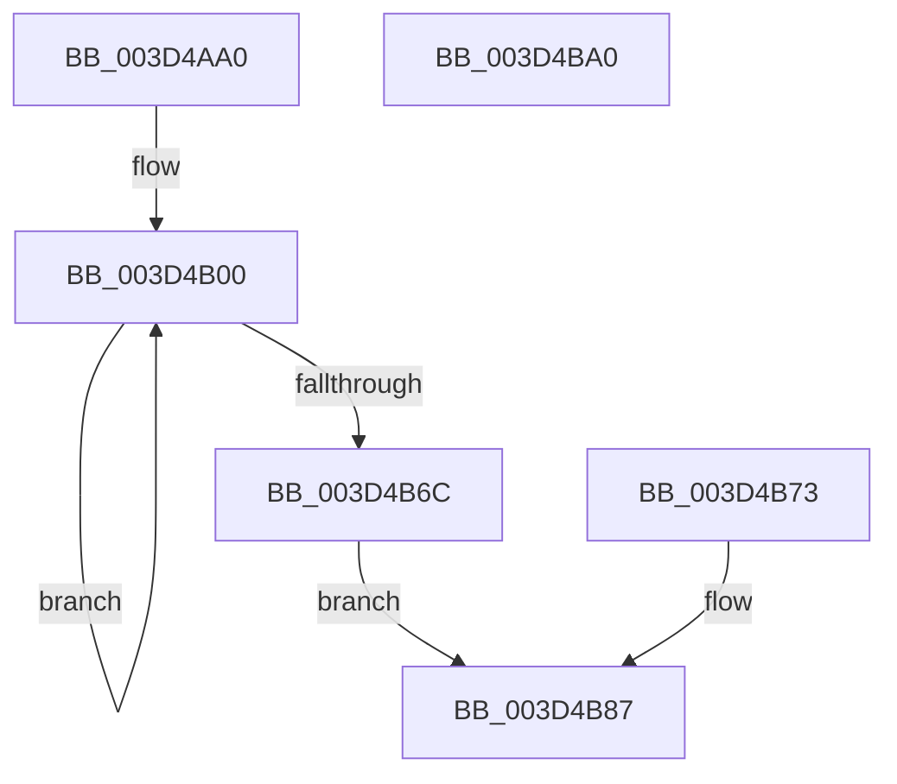

# MiPerformCombineScan

- RVA: `0x003D4AA0`–`0x003D4BA1` (길이 `257` bytes)
- VA: `0x00000001403D4AA0`
- 실행 섹션: `.text`
- PDB 이름 있음: `예`; PDB Function 태그: `아니요`
- unwind 정보 RVA: `0x00092570`
- 디코드: `64`개 명령, `257/257` bytes 표시
- 미해석 바이트: `0` (있으면 어셈블리에 `.byte`로 보존)

> 이 문서는 커널 이미지의 기계어와 PDB 기호를 분석해 생성했습니다. 4번과 5번은 함수 원형과 자료형을 바이너리 사용 방식에서 추정한 C 해석이며 원본 소스 복구 결과는 아닙니다.

## 1. Dependencies

- 직접 호출 지점: **0**; 고유 호출 대상: **0**
- 직접 호출자로 확인된 함수: **1**
- RIP 상대 이미지 참조: **0**

### Outgoing calls
- 직접 디코드된 call 명령이 없습니다.

### Direct callers
- [MiComputeCombineHash](../32/MiComputeCombineHash_function_003227C0.md) at `0x00322900`

### Static image references
- 디코드된 RIP-relative 메모리 참조가 없습니다.

## 2. Other-region calls and transfers

- 다른 실행 섹션으로 향하는 call: **0**
- 별도 외부 분기/꼬리 이동을 확인하지 못했습니다.

## 3. Assembly (complete function range)

```asm
003D4AA0  48 89 5C 24 08                  mov qword ptr [rsp + 8], rbx
003D4AA5  4C 89 4C 24 20                  mov qword ptr [rsp + 0x20], r9
003D4AAA  57                              push rdi
003D4AAB  48 83 EC 10                     sub rsp, 0x10
003D4AAF  49 8B F9                        mov rdi, r9
003D4AB2  48 8B 42 38                     mov rax, qword ptr [rdx + 0x38]
003D4AB6  48 C1 E0 19                     shl rax, 0x19
003D4ABA  48 B9 00 00 00 00 80 F6 FF FF   movabs rcx, 0xfffff68000000000
003D4AC4  48 C1 E1 19                     shl rcx, 0x19
003D4AC8  48 2B C1                        sub rax, rcx
003D4ACB  48 C1 F8 10                     sar rax, 0x10
003D4ACF  33 DB                           xor ebx, ebx
003D4AD1  44 8D 5B 01                     lea r11d, [rbx + 1]
003D4AD5  48 89 5C 24 08                  mov qword ptr [rsp + 8], rbx
003D4ADA  89 1C 24                        mov dword ptr [rsp], ebx
003D4ADD  49 B9 F5 08 86 87 3F F1 5D DE   movabs r9, 0xde5df13f878608f5
003D4AE7  41 BA 00 02 00 00               mov r10d, 0x200
003D4AED  44 89 14 24                     mov dword ptr [rsp], r10d
003D4AF1  0F 1F 40 00                     nop dword ptr [rax]
003D4AF5  66 66 66 0F 1F 84 00 00 00 00 00  nop word ptr [rax + rax]
003D4B00  45 8D 42 F8                     lea r8d, [r10 - 8]
003D4B04  49 C1 C9 02                     ror r9, 2
003D4B08  41 8D 4A FF                     lea ecx, [r10 - 1]
003D4B0C  4C 03 0C C8                     add r9, qword ptr [rax + rcx*8]
003D4B10  49 C1 C9 03                     ror r9, 3
003D4B14  41 8D 4A FE                     lea ecx, [r10 - 2]
003D4B18  4C 03 0C C8                     add r9, qword ptr [rax + rcx*8]
003D4B1C  49 C1 C9 05                     ror r9, 5
003D4B20  41 8D 4A FD                     lea ecx, [r10 - 3]
003D4B24  4C 03 0C C8                     add r9, qword ptr [rax + rcx*8]
003D4B28  49 C1 C9 07                     ror r9, 7
003D4B2C  41 8D 4A FC                     lea ecx, [r10 - 4]
003D4B30  4C 03 0C C8                     add r9, qword ptr [rax + rcx*8]
003D4B34  49 C1 C9 0B                     ror r9, 0xb
003D4B38  41 8D 4A FB                     lea ecx, [r10 - 5]
003D4B3C  4C 33 0C C8                     xor r9, qword ptr [rax + rcx*8]
003D4B40  49 C1 C9 0D                     ror r9, 0xd
003D4B44  41 8D 4A FA                     lea ecx, [r10 - 6]
003D4B48  4C 03 0C C8                     add r9, qword ptr [rax + rcx*8]
003D4B4C  49 C1 C9 11                     ror r9, 0x11
003D4B50  41 8D 4A F9                     lea ecx, [r10 - 7]
003D4B54  4C 03 0C C8                     add r9, qword ptr [rax + rcx*8]
003D4B58  49 C1 C9 13                     ror r9, 0x13
003D4B5C  4E 03 0C C0                     add r9, qword ptr [rax + r8*8]
003D4B60  45 8B D0                        mov r10d, r8d
003D4B63  44 89 04 24                     mov dword ptr [rsp], r8d
003D4B67  45 85 C0                        test r8d, r8d
003D4B6A  75 94                           jne 0x1403d4b00
003D4B6C  4C 89 4C 24 08                  mov qword ptr [rsp + 8], r9
003D4B71  EB 14                           jmp 0x1403d4b87
003D4B73  45 33 DB                        xor r11d, r11d
003D4B76  44 89 5C 24 04                  mov dword ptr [rsp + 4], r11d
003D4B7B  33 DB                           xor ebx, ebx
003D4B7D  48 8B 7C 24 38                  mov rdi, qword ptr [rsp + 0x38]
003D4B82  4C 8B 4C 24 08                  mov r9, qword ptr [rsp + 8]
003D4B87  4C 89 4F 08                     mov qword ptr [rdi + 8], r9
003D4B8B  4D 85 C9                        test r9, r9
003D4B8E  44 0F 44 DB                     cmove r11d, ebx
003D4B92  41 8B C3                        mov eax, r11d
003D4B95  48 8B 5C 24 20                  mov rbx, qword ptr [rsp + 0x20]
003D4B9A  48 83 C4 10                     add rsp, 0x10
003D4B9E  5F                              pop rdi
003D4B9F  C3                              ret
003D4BA0  CC                              int3
```

## 4. C-style interpretation (structured pseudocode)

```c
__int64 __fastcall MiPerformCombineScan(__int64 a1, __int64 a2, __int64 a3, __int64 a4)
{
    __int64 result;
    __int64 v_r11;
    __int64 v_rbx;
    __int64 v_rsp;
    unsigned __int64 v_stack_m10;
    unsigned int v_stack_m14;
    unsigned int v_stack_m18;
    unsigned __int64 v_stack_p20;
    unsigned __int64 v_stack_p8;

    v_stack_p8 = v_rbx;
    v_stack_p20 = a4;
    v_rsp = (v_rsp) - (16);
    result = (*(unsigned __int64 *)(a2 + 56)) << (25);
    a1 = (a1) << (25);
    result = (result) - (a1);
    result = (result) >> (16);
    v_rbx = 0;
    v_stack_m10 = 0;
    v_stack_m18 = 0;
    v_stack_m18 = 512;
loc_003D4B00:
    a4 = (a4) + (*(unsigned __int64 *)(result + 512 - 1 * 8));
    a4 = (a4) + (*(unsigned __int64 *)(result + 512 - 2 * 8));
    a4 = (a4) + (*(unsigned __int64 *)(result + 512 - 3 * 8));
    a4 = (a4) + (*(unsigned __int64 *)(result + 512 - 4 * 8));
    a4 = (a4) ^ (*(unsigned __int64 *)(result + 512 - 5 * 8));
    a4 = (a4) + (*(unsigned __int64 *)(result + 512 - 6 * 8));
    a4 = (a4) + (*(unsigned __int64 *)(result + 512 - 7 * 8));
    a4 = (a4) + (*(unsigned __int64 *)(result + 512 - 8 * 8));
    v_stack_m18 = (unsigned int)(512 - 8);
    if ((unsigned int)(512 - 8) != 0) goto loc_003D4B00;
    v_stack_m10 = a4;
    goto loc_003D4B87;
loc_003D4B87:
    *(unsigned __int64 *)(a4 + 8) = a4;
    v_r11 = v_rbx + 1;
    if (a4 == 0) { v_r11 = 0; }
    v_rsp = (v_rsp) + (16);
    return (unsigned int)((unsigned int)(v_r11));
}
```

## 5. (Beta) C Style

```c
int64_t MiPerformCombineScan(int64_t Arg1, void *Arg2, int64_t Arg3, void *Arg4)
{
    uint8_t *arg2 = (uint8_t *)Arg2;
    uint8_t *arg4 = (uint8_t *)Arg4;

    int64_t result;
    int64_t local_r11;
    int64_t local_rbx;
    int64_t local_rsp;
    uint64_t v_stack_m10;
    uint32_t v_stack_m14;
    uint32_t v_stack_m18;
    uint64_t v_stack_p20;
    uint64_t v_stack_p8;

    v_stack_p8 = local_rbx;
    v_stack_p20 = Arg4;
    local_rsp = (local_rsp) - (16);
    result = (*(uint64_t *)(arg2 + 0x38)) << (25);
    Arg1 = (Arg1) << (25);
    result = (result) - (Arg1);
    result = (result) >> (16);
    local_rbx = 0;
    v_stack_m10 = 0;
    v_stack_m18 = 0;
    v_stack_m18 = 512;
loc_003D4B00:
    Arg4 = (Arg4) + (*(uint64_t *)(result + 0x200 - 0x1 * 8));
    Arg4 = (Arg4) + (*(uint64_t *)(result + 0x200 - 0x2 * 8));
    Arg4 = (Arg4) + (*(uint64_t *)(result + 0x200 - 0x3 * 8));
    Arg4 = (Arg4) + (*(uint64_t *)(result + 0x200 - 0x4 * 8));
    Arg4 = (Arg4) ^ (*(uint64_t *)(result + 0x200 - 0x5 * 8));
    Arg4 = (Arg4) + (*(uint64_t *)(result + 0x200 - 0x6 * 8));
    Arg4 = (Arg4) + (*(uint64_t *)(result + 0x200 - 0x7 * 8));
    Arg4 = (Arg4) + (*(uint64_t *)(result + 0x200 - 0x8 * 8));
    v_stack_m18 = (uint32_t)(512 - 8);
    if ((uint32_t)(512 - 8) != 0) goto loc_003D4B00;
    v_stack_m10 = Arg4;
    goto loc_003D4B87;
loc_003D4B87:
    *(void **)(arg4 + 0x8) = Arg4;
    local_r11 = local_rbx + 1;
    if (Arg4 == NULL) { local_r11 = 0; }
    local_rsp = (local_rsp) + (16);
    return (uint32_t)((uint32_t)(local_r11));
}
```

### 관측된 메모리 오프셋

구조체 형식이 확인되지 않은 접근은 인자 기준의 오프셋으로만 기록했습니다.

| 기준 인자 | 오프셋 표현 | 폭 (bit) | 접근 |
|---|---:|---:|---|
| `Arg2` | `+ 0x38` | `64` | `R` |
| `Arg4` | `+ 0x8` | `64` | `W` |

## 6. Execution-region graph

[열기: 2D/3D 그래프와 함수 탐색 컨트롤 패널](../../../control-panel.html?section=text&rva=0x003D4AA0&view=graph)

- 2D 그래프는 위에서 아래로 흐르고, 3D 그래프는 빈 공간을 드래그해 회전합니다. Shift+드래그는 이동, 휠은 확대·축소, 함수 노드 선택은 대상 보고서 이동입니다.

### Static fallback


