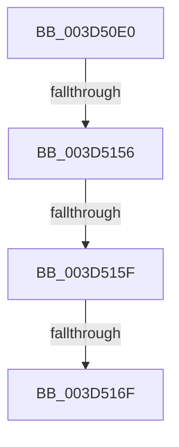

# MiRebuildStandbyLookasideList

- RVA: `0x003D50E0`–`0x003D5182` (길이 `162` bytes)
- VA: `0x00000001403D50E0`
- 실행 섹션: `.text`
- PDB 이름 있음: `예`; PDB Function 태그: `아니요`
- unwind 정보 RVA: `0x000938CC`
- 디코드: `38`개 명령, `162/162` bytes 표시
- 미해석 바이트: `0` (있으면 어셈블리에 `.byte`로 보존)

> 이 문서는 커널 이미지의 기계어와 PDB 기호를 분석해 생성했습니다. 4번과 5번은 함수 원형과 자료형을 바이너리 사용 방식에서 추정한 C 해석이며 원본 소스 복구 결과는 아닙니다.

## 1. Dependencies

- 직접 호출 지점: **2**; 고유 호출 대상: **2**
- 직접 호출자로 확인된 함수: **3**
- RIP 상대 이미지 참조: **0**

### Outgoing calls
- `0x003D512D` → [MiPfnToStandbyLookaside](../33/MiPfnToStandbyLookaside_function_0033BAE0.md) (function, `0x0033BAE0`)
- `0x003D5146` → [MiGetStandbyLookaside](MiGetStandbyLookaside_function_003D5620.md) (function, `0x003D5620`)

### Direct callers
- [MiInsertPageInList](../2B/MiInsertPageInList_function_002BA000.md) at `0x002BA5BA`
- [sub_0033EABD](../33/Unknown_function_0033EABD.md) at `0x0033EBC0`
- [MiLockStandbyOldestPage](MiLockStandbyOldestPage_function_003D4EA4.md) at `0x003D4F87`

### Static image references
- 디코드된 RIP-relative 메모리 참조가 없습니다.

## 2. Other-region calls and transfers

- 다른 실행 섹션으로 향하는 call: **0**
- call이 아닌 외부 분기/꼬리 이동: **4**
  - `0x003D5150` → [sub_003D534C](Unknown_function_003D534C.md) (`tail-transfer`)
  - `0x003D5159` → [sub_003D534C + 0xC](Unknown_function_003D534C.md) (`tail-transfer`)
  - `0x003D5169` → [sub_003D5378](Unknown_function_003D5378.md) (`tail-transfer`)
  - `0x003D517C` → [sub_003D52C7](Unknown_function_003D52C7.md) (`tail-transfer`)

## 3. Assembly (complete function range)

```asm
003D50E0  40 53                           push rbx
003D50E2  55                              push rbp
003D50E3  56                              push rsi
003D50E4  57                              push rdi
003D50E5  48 83 EC 68                     sub rsp, 0x68
003D50E9  0F 57 C0                        xorps xmm0, xmm0
003D50EC  48 B8 00 00 00 00 00 DE FF FF   movabs rax, 0xffffde0000000000
003D50F6  0F 11 44 24 30                  movups xmmword ptr [rsp + 0x30], xmm0
003D50FB  41 0F B6 F0                     movzx esi, r8b
003D50FF  8B EA                           mov ebp, edx
003D5101  0F 11 44 24 40                  movups xmmword ptr [rsp + 0x40], xmm0
003D5106  0F 11 44 24 50                  movups xmmword ptr [rsp + 0x50], xmm0
003D510B  48 8B C0                        mov rax, rax
003D510E  48 2B C8                        sub rcx, rax
003D5111  4C 8D 4C 24 30                  lea r9, [rsp + 0x30]
003D5116  48 C1 F9 04                     sar rcx, 4
003D511A  48 B8 AB AA AA AA AA AA AA AA   movabs rax, 0xaaaaaaaaaaaaaaab
003D5124  48 0F AF C8                     imul rcx, rax
003D5128  45 33 C0                        xor r8d, r8d
003D512B  33 D2                           xor edx, edx
003D512D  E8 AE 69 F6 FF                  call 0x14033bae0
003D5132  8B 44 24 4C                     mov eax, dword ptr [rsp + 0x4c]
003D5136  48 8D 4C 24 30                  lea rcx, [rsp + 0x30]
003D513B  48 6B D8 58                     imul rbx, rax, 0x58
003D513F  8B D5                           mov edx, ebp
003D5141  48 03 5C 24 30                  add rbx, qword ptr [rsp + 0x30]
003D5146  E8 D5 04 00 00                  call 0x1403d5620
003D514B  48 8B F8                        mov rdi, rax
003D514E  85 ED                           test ebp, ebp
003D5150  0F 84 F6 01 00 00               je 0x1403d534c
003D5156  83 FD 01                        cmp ebp, 1
003D5159  0F 85 F9 01 00 00               jne 0x1403d5358
003D515F  48 8B 9B D8 0C 00 00            mov rbx, qword ptr [rbx + 0xcd8]
003D5166  40 84 F6                        test sil, sil
003D5169  0F 84 09 02 00 00               je 0x1403d5378
003D516F  48 BE FF FF FF FF 3F 00 00 00   movabs rsi, 0x3fffffffff
003D5179  48 3B DE                        cmp rbx, rsi
003D517C  0F 84 45 01 00 00               je 0x1403d52c7
```

## 4. C-style interpretation (structured pseudocode)

```c
__int64 __fastcall MiRebuildStandbyLookasideList(__int64 a1, int a2, int a3)
{
    __int64 result;
    __int64 v_rbx;
    __int64 v_rsp;
    unsigned __int64 v_stack_m38;
    unsigned int v_stack_m3C;
    unsigned __int64 v_stack_m48;
    unsigned __int64 v_stack_m58;

    v_rsp = (v_rsp) - (104);
    v_stack_m58 = v_xmm0;
    v_stack_m48 = v_xmm0;
    v_stack_m38 = v_xmm0;
    a1 = (a1) - (result);
    a1 = (a1) >> (4);
    a1 = (a1) * (result);
    a3 = 0;
    a2 = 0;
    result = MiPfnToStandbyLookaside(a1, a2, a3, v_stack_m58);
    v_rbx = (v_rbx) * ((unsigned int)(v_stack_m3C));
    v_rbx = (v_rbx) + (v_stack_m58);
    result = MiGetStandbyLookaside(v_stack_m58, (unsigned int)((unsigned int)((unsigned int)(a2))), a3, v_stack_m58);
}
```

## 5. (Beta) C Style

```c
int64_t MiRebuildStandbyLookasideList(int64_t Arg1, int32_t Arg2, int32_t Arg3)
{
    int64_t result;
    int64_t local_rbx;
    int64_t local_rsp;
    uint64_t v_stack_m38;
    uint32_t v_stack_m3C;
    uint64_t v_stack_m48;
    uint64_t v_stack_m58;

    local_rsp = (local_rsp) - (104);
    v_stack_m58 = v_xmm0;
    v_stack_m48 = v_xmm0;
    v_stack_m38 = v_xmm0;
    Arg1 = (Arg1) - (result);
    Arg1 = (Arg1) >> (4);
    Arg1 = (Arg1) * (result);
    Arg3 = 0;
    Arg2 = 0;
    result = MiPfnToStandbyLookaside(Arg1, Arg2, Arg3, v_stack_m58);
    local_rbx = (local_rbx) * ((uint32_t)(v_stack_m3C));
    local_rbx = (local_rbx) + (v_stack_m58);
    result = MiGetStandbyLookaside(v_stack_m58, (uint32_t)((uint32_t)((uint32_t)(Arg2))), Arg3, v_stack_m58);
}
```

## 6. Execution-region graph

[열기: 2D/3D 그래프와 함수 탐색 컨트롤 패널](../../../control-panel.html?section=text&rva=0x003D50E0&view=graph)

- 2D 그래프는 위에서 아래로 흐르고, 3D 그래프는 빈 공간을 드래그해 회전합니다. Shift+드래그는 이동, 휠은 확대·축소, 함수 노드 선택은 대상 보고서 이동입니다.

### Static fallback


