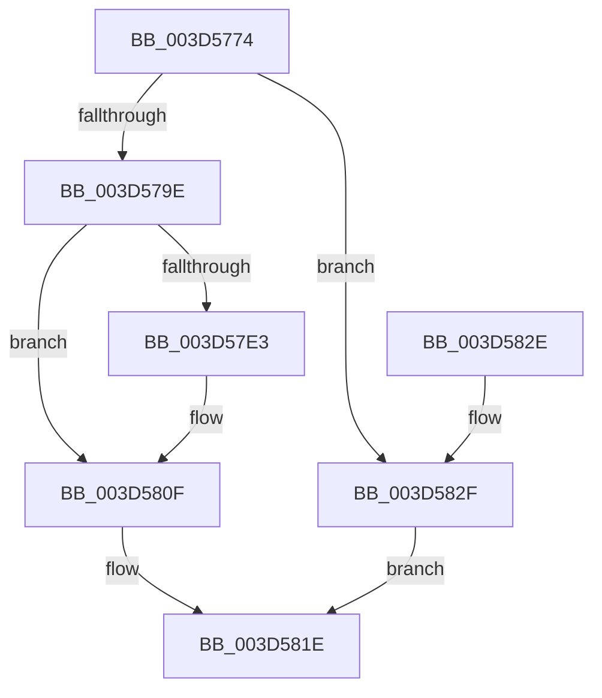

# MiRepurposeDecayNode

- RVA: `0x003D5774`–`0x003D5848` (길이 `212` bytes)
- VA: `0x00000001403D5774`
- 실행 섹션: `.text`
- PDB 이름 있음: `예`; PDB Function 태그: `아니요`
- unwind 정보 RVA: `0x00093A14`
- 디코드: `53`개 명령, `212/212` bytes 표시
- 미해석 바이트: `0` (있으면 어셈블리에 `.byte`로 보존)

> 이 문서는 커널 이미지의 기계어와 PDB 기호를 분석해 생성했습니다. 4번과 5번은 함수 원형과 자료형을 바이너리 사용 방식에서 추정한 C 해석이며 원본 소스 복구 결과는 아닙니다.

## 1. Dependencies

- 직접 호출 지점: **4**; 고유 호출 대상: **4**
- 직접 호출자로 확인된 함수: **1**
- RIP 상대 이미지 참조: **4**

### Outgoing calls
- `0x003D578B` → [MiUnlinkPageFromListEx](../28/MiUnlinkPageFromListEx_function_00287590.md) (function, `0x00287590`)
- `0x003D57EA` → [ExAcquireSpinLockExclusiveAtDpcLevel](../24/ExAcquireSpinLockExclusiveAtDpcLevel_function_00248E80.md) (function, `0x00248E80`)
- `0x003D580A` → [ExReleaseSpinLockExclusiveFromDpcLevel](../24/ExReleaseSpinLockExclusiveFromDpcLevel_function_002497E0.md) (function, `0x002497E0`)
- `0x003D5819` → [ExpInterlockedPushEntrySList](../6B/ExpInterlockedPushEntrySList_function_006BA5B0.md) (function, `0x006BA5B0`)

### Direct callers
- [MiLockStandbyOldestPage](MiLockStandbyOldestPage_function_003D4EA4.md) at `0x003D5030`

### Static image references
- `0x003D57C0` → RVA `0x00E35C30` (`.data`; read)
- `0x003D57C7` → RVA `0x00E35C00` (`.data`; read)
- `0x003D57E3` → RVA `0x00E35C20` (`.data`; read)
- `0x003D5812` → RVA `0x00E35C10` (`.data`; read)

## 2. Other-region calls and transfers

- 다른 실행 섹션으로 향하는 call: **0**
- 별도 외부 분기/꼬리 이동을 확인하지 못했습니다.

## 3. Assembly (complete function range)

```asm
003D5774  48 89 5C 24 10                  mov qword ptr [rsp + 0x10], rbx
003D5779  48 89 74 24 18                  mov qword ptr [rsp + 0x18], rsi
003D577E  57                              push rdi
003D577F  48 83 EC 20                     sub rsp, 0x20
003D5783  BA 01 00 00 00                  mov edx, 1
003D5788  48 8B D9                        mov rbx, rcx
003D578B  E8 00 1E EB FF                  call 0x140287590
003D5790  8B 43 20                        mov eax, dword ptr [rbx + 0x20]
003D5793  C1 E8 18                        shr eax, 0x18
003D5796  A8 08                           test al, 8
003D5798  0F 85 91 00 00 00               jne 0x1403d582f
003D579E  48 B8 00 00 00 00 00 DE FF FF   movabs rax, 0xffffde0000000000
003D57A8  48 8B CB                        mov rcx, rbx
003D57AB  48 2B C8                        sub rcx, rax
003D57AE  48 B8 AB AA AA AA AA AA AA AA   movabs rax, 0xaaaaaaaaaaaaaaab
003D57B8  48 C1 F9 04                     sar rcx, 4
003D57BC  48 0F AF C8                     imul rcx, rax
003D57C0  48 8B 05 69 04 A6 00            mov rax, qword ptr [rip + 0xa60469]
003D57C7  48 2B 0D 32 04 A6 00            sub rcx, qword ptr [rip + 0xa60432]
003D57CE  8B F1                           mov esi, ecx
003D57D0  48 C1 EE 03                     shr rsi, 3
003D57D4  8B F9                           mov edi, ecx
003D57D6  80 E1 07                        and cl, 7
003D57D9  8A 14 06                        mov dl, byte ptr [rsi + rax]
003D57DC  D2 FA                           sar dl, cl
003D57DE  F6 C2 01                        test dl, 1
003D57E1  74 2C                           je 0x1403d580f
003D57E3  48 8D 0D 36 04 A6 00            lea rcx, [rip + 0xa60436]
003D57EA  E8 91 36 E7 FF                  call 0x140248e80
003D57EF  48 8B 15 3A 04 A6 00            mov rdx, qword ptr [rip + 0xa6043a]
003D57F6  48 8D 0D 23 04 A6 00            lea rcx, [rip + 0xa60423]
003D57FD  83 E7 07                        and edi, 7
003D5800  0F BE 04 16                     movsx eax, byte ptr [rsi + rdx]
003D5804  0F B3 F8                        btr eax, edi
003D5807  88 04 16                        mov byte ptr [rsi + rdx], al
003D580A  E8 D1 3F E7 FF                  call 0x1402497e0
003D580F  48 8B D3                        mov rdx, rbx
003D5812  48 8D 0D F7 03 A6 00            lea rcx, [rip + 0xa603f7]
003D5819  E8 92 4D 2E 00                  call 0x1406ba5b0
003D581E  48 8B 5C 24 38                  mov rbx, qword ptr [rsp + 0x38]
003D5823  48 8B 74 24 40                  mov rsi, qword ptr [rsp + 0x40]
003D5828  48 83 C4 20                     add rsp, 0x20
003D582C  5F                              pop rdi
003D582D  C3                              ret
003D582E  CC                              int3
003D582F  8B 43 20                        mov eax, dword ptr [rbx + 0x20]
003D5832  89 44 24 30                     mov dword ptr [rsp + 0x30], eax
003D5836  C1 E8 18                        shr eax, 0x18
003D5839  24 F7                           and al, 0xf7
003D583B  88 44 24 33                     mov byte ptr [rsp + 0x33], al
003D583F  8B 44 24 30                     mov eax, dword ptr [rsp + 0x30]
003D5843  89 43 20                        mov dword ptr [rbx + 0x20], eax
003D5846  EB D6                           jmp 0x1403d581e
```

## 4. C-style interpretation (structured pseudocode)

```c
__int64 __fastcall MiRepurposeDecayNode(__int64 a1)
{
    __int64 result;
    __int64 v_rdi;
    __int64 v_rsi;
    __int64 v_rsp;
    unsigned __int64 v_stack_p10;
    unsigned __int64 v_stack_p18;
    unsigned int v_stack_p30;
    unsigned __int8 v_stack_p33;

    v_stack_p10 = v_rbx;
    v_stack_p18 = v_rsi;
    v_rsp = (v_rsp) - (32);
    result = MiUnlinkPageFromListEx(a1, 1, a3, a4);
    result = (unsigned int)(((unsigned int)(*(unsigned int *)(a1 + 32))) >> (24));
    if ((((unsigned __int8)(result)) & (8)) != 0) goto loc_003D582F;
    a1 = (a1) - (result);
    a1 = (a1) >> (4);
    a1 = (a1) * (result);
    a1 = (a1) - (*(unsigned __int64 *)(v_rip + 10880050));
    v_rsi = ((unsigned int)((unsigned int)(a1))) >> (3);
    a1 = (unsigned __int8)((a1) & (7));
    a2 = (unsigned __int8)((*(unsigned __int8 *)(v_rsi + *(unsigned __int64 *)(v_rip + 10880105) * 1)) >> ((unsigned __int8)(a1)));
    result = *(unsigned __int64 *)(v_rip + 10880105);
    v_rdi = (unsigned int)((unsigned int)(a1));
    if ((((unsigned __int8)(a2)) & (1)) != 0) {
        a1 = v_rip + 10880054;
        result = ExAcquireSpinLockExclusiveAtDpcLevel(a1, a2, a3, a4);
        a2 = *(unsigned __int64 *)(v_rip + 10880058);
        a1 = v_rip + 10880035;
        v_rdi = (unsigned int)(((unsigned int)((unsigned int)(a1))) & (7));
        result = (__int8)(*(unsigned __int8 *)(v_rsi + a2 * 1));
        *(unsigned __int8 *)(v_rsi + a2 * 1) = (unsigned __int8)(result);
        result = ExReleaseSpinLockExclusiveFromDpcLevel(a1, a2, a3, a4);
    }
    result = ExpInterlockedPushEntrySList(v_rip + 10879991, a1, a3, a4);
loc_003D581E:
    v_rsp = (v_rsp) + (32);
    return result;
loc_003D582F:
    v_stack_p30 = (unsigned int)((unsigned int)(*(unsigned int *)(v_stack_p10 + 32)));
    result = (unsigned int)(((unsigned int)(*(unsigned int *)(v_stack_p10 + 32))) >> (24));
    result = (unsigned __int8)((result) & (247));
    v_stack_p33 = (unsigned __int8)(result);
    *(unsigned int *)(v_stack_p10 + 32) = (unsigned int)((unsigned int)(v_stack_p30));
    goto loc_003D581E;
}
```

## 5. (Beta) C Style

```c
int64_t MiRepurposeDecayNode(void *Arg1)
{
    uint8_t *arg1 = (uint8_t *)Arg1;

    int64_t result;
    int64_t local_rdi;
    int64_t local_rsi;
    int64_t local_rsp;
    uint64_t v_stack_p10;
    uint64_t v_stack_p18;
    uint32_t v_stack_p30;
    uint8_t v_stack_p33;

    v_stack_p10 = local_rbx;
    v_stack_p18 = local_rsi;
    local_rsp = (local_rsp) - (32);
    result = MiUnlinkPageFromListEx(Arg1, 1, a3, a4);
    result = (uint32_t)(((uint32_t)(*(uint32_t *)(arg1 + 0x20))) >> (24));
    if ((((uint8_t)(result)) & (8)) != 0) goto loc_003D582F;
    Arg1 = (Arg1) - (result);
    Arg1 = (Arg1) >> (4);
    Arg1 = (Arg1) * (result);
    Arg1 = (Arg1) - (*(uint64_t *)(v_rip + 0xA60432));
    local_rsi = ((uint32_t)((uint32_t)(Arg1))) >> (3);
    Arg1 = (uint8_t)((Arg1) & (7));
    a2 = (uint8_t)((*(uint8_t *)(local_rsi + *(uint64_t *)(v_rip + 0xA60469) * 1)) >> ((uint8_t)(Arg1)));
    result = *(uint64_t *)(v_rip + 0xA60469);
    local_rdi = (uint32_t)((uint32_t)(Arg1));
    if ((((uint8_t)(a2)) & (1)) != 0) {
        Arg1 = v_rip + 10880054;
        result = ExAcquireSpinLockExclusiveAtDpcLevel(Arg1, a2, a3, a4);
        a2 = *(uint64_t *)(v_rip + 0xA6043A);
        Arg1 = v_rip + 10880035;
        local_rdi = (uint32_t)(((uint32_t)((uint32_t)(Arg1))) & (7));
        result = (int8_t)(*(uint8_t *)(local_rsi + a2 * 1));
        *(uint8_t *)(local_rsi + a2 * 1) = (uint8_t)(result);
        result = ExReleaseSpinLockExclusiveFromDpcLevel(Arg1, a2, a3, a4);
    }
    result = ExpInterlockedPushEntrySList(v_rip + 10879991, Arg1, a3, a4);
loc_003D581E:
    local_rsp = (local_rsp) + (32);
    return result;
loc_003D582F:
    v_stack_p30 = (uint32_t)((uint32_t)(*(uint32_t *)(v_stack_p10 + 0x20)));
    result = (uint32_t)(((uint32_t)(*(uint32_t *)(v_stack_p10 + 0x20))) >> (24));
    result = (uint8_t)((result) & (247));
    v_stack_p33 = (uint8_t)(result);
    *(uint32_t *)(v_stack_p10 + 0x20) = (uint32_t)((uint32_t)(v_stack_p30));
    goto loc_003D581E;
}
```

### 관측된 메모리 오프셋

구조체 형식이 확인되지 않은 접근은 인자 기준의 오프셋으로만 기록했습니다.

| 기준 인자 | 오프셋 표현 | 폭 (bit) | 접근 |
|---|---:|---:|---|
| `Arg1` | `+ 0x20` | `32` | `R` |
| `Arg1` | `+ 0x20` | `32` | `W` |

## 6. Execution-region graph

[열기: 2D/3D 그래프와 함수 탐색 컨트롤 패널](../../../control-panel.html?section=text&rva=0x003D5774&view=graph)

- 2D 그래프는 위에서 아래로 흐르고, 3D 그래프는 빈 공간을 드래그해 회전합니다. Shift+드래그는 이동, 휠은 확대·축소, 함수 노드 선택은 대상 보고서 이동입니다.

### Static fallback


