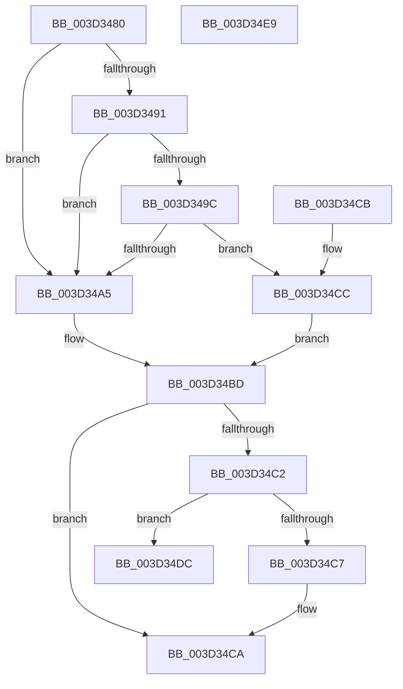

# MiThreadIdealNode

- RVA: `0x003D3480`–`0x003D34EA` (길이 `106` bytes)
- VA: `0x00000001403D3480`
- 실행 섹션: `.text`
- PDB 이름 있음: `예`; PDB Function 태그: `아니요`
- unwind 정보 RVA: `0x000DB714`
- 디코드: `27`개 명령, `106/106` bytes 표시
- 미해석 바이트: `0` (있으면 어셈블리에 `.byte`로 보존)

> 이 문서는 커널 이미지의 기계어와 PDB 기호를 분석해 생성했습니다. 4번과 5번은 함수 원형과 자료형을 바이너리 사용 방식에서 추정한 C 해석이며 원본 소스 복구 결과는 아닙니다.

## 1. Dependencies

- 직접 호출 지점: **0**; 고유 호출 대상: **0**
- 직접 호출자로 확인된 함수: **5**
- RIP 상대 이미지 참조: **1**

### Outgoing calls
- 직접 디코드된 call 명령이 없습니다.

### Direct callers
- [MiPrefetchPreallocatePages](../36/MiPrefetchPreallocatePages_function_0036B1F0.md) at `0x0036B3E4`
- [MiComputePreferredNode](MiComputePreferredNode_function_003D3438.md) at `0x003D3454`
- [MiProcessVaContiguityInformation](../69/MiProcessVaContiguityInformation_function_006939C0.md) at `0x00693BAC`
- [MiCreatePagingFileMap](../../page/98/MiCreatePagingFileMap_function_009852F8.md) at `0x00985AA7`
- [MiGetLargePagesForSystemMapping](../../page/AC/MiGetLargePagesForSystemMapping_function_00AC5094.md) at `0x00AC517B`

### Static image references
- `0x003D34AB` → RVA `0x00FC8C40` (`ALMOSTRO`; read)

## 2. Other-region calls and transfers

- 다른 실행 섹션으로 향하는 call: **0**
- 별도 외부 분기/꼬리 이동을 확인하지 못했습니다.

## 3. Assembly (complete function range)

```asm
003D3480  65 48 8B 04 25 88 01 00 00      mov rax, qword ptr gs:[0x188]
003D3489  45 33 C0                        xor r8d, r8d
003D348C  48 85 C9                        test rcx, rcx
003D348F  74 14                           je 0x1403d34a5
003D3491  8B 89 B8 00 00 00               mov ecx, dword ptr [rcx + 0xb8]
003D3497  F6 C1 0F                        test cl, 0xf
003D349A  75 09                           jne 0x1403d34a5
003D349C  80 B8 4A 02 00 00 01            cmp byte ptr [rax + 0x24a], 1
003D34A3  74 27                           je 0x1403d34cc
003D34A5  8B 88 4C 02 00 00               mov ecx, dword ptr [rax + 0x24c]
003D34AB  4C 8D 05 8E 57 BF 00            lea r8, [rip + 0xbf578e]
003D34B2  4D 8B 04 C8                     mov r8, qword ptr [r8 + rcx*8]
003D34B6  41 8B 80 54 87 00 00            mov eax, dword ptr [r8 + 0x8754]
003D34BD  48 85 D2                        test rdx, rdx
003D34C0  74 08                           je 0x1403d34ca
003D34C2  4D 85 C0                        test r8, r8
003D34C5  74 15                           je 0x1403d34dc
003D34C7  4C 89 02                        mov qword ptr [rdx], r8
003D34CA  C3                              ret
003D34CB  CC                              int3
003D34CC  48 8B 88 B8 00 00 00            mov rcx, qword ptr [rax + 0xb8]
003D34D3  0F B7 81 04 01 00 00            movzx eax, word ptr [rcx + 0x104]
003D34DA  EB E1                           jmp 0x1403d34bd
003D34DC  65 48 8B 0C 25 20 00 00 00      mov rcx, qword ptr gs:[0x20]
003D34E5  48 89 0A                        mov qword ptr [rdx], rcx
003D34E8  C3                              ret
003D34E9  CC                              int3
```

## 4. C-style interpretation (structured pseudocode)

```c
__int64 __fastcall MiThreadIdealNode(__int64 a1, __int64 a2, int a3)
{
    a3 = 0;
    if (a1 == 0) goto loc_003D34A5;
    if ((((unsigned __int8)((unsigned int)(*(unsigned int *)(a1 + 184)))) & (15)) != 0) goto loc_003D34A5;
    if ((*(unsigned __int8 *)(*(unsigned __int64 *)(gs_base + (0 + 392)) + 586)) == 1) goto loc_003D34CC;
loc_003D34A5:
loc_003D34BD:
    if (a2 == 0) goto loc_003D34CA;
    if (*(unsigned __int64 *)(v_rip + 12539790 + (unsigned int)(*(unsigned int *)(*(unsigned __int64 *)(gs_base + (0 + 392)) + 588)) * 8) == 0) goto loc_003D34DC;
    *(unsigned __int64 *)(a2) = *(unsigned __int64 *)(v_rip + 12539790 + (unsigned int)(*(unsigned int *)(*(unsigned __int64 *)(gs_base + (0 + 392)) + 588)) * 8);
loc_003D34CA:
    return (unsigned int)(*(unsigned int *)(*(unsigned __int64 *)(v_rip + 12539790 + (unsigned int)(*(unsigned int *)(*(unsigned __int64 *)(gs_base + (0 + 392)) + 588)) * 8) + 34644));
loc_003D34CC:
    goto loc_003D34BD;
loc_003D34DC:
    *(unsigned __int64 *)(a2) = *(unsigned __int64 *)(gs_base + (0 + 32));
    return *(unsigned __int16 *)(*(unsigned __int64 *)((unsigned int)(*(unsigned int *)(*(unsigned __int64 *)(v_rip + 12539790 + (unsigned int)(*(unsigned int *)(*(unsigned __int64 *)(gs_base + (0 + 392)) + 588)) * 8) + 34644)) + 184) + 260);
}
```

## 5. (Beta) C Style

```c
int64_t MiThreadIdealNode(int64_t Arg1, int64_t Arg2, int32_t Arg3)
{
    Arg3 = 0;
    if (Arg1 == 0) goto loc_003D34A5;
    if ((((uint8_t)((uint32_t)(*(uint32_t *)(Arg1 + 0xB8)))) & (15)) != 0) goto loc_003D34A5;
    if ((*(uint8_t *)(*(uint64_t *)(gs_base + (0 + 0x188)) + 0x24A)) == 1) goto loc_003D34CC;
loc_003D34A5:
loc_003D34BD:
    if (Arg2 == 0) goto loc_003D34CA;
    if (*(uint64_t *)(v_rip + 0xBF578E + (uint32_t)(*(uint32_t *)(*(uint64_t *)(gs_base + (0 + 0x188)) + 0x24C)) * 8) == 0) goto loc_003D34DC;
    *(uint64_t *)(Arg2) = *(uint64_t *)(v_rip + 0xBF578E + (uint32_t)(*(uint32_t *)(*(uint64_t *)(gs_base + (0 + 0x188)) + 0x24C)) * 8);
loc_003D34CA:
    return (uint32_t)(*(uint32_t *)(*(uint64_t *)(v_rip + 0xBF578E + (uint32_t)(*(uint32_t *)(*(uint64_t *)(gs_base + (0 + 0x188)) + 0x24C)) * 8) + 0x8754));
loc_003D34CC:
    goto loc_003D34BD;
loc_003D34DC:
    *(uint64_t *)(Arg2) = *(uint64_t *)(gs_base + (0 + 0x20));
    return *(uint16_t *)(*(uint64_t *)((uint32_t)(*(uint32_t *)(*(uint64_t *)(v_rip + 0xBF578E + (uint32_t)(*(uint32_t *)(*(uint64_t *)(gs_base + (0 + 0x188)) + 0x24C)) * 8) + 0x8754)) + 0xB8) + 0x104);
}
```

## 6. Execution-region graph

[열기: 2D/3D 그래프와 함수 탐색 컨트롤 패널](../../../control-panel.html?section=text&rva=0x003D3480&view=graph)

- 2D 그래프는 위에서 아래로 흐르고, 3D 그래프는 빈 공간을 드래그해 회전합니다. Shift+드래그는 이동, 휠은 확대·축소, 함수 노드 선택은 대상 보고서 이동입니다.

### Static fallback


