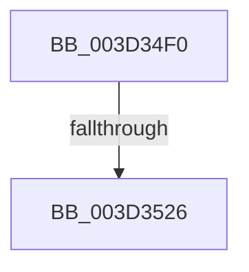

# MiUpdatePageTableUseCount

- RVA: `0x003D34F0`–`0x003D3529` (길이 `57` bytes)
- VA: `0x00000001403D34F0`
- 실행 섹션: `.text`
- PDB 이름 있음: `예`; PDB Function 태그: `아니요`
- unwind 정보 RVA: `0x000917E4`
- 디코드: `12`개 명령, `57/57` bytes 표시
- 미해석 바이트: `0` (있으면 어셈블리에 `.byte`로 보존)

> 이 문서는 커널 이미지의 기계어와 PDB 기호를 분석해 생성했습니다. 4번과 5번은 함수 원형과 자료형을 바이너리 사용 방식에서 추정한 C 해석이며 원본 소스 복구 결과는 아닙니다.

## 1. Dependencies

- 직접 호출 지점: **0**; 고유 호출 대상: **0**
- 직접 호출자로 확인된 함수: **4**
- RIP 상대 이미지 참조: **0**

### Outgoing calls
- 직접 디코드된 call 명령이 없습니다.

### Direct callers
- [MiActOnPte](../24/MiActOnPte_function_00244C90.md) at `0x0024550B`
- [sub_0032DD4A](../32/Unknown_function_0032DD4A.md) at `0x0032DD64`
- [MiCompletePrivateZeroFault](../33/MiCompletePrivateZeroFault_function_00330CC0.md) at `0x0033193E`
- [MiExpandSharedZeroCluster](../36/MiExpandSharedZeroCluster_function_0036F20C.md) at `0x0036F4AB`

### Static image references
- 디코드된 RIP-relative 메모리 참조가 없습니다.

## 2. Other-region calls and transfers

- 다른 실행 섹션으로 향하는 call: **0**
- call이 아닌 외부 분기/꼬리 이동: **1**
  - `0x003D3520` → [sub_003D35F6](Unknown_function_003D35F6.md) (`tail-transfer`)

## 3. Assembly (complete function range)

```asm
003D34F0  40 56                           push rsi
003D34F2  48 83 EC 20                     sub rsp, 0x20
003D34F6  4C 8B C9                        mov r9, rcx
003D34F9  8B F2                           mov esi, edx
003D34FB  49 C1 E9 12                     shr r9, 0x12
003D34FF  41 81 E1 F8 FF FF 3F            and r9d, 0x3ffffff8
003D3506  48 B8 00 00 00 40 FB F6 FF FF   movabs rax, 0xfffff6fb40000000
003D3510  4C 03 C8                        add r9, rax
003D3513  48 B8 68 DF BE 7D FB F6 FF FF   movabs rax, 0xfffff6fb7dbedf68
003D351D  4C 3B C8                        cmp r9, rax
003D3520  0F 84 D0 00 00 00               je 0x1403d35f6
003D3526  49 8B 01                        mov rax, qword ptr [r9]
```

## 4. C-style interpretation (structured pseudocode)

```c
__int64 __fastcall MiUpdatePageTableUseCount(__int64 a1, int a2)
{
    __int64 v_rsp;

    v_rsp = (v_rsp) - (32);
    a4 = (a1) >> (18);
    a4 = (unsigned int)((a4) & (0x3FFFFFF8ULL));
    a4 = (a4) + (result);
    return *(unsigned __int64 *)(a4);
}
```

## 5. (Beta) C Style

```c
int64_t MiUpdatePageTableUseCount(int64_t Arg1, int32_t Arg2)
{
    int64_t local_rsp;

    local_rsp = (local_rsp) - (32);
    a4 = (Arg1) >> (18);
    a4 = (uint32_t)((a4) & (0x3FFFFFF8ULL));
    a4 = (a4) + (result);
    return *(uint64_t *)(a4);
}
```

## 6. Execution-region graph

[열기: 2D/3D 그래프와 함수 탐색 컨트롤 패널](../../../control-panel.html?section=text&rva=0x003D34F0&view=graph)

- 2D 그래프는 위에서 아래로 흐르고, 3D 그래프는 빈 공간을 드래그해 회전합니다. Shift+드래그는 이동, 휠은 확대·축소, 함수 노드 선택은 대상 보고서 이동입니다.

### Static fallback


