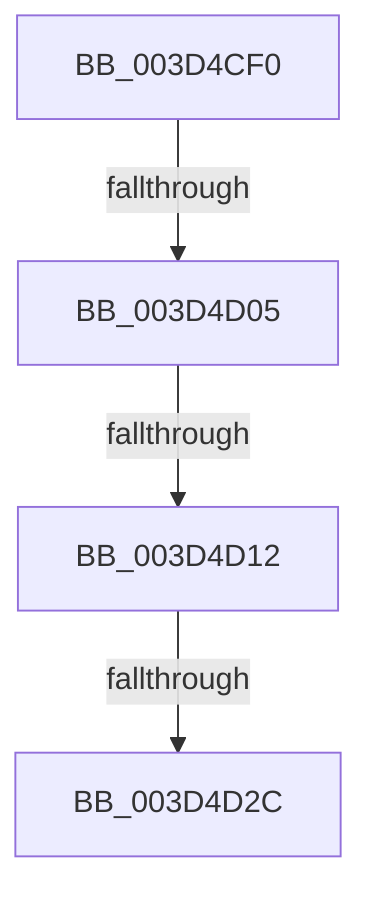

# MmGetLoadedModuleImageAdditionalTablesAddress

- RVA: `0x003D4CF0`–`0x003D4D3D` (길이 `77` bytes)
- VA: `0x00000001403D4CF0`
- 실행 섹션: `.text`
- PDB 이름 있음: `예`; PDB Function 태그: `아니요`
- unwind 정보 RVA: `0x000925D8`
- 디코드: `14`개 명령, `77/77` bytes 표시
- 미해석 바이트: `0` (있으면 어셈블리에 `.byte`로 보존)

> 이 문서는 커널 이미지의 기계어와 PDB 기호를 분석해 생성했습니다. 4번과 5번은 함수 원형과 자료형을 바이너리 사용 방식에서 추정한 C 해석이며 원본 소스 복구 결과는 아닙니다.

## 1. Dependencies

- 직접 호출 지점: **0**; 고유 호출 대상: **0**
- 직접 호출자로 확인된 함수: **7**
- RIP 상대 이미지 참조: **4**

### Outgoing calls
- 직접 디코드된 call 명령이 없습니다.

### Direct callers
- [MiUpdateDriverLoadInProgress](../43/MiUpdateDriverLoadInProgress_function_004318DC.md) at `0x00431A57`
- [IopLiveDumpMarkLoadedModuleList](../59/IopLiveDumpMarkLoadedModuleList_function_0059CE1C.md) at `0x0059CECF`
- [IopMarkPagesForLoadedDriverInformation](../5A/IopMarkPagesForLoadedDriverInformation_function_005A20DC.md) at `0x005A2181`
- [MmMarkImageForHiberPhase](../../pagelk/B7/MmMarkImageForHiberPhase_function_00B748EC.md) at `0x00B74921`
- [MiMarkHotPatchForHiberPhase](../../pagelk/B7/MiMarkHotPatchForHiberPhase_function_00B74BB0.md) at `0x00B74BC7`
- [MiMarkHotPatchesForHiberPhase](../../pagelk/B7/MiMarkHotPatchesForHiberPhase_function_00B74C10.md) at `0x00B74C40`
- [MiInitializeLoadedModuleList](../../init/C6/MiInitializeLoadedModuleList_function_00C6BCDC.md) at `0x00C6BE4B`

### Static image references
- `0x003D4CF8` → RVA `0x00FC6B28` (`ALMOSTRO`; read)
- `0x003D4D05` → RVA `0x00FC6B98` (`ALMOSTRO`; read)
- `0x003D4D12` → RVA `0x00E375B0` (`.data`; read)
- `0x003D4D19` → RVA `0x00E375AC` (`.data`; read)

## 2. Other-region calls and transfers

- 다른 실행 섹션으로 향하는 call: **0**
- call이 아닌 외부 분기/꼬리 이동: **3**
  - `0x003D4CFF` → [sub_003D4E88](Unknown_function_003D4E88.md) (`tail-transfer`)
  - `0x003D4D0C` → [sub_003D4E88](Unknown_function_003D4E88.md) (`tail-transfer`)
  - `0x003D4D26` → [sub_003D4E88 + 0xC](Unknown_function_003D4E88.md) (`tail-transfer`)

## 3. Assembly (complete function range)

```asm
003D4CF0  48 83 EC 28                     sub rsp, 0x28
003D4CF4  4C 8B 49 30                     mov r9, qword ptr [rcx + 0x30]
003D4CF8  4C 3B 0D 29 1E BF 00            cmp r9, qword ptr [rip + 0xbf1e29]
003D4CFF  0F 84 83 01 00 00               je 0x1403d4e88
003D4D05  4C 3B 0D 8C 1E BF 00            cmp r9, qword ptr [rip + 0xbf1e8c]
003D4D0C  0F 84 76 01 00 00               je 0x1403d4e88
003D4D12  44 8B 15 97 28 A6 00            mov r10d, dword ptr [rip + 0xa62897]
003D4D19  44 03 15 8C 28 A6 00            add r10d, dword ptr [rip + 0xa6288c]
003D4D20  44 89 12                        mov dword ptr [rdx], r10d
003D4D23  45 85 D2                        test r10d, r10d
003D4D26  0F 84 68 01 00 00               je 0x1403d4e94
003D4D2C  44 8B 41 40                     mov r8d, dword ptr [rcx + 0x40]
003D4D30  48 BA F8 FF FF FF 7F 00 00 00   movabs rdx, 0x7ffffffff8
003D4D3A  4D 03 C1                        add r8, r9
```

## 4. C-style interpretation (structured pseudocode)

```c
void __fastcall MmGetLoadedModuleImageAdditionalTablesAddress(__int64 a1, __int64 a2)
{
    __int64 v_r10;
    __int64 v_rsp;

    v_rsp = (v_rsp) - (40);
    v_r10 = (unsigned int)(((unsigned int)(*(unsigned int *)(v_rip + 10889367))) + (*(unsigned int *)(v_rip + 10889356)));
    *(unsigned int *)(a2) = (unsigned int)(v_r10);
    a3 = ((unsigned int)(*(unsigned int *)(a1 + 64))) + (*(unsigned __int64 *)(a1 + 48));
    return;
}
```

## 5. (Beta) C Style

```c
void MmGetLoadedModuleImageAdditionalTablesAddress(void *Arg1, void *Arg2)
{
    uint8_t *arg1 = (uint8_t *)Arg1;
    uint8_t *arg2 = (uint8_t *)Arg2;

    int64_t local_r10;
    int64_t local_rsp;

    local_rsp = (local_rsp) - (40);
    local_r10 = (uint32_t)(((uint32_t)(*(uint32_t *)(v_rip + 0xA62897))) + (*(uint32_t *)(v_rip + 0xA6288C)));
    *(uint32_t *)(arg2) = (uint32_t)(local_r10);
    a3 = ((uint32_t)(*(uint32_t *)(arg1 + 0x40))) + (*(uint64_t *)(arg1 + 0x30));
    return;
}
```

### 관측된 메모리 오프셋

구조체 형식이 확인되지 않은 접근은 인자 기준의 오프셋으로만 기록했습니다.

| 기준 인자 | 오프셋 표현 | 폭 (bit) | 접근 |
|---|---:|---:|---|
| `Arg1` | `+ 0x30` | `64` | `R` |
| `Arg1` | `+ 0x40` | `32` | `R` |
| `Arg2` | `+ 0x0` | `32` | `W` |

## 6. Execution-region graph

[열기: 2D/3D 그래프와 함수 탐색 컨트롤 패널](../../../control-panel.html?section=text&rva=0x003D4CF0&view=graph)

- 2D 그래프는 위에서 아래로 흐르고, 3D 그래프는 빈 공간을 드래그해 회전합니다. Shift+드래그는 이동, 휠은 확대·축소, 함수 노드 선택은 대상 보고서 이동입니다.

### Static fallback


