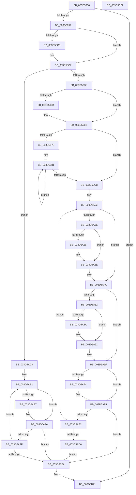

# RtlCopyXStateArea

- RVA: `0x003D5850`–`0x003D5B23` (길이 `723` bytes)
- VA: `0x00000001403D5850`
- 실행 섹션: `.text`
- PDB 이름 있음: `예`; PDB Function 태그: `아니요`
- unwind 정보 RVA: `0x00093A28`
- 디코드: `183`개 명령, `723/723` bytes 표시
- 미해석 바이트: `0` (있으면 어셈블리에 `.byte`로 보존)

> 이 문서는 커널 이미지의 기계어와 PDB 기호를 분석해 생성했습니다. 4번과 5번은 함수 원형과 자료형을 바이너리 사용 방식에서 추정한 C 해석이며 원본 소스 복구 결과는 아닙니다.

## 1. Dependencies

- 직접 호출 지점: **2**; 고유 호출 대상: **1**
- 직접 호출자로 확인된 함수: **4**
- RIP 상대 이미지 참조: **0**

### Outgoing calls
- `0x003D5A86` → [memcpy](../6C/memcpy_function_006C6840.md) (function, `0x006C6840`)
- `0x003D5AF5` → [memcpy](../6C/memcpy_function_006C6840.md) (function, `0x006C6840`)

### Direct callers
- [KxContextToKframes](KxContextToKframes_function_003D6850.md) at `0x003D6DAC`
- [KeContextFromKframes](KeContextFromKframes_function_003D9380.md) at `0x003D991C`
- [sub_009A6C56](../../page/9A/Unknown_function_009A6C56.md) at `0x009A6C67`
- [sub_009A70A8](../../page/9A/Unknown_function_009A70A8.md) at `0x009A70C3`

### Static image references
- 디코드된 RIP-relative 메모리 참조가 없습니다.

## 2. Other-region calls and transfers

- 다른 실행 섹션으로 향하는 call: **0**
- 별도 외부 분기/꼬리 이동을 확인하지 못했습니다.

## 3. Assembly (complete function range)

```asm
003D5850  48 85 D2                        test rdx, rdx
003D5853  0F 84 C8 02 00 00               je 0x1403d5b21
003D5859  48 89 5C 24 08                  mov qword ptr [rsp + 8], rbx
003D585E  55                              push rbp
003D585F  56                              push rsi
003D5860  57                              push rdi
003D5861  41 54                           push r12
003D5863  41 55                           push r13
003D5865  41 56                           push r14
003D5867  41 57                           push r15
003D5869  48 83 EC 40                     sub rsp, 0x40
003D586D  48 8B E9                        mov rbp, rcx
003D5870  4D 8B F0                        mov r14, r8
003D5873  33 FF                           xor edi, edi
003D5875  48 B9 D8 03 00 00 80 F7 FF FF   movabs rcx, 0xfffff780000003d8
003D587F  49 B8 F0 05 00 00 80 F7 FF FF   movabs r8, 0xfffff780000005f0
003D5889  49 8B 9E 00 02 00 00            mov rbx, qword ptr [r14 + 0x200]
003D5890  4C 8B 09                        mov r9, qword ptr [rcx]
003D5893  8D 77 02                        lea esi, [rdi + 2]
003D5896  4D 0B 08                        or r9, qword ptr [r8]
003D5899  49 83 C9 03                     or r9, 3
003D589D  49 23 D1                        and rdx, r9
003D58A0  48 23 DA                        and rbx, rdx
003D58A3  48 F7 D2                        not rdx
003D58A6  48 23 95 00 02 00 00            and rdx, qword ptr [rbp + 0x200]
003D58AD  8A C3                           mov al, bl
003D58AF  48 0B D3                        or rdx, rbx
003D58B2  24 03                           and al, 3
003D58B4  48 89 95 00 02 00 00            mov qword ptr [rbp + 0x200], rdx
003D58BB  40 3A C6                        cmp al, sil
003D58BE  75 07                           jne 0x1403d58c7
003D58C0  41 8B 46 18                     mov eax, dword ptr [r14 + 0x18]
003D58C4  89 45 18                        mov dword ptr [rbp + 0x18], eax
003D58C7  A1 EC 03 00 00 80 F7 FF FF      movabs eax, dword ptr [0xfffff780000003ec]
003D58D0  40 84 C6                        test sil, al
003D58D3  0F 84 FF 01 00 00               je 0x1403d5ad8
003D58D9  48 8B 09                        mov rcx, qword ptr [rcx]
003D58DC  48 B8 03 00 00 00 00 00 00 80   movabs rax, 0x8000000000000003
003D58E6  49 0B 08                        or rcx, qword ptr [r8]
003D58E9  41 B9 80 00 00 00               mov r9d, 0x80
003D58EF  49 8B 96 08 02 00 00            mov rdx, qword ptr [r14 + 0x208]
003D58F6  48 0B C8                        or rcx, rax
003D58F9  4C 8B AD 08 02 00 00            mov r13, qword ptr [rbp + 0x208]
003D5900  48 23 D1                        and rdx, rcx
003D5903  4C 23 E9                        and r13, rcx
003D5906  F6 C3 01                        test bl, 1
003D5909  74 60                           je 0x1403d596b
003D590B  41 0F 10 06                     movups xmm0, xmmword ptr [r14]
003D590F  0F 11 45 00                     movups xmmword ptr [rbp], xmm0
003D5913  41 0F 10 4E 10                  movups xmm1, xmmword ptr [r14 + 0x10]
003D5918  0F 11 4D 10                     movups xmmword ptr [rbp + 0x10], xmm1
003D591C  41 0F 10 46 20                  movups xmm0, xmmword ptr [r14 + 0x20]
003D5921  0F 11 45 20                     movups xmmword ptr [rbp + 0x20], xmm0
003D5925  41 0F 10 4E 30                  movups xmm1, xmmword ptr [r14 + 0x30]
003D592A  0F 11 4D 30                     movups xmmword ptr [rbp + 0x30], xmm1
003D592E  41 0F 10 46 40                  movups xmm0, xmmword ptr [r14 + 0x40]
003D5933  0F 11 45 40                     movups xmmword ptr [rbp + 0x40], xmm0
003D5937  41 0F 10 4E 50                  movups xmm1, xmmword ptr [r14 + 0x50]
003D593C  0F 11 4D 50                     movups xmmword ptr [rbp + 0x50], xmm1
003D5940  41 0F 10 46 60                  movups xmm0, xmmword ptr [r14 + 0x60]
003D5945  0F 11 45 60                     movups xmmword ptr [rbp + 0x60], xmm0
003D5949  41 0F 10 4E 70                  movups xmm1, xmmword ptr [r14 + 0x70]
003D594E  42 0F 11 4C 0D F0               movups xmmword ptr [rbp + r9 - 0x10], xmm1
003D5954  43 0F 10 04 0E                  movups xmm0, xmmword ptr [r14 + r9]
003D5959  42 0F 11 44 0D 00               movups xmmword ptr [rbp + r9], xmm0
003D595F  43 0F 10 4C 0E 10               movups xmm1, xmmword ptr [r14 + r9 + 0x10]
003D5965  42 0F 11 4C 0D 10               movups xmmword ptr [rbp + r9 + 0x10], xmm1
003D596B  40 84 DE                        test sil, bl
003D596E  74 5B                           je 0x1403d59cb
003D5970  48 8D 85 A0 00 00 00            lea rax, [rbp + 0xa0]
003D5977  4C 8B C6                        mov r8, rsi
003D597A  49 8D 8E A0 00 00 00            lea rcx, [r14 + 0xa0]
003D5981  0F 10 01                        movups xmm0, xmmword ptr [rcx]
003D5984  0F 11 00                        movups xmmword ptr [rax], xmm0
003D5987  0F 10 49 10                     movups xmm1, xmmword ptr [rcx + 0x10]
003D598B  0F 11 48 10                     movups xmmword ptr [rax + 0x10], xmm1
003D598F  0F 10 41 20                     movups xmm0, xmmword ptr [rcx + 0x20]
003D5993  0F 11 40 20                     movups xmmword ptr [rax + 0x20], xmm0
003D5997  0F 10 49 30                     movups xmm1, xmmword ptr [rcx + 0x30]
003D599B  0F 11 48 30                     movups xmmword ptr [rax + 0x30], xmm1
003D599F  0F 10 41 40                     movups xmm0, xmmword ptr [rcx + 0x40]
003D59A3  0F 11 40 40                     movups xmmword ptr [rax + 0x40], xmm0
003D59A7  0F 10 49 50                     movups xmm1, xmmword ptr [rcx + 0x50]
003D59AB  0F 11 48 50                     movups xmmword ptr [rax + 0x50], xmm1
003D59AF  0F 10 41 60                     movups xmm0, xmmword ptr [rcx + 0x60]
003D59B3  0F 11 40 60                     movups xmmword ptr [rax + 0x60], xmm0
003D59B7  49 03 C1                        add rax, r9
003D59BA  0F 10 49 70                     movups xmm1, xmmword ptr [rcx + 0x70]
003D59BE  49 03 C9                        add rcx, r9
003D59C1  0F 11 48 F0                     movups xmmword ptr [rax - 0x10], xmm1
003D59C5  49 83 E8 01                     sub r8, 1
003D59C9  75 B6                           jne 0x1403d5981
003D59CB  48 A1 F8 05 00 00 80 F7 FF FF   movabs rax, qword ptr [0xfffff780000005f8]
003D59D5  41 BF 40 02 00 00               mov r15d, 0x240
003D59DB  48 C1 EA 02                     shr rdx, 2
003D59DF  49 B8 0C 06 00 00 80 F7 FF FF   movabs r8, 0xfffff7800000060c
003D59E9  48 C1 EB 02                     shr rbx, 2
003D59ED  45 8B CF                        mov r9d, r15d
003D59F0  48 23 DA                        and rbx, rdx
003D59F3  49 C1 ED 02                     shr r13, 2
003D59F7  49 23 DD                        and rbx, r13
003D59FA  44 89 BC 24 88 00 00 00         mov dword ptr [rsp + 0x88], r15d
003D5A02  48 C1 E8 02                     shr rax, 2
003D5A06  45 8B E7                        mov r12d, r15d
003D5A09  48 89 44 24 28                  mov qword ptr [rsp + 0x28], rax
003D5A0E  45 8B D7                        mov r10d, r15d
003D5A11  44 89 BC 24 98 00 00 00         mov dword ptr [rsp + 0x98], r15d
003D5A19  48 89 54 24 20                  mov qword ptr [rsp + 0x20], rdx
003D5A1E  4C 89 44 24 30                  mov qword ptr [rsp + 0x30], r8
003D5A23  48 8B C8                        mov rcx, rax
003D5A26  83 E1 01                        and ecx, 1
003D5A29  F6 C2 01                        test dl, 1
003D5A2C  74 1E                           je 0x1403d5a4c
003D5A2E  45 8B F9                        mov r15d, r9d
003D5A31  48 85 C9                        test rcx, rcx
003D5A34  74 08                           je 0x1403d5a3e
003D5A36  45 8D 79 3F                     lea r15d, [r9 + 0x3f]
003D5A3A  41 83 E7 C0                     and r15d, 0xffffffc0
003D5A3E  45 8B 08                        mov r9d, dword ptr [r8]
003D5A41  45 03 CF                        add r9d, r15d
003D5A44  44 89 8C 24 88 00 00 00         mov dword ptr [rsp + 0x88], r9d
003D5A4C  41 F6 C5 01                     test r13b, 1
003D5A50  74 1D                           je 0x1403d5a6f
003D5A52  45 8B E2                        mov r12d, r10d
003D5A55  48 85 C9                        test rcx, rcx
003D5A58  74 08                           je 0x1403d5a62
003D5A5A  45 8D 62 3F                     lea r12d, [r10 + 0x3f]
003D5A5E  41 83 E4 C0                     and r12d, 0xffffffc0
003D5A62  41 8B 08                        mov ecx, dword ptr [r8]
003D5A65  41 03 CC                        add ecx, r12d
003D5A68  89 8C 24 98 00 00 00            mov dword ptr [rsp + 0x98], ecx
003D5A6F  F6 C3 01                        test bl, 1
003D5A72  74 21                           je 0x1403d5a95
003D5A74  45 8B C1                        mov r8d, r9d
003D5A77  41 8B D7                        mov edx, r15d
003D5A7A  41 8B CC                        mov ecx, r12d
003D5A7D  45 2B C7                        sub r8d, r15d
003D5A80  49 03 D6                        add rdx, r14
003D5A83  48 03 CD                        add rcx, rbp
003D5A86  E8 B5 0D 2F 00                  call 0x1406c6840
003D5A8B  48 8B 54 24 20                  mov rdx, qword ptr [rsp + 0x20]
003D5A90  4C 8B 44 24 30                  mov r8, qword ptr [rsp + 0x30]
003D5A95  48 8B 44 24 28                  mov rax, qword ptr [rsp + 0x28]
003D5A9A  48 D1 E8                        shr rax, 1
003D5A9D  48 D1 EA                        shr rdx, 1
003D5AA0  49 D1 ED                        shr r13, 1
003D5AA3  48 D1 EB                        shr rbx, 1
003D5AA6  48 89 54 24 20                  mov qword ptr [rsp + 0x20], rdx
003D5AAB  48 89 44 24 28                  mov qword ptr [rsp + 0x28], rax
003D5AB0  74 58                           je 0x1403d5b0a
003D5AB2  44 8B 8C 24 88 00 00 00         mov r9d, dword ptr [rsp + 0x88]
003D5ABA  49 83 C0 04                     add r8, 4
003D5ABE  44 8B 94 24 98 00 00 00         mov r10d, dword ptr [rsp + 0x98]
003D5AC6  FF C6                           inc esi
003D5AC8  4C 89 44 24 30                  mov qword ptr [rsp + 0x30], r8
003D5ACD  83 FE 40                        cmp esi, 0x40
003D5AD0  0F 82 4D FF FF FF               jb 0x1403d5a23
003D5AD6  EB 32                           jmp 0x1403d5b0a
003D5AD8  48 BE F4 03 00 00 80 F7 FF FF   movabs rsi, 0xfffff780000003f4
003D5AE2  F6 C3 01                        test bl, 1
003D5AE5  74 13                           je 0x1403d5afa
003D5AE7  8B 46 FC                        mov eax, dword ptr [rsi - 4]
003D5AEA  44 8B 06                        mov r8d, dword ptr [rsi]
003D5AED  4A 8D 14 30                     lea rdx, [rax + r14]
003D5AF1  48 8D 0C 28                     lea rcx, [rax + rbp]
003D5AF5  E8 46 0D 2F 00                  call 0x1406c6840
003D5AFA  48 D1 EB                        shr rbx, 1
003D5AFD  74 0B                           je 0x1403d5b0a
003D5AFF  FF C7                           inc edi
003D5B01  48 83 C6 08                     add rsi, 8
003D5B05  83 FF 40                        cmp edi, 0x40
003D5B08  72 D8                           jb 0x1403d5ae2
003D5B0A  48 8B 9C 24 80 00 00 00         mov rbx, qword ptr [rsp + 0x80]
003D5B12  48 83 C4 40                     add rsp, 0x40
003D5B16  41 5F                           pop r15
003D5B18  41 5E                           pop r14
003D5B1A  41 5D                           pop r13
003D5B1C  41 5C                           pop r12
003D5B1E  5F                              pop rdi
003D5B1F  5E                              pop rsi
003D5B20  5D                              pop rbp
003D5B21  C3                              ret
003D5B22  CC                              int3
```

## 4. C-style interpretation (structured pseudocode)

```c
__int64 __fastcall RtlCopyXStateArea(__int64 a1, __int64 a2, __int64 a3)
{
    __int64 result;
    __int64 v_r12;
    __int64 v_r13;
    __int64 v_r15;
    __int64 v_rbx;
    __int64 v_rdi;
    __int64 v_rsi;
    __int64 v_rsp;
    unsigned __int64 v_stack_m48;
    unsigned __int64 v_stack_m50;
    unsigned __int64 v_stack_m58;
    unsigned int v_stack_p10;
    unsigned int v_stack_p20;
    unsigned __int64 v_stack_p8;

    if (a2 == 0) goto loc_003D5B21;
    v_stack_p8 = v_rbx;
    v_rsp = (v_rsp) - (64);
    v_rdi = 0;
    a4 = (*(unsigned __int64 *)(a1)) | (*(unsigned __int64 *)(a3));
    a4 = (a4) | (3);
    a2 = (a2) & (a4);
    v_rbx = (*(unsigned __int64 *)(a3 + 512)) & (a2);
    a2 = ~(a2);
    a2 = (a2) & (*(unsigned __int64 *)(a1 + 512));
    a2 = (a2) | (v_rbx);
    result = (unsigned __int8)(((unsigned __int8)(v_rbx)) & (3));
    *(unsigned __int64 *)(a1 + 512) = a2;
    if (((unsigned __int8)(result)) == ((unsigned __int8)(v_rdi + 2))) {
        result = *(unsigned int *)(a3 + 24);
        *(unsigned int *)(a1 + 24) = (unsigned int)(result);
    }
    if ((((unsigned __int8)(v_rdi + 2)) & ((unsigned __int8)(result))) == 0) goto loc_003D5AD8;
    a1 = (*(unsigned __int64 *)(a1)) | (*(unsigned __int64 *)(a3));
    a1 = (a1) | (result);
    a2 = (*(unsigned __int64 *)(a3 + 520)) & (a1);
    v_r13 = (*(unsigned __int64 *)(a1 + 520)) & (a1);
    if ((((unsigned __int8)(v_rbx)) & (1)) != 0) {
        *(unsigned __int64 *)(a1) = v_xmm0;
        *(unsigned __int64 *)(a1 + 16) = v_xmm1;
        *(unsigned __int64 *)(a1 + 32) = v_xmm0;
        *(unsigned __int64 *)(a1 + 48) = v_xmm1;
        *(unsigned __int64 *)(a1 + 64) = v_xmm0;
        *(unsigned __int64 *)(a1 + 80) = v_xmm1;
        *(unsigned __int64 *)(a1 + 96) = v_xmm0;
        *(unsigned __int64 *)(a1 + 128 * 1 - 16) = v_xmm1;
        *(unsigned __int64 *)(a1 + 128 * 1) = v_xmm0;
        *(unsigned __int64 *)(a1 + 128 * 1 + 16) = v_xmm1;
    }
    if ((((unsigned __int8)(v_rdi + 2)) & ((unsigned __int8)(v_rbx))) == 0) goto loc_003D59CB;
loc_003D5981:
    *(unsigned __int64 *)(a1 + 160) = v_xmm0;
    *(unsigned __int64 *)(a1 + 160 + 16) = v_xmm1;
    *(unsigned __int64 *)(a1 + 160 + 32) = v_xmm0;
    *(unsigned __int64 *)(a1 + 160 + 48) = v_xmm1;
    *(unsigned __int64 *)(a1 + 160 + 64) = v_xmm0;
    *(unsigned __int64 *)(a1 + 160 + 80) = v_xmm1;
    *(unsigned __int64 *)(a1 + 160 + 96) = v_xmm0;
    result = (a1 + 160) + (128);
    a1 = (a3 + 160) + (128);
    *(unsigned __int64 *)(result - 16) = v_xmm1;
    a3 = (v_rdi + 2) - (1);
    if (condition_is_not_equal) goto loc_003D5981;
loc_003D59CB:
    a2 = (a2) >> (2);
    v_rbx = (v_rbx) >> (2);
    v_rbx = (v_rbx) & (a2);
    v_r13 = (v_r13) >> (2);
    v_rbx = (v_rbx) & (v_r13);
    v_stack_p10 = 576;
    result = (result) >> (2);
    v_stack_m50 = result;
    v_stack_p20 = 576;
    v_stack_m58 = a2;
    v_stack_m48 = a3;
loc_003D5A23:
    a1 = (unsigned int)((result) & (1));
    if ((((unsigned __int8)(a2)) & (1)) == 0) goto loc_003D5A4C;
    v_r15 = 576;
    if (a1 != 0) {
        v_r15 = 576 + 63;
        v_r15 = (unsigned int)((v_r15) & (0xFFFFFFC0ULL));
    }
    a4 = (unsigned int)(((unsigned int)(*(unsigned int *)(a3))) + ((unsigned int)(v_r15)));
    v_stack_p10 = (unsigned int)(a4);
loc_003D5A4C:
    if ((((unsigned __int8)(v_r13)) & (1)) == 0) goto loc_003D5A6F;
    v_r12 = 576;
    if (a1 != 0) {
        v_r12 = 576 + 63;
        v_r12 = (unsigned int)((v_r12) & (0xFFFFFFC0ULL));
    }
    a1 = (unsigned int)(((unsigned int)(*(unsigned int *)(a3))) + ((unsigned int)(v_r12)));
    v_stack_p20 = (unsigned int)(a1);
loc_003D5A6F:
    if ((((unsigned __int8)(v_rbx)) & (1)) != 0) {
        a3 = (unsigned int)(a4);
        a2 = (unsigned int)(v_r15);
        a1 = (unsigned int)(v_r12);
        a3 = (unsigned int)((a3) - ((unsigned int)(v_r15)));
        a2 = (a2) + (a3);
        a1 = (a1) + (a1);
        result = memcpy(a1, a2, a3, a4);
        a2 = v_stack_m58;
        a3 = v_stack_m48;
    }
    result = (v_stack_m50) >> (1);
    a2 = (a2) >> (1);
    v_r13 = (v_r13) >> (1);
    v_rbx = (v_rbx) >> (1);
    v_stack_m58 = a2;
    v_stack_m50 = result;
    if (condition_is_equal) goto loc_003D5B0A;
    a3 = (a3) + (4);
    v_rsi = (unsigned int)((v_rdi + 2) + 1);
    v_stack_m48 = a3;
    if (((unsigned int)(v_rsi)) < 64) goto loc_003D5A23;
    goto loc_003D5B0A;
loc_003D5AD8:
loc_003D5AE2:
    if ((((unsigned __int8)(v_rbx)) & (1)) != 0) {
        result = *(unsigned int *)(v_rsi - 4);
        a3 = *(unsigned int *)(v_rsi);
        a2 = result + a3 * 1;
        a1 = result + a1 * 1;
        result = memcpy(a1, a2, a3, (unsigned int)(v_stack_p10));
    }
    v_rbx = (v_rbx) >> (1);
    if (condition_is_equal) goto loc_003D5B0A;
    v_rdi = (unsigned int)((v_rdi) + 1);
    v_rsi = (v_rsi) + (8);
    if (((unsigned int)(v_rdi)) < 64) goto loc_003D5AE2;
loc_003D5B0A:
    v_rsp = (v_rsp) + (64);
loc_003D5B21:
    return result;
}
```

## 5. (Beta) C Style

```c
int64_t RtlCopyXStateArea(void *Arg1, int64_t Arg2, void *Arg3)
{
    uint8_t *arg1 = (uint8_t *)Arg1;
    uint8_t *arg3 = (uint8_t *)Arg3;

    int64_t result;
    int64_t local_r12;
    int64_t local_r13;
    int64_t local_r15;
    int64_t local_rbx;
    int64_t local_rdi;
    int64_t local_rsi;
    int64_t local_rsp;
    uint64_t v_stack_m48;
    uint64_t v_stack_m50;
    uint64_t v_stack_m58;
    uint32_t v_stack_p10;
    uint32_t v_stack_p20;
    uint64_t v_stack_p8;

    if (Arg2 == 0) goto loc_003D5B21;
    v_stack_p8 = local_rbx;
    local_rsp = (local_rsp) - (64);
    local_rdi = 0;
    a4 = (*(uint64_t *)(arg1)) | (*(uint64_t *)(arg3));
    a4 = (a4) | (3);
    Arg2 = (Arg2) & (a4);
    local_rbx = (*(uint64_t *)(arg3 + 0x200)) & (Arg2);
    Arg2 = ~(Arg2);
    Arg2 = (Arg2) & (*(uint64_t *)(arg1 + 0x200));
    Arg2 = (Arg2) | (local_rbx);
    result = (uint8_t)(((uint8_t)(local_rbx)) & (3));
    *(uint64_t *)(arg1 + 0x200) = Arg2;
    if (((uint8_t)(result)) == ((uint8_t)(local_rdi + 2))) {
        result = *(uint32_t *)(arg3 + 0x18);
        *(uint32_t *)(arg1 + 0x18) = (uint32_t)(result);
    }
    if ((((uint8_t)(local_rdi + 2)) & ((uint8_t)(result))) == 0) goto loc_003D5AD8;
    Arg1 = (*(uint64_t *)(arg1)) | (*(uint64_t *)(arg3));
    Arg1 = (Arg1) | (result);
    Arg2 = (*(uint64_t *)(arg3 + 0x208)) & (Arg1);
    local_r13 = (*(uint64_t *)(arg1 + 0x208)) & (Arg1);
    if ((((uint8_t)(local_rbx)) & (1)) != 0) {
        *(uint64_t *)(arg1) = v_xmm0;
        *(uint64_t *)(arg1 + 0x10) = v_xmm1;
        *(uint64_t *)(arg1 + 0x20) = v_xmm0;
        *(uint64_t *)(arg1 + 0x30) = v_xmm1;
        *(uint64_t *)(arg1 + 0x40) = v_xmm0;
        *(uint64_t *)(arg1 + 0x50) = v_xmm1;
        *(uint64_t *)(arg1 + 0x60) = v_xmm0;
        *(uint64_t *)(arg1 + 0x80 * 1 - 0x10) = v_xmm1;
        *(uint64_t *)(arg1 + 0x80 * 1) = v_xmm0;
        *(uint64_t *)(arg1 + 0x80 * 1 + 0x10) = v_xmm1;
    }
    if ((((uint8_t)(local_rdi + 2)) & ((uint8_t)(local_rbx))) == 0) goto loc_003D59CB;
loc_003D5981:
    *(uint64_t *)(arg1 + 0xA0) = v_xmm0;
    *(uint64_t *)(arg1 + 0xA0 + 0x10) = v_xmm1;
    *(uint64_t *)(arg1 + 0xA0 + 0x20) = v_xmm0;
    *(uint64_t *)(arg1 + 0xA0 + 0x30) = v_xmm1;
    *(uint64_t *)(arg1 + 0xA0 + 0x40) = v_xmm0;
    *(uint64_t *)(arg1 + 0xA0 + 0x50) = v_xmm1;
    *(uint64_t *)(arg1 + 0xA0 + 0x60) = v_xmm0;
    result = (Arg1 + 160) + (128);
    Arg1 = (Arg3 + 160) + (128);
    *(uint64_t *)(result - 0x10) = v_xmm1;
    Arg3 = (local_rdi + 2) - (1);
    if (condition_is_not_equal) goto loc_003D5981;
loc_003D59CB:
    Arg2 = (Arg2) >> (2);
    local_rbx = (local_rbx) >> (2);
    local_rbx = (local_rbx) & (Arg2);
    local_r13 = (local_r13) >> (2);
    local_rbx = (local_rbx) & (local_r13);
    v_stack_p10 = 576;
    result = (result) >> (2);
    v_stack_m50 = result;
    v_stack_p20 = 576;
    v_stack_m58 = Arg2;
    v_stack_m48 = Arg3;
loc_003D5A23:
    Arg1 = (uint32_t)((result) & (1));
    if ((((uint8_t)(Arg2)) & (1)) == 0) goto loc_003D5A4C;
    local_r15 = 576;
    if (Arg1 != NULL) {
        local_r15 = 576 + 63;
        local_r15 = (uint32_t)((local_r15) & (0xFFFFFFC0ULL));
    }
    a4 = (uint32_t)(((uint32_t)(*(uint32_t *)(arg3))) + ((uint32_t)(local_r15)));
    v_stack_p10 = (uint32_t)(a4);
loc_003D5A4C:
    if ((((uint8_t)(local_r13)) & (1)) == 0) goto loc_003D5A6F;
    local_r12 = 576;
    if (Arg1 != NULL) {
        local_r12 = 576 + 63;
        local_r12 = (uint32_t)((local_r12) & (0xFFFFFFC0ULL));
    }
    Arg1 = (uint32_t)(((uint32_t)(*(uint32_t *)(arg3))) + ((uint32_t)(local_r12)));
    v_stack_p20 = (uint32_t)(Arg1);
loc_003D5A6F:
    if ((((uint8_t)(local_rbx)) & (1)) != 0) {
        Arg3 = (uint32_t)(a4);
        Arg2 = (uint32_t)(local_r15);
        Arg1 = (uint32_t)(local_r12);
        Arg3 = (uint32_t)((Arg3) - ((uint32_t)(local_r15)));
        Arg2 = (Arg2) + (Arg3);
        Arg1 = (Arg1) + (Arg1);
        result = memcpy(Arg1, Arg2, Arg3, a4);
        Arg2 = v_stack_m58;
        Arg3 = v_stack_m48;
    }
    result = (v_stack_m50) >> (1);
    Arg2 = (Arg2) >> (1);
    local_r13 = (local_r13) >> (1);
    local_rbx = (local_rbx) >> (1);
    v_stack_m58 = Arg2;
    v_stack_m50 = result;
    if (condition_is_equal) goto loc_003D5B0A;
    Arg3 = (Arg3) + (4);
    local_rsi = (uint32_t)((local_rdi + 2) + 1);
    v_stack_m48 = Arg3;
    if (((uint32_t)(local_rsi)) < 64) goto loc_003D5A23;
    goto loc_003D5B0A;
loc_003D5AD8:
loc_003D5AE2:
    if ((((uint8_t)(local_rbx)) & (1)) != 0) {
        result = *(uint32_t *)(local_rsi - 0x4);
        Arg3 = *(uint32_t *)(local_rsi);
        Arg2 = result + Arg3 * 1;
        Arg1 = result + Arg1 * 1;
        result = memcpy(Arg1, Arg2, Arg3, (uint32_t)(v_stack_p10));
    }
    local_rbx = (local_rbx) >> (1);
    if (condition_is_equal) goto loc_003D5B0A;
    local_rdi = (uint32_t)((local_rdi) + 1);
    local_rsi = (local_rsi) + (8);
    if (((uint32_t)(local_rdi)) < 64) goto loc_003D5AE2;
loc_003D5B0A:
    local_rsp = (local_rsp) + (64);
loc_003D5B21:
    return result;
}
```

### 관측된 메모리 오프셋

구조체 형식이 확인되지 않은 접근은 인자 기준의 오프셋으로만 기록했습니다.

| 기준 인자 | 오프셋 표현 | 폭 (bit) | 접근 |
|---|---:|---:|---|
| `Arg1` | `- 0x10` | `128` | `R` |
| `Arg1` | `- 0x10 + r9*1` | `128` | `R` |
| `Arg1` | `+ 0x0` | `128` | `R` |
| `Arg1` | `+ 0x0 + r9*1` | `128` | `R` |
| `Arg1` | `+ 0x10` | `128` | `R` |
| `Arg1` | `+ 0x10 + r9*1` | `128` | `R` |
| `Arg1` | `+ 0x18` | `32` | `W` |
| `Arg1` | `+ 0x20` | `128` | `R` |
| `Arg1` | `+ 0x30` | `128` | `R` |
| `Arg1` | `+ 0x40` | `128` | `R` |
| `Arg1` | `+ 0x50` | `128` | `R` |
| `Arg1` | `+ 0x60` | `128` | `R` |
| `Arg1` | `+ 0xA0` | `64` | `R` |
| `Arg1` | `+ 0x200` | `64` | `R` |
| `Arg1` | `+ 0x200` | `64` | `W` |
| `Arg1` | `+ 0x208` | `64` | `R` |
| `Arg3` | `+ 0x0` | `128` | `R` |
| `Arg3` | `+ 0x0 + r9*1` | `128` | `R` |
| `Arg3` | `+ 0x10` | `128` | `R` |
| `Arg3` | `+ 0x10 + r9*1` | `128` | `R` |
| `Arg3` | `+ 0x18` | `32` | `R` |
| `Arg3` | `+ 0x20` | `128` | `R` |
| `Arg3` | `+ 0x30` | `128` | `R` |
| `Arg3` | `+ 0x40` | `128` | `R` |
| `Arg3` | `+ 0x50` | `128` | `R` |
| `Arg3` | `+ 0x60` | `128` | `R` |
| `Arg3` | `+ 0x70` | `128` | `R` |
| `Arg3` | `+ 0xA0` | `64` | `R` |
| `Arg3` | `+ 0x200` | `64` | `R` |
| `Arg3` | `+ 0x208` | `64` | `R` |

## 6. Execution-region graph

[열기: 2D/3D 그래프와 함수 탐색 컨트롤 패널](../../../control-panel.html?section=text&rva=0x003D5850&view=graph)

- 2D 그래프는 위에서 아래로 흐르고, 3D 그래프는 빈 공간을 드래그해 회전합니다. Shift+드래그는 이동, 휠은 확대·축소, 함수 노드 선택은 대상 보고서 이동입니다.

### Static fallback


