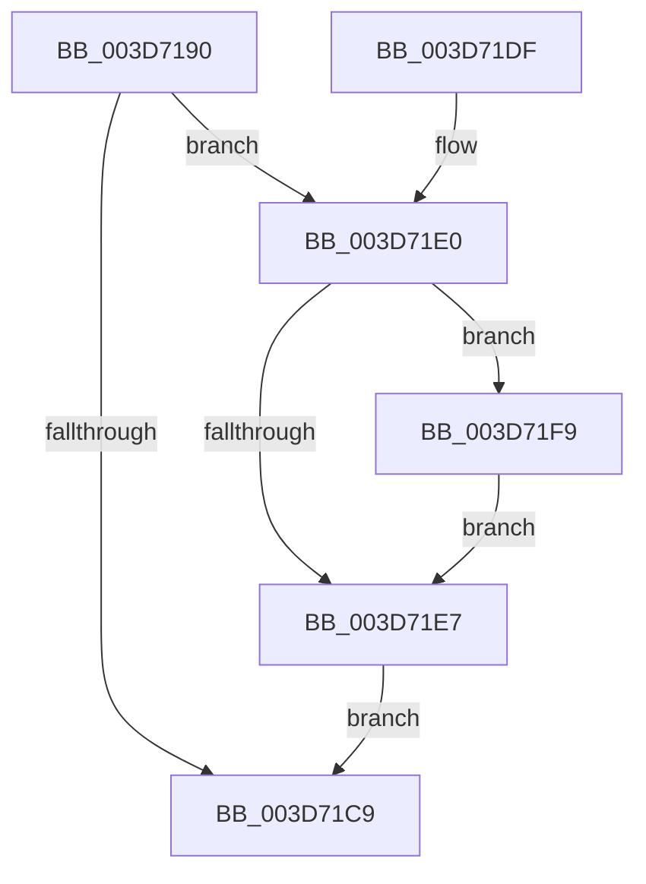

# RtlGetExtendedContextLength

- RVA: `0x003D7190`–`0x003D720B` (길이 `123` bytes)
- VA: `0x00000001403D7190`
- 실행 섹션: `.text`
- PDB 이름 있음: `예`; PDB Function 태그: `아니요`
- unwind 정보 RVA: `0x00093BC0`
- 디코드: `35`개 명령, `123/123` bytes 표시
- 미해석 바이트: `0` (있으면 어셈블리에 `.byte`로 보존)

> 이 문서는 커널 이미지의 기계어와 PDB 기호를 분석해 생성했습니다. 4번과 5번은 함수 원형과 자료형을 바이너리 사용 방식에서 추정한 C 해석이며 원본 소스 복구 결과는 아닙니다.

## 1. Dependencies

- 직접 호출 지점: **2**; 고유 호출 대상: **2**
- 직접 호출자로 확인된 함수: **8**
- RIP 상대 이미지 참조: **0**

### Outgoing calls
- `0x003D71C0` → [RtlpValidateContextFlags2](../4E/RtlpValidateContextFlags2_function_004EF138.md) (function, `0x004EF138`)
- `0x003D71F2` → [RtlGetExtendedContextLength3](../4E/RtlGetExtendedContextLength3_function_004EF028.md) (function, `0x004EF028`)

### Direct callers
- [RtlUnwindEx](../2F/RtlUnwindEx_function_002F2830.md) at `0x002F2D24`
- [KyRaiseException](KyRaiseException_function_003D5E20.md) at `0x003D5EBF`
- [KiUnwindUserSspForApcContextCopyBypass](KiUnwindUserSspForApcContextCopyBypass_function_003D6F0C.md) at `0x003D6F70`
- [PspSetContextState](../../page/78/PspSetContextState_function_00789FBC.md) at `0x0078A006`
- [PspSetContextThreadInternal](../../page/8D/PspSetContextThreadInternal_function_008D4420.md) at `0x008D45F4`
- [PspGetContextThreadInternal](../../page/8D/PspGetContextThreadInternal_function_008D4770.md) at `0x008D498B`
- [sub_009A6724](../../page/9A/Unknown_function_009A6724.md) at `0x009A67AD`
- [sub_00B30C5A](../../page/B3/Unknown_function_00B30C5A.md) at `0x00B30E4A`

### Static image references
- 디코드된 RIP-relative 메모리 참조가 없습니다.

## 2. Other-region calls and transfers

- 다른 실행 섹션으로 향하는 call: **0**
- 별도 외부 분기/꼬리 이동을 확인하지 못했습니다.

## 3. Assembly (complete function range)

```asm
003D7190  48 8B C4                        mov rax, rsp
003D7193  48 89 58 08                     mov qword ptr [rax + 8], rbx
003D7197  48 89 70 10                     mov qword ptr [rax + 0x10], rsi
003D719B  48 89 78 20                     mov qword ptr [rax + 0x20], rdi
003D719F  41 56                           push r14
003D71A1  48 83 EC 20                     sub rsp, 0x20
003D71A5  48 8B F2                        mov rsi, rdx
003D71A8  49 BE D8 03 00 00 80 F7 FF FF   movabs r14, 0xfffff780000003d8
003D71B2  33 DB                           xor ebx, ebx
003D71B4  48 8D 50 18                     lea rdx, [rax + 0x18]
003D71B8  4D 8B C6                        mov r8, r14
003D71BB  89 58 18                        mov dword ptr [rax + 0x18], ebx
003D71BE  8B F9                           mov edi, ecx
003D71C0  E8 73 7F 11 00                  call 0x1404ef138
003D71C5  85 C0                           test eax, eax
003D71C7  79 17                           jns 0x1403d71e0
003D71C9  48 8B 5C 24 30                  mov rbx, qword ptr [rsp + 0x30]
003D71CE  48 8B 74 24 38                  mov rsi, qword ptr [rsp + 0x38]
003D71D3  48 8B 7C 24 48                  mov rdi, qword ptr [rsp + 0x48]
003D71D8  48 83 C4 20                     add rsp, 0x20
003D71DC  41 5E                           pop r14
003D71DE  C3                              ret
003D71DF  CC                              int3
003D71E0  F6 44 24 40 02                  test byte ptr [rsp + 0x40], 2
003D71E5  75 12                           jne 0x1403d71f9
003D71E7  4D 8B CE                        mov r9, r14
003D71EA  4C 8B C3                        mov r8, rbx
003D71ED  48 8B D6                        mov rdx, rsi
003D71F0  8B CF                           mov ecx, edi
003D71F2  E8 31 7E 11 00                  call 0x1404ef028
003D71F7  EB D0                           jmp 0x1403d71c9
003D71F9  48 BB 08 07 00 00 80 F7 FF FF   movabs rbx, 0xfffff78000000708
003D7203  48 8B 1B                        mov rbx, qword ptr [rbx]
003D7206  49 0B 1E                        or rbx, qword ptr [r14]
003D7209  EB DC                           jmp 0x1403d71e7
```

## 4. C-style interpretation (structured pseudocode)

```c
__int64 __fastcall RtlGetExtendedContextLength(int a1, __int64 a2)
{
    __int64 result;
    __int64 v_rbx;
    __int64 v_rsp;
    unsigned __int64 v_stack_p10;
    unsigned __int64 v_stack_p20;
    unsigned __int8 v_stack_p40;
    unsigned __int64 v_stack_p8;

    *(unsigned __int64 *)(v_rsp + 8) = v_rbx;
    *(unsigned __int64 *)(v_rsp + 16) = v_rsi;
    *(unsigned __int64 *)(v_rsp + 32) = v_rdi;
    v_rsp = (v_rsp) - (32);
    v_rbx = 0;
    *(unsigned int *)(v_rsp + 24) = 0;
    result = RtlpValidateContextFlags2(a1, v_rsp + 24, v_r14, a4);
    if (!sign_flag) goto loc_003D71E0;
loc_003D71C9:
    v_rsp = (v_rsp) + (32);
    return result;
loc_003D71E0:
    if (((v_stack_p40) & (2)) != 0) goto loc_003D71F9;
loc_003D71E7:
    result = RtlGetExtendedContextLength3((unsigned int)((unsigned int)(v_stack_p20)), v_stack_p10, v_stack_p8, v_r14);
    goto loc_003D71C9;
loc_003D71F9:
    v_rbx = (*(unsigned __int64 *)(v_stack_p8)) | (*(unsigned __int64 *)(v_r14));
    goto loc_003D71E7;
}
```

## 5. (Beta) C Style

```c
int64_t RtlGetExtendedContextLength(int32_t Arg1, int64_t Arg2)
{
    int64_t result;
    int64_t local_rbx;
    int64_t local_rsp;
    uint64_t v_stack_p10;
    uint64_t v_stack_p20;
    uint8_t v_stack_p40;
    uint64_t v_stack_p8;

    *(uint64_t *)(local_rsp + 0x8) = local_rbx;
    *(uint64_t *)(local_rsp + 0x10) = local_rsi;
    *(uint64_t *)(local_rsp + 0x20) = local_rdi;
    local_rsp = (local_rsp) - (32);
    local_rbx = 0;
    *(uint32_t *)(local_rsp + 0x18) = 0;
    result = RtlpValidateContextFlags2(Arg1, local_rsp + 24, local_r14, a4);
    if (!sign_flag) goto loc_003D71E0;
loc_003D71C9:
    local_rsp = (local_rsp) + (32);
    return result;
loc_003D71E0:
    if (((v_stack_p40) & (2)) != 0) goto loc_003D71F9;
loc_003D71E7:
    result = RtlGetExtendedContextLength3((uint32_t)((uint32_t)(v_stack_p20)), v_stack_p10, v_stack_p8, local_r14);
    goto loc_003D71C9;
loc_003D71F9:
    local_rbx = (*(uint64_t *)(v_stack_p8)) | (*(uint64_t *)(local_r14));
    goto loc_003D71E7;
}
```

## 6. Execution-region graph

[열기: 2D/3D 그래프와 함수 탐색 컨트롤 패널](../../../control-panel.html?section=text&rva=0x003D7190&view=graph)

- 2D 그래프는 위에서 아래로 흐르고, 3D 그래프는 빈 공간을 드래그해 회전합니다. Shift+드래그는 이동, 휠은 확대·축소, 함수 노드 선택은 대상 보고서 이동입니다.

### Static fallback


