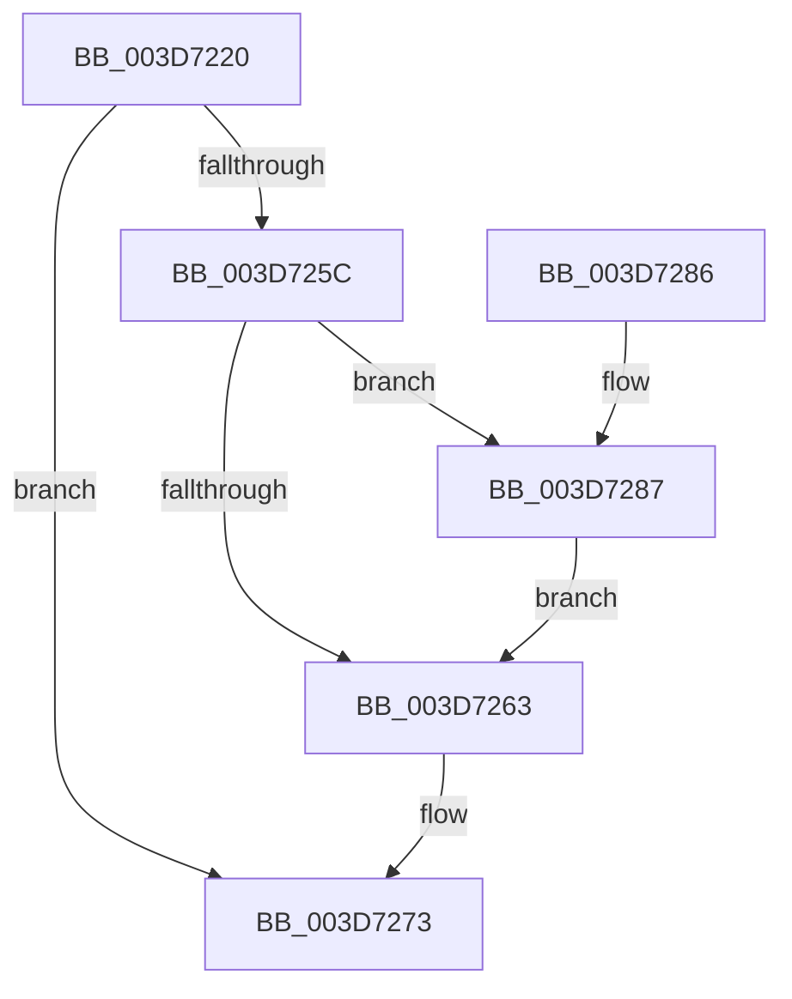

# RtlInitializeExtendedContext

- RVA: `0x003D7220`–`0x003D7299` (길이 `121` bytes)
- VA: `0x00000001403D7220`
- 실행 섹션: `.text`
- PDB 이름 있음: `예`; PDB Function 태그: `아니요`
- unwind 정보 RVA: `0x00093BD8`
- 디코드: `38`개 명령, `121/121` bytes 표시
- 미해석 바이트: `0` (있으면 어셈블리에 `.byte`로 보존)

> 이 문서는 커널 이미지의 기계어와 PDB 기호를 분석해 생성했습니다. 4번과 5번은 함수 원형과 자료형을 바이너리 사용 방식에서 추정한 C 해석이며 원본 소스 복구 결과는 아닙니다.

## 1. Dependencies

- 직접 호출 지점: **2**; 고유 호출 대상: **2**
- 직접 호출자로 확인된 함수: **6**
- RIP 상대 이미지 참조: **0**

### Outgoing calls
- `0x003D7253` → [RtlpValidateContextFlags2](../4E/RtlpValidateContextFlags2_function_004EF138.md) (function, `0x004EF138`)
- `0x003D726E` → [RtlInitializeExtendedContext2](../2F/RtlInitializeExtendedContext2_function_002F5D40.md) (function, `0x002F5D40`)

### Direct callers
- [RtlUnwindEx](../2F/RtlUnwindEx_function_002F2830.md) at `0x002F2D61`
- [KyRaiseException](KyRaiseException_function_003D5E20.md) at `0x003D5EFC`
- [KiUnwindUserSspForApcContextCopyBypass](KiUnwindUserSspForApcContextCopyBypass_function_003D6F0C.md) at `0x003D6FB0`
- [PspSetContextState](../../page/78/PspSetContextState_function_00789FBC.md) at `0x0078A028`
- [PspSetContextThreadInternal](../../page/8D/PspSetContextThreadInternal_function_008D4420.md) at `0x008D4640`
- [PspGetContextThreadInternal](../../page/8D/PspGetContextThreadInternal_function_008D4770.md) at `0x008D49D0`

### Static image references
- 디코드된 RIP-relative 메모리 참조가 없습니다.

## 2. Other-region calls and transfers

- 다른 실행 섹션으로 향하는 call: **0**
- 별도 외부 분기/꼬리 이동을 확인하지 못했습니다.

## 3. Assembly (complete function range)

```asm
003D7220  48 8B C4                        mov rax, rsp
003D7223  48 89 58 08                     mov qword ptr [rax + 8], rbx
003D7227  48 89 68 10                     mov qword ptr [rax + 0x10], rbp
003D722B  56                              push rsi
003D722C  57                              push rdi
003D722D  41 56                           push r14
003D722F  48 83 EC 20                     sub rsp, 0x20
003D7233  8B FA                           mov edi, edx
003D7235  49 8B F0                        mov rsi, r8
003D7238  48 8B E9                        mov rbp, rcx
003D723B  48 8D 50 20                     lea rdx, [rax + 0x20]
003D723F  49 BE D8 03 00 00 80 F7 FF FF   movabs r14, 0xfffff780000003d8
003D7249  33 DB                           xor ebx, ebx
003D724B  4D 8B C6                        mov r8, r14
003D724E  89 58 20                        mov dword ptr [rax + 0x20], ebx
003D7251  8B CF                           mov ecx, edi
003D7253  E8 E0 7E 11 00                  call 0x1404ef138
003D7258  85 C0                           test eax, eax
003D725A  78 17                           js 0x1403d7273
003D725C  F6 44 24 58 02                  test byte ptr [rsp + 0x58], 2
003D7261  75 24                           jne 0x1403d7287
003D7263  4C 8B CB                        mov r9, rbx
003D7266  4C 8B C6                        mov r8, rsi
003D7269  8B D7                           mov edx, edi
003D726B  48 8B CD                        mov rcx, rbp
003D726E  E8 CD EA F1 FF                  call 0x1402f5d40
003D7273  48 8B 5C 24 40                  mov rbx, qword ptr [rsp + 0x40]
003D7278  48 8B 6C 24 48                  mov rbp, qword ptr [rsp + 0x48]
003D727D  48 83 C4 20                     add rsp, 0x20
003D7281  41 5E                           pop r14
003D7283  5F                              pop rdi
003D7284  5E                              pop rsi
003D7285  C3                              ret
003D7286  CC                              int3
003D7287  48 BB 08 07 00 00 80 F7 FF FF   movabs rbx, 0xfffff78000000708
003D7291  48 8B 1B                        mov rbx, qword ptr [rbx]
003D7294  49 0B 1E                        or rbx, qword ptr [r14]
003D7297  EB CA                           jmp 0x1403d7263
```

## 4. C-style interpretation (structured pseudocode)

```c
__int64 __fastcall RtlInitializeExtendedContext(__int64 a1, int a2, __int64 a3)
{
    __int64 result;
    __int64 v_rbx;
    __int64 v_rsp;
    unsigned __int64 v_stack_p10;
    unsigned __int8 v_stack_p20;
    unsigned __int64 v_stack_p8;

    *(unsigned __int64 *)(v_rsp + 8) = v_rbx;
    *(unsigned __int64 *)(v_rsp + 16) = v_rbp;
    v_rsp = (v_rsp) - (32);
    v_rbx = 0;
    *(unsigned int *)(v_rsp + 32) = 0;
    result = RtlpValidateContextFlags2((unsigned int)((unsigned int)((unsigned int)(a2))), v_rsp + 32, v_r14, a4);
    if (sign_flag) goto loc_003D7273;
    if (((v_stack_p20) & (2)) != 0) goto loc_003D7287;
loc_003D7263:
    result = RtlInitializeExtendedContext2(a1, (unsigned int)((unsigned int)((unsigned int)(a2))), a3, 0);
loc_003D7273:
    v_rsp = (v_rsp) + (32);
    return result;
loc_003D7287:
    v_rbx = (*(unsigned __int64 *)(v_stack_p8)) | (*(unsigned __int64 *)(v_r14));
    goto loc_003D7263;
}
```

## 5. (Beta) C Style

```c
int64_t RtlInitializeExtendedContext(int64_t Arg1, int32_t Arg2, int64_t Arg3)
{
    int64_t result;
    int64_t local_rbx;
    int64_t local_rsp;
    uint64_t v_stack_p10;
    uint8_t v_stack_p20;
    uint64_t v_stack_p8;

    *(uint64_t *)(local_rsp + 0x8) = local_rbx;
    *(uint64_t *)(local_rsp + 0x10) = local_rbp;
    local_rsp = (local_rsp) - (32);
    local_rbx = 0;
    *(uint32_t *)(local_rsp + 0x20) = 0;
    result = RtlpValidateContextFlags2((uint32_t)((uint32_t)((uint32_t)(Arg2))), local_rsp + 32, local_r14, a4);
    if (sign_flag) goto loc_003D7273;
    if (((v_stack_p20) & (2)) != 0) goto loc_003D7287;
loc_003D7263:
    result = RtlInitializeExtendedContext2(Arg1, (uint32_t)((uint32_t)((uint32_t)(Arg2))), Arg3, 0);
loc_003D7273:
    local_rsp = (local_rsp) + (32);
    return result;
loc_003D7287:
    local_rbx = (*(uint64_t *)(v_stack_p8)) | (*(uint64_t *)(local_r14));
    goto loc_003D7263;
}
```

## 6. Execution-region graph

[열기: 2D/3D 그래프와 함수 탐색 컨트롤 패널](../../../control-panel.html?section=text&rva=0x003D7220&view=graph)

- 2D 그래프는 위에서 아래로 흐르고, 3D 그래프는 빈 공간을 드래그해 회전합니다. Shift+드래그는 이동, 휠은 확대·축소, 함수 노드 선택은 대상 보고서 이동입니다.

### Static fallback


