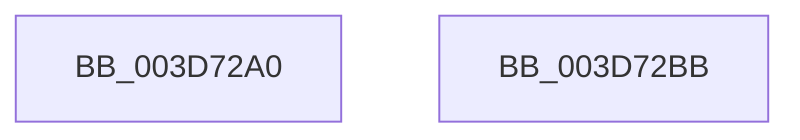

# RtlLocateExtendedFeature

- RVA: `0x003D72A0`–`0x003D72BC` (길이 `28` bytes)
- VA: `0x00000001403D72A0`
- 실행 섹션: `.text`
- PDB 이름 있음: `예`; PDB Function 태그: `아니요`
- unwind 정보 RVA: `0x0005C788`
- 디코드: `7`개 명령, `28/28` bytes 표시
- 미해석 바이트: `0` (있으면 어셈블리에 `.byte`로 보존)

> 이 문서는 커널 이미지의 기계어와 PDB 기호를 분석해 생성했습니다. 4번과 5번은 함수 원형과 자료형을 바이너리 사용 방식에서 추정한 C 해석이며 원본 소스 복구 결과는 아닙니다.

## 1. Dependencies

- 직접 호출 지점: **1**; 고유 호출 대상: **1**
- 직접 호출자로 확인된 함수: **4**
- RIP 상대 이미지 참조: **0**

### Outgoing calls
- `0x003D72B1` → [RtlLocateExtendedFeature2](../2F/RtlLocateExtendedFeature2_function_002F82F0.md) (function, `0x002F82F0`)

### Direct callers
- [KiInitializeContextThread](KiInitializeContextThread_function_003D6400.md) at `0x003D67C6`
- [KiUnwindUserSspForApcContextCopyBypass](KiUnwindUserSspForApcContextCopyBypass_function_003D6F0C.md) at `0x003D6FE1`
- [PspSetupUserShadowStack](../../page/88/PspSetupUserShadowStack_function_008825D4.md) at `0x008826F5`
- [sub_00B30C5A](../../page/B3/Unknown_function_00B30C5A.md) at `0x00B30F19`

### Static image references
- 디코드된 RIP-relative 메모리 참조가 없습니다.

## 2. Other-region calls and transfers

- 다른 실행 섹션으로 향하는 call: **0**
- 별도 외부 분기/꼬리 이동을 확인하지 못했습니다.

## 3. Assembly (complete function range)

```asm
003D72A0  48 83 EC 28                     sub rsp, 0x28
003D72A4  4D 8B C8                        mov r9, r8
003D72A7  49 B8 D8 03 00 00 80 F7 FF FF   movabs r8, 0xfffff780000003d8
003D72B1  E8 3A 10 F2 FF                  call 0x1402f82f0
003D72B6  48 83 C4 28                     add rsp, 0x28
003D72BA  C3                              ret
003D72BB  CC                              int3
```

## 4. C-style interpretation (structured pseudocode)

```c
__int64 __fastcall RtlLocateExtendedFeature(__int64 a1, __int64 a2, __int64 a3)
{
    __int64 result;
    __int64 v_rsp;

    v_rsp = (v_rsp) - (40);
    result = RtlLocateExtendedFeature2(a1, a2, a3, a3);
    v_rsp = (v_rsp) + (40);
    return result;
}
```

## 5. (Beta) C Style

```c
int64_t RtlLocateExtendedFeature(int64_t Arg1, int64_t Arg2, int64_t Arg3)
{
    int64_t result;
    int64_t local_rsp;

    local_rsp = (local_rsp) - (40);
    result = RtlLocateExtendedFeature2(Arg1, Arg2, Arg3, Arg3);
    local_rsp = (local_rsp) + (40);
    return result;
}
```

## 6. Execution-region graph

[열기: 2D/3D 그래프와 함수 탐색 컨트롤 패널](../../../control-panel.html?section=text&rva=0x003D72A0&view=graph)

- 2D 그래프는 위에서 아래로 흐르고, 3D 그래프는 빈 공간을 드래그해 회전합니다. Shift+드래그는 이동, 휠은 확대·축소, 함수 노드 선택은 대상 보고서 이동입니다.

### Static fallback


