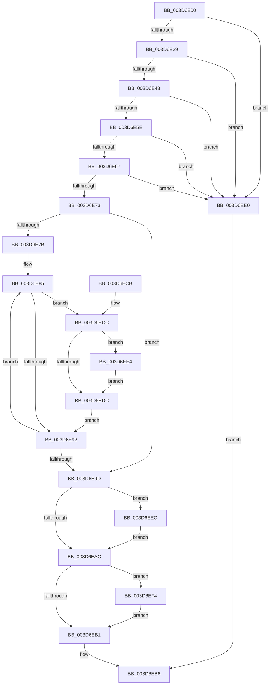

# RtlLocateSupervisorFeature

- RVA: `0x003D6E00`–`0x003D6F06` (길이 `262` bytes)
- VA: `0x00000001403D6E00`
- 실행 섹션: `.text`
- PDB 이름 있음: `예`; PDB Function 태그: `아니요`
- unwind 정보 RVA: `0x00093B74`
- 디코드: `70`개 명령, `262/262` bytes 표시
- 미해석 바이트: `0` (있으면 어셈블리에 `.byte`로 보존)

> 이 문서는 커널 이미지의 기계어와 PDB 기호를 분석해 생성했습니다. 4번과 5번은 함수 원형과 자료형을 바이너리 사용 방식에서 추정한 C 해석이며 원본 소스 복구 결과는 아닙니다.

## 1. Dependencies

- 직접 호출 지점: **0**; 고유 호출 대상: **0**
- 직접 호출자로 확인된 함수: **2**
- RIP 상대 이미지 참조: **0**

### Outgoing calls
- 직접 디코드된 call 명령이 없습니다.

### Direct callers
- [KiInitializeContextThread](KiInitializeContextThread_function_003D6400.md) at `0x003D67DC`
- [KiInitializeContextThread](KiInitializeContextThread_function_003D6400.md) at `0x003D683B`
- [KiGetSavedIptState](../5B/KiGetSavedIptState_function_005B9E50.md) at `0x005B9EB3`

### Static image references
- 디코드된 RIP-relative 메모리 참조가 없습니다.

## 2. Other-region calls and transfers

- 다른 실행 섹션으로 향하는 call: **0**
- 별도 외부 분기/꼬리 이동을 확인하지 못했습니다.

## 3. Assembly (complete function range)

```asm
003D6E00  48 8B C4                        mov rax, rsp
003D6E03  48 89 58 08                     mov qword ptr [rax + 8], rbx
003D6E07  48 89 68 10                     mov qword ptr [rax + 0x10], rbp
003D6E0B  48 89 70 18                     mov qword ptr [rax + 0x18], rsi
003D6E0F  48 89 78 20                     mov qword ptr [rax + 0x20], rdi
003D6E13  44 8B CA                        mov r9d, edx
003D6E16  49 8B D8                        mov rbx, r8
003D6E19  4C 8B D9                        mov r11, rcx
003D6E1C  41 8D 41 FE                     lea eax, [r9 - 2]
003D6E20  83 F8 3D                        cmp eax, 0x3d
003D6E23  0F 87 B7 00 00 00               ja 0x1403d6ee0
003D6E29  48 A1 F0 05 00 00 80 F7 FF FF   movabs rax, qword ptr [0xfffff780000005f0]
003D6E33  41 8B C9                        mov ecx, r9d
003D6E36  41 BA 01 00 00 00               mov r10d, 1
003D6E3C  49 D3 E2                        shl r10, cl
003D6E3F  49 85 C2                        test r10, rax
003D6E42  0F 84 98 00 00 00               je 0x1403d6ee0
003D6E48  A1 EC 03 00 00 80 F7 FF FF      movabs eax, dword ptr [0xfffff780000003ec]
003D6E51  B9 02 00 00 00                  mov ecx, 2
003D6E56  84 C1                           test cl, al
003D6E58  0F 84 82 00 00 00               je 0x1403d6ee0
003D6E5E  4D 8B 43 08                     mov r8, qword ptr [r11 + 8]
003D6E62  4D 85 C0                        test r8, r8
003D6E65  79 79                           jns 0x1403d6ee0
003D6E67  49 8B 03                        mov rax, qword ptr [r11]
003D6E6A  49 23 C0                        and rax, r8
003D6E6D  4C 0F A3 C8                     bt rax, r9
003D6E71  73 6D                           jae 0x1403d6ee0
003D6E73  8D 51 3E                        lea edx, [rcx + 0x3e]
003D6E76  44 3B C9                        cmp r9d, ecx
003D6E79  76 22                           jbe 0x1403d6e9d
003D6E7B  48 B8 0C 06 00 00 80 F7 FF FF   movabs rax, 0xfffff7800000060c
003D6E85  BF 01 00 00 00                  mov edi, 1
003D6E8A  48 D3 E7                        shl rdi, cl
003D6E8D  49 85 F8                        test r8, rdi
003D6E90  75 3A                           jne 0x1403d6ecc
003D6E92  FF C1                           inc ecx
003D6E94  48 83 C0 04                     add rax, 4
003D6E98  41 3B C9                        cmp ecx, r9d
003D6E9B  72 E8                           jb 0x1403d6e85
003D6E9D  48 A1 F8 05 00 00 80 F7 FF FF   movabs rax, qword ptr [0xfffff780000005f8]
003D6EA7  49 85 C2                        test r10, rax
003D6EAA  75 40                           jne 0x1403d6eec
003D6EAC  48 85 DB                        test rbx, rbx
003D6EAF  75 43                           jne 0x1403d6ef4
003D6EB1  8B C2                           mov eax, edx
003D6EB3  49 03 C3                        add rax, r11
003D6EB6  48 8B 5C 24 08                  mov rbx, qword ptr [rsp + 8]
003D6EBB  48 8B 6C 24 10                  mov rbp, qword ptr [rsp + 0x10]
003D6EC0  48 8B 74 24 18                  mov rsi, qword ptr [rsp + 0x18]
003D6EC5  48 8B 7C 24 20                  mov rdi, qword ptr [rsp + 0x20]
003D6ECA  C3                              ret
003D6ECB  CC                              int3
003D6ECC  48 BD F8 05 00 00 80 F7 FF FF   movabs rbp, 0xfffff780000005f8
003D6ED6  48 85 7D 00                     test qword ptr [rbp], rdi
003D6EDA  75 08                           jne 0x1403d6ee4
003D6EDC  03 10                           add edx, dword ptr [rax]
003D6EDE  EB B2                           jmp 0x1403d6e92
003D6EE0  33 C0                           xor eax, eax
003D6EE2  EB D2                           jmp 0x1403d6eb6
003D6EE4  83 C2 3F                        add edx, 0x3f
003D6EE7  83 E2 C0                        and edx, 0xffffffc0
003D6EEA  EB F0                           jmp 0x1403d6edc
003D6EEC  83 C2 3F                        add edx, 0x3f
003D6EEF  83 E2 C0                        and edx, 0xffffffc0
003D6EF2  EB B8                           jmp 0x1403d6eac
003D6EF4  48 B8 04 06 00 00 80 F7 FF FF   movabs rax, 0xfffff78000000604
003D6EFE  42 8B 04 88                     mov eax, dword ptr [rax + r9*4]
003D6F02  89 03                           mov dword ptr [rbx], eax
003D6F04  EB AB                           jmp 0x1403d6eb1
```

## 4. C-style interpretation (structured pseudocode)

```c
__int64 __fastcall RtlLocateSupervisorFeature(__int64 a1, int a2, __int64 a3)
{
    __int64 result;
    __int64 v_r10;
    __int64 v_rdi;
    unsigned __int64 v_stack_p10;
    unsigned __int64 v_stack_p18;
    unsigned __int64 v_stack_p20;
    unsigned __int64 v_stack_p8;

    *(unsigned __int64 *)(v_rsp + 8) = v_rbx;
    *(unsigned __int64 *)(v_rsp + 16) = v_rbp;
    *(unsigned __int64 *)(v_rsp + 24) = v_rsi;
    *(unsigned __int64 *)(v_rsp + 32) = v_rdi;
    if (((unsigned int)((unsigned int)(a2) - 2)) > 61) goto loc_003D6EE0;
    v_r10 = (1) << ((unsigned __int8)((unsigned int)((unsigned int)((unsigned int)(a2)))));
    if (((v_r10) & ((unsigned int)(a2) - 2)) == 0) goto loc_003D6EE0;
    if (((2) & ((unsigned __int8)((unsigned int)(a2) - 2))) == 0) goto loc_003D6EE0;
    if (!sign_flag) goto loc_003D6EE0;
    result = (*(unsigned __int64 *)(a1)) & (*(unsigned __int64 *)(a1 + 8));
    if (condition_is_above_or_equal) goto loc_003D6EE0;
    if (((unsigned int)((unsigned int)(a2))) <= 2) goto loc_003D6E9D;
loc_003D6E85:
    v_rdi = (1) << (2);
    if (((*(unsigned __int64 *)(a1 + 8)) & (v_rdi)) != 0) goto loc_003D6ECC;
loc_003D6E92:
    a1 = (unsigned int)((2) + 1);
    result = (result) + (4);
    if (((unsigned int)(a1)) < ((unsigned int)((unsigned int)(a2)))) goto loc_003D6E85;
loc_003D6E9D:
    if (((v_r10) & (result)) != 0) goto loc_003D6EEC;
loc_003D6EAC:
    if (a3 != 0) goto loc_003D6EF4;
loc_003D6EB1:
    result = ((unsigned int)((unsigned int)(2 + 62))) + (a1);
loc_003D6EB6:
    return result;
loc_003D6ECC:
    if (((*(unsigned __int64 *)(v_stack_p10)) & (v_stack_p20)) != 0) goto loc_003D6EE4;
loc_003D6EDC:
    a2 = (unsigned int)((2 + 62) + (*(unsigned int *)(result)));
    goto loc_003D6E92;
loc_003D6EE0:
    result = 0;
    goto loc_003D6EB6;
loc_003D6EE4:
    a2 = (unsigned int)((a2) + (63));
    a2 = (unsigned int)((a2) & (0xFFFFFFC0ULL));
    goto loc_003D6EDC;
loc_003D6EEC:
    a2 = (unsigned int)((a2) + (63));
    a2 = (unsigned int)((a2) & (0xFFFFFFC0ULL));
    goto loc_003D6EAC;
loc_003D6EF4:
    *(unsigned int *)(v_stack_p8) = (unsigned int)((unsigned int)(*(unsigned int *)(result + (unsigned int)(a2) * 4)));
    goto loc_003D6EB1;
}
```

## 5. (Beta) C Style

```c
int64_t RtlLocateSupervisorFeature(void *Arg1, void *Arg2, int64_t Arg3)
{
    uint8_t *arg1 = (uint8_t *)Arg1;
    uint8_t *arg2 = (uint8_t *)Arg2;

    int64_t result;
    int64_t local_r10;
    int64_t local_rdi;
    uint64_t v_stack_p10;
    uint64_t v_stack_p18;
    uint64_t v_stack_p20;
    uint64_t v_stack_p8;

    *(uint64_t *)(local_rsp + 0x8) = local_rbx;
    *(uint64_t *)(local_rsp + 0x10) = local_rbp;
    *(uint64_t *)(local_rsp + 0x18) = local_rsi;
    *(uint64_t *)(local_rsp + 0x20) = local_rdi;
    if (((uint32_t)((uint32_t)(Arg2) - 2)) > 61) goto loc_003D6EE0;
    local_r10 = (1) << ((uint8_t)((uint32_t)((uint32_t)((uint32_t)(Arg2)))));
    if (((local_r10) & ((uint32_t)(Arg2) - 2)) == 0) goto loc_003D6EE0;
    if (((2) & ((uint8_t)((uint32_t)(Arg2) - 2))) == 0) goto loc_003D6EE0;
    if (!sign_flag) goto loc_003D6EE0;
    result = (*(uint64_t *)(arg1)) & (*(uint64_t *)(arg1 + 0x8));
    if (condition_is_above_or_equal) goto loc_003D6EE0;
    if (((uint32_t)((uint32_t)(Arg2))) <= 2) goto loc_003D6E9D;
loc_003D6E85:
    local_rdi = (1) << (2);
    if (((*(uint64_t *)(arg1 + 0x8)) & (local_rdi)) != 0) goto loc_003D6ECC;
loc_003D6E92:
    Arg1 = (uint32_t)((2) + 1);
    result = (result) + (4);
    if (((uint32_t)(Arg1)) < ((uint32_t)((uint32_t)(Arg2)))) goto loc_003D6E85;
loc_003D6E9D:
    if (((local_r10) & (result)) != 0) goto loc_003D6EEC;
loc_003D6EAC:
    if (Arg3 != 0) goto loc_003D6EF4;
loc_003D6EB1:
    result = ((uint32_t)((uint32_t)(2 + 62))) + (Arg1);
loc_003D6EB6:
    return result;
loc_003D6ECC:
    if (((*(uint64_t *)(v_stack_p10)) & (v_stack_p20)) != 0) goto loc_003D6EE4;
loc_003D6EDC:
    Arg2 = (uint32_t)((2 + 62) + (*(uint32_t *)(result)));
    goto loc_003D6E92;
loc_003D6EE0:
    result = 0;
    goto loc_003D6EB6;
loc_003D6EE4:
    Arg2 = (uint32_t)((Arg2) + (63));
    Arg2 = (uint32_t)((Arg2) & (0xFFFFFFC0ULL));
    goto loc_003D6EDC;
loc_003D6EEC:
    Arg2 = (uint32_t)((Arg2) + (63));
    Arg2 = (uint32_t)((Arg2) & (0xFFFFFFC0ULL));
    goto loc_003D6EAC;
loc_003D6EF4:
    *(uint32_t *)(v_stack_p8) = (uint32_t)((uint32_t)(*(uint32_t *)(result + (uint32_t)(arg2) * 4)));
    goto loc_003D6EB1;
}
```

### 관측된 메모리 오프셋

구조체 형식이 확인되지 않은 접근은 인자 기준의 오프셋으로만 기록했습니다.

| 기준 인자 | 오프셋 표현 | 폭 (bit) | 접근 |
|---|---:|---:|---|
| `Arg1` | `+ 0x0` | `64` | `R` |
| `Arg1` | `+ 0x8` | `64` | `R` |
| `Arg2` | `- 0x2` | `32` | `R` |

## 6. Execution-region graph

[열기: 2D/3D 그래프와 함수 탐색 컨트롤 패널](../../../control-panel.html?section=text&rva=0x003D6E00&view=graph)

- 2D 그래프는 위에서 아래로 흐르고, 3D 그래프는 빈 공간을 드래그해 회전합니다. Shift+드래그는 이동, 휠은 확대·축소, 함수 노드 선택은 대상 보고서 이동입니다.

### Static fallback


