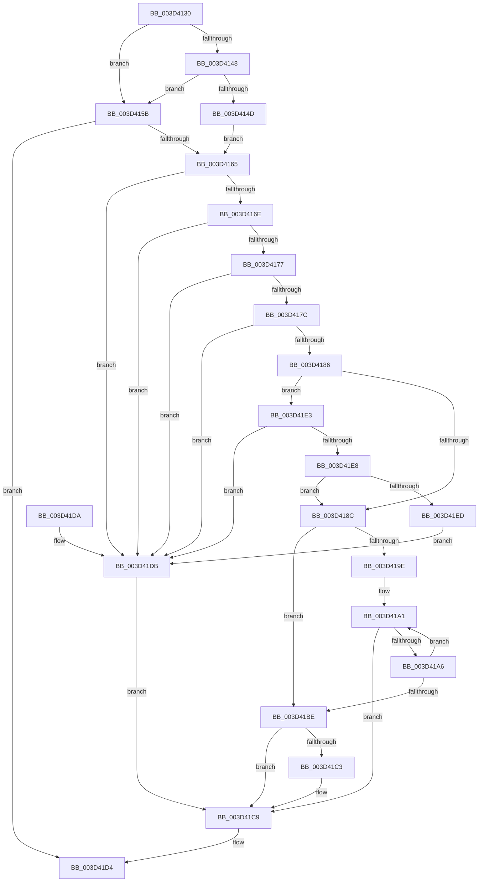

# RtlUnicodeStringCopy

- RVA: `0x003D4130`–`0x003D41EF` (길이 `191` bytes)
- VA: `0x00000001403D4130`
- 실행 섹션: `.text`
- PDB 이름 있음: `예`; PDB Function 태그: `아니요`
- unwind 정보 RVA: `0x00060A68`
- 디코드: `64`개 명령, `191/191` bytes 표시
- 미해석 바이트: `0` (있으면 어셈블리에 `.byte`로 보존)

> 이 문서는 커널 이미지의 기계어와 PDB 기호를 분석해 생성했습니다. 4번과 5번은 함수 원형과 자료형을 바이너리 사용 방식에서 추정한 C 해석이며 원본 소스 복구 결과는 아닙니다.

## 1. Dependencies

- 직접 호출 지점: **1**; 고유 호출 대상: **1**
- 직접 호출자로 확인된 함수: **16**
- RIP 상대 이미지 참조: **0**

### Outgoing calls
- `0x003D413C` → [RtlUnicodeStringValidateWorker](RtlUnicodeStringValidateWorker_function_003D41F8.md) (function, `0x003D41F8`)

### Direct callers
- [SleepstudyHelperSetBlockerFriendlyName](SleepstudyHelperSetBlockerFriendlyName_function_003D4050.md) at `0x003D40AD`
- [sub_005AB009](../5A/Unknown_function_005AB009.md) at `0x005AB02C`
- [KiAllocatePrcbThread](../5B/KiAllocatePrcbThread_function_005B9130.md) at `0x005B9339`
- [SshpCopyDataEntry](../5E/SshpCopyDataEntry_function_005E1E10.md) at `0x005E1E62`
- [ExpAcquirePrmInterface](../../page/7C/ExpAcquirePrmInterface_function_007CECA8.md) at `0x007CED3E`
- [ExpPrivatePoolCreate](../../page/7D/ExpPrivatePoolCreate_function_007D5F98.md) at `0x007D60A2`
- [MiConstructNonRetpolineImageLoadRecord](../../page/80/MiConstructNonRetpolineImageLoadRecord_function_008014C0.md) at `0x00801511`
- [AslpPathWildcardAllocMatchNode](../../page/81/AslpPathWildcardAllocMatchNode_function_0081C620.md) at `0x0081C727`
- [sub_00857864](../../page/85/Unknown_function_00857864.md) at `0x0085787F`
- [CmpLinkHiveToMaster](../../page/87/CmpLinkHiveToMaster_function_00877D6C.md) at `0x00877FBF`
- [CmpLogTransactionAbortedWithChildName](../../page/9A/CmpLogTransactionAbortedWithChildName_function_009AED70.md) at `0x009AEE31`
- [SleepstudyHelper_GetPdoFriendlyName](../../page/A2/SleepstudyHelper_GetPdoFriendlyName_function_00A2D570.md) at `0x00A2D5CE`
- [PopUnicodeStringDeepCopy](../../page/A2/PopUnicodeStringDeepCopy_function_00A2E6B8.md) at `0x00A2E72E`
- [CmpVEExecuteVirtualStoreParseLogic](../../page/A7/CmpVEExecuteVirtualStoreParseLogic_function_00A76A20.md) at `0x00A76AF3`
- [sub_00B24EA0](../../page/B2/Unknown_function_00B24EA0.md) at `0x00B24EBA`
- [sub_00B49CA4](../../page/B4/Unknown_function_00B49CA4.md) at `0x00B49CDB`

### Static image references
- 디코드된 RIP-relative 메모리 참조가 없습니다.

## 2. Other-region calls and transfers

- 다른 실행 섹션으로 향하는 call: **0**
- 별도 외부 분기/꼬리 이동을 확인하지 못했습니다.

## 3. Assembly (complete function range)

```asm
003D4130  40 53                           push rbx
003D4132  48 83 EC 20                     sub rsp, 0x20
003D4136  4C 8B DA                        mov r11, rdx
003D4139  48 8B D9                        mov rbx, rcx
003D413C  E8 B7 00 00 00                  call 0x1403d41f8
003D4141  45 33 C9                        xor r9d, r9d
003D4144  85 C0                           test eax, eax
003D4146  78 13                           js 0x1403d415b
003D4148  48 85 C9                        test rcx, rcx
003D414B  74 0E                           je 0x1403d415b
003D414D  44 0F B7 41 02                  movzx r8d, word ptr [rcx + 2]
003D4152  4C 8B 51 08                     mov r10, qword ptr [rcx + 8]
003D4156  49 D1 E8                        shr r8, 1
003D4159  EB 0A                           jmp 0x1403d4165
003D415B  4D 8B D1                        mov r10, r9
003D415E  4D 8B C1                        mov r8, r9
003D4161  85 C0                           test eax, eax
003D4163  78 6F                           js 0x1403d41d4
003D4165  41 0F B7 0B                     movzx ecx, word ptr [r11]
003D4169  F6 C1 01                        test cl, 1
003D416C  75 6D                           jne 0x1403d41db
003D416E  41 0F B7 43 02                  movzx eax, word ptr [r11 + 2]
003D4173  A8 01                           test al, 1
003D4175  75 64                           jne 0x1403d41db
003D4177  66 3B C8                        cmp cx, ax
003D417A  77 5F                           ja 0x1403d41db
003D417C  BA FE FF 00 00                  mov edx, 0xfffe
003D4181  66 3B C2                        cmp ax, dx
003D4184  77 55                           ja 0x1403d41db
003D4186  4D 39 4B 08                     cmp qword ptr [r11 + 8], r9
003D418A  74 57                           je 0x1403d41e3
003D418C  49 8B 43 08                     mov rax, qword ptr [r11 + 8]
003D4190  48 8B D1                        mov rdx, rcx
003D4193  48 D1 EA                        shr rdx, 1
003D4196  45 8B D9                        mov r11d, r9d
003D4199  4D 85 C0                        test r8, r8
003D419C  74 20                           je 0x1403d41be
003D419E  4C 2B D0                        sub r10, rax
003D41A1  48 85 D2                        test rdx, rdx
003D41A4  74 23                           je 0x1403d41c9
003D41A6  0F B7 08                        movzx ecx, word ptr [rax]
003D41A9  48 FF CA                        dec rdx
003D41AC  66 41 89 0C 02                  mov word ptr [r10 + rax], cx
003D41B1  49 FF C1                        inc r9
003D41B4  48 83 C0 02                     add rax, 2
003D41B8  49 83 E8 01                     sub r8, 1
003D41BC  75 E3                           jne 0x1403d41a1
003D41BE  48 85 D2                        test rdx, rdx
003D41C1  74 06                           je 0x1403d41c9
003D41C3  41 BB 05 00 00 80               mov r11d, 0x80000005
003D41C9  66 45 03 C9                     add r9w, r9w
003D41CD  41 8B C3                        mov eax, r11d
003D41D0  66 44 89 0B                     mov word ptr [rbx], r9w
003D41D4  48 83 C4 20                     add rsp, 0x20
003D41D8  5B                              pop rbx
003D41D9  C3                              ret
003D41DA  CC                              int3
003D41DB  41 BB 0D 00 00 C0               mov r11d, 0xc000000d
003D41E1  EB E6                           jmp 0x1403d41c9
003D41E3  66 85 C9                        test cx, cx
003D41E6  75 F3                           jne 0x1403d41db
003D41E8  66 85 C0                        test ax, ax
003D41EB  74 9F                           je 0x1403d418c
003D41ED  EB EC                           jmp 0x1403d41db
```

## 4. C-style interpretation (structured pseudocode)

```c
__int64 __fastcall RtlUnicodeStringCopy(__int64 a1, __int64 a2, __int64 a3, int a4)
{
    __int64 result;
    __int64 v_r10;
    __int64 v_r11;
    __int64 v_rsp;

    v_rsp = (v_rsp) - (32);
    result = RtlUnicodeStringValidateWorker(a1, a2, a3, a4);
    a4 = 0;
    if (sign_flag) goto loc_003D415B;
    if (a1 == 0) goto loc_003D415B;
    a3 = (*(unsigned __int16 *)(a1 + 2)) >> (1);
    goto loc_003D4165;
loc_003D415B:
    if (sign_flag) goto loc_003D41D4;
loc_003D4165:
    if ((((unsigned __int8)(*(unsigned __int16 *)(a2))) & (1)) != 0) goto loc_003D41DB;
    if ((((unsigned __int8)(*(unsigned __int16 *)(a2 + 2))) & (1)) != 0) goto loc_003D41DB;
    if (((unsigned __int16)(*(unsigned __int16 *)(a2))) > ((unsigned __int16)(*(unsigned __int16 *)(a2 + 2)))) goto loc_003D41DB;
    if (((unsigned __int16)(*(unsigned __int16 *)(a2 + 2))) > ((unsigned __int16)((unsigned int)(0xFFFEULL)))) goto loc_003D41DB;
    if ((*(unsigned __int64 *)(a2 + 8)) == 0) goto loc_003D41E3;
loc_003D418C:
    a2 = (*(unsigned __int16 *)(a2)) >> (1);
    if (0 == 0) goto loc_003D41BE;
    v_r10 = (0) - (*(unsigned __int64 *)(a2 + 8));
loc_003D41A1:
    if (a2 == 0) goto loc_003D41C9;
    a2 = (a2) - 1;
    *(unsigned __int16 *)(v_r10 + *(unsigned __int64 *)(a2 + 8) * 1) = (unsigned __int16)(*(unsigned __int16 *)(*(unsigned __int64 *)(a2 + 8)));
    a4 = (a4) + 1;
    result = (*(unsigned __int64 *)(a2 + 8)) + (2);
    a3 = (0) - (1);
    if (condition_is_not_equal) goto loc_003D41A1;
loc_003D41BE:
    v_r11 = 0;
    if (a2 != 0) {
        v_r11 = 0x80000005ULL;
    }
    a4 = (unsigned __int16)((a4) + ((unsigned __int16)(a4)));
    *(unsigned __int16 *)(a1) = (unsigned __int16)(a4);
loc_003D41D4:
    v_rsp = (v_rsp) + (32);
    return (unsigned int)((unsigned int)(v_r11));
loc_003D41DB:
    goto loc_003D41C9;
loc_003D41E3:
    if ((unsigned __int16)(*(unsigned __int16 *)(*(unsigned __int64 *)(a2 + 8))) != 0) goto loc_003D41DB;
    if ((unsigned __int16)((unsigned int)((unsigned int)(v_r11))) == 0) goto loc_003D418C;
    goto loc_003D41DB;
}
```

## 5. (Beta) C Style

```c
int64_t RtlUnicodeStringCopy(void *Arg1, int64_t Arg2, int64_t Arg3, int32_t Arg4)
{
    uint8_t *arg1 = (uint8_t *)Arg1;

    int64_t result;
    int64_t local_r10;
    int64_t local_r11;
    int64_t local_rsp;

    local_rsp = (local_rsp) - (32);
    result = RtlUnicodeStringValidateWorker(Arg1, Arg2, Arg3, Arg4);
    Arg4 = 0;
    if (sign_flag) goto loc_003D415B;
    if (Arg1 == NULL) goto loc_003D415B;
    Arg3 = (*(uint16_t *)(arg1 + 0x2)) >> (1);
    goto loc_003D4165;
loc_003D415B:
    if (sign_flag) goto loc_003D41D4;
loc_003D4165:
    if ((((uint8_t)(*(uint16_t *)(Arg2))) & (1)) != 0) goto loc_003D41DB;
    if ((((uint8_t)(*(uint16_t *)(Arg2 + 0x2))) & (1)) != 0) goto loc_003D41DB;
    if (((uint16_t)(*(uint16_t *)(Arg2))) > ((uint16_t)(*(uint16_t *)(Arg2 + 0x2)))) goto loc_003D41DB;
    if (((uint16_t)(*(uint16_t *)(Arg2 + 0x2))) > ((uint16_t)((uint32_t)(0xFFFEULL)))) goto loc_003D41DB;
    if ((*(uint64_t *)(Arg2 + 0x8)) == 0) goto loc_003D41E3;
loc_003D418C:
    Arg2 = (*(uint16_t *)(Arg2)) >> (1);
    if (0 == 0) goto loc_003D41BE;
    local_r10 = (0) - (*(uint64_t *)(Arg2 + 0x8));
loc_003D41A1:
    if (Arg2 == 0) goto loc_003D41C9;
    Arg2 = (Arg2) - 1;
    *(uint16_t *)(local_r10 + *(uint64_t *)(Arg2 + 0x8) * 1) = (uint16_t)(*(uint16_t *)(*(uint64_t *)(Arg2 + 0x8)));
    Arg4 = (Arg4) + 1;
    result = (*(uint64_t *)(Arg2 + 0x8)) + (2);
    Arg3 = (0) - (1);
    if (condition_is_not_equal) goto loc_003D41A1;
loc_003D41BE:
    local_r11 = 0;
    if (Arg2 != 0) {
        local_r11 = 0x80000005ULL;
    }
    Arg4 = (uint16_t)((Arg4) + ((uint16_t)(Arg4)));
    *(uint16_t *)(arg1) = (uint16_t)(Arg4);
loc_003D41D4:
    local_rsp = (local_rsp) + (32);
    return (uint32_t)((uint32_t)(local_r11));
loc_003D41DB:
    goto loc_003D41C9;
loc_003D41E3:
    if ((uint16_t)(*(uint16_t *)(*(uint64_t *)(Arg2 + 0x8))) != 0) goto loc_003D41DB;
    if ((uint16_t)((uint32_t)((uint32_t)(local_r11))) == 0) goto loc_003D418C;
    goto loc_003D41DB;
}
```

### 관측된 메모리 오프셋

구조체 형식이 확인되지 않은 접근은 인자 기준의 오프셋으로만 기록했습니다.

| 기준 인자 | 오프셋 표현 | 폭 (bit) | 접근 |
|---|---:|---:|---|
| `Arg1` | `+ 0x0` | `16` | `W` |

## 6. Execution-region graph

[열기: 2D/3D 그래프와 함수 탐색 컨트롤 패널](../../../control-panel.html?section=text&rva=0x003D4130&view=graph)

- 2D 그래프는 위에서 아래로 흐르고, 3D 그래프는 빈 공간을 드래그해 회전합니다. Shift+드래그는 이동, 휠은 확대·축소, 함수 노드 선택은 대상 보고서 이동입니다.

### Static fallback


