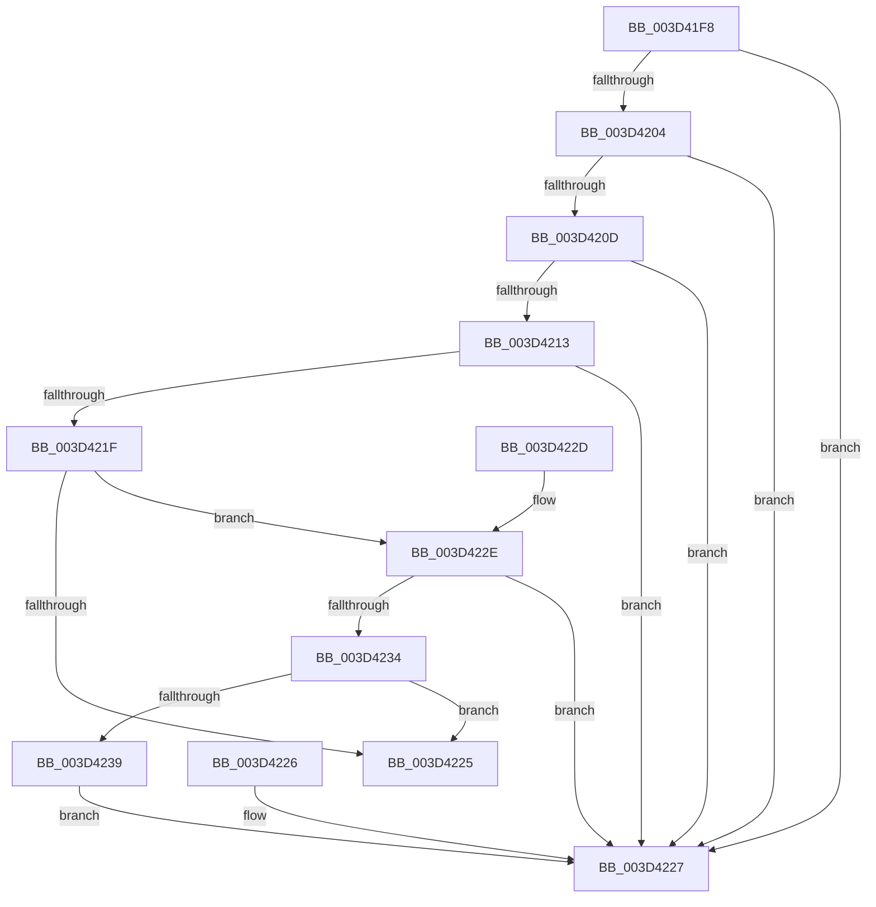

# RtlUnicodeStringValidateWorker

- RVA: `0x003D41F8`–`0x003D423B` (길이 `67` bytes)
- VA: `0x00000001403D41F8`
- 실행 섹션: `.text`
- PDB 이름 있음: `예`; PDB Function 태그: `예`
- unwind 정보 RVA: `0x000DB714`
- 디코드: `24`개 명령, `67/67` bytes 표시
- 미해석 바이트: `0` (있으면 어셈블리에 `.byte`로 보존)

> 이 문서는 커널 이미지의 기계어와 PDB 기호를 분석해 생성했습니다. 4번과 5번은 함수 원형과 자료형을 바이너리 사용 방식에서 추정한 C 해석이며 원본 소스 복구 결과는 아닙니다.

## 1. Dependencies

- 직접 호출 지점: **0**; 고유 호출 대상: **0**
- 직접 호출자로 확인된 함수: **3**
- RIP 상대 이미지 참조: **0**

### Outgoing calls
- 직접 디코드된 call 명령이 없습니다.

### Direct callers
- [RtlUnicodeStringCopy](RtlUnicodeStringCopy_function_003D4130.md) at `0x003D413C`
- [CmpGetSymbolicLinkTarget](../../page/85/CmpGetSymbolicLinkTarget_function_008570A0.md) at `0x00857345`
- [CmpGetSymbolicLinkTarget](../../page/85/CmpGetSymbolicLinkTarget_function_008570A0.md) at `0x0085735B`
- [sub_0094AD50](../../page/94/Unknown_function_0094AD50.md) at `0x0094ADED`
- [sub_0094AD50](../../page/94/Unknown_function_0094AD50.md) at `0x0094AE0A`

### Static image references
- 디코드된 RIP-relative 메모리 참조가 없습니다.

## 2. Other-region calls and transfers

- 다른 실행 섹션으로 향하는 call: **0**
- 별도 외부 분기/꼬리 이동을 확인하지 못했습니다.

## 3. Assembly (complete function range)

```asm
003D41F8  44 0F B7 01                     movzx r8d, word ptr [rcx]
003D41FC  33 C0                           xor eax, eax
003D41FE  41 F6 C0 01                     test r8b, 1
003D4202  75 23                           jne 0x1403d4227
003D4204  0F B7 51 02                     movzx edx, word ptr [rcx + 2]
003D4208  F6 C2 01                        test dl, 1
003D420B  75 1A                           jne 0x1403d4227
003D420D  66 44 3B C2                     cmp r8w, dx
003D4211  77 14                           ja 0x1403d4227
003D4213  41 B9 FE FF 00 00               mov r9d, 0xfffe
003D4219  66 41 3B D1                     cmp dx, r9w
003D421D  77 08                           ja 0x1403d4227
003D421F  48 39 41 08                     cmp qword ptr [rcx + 8], rax
003D4223  74 09                           je 0x1403d422e
003D4225  C3                              ret
003D4226  CC                              int3
003D4227  B8 0D 00 00 C0                  mov eax, 0xc000000d
003D422C  C3                              ret
003D422D  CC                              int3
003D422E  66 45 85 C0                     test r8w, r8w
003D4232  75 F3                           jne 0x1403d4227
003D4234  66 85 D2                        test dx, dx
003D4237  74 EC                           je 0x1403d4225
003D4239  EB EC                           jmp 0x1403d4227
```

## 4. C-style interpretation (structured pseudocode)

```c
__int64 __fastcall RtlUnicodeStringValidateWorker(__int64 a1)
{
    __int64 result;

    result = 0;
    if ((((unsigned __int8)(*(unsigned __int16 *)(a1))) & (1)) != 0) goto loc_003D4227;
    if ((((unsigned __int8)(*(unsigned __int16 *)(a1 + 2))) & (1)) != 0) goto loc_003D4227;
    if (((unsigned __int16)(*(unsigned __int16 *)(a1))) > ((unsigned __int16)(*(unsigned __int16 *)(a1 + 2)))) goto loc_003D4227;
    if (((unsigned __int16)(*(unsigned __int16 *)(a1 + 2))) > ((unsigned __int16)((unsigned int)(0xFFFEULL)))) goto loc_003D4227;
    if ((*(unsigned __int64 *)(a1 + 8)) == 0) goto loc_003D422E;
loc_003D4225:
    return result;
loc_003D4227:
    return (unsigned int)(0xC000000DULL);
loc_003D422E:
    if ((unsigned __int16)(*(unsigned __int16 *)(a1)) != 0) goto loc_003D4227;
    if ((unsigned __int16)(*(unsigned __int16 *)(a1 + 2)) == 0) goto loc_003D4225;
    goto loc_003D4227;
}
```

## 5. (Beta) C Style

```c
int64_t RtlUnicodeStringValidateWorker(void *Arg1)
{
    uint8_t *arg1 = (uint8_t *)Arg1;

    int64_t result;

    result = 0;
    if ((((uint8_t)(*(uint16_t *)(arg1))) & (1)) != 0) goto loc_003D4227;
    if ((((uint8_t)(*(uint16_t *)(arg1 + 0x2))) & (1)) != 0) goto loc_003D4227;
    if (((uint16_t)(*(uint16_t *)(arg1))) > ((uint16_t)(*(uint16_t *)(arg1 + 0x2)))) goto loc_003D4227;
    if (((uint16_t)(*(uint16_t *)(arg1 + 0x2))) > ((uint16_t)((uint32_t)(0xFFFEULL)))) goto loc_003D4227;
    if ((*(uint64_t *)(arg1 + 0x8)) == 0) goto loc_003D422E;
loc_003D4225:
    return result;
loc_003D4227:
    return (uint32_t)(0xC000000DULL);
loc_003D422E:
    if ((uint16_t)(*(uint16_t *)(arg1)) != 0) goto loc_003D4227;
    if ((uint16_t)(*(uint16_t *)(arg1 + 0x2)) == 0) goto loc_003D4225;
    goto loc_003D4227;
}
```

### 관측된 메모리 오프셋

구조체 형식이 확인되지 않은 접근은 인자 기준의 오프셋으로만 기록했습니다.

| 기준 인자 | 오프셋 표현 | 폭 (bit) | 접근 |
|---|---:|---:|---|
| `Arg1` | `+ 0x0` | `16` | `R` |
| `Arg1` | `+ 0x2` | `16` | `R` |
| `Arg1` | `+ 0x8` | `64` | `R` |

## 6. Execution-region graph

[열기: 2D/3D 그래프와 함수 탐색 컨트롤 패널](../../../control-panel.html?section=text&rva=0x003D41F8&view=graph)

- 2D 그래프는 위에서 아래로 흐르고, 3D 그래프는 빈 공간을 드래그해 회전합니다. Shift+드래그는 이동, 휠은 확대·축소, 함수 노드 선택은 대상 보고서 이동입니다.

### Static fallback


