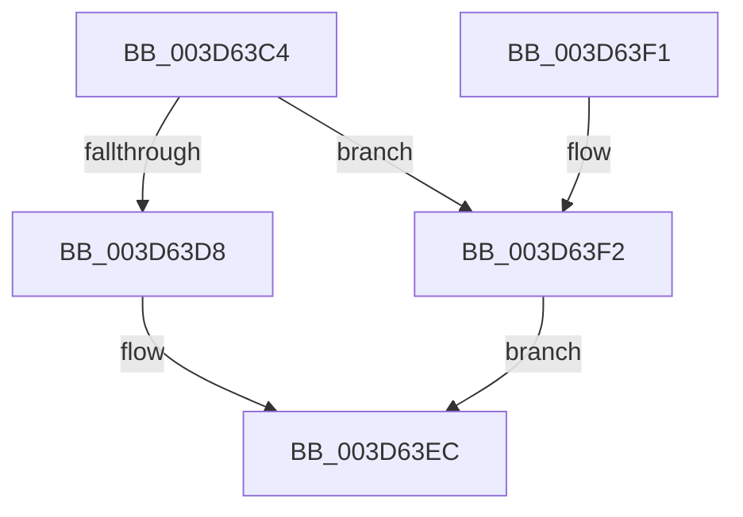

# RtlXRestoreS

- RVA: `0x003D63C4`–`0x003D63F9` (길이 `53` bytes)
- VA: `0x00000001403D63C4`
- 실행 섹션: `.text`
- PDB 이름 있음: `예`; PDB Function 태그: `아니요`
- unwind 정보 RVA: `0x0005CEE8`
- 디코드: `15`개 명령, `53/53` bytes 표시
- 미해석 바이트: `0` (있으면 어셈블리에 `.byte`로 보존)

> 이 문서는 커널 이미지의 기계어와 PDB 기호를 분석해 생성했습니다. 4번과 5번은 함수 원형과 자료형을 바이너리 사용 방식에서 추정한 C 해석이며 원본 소스 복구 결과는 아닙니다.

## 1. Dependencies

- 직접 호출 지점: **1**; 고유 호출 대상: **1**
- 직접 호출자로 확인된 함수: **3**
- RIP 상대 이미지 참조: **0**

### Outgoing calls
- `0x003D63F2` → [RtlXRestore](RtlXRestore_function_003D6DBC.md) (function, `0x003D6DBC`)

### Direct callers
- [KeRestoreExtendedAndSupervisorState](KeRestoreExtendedAndSupervisorState_function_003D60D0.md) at `0x003D6246`
- [KeRestoreSupervisorState](../5B/KeRestoreSupervisorState_function_005B9C30.md) at `0x005B9C6C`
- [sub_009A6FF0](../../page/9A/Unknown_function_009A6FF0.md) at `0x009A7035`

### Static image references
- 디코드된 RIP-relative 메모리 참조가 없습니다.

## 2. Other-region calls and transfers

- 다른 실행 섹션으로 향하는 call: **0**
- 별도 외부 분기/꼬리 이동을 확인하지 못했습니다.

## 3. Assembly (complete function range)

```asm
003D63C4  48 83 EC 28                     sub rsp, 0x28
003D63C8  A1 EC 03 00 00 80 F7 FF FF      movabs eax, dword ptr [0xfffff780000003ec]
003D63D1  4C 8B C2                        mov r8, rdx
003D63D4  A8 02                           test al, 2
003D63D6  74 1A                           je 0x1403d63f2
003D63D8  48 8B 91 08 02 00 00            mov rdx, qword ptr [rcx + 0x208]
003D63DF  49 23 D0                        and rdx, r8
003D63E2  48 8B C2                        mov rax, rdx
003D63E5  48 C1 EA 20                     shr rdx, 0x20
003D63E9  0F C7 19                        xrstors ptr [rcx]
003D63EC  48 83 C4 28                     add rsp, 0x28
003D63F0  C3                              ret
003D63F1  CC                              int3
003D63F2  E8 C5 09 00 00                  call 0x1403d6dbc
003D63F7  EB F3                           jmp 0x1403d63ec
```

## 4. C-style interpretation (structured pseudocode)

```c
__int64 __fastcall RtlXRestoreS(__int64 a1, __int64 a2)
{
    __int64 result;
    __int64 v_rsp;

    v_rsp = (v_rsp) - (40);
    if ((((unsigned __int8)(result)) & (2)) == 0) goto loc_003D63F2;
    a2 = (*(unsigned __int64 *)(a1 + 520)) & (a2);
    a2 = (a2) >> (32);
loc_003D63EC:
    v_rsp = (v_rsp) + (40);
    return a2;
loc_003D63F2:
    result = RtlXRestore(a1, a2, a2, a4);
    goto loc_003D63EC;
}
```

## 5. (Beta) C Style

```c
int64_t RtlXRestoreS(void *Arg1, int64_t Arg2)
{
    uint8_t *arg1 = (uint8_t *)Arg1;

    int64_t result;
    int64_t local_rsp;

    local_rsp = (local_rsp) - (40);
    if ((((uint8_t)(result)) & (2)) == 0) goto loc_003D63F2;
    Arg2 = (*(uint64_t *)(arg1 + 0x208)) & (Arg2);
    Arg2 = (Arg2) >> (32);
loc_003D63EC:
    local_rsp = (local_rsp) + (40);
    return Arg2;
loc_003D63F2:
    result = RtlXRestore(Arg1, Arg2, Arg2, a4);
    goto loc_003D63EC;
}
```

### 관측된 메모리 오프셋

구조체 형식이 확인되지 않은 접근은 인자 기준의 오프셋으로만 기록했습니다.

| 기준 인자 | 오프셋 표현 | 폭 (bit) | 접근 |
|---|---:|---:|---|
| `Arg1` | `+ 0x0` | `64` | `R` |
| `Arg1` | `+ 0x208` | `64` | `R` |

## 6. Execution-region graph

[열기: 2D/3D 그래프와 함수 탐색 컨트롤 패널](../../../control-panel.html?section=text&rva=0x003D63C4&view=graph)

- 2D 그래프는 위에서 아래로 흐르고, 3D 그래프는 빈 공간을 드래그해 회전합니다. Shift+드래그는 이동, 휠은 확대·축소, 함수 노드 선택은 대상 보고서 이동입니다.

### Static fallback


