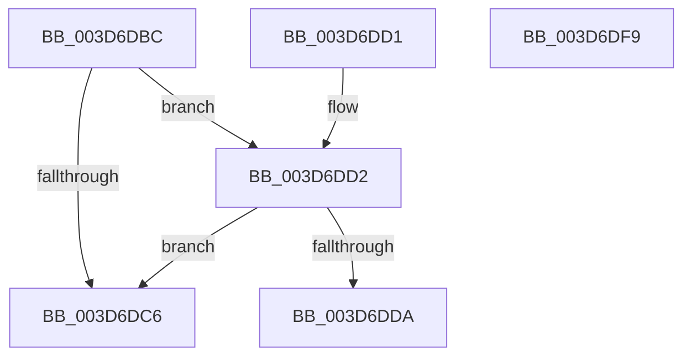

# RtlXRestore

- RVA: `0x003D6DBC`–`0x003D6DFA` (길이 `62` bytes)
- VA: `0x00000001403D6DBC`
- 실행 섹션: `.text`
- PDB 이름 있음: `예`; PDB Function 태그: `아니요`
- unwind 정보 RVA: `0x000DB714`
- 디코드: `21`개 명령, `62/62` bytes 표시
- 미해석 바이트: `0` (있으면 어셈블리에 `.byte`로 보존)

> 이 문서는 커널 이미지의 기계어와 PDB 기호를 분석해 생성했습니다. 4번과 5번은 함수 원형과 자료형을 바이너리 사용 방식에서 추정한 C 해석이며 원본 소스 복구 결과는 아닙니다.

## 1. Dependencies

- 직접 호출 지점: **0**; 고유 호출 대상: **0**
- 직접 호출자로 확인된 함수: **3**
- RIP 상대 이미지 참조: **0**

### Outgoing calls
- 직접 디코드된 call 명령이 없습니다.

### Direct callers
- [RtlXRestoreS](RtlXRestoreS_function_003D63C4.md) at `0x003D63F2`
- [KxContextToKframes](KxContextToKframes_function_003D6850.md) at `0x003D6C35`
- [KiRestoreProcessorState](../5C/KiRestoreProcessorState_function_005CB87C.md) at `0x005CB8F7`

### Static image references
- 디코드된 RIP-relative 메모리 참조가 없습니다.

## 2. Other-region calls and transfers

- 다른 실행 섹션으로 향하는 call: **0**
- 별도 외부 분기/꼬리 이동을 확인하지 못했습니다.

## 3. Assembly (complete function range)

```asm
003D6DBC  48 83 B9 08 02 00 00 00         cmp qword ptr [rcx + 0x208], 0
003D6DC4  7D 0C                           jge 0x1403d6dd2
003D6DC6  48 8B C2                        mov rax, rdx
003D6DC9  48 C1 EA 20                     shr rdx, 0x20
003D6DCD  0F AE 29                        xrstor ptr [rcx]
003D6DD0  C3                              ret
003D6DD1  CC                              int3
003D6DD2  8A C2                           mov al, dl
003D6DD4  24 06                           and al, 6
003D6DD6  3C 04                           cmp al, 4
003D6DD8  75 EC                           jne 0x1403d6dc6
003D6DDA  44 8B 41 18                     mov r8d, dword ptr [rcx + 0x18]
003D6DDE  0F AE 5C 24 08                  stmxcsr dword ptr [rsp + 8]
003D6DE3  8B 44 24 08                     mov eax, dword ptr [rsp + 8]
003D6DE7  89 41 18                        mov dword ptr [rcx + 0x18], eax
003D6DEA  48 8B C2                        mov rax, rdx
003D6DED  48 C1 EA 20                     shr rdx, 0x20
003D6DF1  0F AE 29                        xrstor ptr [rcx]
003D6DF4  44 89 41 18                     mov dword ptr [rcx + 0x18], r8d
003D6DF8  C3                              ret
003D6DF9  CC                              int3
```

## 4. C-style interpretation (structured pseudocode)

```c
__int64 __fastcall RtlXRestore(__int64 a1, __int64 a2)
{
    __int64 result;
    unsigned int v_stack_p8;

    if ((*(unsigned __int64 *)(a1 + 520)) >= 0) goto loc_003D6DD2;
loc_003D6DC6:
    a2 = (a2) >> (32);
    return a2;
loc_003D6DD2:
    result = (unsigned __int8)(((unsigned __int8)(a2)) & (6));
    if (((unsigned __int8)(result)) != 4) goto loc_003D6DC6;
    *(unsigned int *)(a1 + 24) = (unsigned int)((unsigned int)(v_stack_p8));
    a2 = (a2) >> (32);
    *(unsigned int *)(a1 + 24) = (unsigned int)((unsigned int)(*(unsigned int *)(a1 + 24)));
    return a2;
}
```

## 5. (Beta) C Style

```c
int64_t RtlXRestore(void *Arg1, int64_t Arg2)
{
    uint8_t *arg1 = (uint8_t *)Arg1;

    int64_t result;
    uint32_t v_stack_p8;

    if ((*(uint64_t *)(arg1 + 0x208)) >= 0) goto loc_003D6DD2;
loc_003D6DC6:
    Arg2 = (Arg2) >> (32);
    return Arg2;
loc_003D6DD2:
    result = (uint8_t)(((uint8_t)(Arg2)) & (6));
    if (((uint8_t)(result)) != 4) goto loc_003D6DC6;
    *(uint32_t *)(arg1 + 0x18) = (uint32_t)((uint32_t)(v_stack_p8));
    Arg2 = (Arg2) >> (32);
    *(uint32_t *)(arg1 + 0x18) = (uint32_t)((uint32_t)(*(uint32_t *)(arg1 + 0x18)));
    return Arg2;
}
```

### 관측된 메모리 오프셋

구조체 형식이 확인되지 않은 접근은 인자 기준의 오프셋으로만 기록했습니다.

| 기준 인자 | 오프셋 표현 | 폭 (bit) | 접근 |
|---|---:|---:|---|
| `Arg1` | `+ 0x0` | `64` | `R` |
| `Arg1` | `+ 0x18` | `32` | `R` |
| `Arg1` | `+ 0x18` | `32` | `W` |
| `Arg1` | `+ 0x208` | `64` | `R` |

## 6. Execution-region graph

[열기: 2D/3D 그래프와 함수 탐색 컨트롤 패널](../../../control-panel.html?section=text&rva=0x003D6DBC&view=graph)

- 2D 그래프는 위에서 아래로 흐르고, 3D 그래프는 빈 공간을 드래그해 회전합니다. Shift+드래그는 이동, 휠은 확대·축소, 함수 노드 선택은 대상 보고서 이동입니다.

### Static fallback


