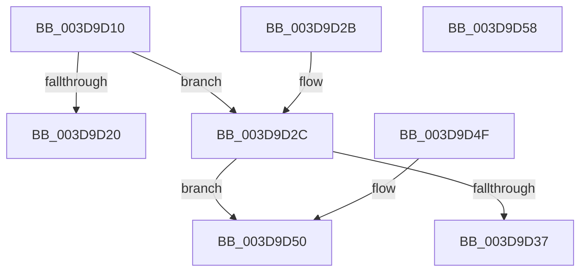

# RtlXSave

- RVA: `0x003D9D10`–`0x003D9D59` (길이 `73` bytes)
- VA: `0x00000001403D9D10`
- 실행 섹션: `.text`
- PDB 이름 있음: `예`; PDB Function 태그: `아니요`
- unwind 정보 RVA: `0x000DB714`
- 디코드: `26`개 명령, `73/73` bytes 표시
- 미해석 바이트: `0` (있으면 어셈블리에 `.byte`로 보존)

> 이 문서는 커널 이미지의 기계어와 PDB 기호를 분석해 생성했습니다. 4번과 5번은 함수 원형과 자료형을 바이너리 사용 방식에서 추정한 C 해석이며 원본 소스 복구 결과는 아닙니다.

## 1. Dependencies

- 직접 호출 지점: **0**; 고유 호출 대상: **0**
- 직접 호출자로 확인된 함수: **6**
- RIP 상대 이미지 참조: **0**

### Outgoing calls
- 직접 디코드된 call 명령이 없습니다.

### Direct callers
- [RtlXSaveS](RtlXSaveS_function_003D8CE4.md) at `0x003D8D2A`
- [KeContextFromKframes](KeContextFromKframes_function_003D9380.md) at `0x003D98D8`
- [KiSaveExtendedAndSupervisorState](KiSaveExtendedAndSupervisorState_function_003D9A1C.md) at `0x003D9B8D`
- [KiSaveProcessorState](../5C/KiSaveProcessorState_function_005CB940.md) at `0x005CBA06`
- [ViCtxCaptureInitialIsrState](../../pagevrfy/BB/ViCtxCaptureInitialIsrState_function_00BB1E9C.md) at `0x00BB1F14`
- [ViCtxCheckAndReleaseIsrState](../../pagevrfy/BB/ViCtxCheckAndReleaseIsrState_function_00BB1F40.md) at `0x00BB1F82`

### Static image references
- 디코드된 RIP-relative 메모리 참조가 없습니다.

## 2. Other-region calls and transfers

- 다른 실행 섹션으로 향하는 call: **0**
- 별도 외부 분기/꼬리 이동을 확인하지 못했습니다.

## 3. Assembly (complete function range)

```asm
003D9D10  A1 EC 03 00 00 80 F7 FF FF      movabs eax, dword ptr [0xfffff780000003ec]
003D9D19  4C 8B C9                        mov r9, rcx
003D9D1C  A8 02                           test al, 2
003D9D1E  74 0C                           je 0x1403d9d2c
003D9D20  48 8B C2                        mov rax, rdx
003D9D23  48 C1 EA 20                     shr rdx, 0x20
003D9D27  0F C7 21                        xsavec ptr [rcx]
003D9D2A  C3                              ret
003D9D2B  CC                              int3
003D9D2C  8A C2                           mov al, dl
003D9D2E  24 06                           and al, 6
003D9D30  3C 04                           cmp al, 4
003D9D32  48 8B C2                        mov rax, rdx
003D9D35  75 19                           jne 0x1403d9d50
003D9D37  44 8B 41 18                     mov r8d, dword ptr [rcx + 0x18]
003D9D3B  8B 49 1C                        mov ecx, dword ptr [rcx + 0x1c]
003D9D3E  48 C1 EA 20                     shr rdx, 0x20
003D9D42  41 0F AE 21                     xsave ptr [r9]
003D9D46  45 89 41 18                     mov dword ptr [r9 + 0x18], r8d
003D9D4A  41 89 49 1C                     mov dword ptr [r9 + 0x1c], ecx
003D9D4E  C3                              ret
003D9D4F  CC                              int3
003D9D50  48 C1 EA 20                     shr rdx, 0x20
003D9D54  0F AE 21                        xsave ptr [rcx]
003D9D57  C3                              ret
003D9D58  CC                              int3
```

## 4. C-style interpretation (structured pseudocode)

```c
__int64 __fastcall RtlXSave(__int64 a1, __int64 a2)
{
    __int64 result;

    if ((((unsigned __int8)(result)) & (2)) == 0) goto loc_003D9D2C;
    a2 = (a2) >> (32);
    return a2;
loc_003D9D2C:
    result = (unsigned __int8)(((unsigned __int8)(a2)) & (6));
    if (((unsigned __int8)(result)) != 4) goto loc_003D9D50;
    a2 = (a2) >> (32);
    *(unsigned int *)(a1 + 24) = (unsigned int)((unsigned int)(*(unsigned int *)(a1 + 24)));
    *(unsigned int *)(a1 + 28) = (unsigned int)((unsigned int)(*(unsigned int *)(a1 + 28)));
    return a2;
loc_003D9D50:
    a2 = (a2) >> (32);
    return a2;
}
```

## 5. (Beta) C Style

```c
int64_t RtlXSave(void *Arg1, int64_t Arg2)
{
    uint8_t *arg1 = (uint8_t *)Arg1;

    int64_t result;

    if ((((uint8_t)(result)) & (2)) == 0) goto loc_003D9D2C;
    Arg2 = (Arg2) >> (32);
    return Arg2;
loc_003D9D2C:
    result = (uint8_t)(((uint8_t)(Arg2)) & (6));
    if (((uint8_t)(result)) != 4) goto loc_003D9D50;
    Arg2 = (Arg2) >> (32);
    *(uint32_t *)(arg1 + 0x18) = (uint32_t)((uint32_t)(*(uint32_t *)(arg1 + 0x18)));
    *(uint32_t *)(arg1 + 0x1C) = (uint32_t)((uint32_t)(*(uint32_t *)(arg1 + 0x1C)));
    return Arg2;
loc_003D9D50:
    Arg2 = (Arg2) >> (32);
    return Arg2;
}
```

### 관측된 메모리 오프셋

구조체 형식이 확인되지 않은 접근은 인자 기준의 오프셋으로만 기록했습니다.

| 기준 인자 | 오프셋 표현 | 폭 (bit) | 접근 |
|---|---:|---:|---|
| `Arg1` | `+ 0x0` | `64` | `W` |
| `Arg1` | `+ 0x18` | `32` | `R` |
| `Arg1` | `+ 0x18` | `32` | `W` |
| `Arg1` | `+ 0x1C` | `32` | `R` |
| `Arg1` | `+ 0x1C` | `32` | `W` |

## 6. Execution-region graph

[열기: 2D/3D 그래프와 함수 탐색 컨트롤 패널](../../../control-panel.html?section=text&rva=0x003D9D10&view=graph)

- 2D 그래프는 위에서 아래로 흐르고, 3D 그래프는 빈 공간을 드래그해 회전합니다. Shift+드래그는 이동, 휠은 확대·축소, 함수 노드 선택은 대상 보고서 이동입니다.

### Static fallback


