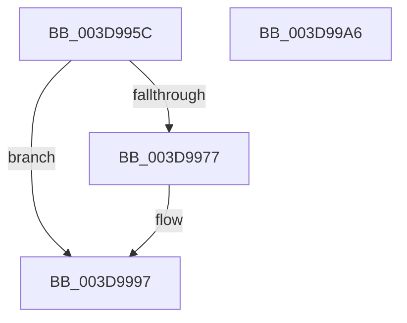

# RtlpGetNonLegacyXStateAreaLength

- RVA: `0x003D995C`–`0x003D99A7` (길이 `75` bytes)
- VA: `0x00000001403D995C`
- 실행 섹션: `.text`
- PDB 이름 있음: `예`; PDB Function 태그: `아니요`
- unwind 정보 RVA: `0x0005C788`
- 디코드: `16`개 명령, `75/75` bytes 표시
- 미해석 바이트: `0` (있으면 어셈블리에 `.byte`로 보존)

> 이 문서는 커널 이미지의 기계어와 PDB 기호를 분석해 생성했습니다. 4번과 5번은 함수 원형과 자료형을 바이너리 사용 방식에서 추정한 C 해석이며 원본 소스 복구 결과는 아닙니다.

## 1. Dependencies

- 직접 호출 지점: **1**; 고유 호출 대상: **1**
- 직접 호출자로 확인된 함수: **1**
- RIP 상대 이미지 참조: **0**

### Outgoing calls
- `0x003D9997` → [RtlpGetEntireXStateAreaLength2](../4E/RtlpGetEntireXStateAreaLength2_function_004EF20C.md) (function, `0x004EF20C`)

### Direct callers
- [KiInitializeUserApc](KiInitializeUserApc_function_003D8D38.md) at `0x003D8E2E`

### Static image references
- 디코드된 RIP-relative 메모리 참조가 없습니다.

## 2. Other-region calls and transfers

- 다른 실행 섹션으로 향하는 call: **0**
- 별도 외부 분기/꼬리 이동을 확인하지 못했습니다.

## 3. Assembly (complete function range)

```asm
003D995C  48 83 EC 28                     sub rsp, 0x28
003D9960  A1 EC 03 00 00 80 F7 FF FF      movabs eax, dword ptr [0xfffff780000003ec]
003D9969  48 BA D8 03 00 00 80 F7 FF FF   movabs rdx, 0xfffff780000003d8
003D9973  A8 02                           test al, 2
003D9975  74 20                           je 0x1403d9997
003D9977  49 B8 08 07 00 00 80 F7 FF FF   movabs r8, 0xfffff78000000708
003D9981  48 B8 00 00 00 00 00 00 00 80   movabs rax, 0x8000000000000000
003D998B  4D 8B 00                        mov r8, qword ptr [r8]
003D998E  4C 0B 02                        or r8, qword ptr [rdx]
003D9991  4C 0B C0                        or r8, rax
003D9994  49 23 C8                        and rcx, r8
003D9997  E8 70 58 11 00                  call 0x1404ef20c
003D999C  2D 00 02 00 00                  sub eax, 0x200
003D99A1  48 83 C4 28                     add rsp, 0x28
003D99A5  C3                              ret
003D99A6  CC                              int3
```

## 4. C-style interpretation (structured pseudocode)

```c
__int64 __fastcall RtlpGetNonLegacyXStateAreaLength(__int64 a1)
{
    __int64 result;
    __int64 v_rsp;

    v_rsp = (v_rsp) - (40);
    if ((((unsigned __int8)(result)) & (2)) != 0) {
        a3 = *(unsigned __int64 *)(a3);
        a3 = (a3) | (*(unsigned __int64 *)(a2));
        a3 = (a3) | (result);
        a1 = (a1) & (a3);
    }
    result = RtlpGetEntireXStateAreaLength2(a1, a2, a3, a4);
    result = (unsigned int)((result) - (512));
    v_rsp = (v_rsp) + (40);
    return result;
}
```

## 5. (Beta) C Style

```c
int64_t RtlpGetNonLegacyXStateAreaLength(int64_t Arg1)
{
    int64_t result;
    int64_t local_rsp;

    local_rsp = (local_rsp) - (40);
    if ((((uint8_t)(result)) & (2)) != 0) {
        a3 = *(uint64_t *)(a3);
        a3 = (a3) | (*(uint64_t *)(a2));
        a3 = (a3) | (result);
        Arg1 = (Arg1) & (a3);
    }
    result = RtlpGetEntireXStateAreaLength2(Arg1, a2, a3, a4);
    result = (uint32_t)((result) - (512));
    local_rsp = (local_rsp) + (40);
    return result;
}
```

## 6. Execution-region graph

[열기: 2D/3D 그래프와 함수 탐색 컨트롤 패널](../../../control-panel.html?section=text&rva=0x003D995C&view=graph)

- 2D 그래프는 위에서 아래로 흐르고, 3D 그래프는 빈 공간을 드래그해 회전합니다. Shift+드래그는 이동, 휠은 확대·축소, 함수 노드 선택은 대상 보고서 이동입니다.

### Static fallback


